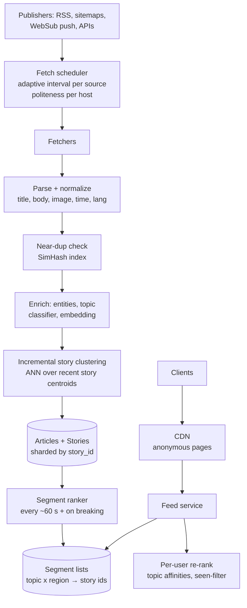
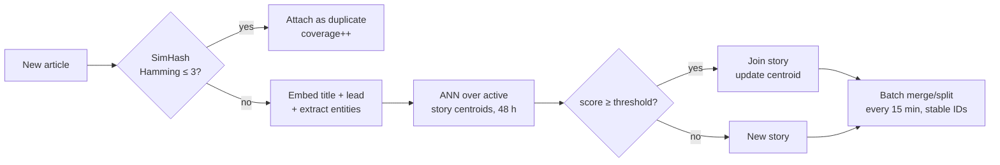

# 44 — Design a News Aggregator (Google News / Apple News)

> **Prerequisites:** [18d §7 — Web Crawler](18d-design-infra-primitives.md) (the ingest side), [07 — Search](07-search.md) (ranking, tiers), [03 — Caching](03-caching.md) (edge caching of shared pages), [DD-12 — Big-Data Structures](../Deep%20Dives/12-big-data-structures.md) (near-duplicate detection). Related: [18a §5 — Facebook News Feed](18a-design-chat-social.md) (the contrast case).
>
> **The prompt:** *"Design a news aggregator like Google News: pull articles from thousands of publishers, group them into stories, and show users a fresh, ranked feed by topic and region."* A Hello Interview staple. It looks like a social feed but behaves completely differently: there's **no social graph and no per-user fan-out**. The crux is **story clustering**, **freshness**, and **serving a mostly-shared feed cheaply**.
>
> **Attempt first:** 35 minutes out loud before reading past this line.

## What you'll master

- Why this is **not** a social-feed problem: content comes from a *small* set of sources, and most of the feed is **shared across users**, so you precompute per *segment* (topic × region), not per user.
- **Adaptive ingestion**: poll-scheduling per source plus push (WebSub) for the fast ones, with the crawler's politeness rules.
- **Story clustering** — near-duplicate detection (SimHash/MinHash) and incremental clustering of articles into "stories", the design's real crux.
- **Ranking a story**, not an article: freshness decay × source authority × cluster velocity.
- **Personalization as a thin re-rank** over precomputed candidate lists, and CDN-cacheable non-personal pages.

## In the Room — the decisive move

> *"This looks like a feed problem but it's the opposite of Twitter. There's no social graph, content comes from roughly 50k sources rather than a billion users, and 90% of what any two people in the same region see is identical. So the design is: **ingest** with adaptive polling plus push; **dedupe and cluster** articles into stories incrementally, using SimHash for near-duplicates and embedding similarity for 'same story, different words'; **rank stories** by freshness, authority and velocity per topic × region; and serve **precomputed segment lists** from cache and CDN, with personalization as a cheap per-user re-rank on top. The hard parts are clustering quality and the freshness SLO — breaking news has to show up in minutes."*

### Decisions to make decisively

| Decision | Choice | Because |
|---|---|---|
| Feed model | **Precompute per segment (topic × region × language), re-rank per user** | Content is shared; per-user fan-out would duplicate the same top-100 stories 100M times |
| Ingestion | **Adaptive polling per source + WebSub push where offered** | A wire service updates every minute, a local blog weekly; one poll interval wastes or lags |
| Unit of ranking | **The story (cluster)**, not the article | Users want "the election result", not 400 near-identical wire rewrites |
| Near-duplicate detection | **SimHash (64-bit) on article body**, Hamming distance ≤ 3 | Catches syndicated wire copies in O(1)-ish lookups; cheap at ingest rate |
| Same-story grouping | **Embedding similarity + entity overlap, incremental clustering** with a time window | Different words, same event; batch re-clustering alone is too slow for breaking news |
| Serving | **CDN for anonymous segment pages (TTL ~30–60 s); app cache for personalized** | Most traffic is a handful of hot pages |
| Content rights | **Headline + snippet + link out** | Copyright/licensing is a real constraint; we're not the publisher |

**Experience hook.** *"It's the same split as typeahead: heavy lifting on the build side (cluster, score, precompute the top lists every minute), trivial work on the serve side (a cache read plus a small re-rank)."*

---

## 1. Requirements

**Functional.**
- Ingest articles from ~50k publishers (RSS/Atom, sitemaps, publisher APIs, WebSub).
- Group articles about the same event into a **story**, with a lead article and "full coverage".
- Feeds: **Top stories**, per **topic** (World, Tech, Sports…), per **region/locale**, plus "For you".
- Article view = headline, snippet, image, publisher, time → **link out** to the publisher.
- Search over recent news (a follow-up, served by the [search stack](07-search.md)).

**Non-functional.**
- **Freshness SLO:** a published article appears in the relevant feeds within **~5 minutes** (breaking news under ~2 minutes from fast sources).
- Feed load **p99 < 200 ms**; 100M DAU; highly read-heavy.
- Quality: low duplicate rate in the top feed, and source diversity (no single publisher dominates a story).

**Non-goals to name:** comments/social features, hosting full article text, and paywall handling (link-out only).

> **Staff-level insight:** say "this is *not* fan-out-on-write" in the first two minutes. Interviewers use this prompt to see whether you pattern-match blindly to the Twitter design. Recognizing that the content is **few-to-many and shared** changes the whole architecture.

## 2. Back-of-envelope

| Quantity | Math | Result |
|---|---|---|
| Sources | given | **~50k publishers** |
| Articles ingested | ~50k sources × ~30/day avg | **~1.5M articles/day ≈ 20/s** avg, ~100/s at news peaks |
| Poll load | 50k sources, adaptive (1 min for top 1k, 15–60 min for the tail) | **~100–200 fetches/s** — a small crawler |
| Article storage | 1.5M/day × ~5 KB metadata + snippet | **~7.5 GB/day**; keep hot 30 days |
| Feed reads | 100M DAU × ~8 loads/day ÷ 86,400 | **~10k QPS** avg, **~50k** at peak; breaking news spikes 5–10× |
| Distinct segments | ~20 topics × ~100 regions × a few languages | **~10k segment lists** — tiny to precompute every minute |

Two conclusions. **Ingest is small**, about 20 articles/s, so the cost is per-article *processing* (dedupe, clustering, embedding), not throughput. **Reads are the scale**, and since segments number only ~10k, almost every read is a cache hit.

## 3. High-level design



- **Fetch scheduler.** Each source has a `next_fetch_at` driven by how often it actually changes: halve the interval when a fetch finds new items, back off when it doesn't, with floors and ceilings. Sources that support **WebSub** push us notifications, giving near-zero latency with no polling. Per-host politeness and conditional GETs (`If-Modified-Since`/ETag) reuse the [crawler](18d-design-infra-primitives.md) frontier design.
- **Parse → dedupe → enrich → cluster** is a stream pipeline (Kafka between stages) so one slow classifier doesn't stall fetching.
- **Segment ranker** recomputes the top-N story list for each of the ~10k segments every ~60 s, and immediately when a story's velocity crosses a breaking threshold.
- **Feed service** = read segment list(s) → merge for the user's topics → re-rank → hydrate story cards from cache.

## 4. Deep dive A — dedupe and story clustering (the crux)

Two different problems, two tools:

**1. Near-duplicates (the same text syndicated).** Wire stories (AP, Reuters) are republished by hundreds of outlets with small edits. **SimHash** maps the body to a 64-bit fingerprint where similar documents differ in few bits. Index the fingerprints by splitting them into 4 blocks of 16 bits (any pair within Hamming distance 3 must match exactly on at least one block), so the lookup is 4 hash-table probes. A match attaches the article to the existing story as a *duplicate*: it counts toward coverage but never becomes a separate card. (MinHash + LSH is the alternative when you want Jaccard similarity on shingles.)

**2. Same event, different words (the real clustering).** "Fed raises rates" and "Powell announces hike" share almost no text. Use an **embedding** of title + lead paragraph, plus **named-entity overlap** (people, orgs, places) and **time proximity**:
- Keep the **centroids of stories active in the last ~48 h** in an in-memory ANN index (HNSW; a few hundred thousand vectors, so small).
- For a new article: find the top-k nearest centroids → score = cosine × entity-overlap bonus × time-decay → if above threshold, **join** that story and update its centroid incrementally; else **start a new story**.
- **Offline repair:** every ~15 min, a batch job re-clusters the window to **merge** stories that started separately (two outlets broke it with different framing) and **split** drifted ones. Story IDs must stay stable through merges (keep an alias map), because clients and caches hold them.



> **Staff-level insight:** *"Online clustering is greedy and order-dependent, so it will make mistakes, and that's fine as long as a periodic batch pass merges and splits with stable story IDs. I'd measure clustering with a small human-labelled set (pairwise precision/recall) and watch one online metric, the duplicate rate in the top 20."* Naming the online+batch repair loop is what separates this from "just use k-means".

## 5. Deep dive B — ranking stories and keeping them fresh

**Score per story, per segment:**

```
score = authority(sources in cluster) × velocity(articles/min, recent) × freshness_decay(age) × diversity_penalty
freshness_decay = exp(−age / τ)     τ ≈ 6 h for top stories, longer for evergreen topics
```

- **Velocity** (how fast coverage is growing) is the breaking-news signal: 40 outlets in 10 minutes beats 200 outlets over 2 days.
- **Authority** is a per-source prior (editorial quality, original reporting, corrections history), maintained offline.
- **Lead article selection** prefers original reporting (earliest + most-cited) and the user's preferred or local source; rotate for diversity.
- **Breaking-news fast path:** when a story's velocity crosses a threshold, push it straight into affected segments, purge those CDN keys, and optionally trigger push notifications (via the [notification system](18d-design-infra-primitives.md)). Don't wait for the 60 s cycle.

**Freshness budget, end to end:** fetch latency (push ≈ seconds, poll ≈ up to interval) + pipeline (~10–30 s) + ranker cycle (≤ 60 s) + cache TTL (≤ 60 s). That's where "~5 minutes" comes from, and why the fast path exists.

## 6. Deep dive C — serving: shared lists, thin personalization

- **Anonymous / non-personalized pages** (Top stories in en-US, Tech in en-GB) are **identical for everyone in the segment**, so serve them from the **CDN with ~30–60 s TTL** keyed by segment. That absorbs most of the 50k QPS peak.
- **"For you"** = merge the segment lists for the user's top topics + locale → **re-rank** with a lightweight model (topic affinity from read history, source preferences) → apply a **seen-filter** (a per-user Bloom filter of recently clicked story IDs, [DD-12](../Deep%20Dives/12-big-data-structures.md)) → hydrate. That's a few hundred candidates, a few ms of compute, no per-user materialization.
- **Pagination stability:** rankings change every minute, so a naive offset cursor duplicates or skips stories on page 2. The cursor carries the **ranking snapshot version** plus the last story ID; keep snapshots for ~10 min.

## 7. Failure drills — volunteer these

| Failure | Blast radius | Design answer |
|---|---|---|
| A major source's feed breaks (format change) | Missing coverage of a big outlet | Per-source health metrics (items/day vs baseline) with an alert; parser versioning; the source falls back to sitemap crawling |
| Breaking news spike (10× reads) | Feed service overload | CDN absorbs anonymous traffic; personalized path degrades to the segment list (skip the re-rank) under load — shed personalization before availability |
| Clustering mis-merges two events | Wrong story card | Batch split pass + manual editorial override; stable IDs with an alias map |
| Spam/low-quality site floods articles | Polluted feeds | Source allowlist/authority prior, per-source rate caps, quality classifier at enrichment |
| Embedding/classifier service down | Pipeline stall | Kafka buffers; fall back to SimHash + entity-only clustering; freshness degrades, not availability |
| Publisher takedown / legal removal | Must disappear everywhere | Removal event invalidates the story card, segment lists and CDN keys; audited |

## 8. The Staff & EM layer

- **Quality is the product, and it needs humans.** Clustering and ranking quality need a labelled evaluation set, an editorial override tool, and a weekly quality review. Budget for the team that runs them; it's not a one-off model.
- **Publisher relationships are a constraint.** Licensing, snippet length rules (varies by jurisdiction), paywall flags and takedown SLAs shape the product. An EM scopes them with legal early.
- **Cost profile:** cheap ingest, cheap serving (CDN-heavy); the spend is ML enrichment (embeddings per article) and people. Say that when asked about cost.

### Altitude — the same probes at three levels

| Probe | Senior says | Staff says | EM adds |
|---|---|---|---|
| "How do you build the feed?" | Fan-out to each user | Precompute per segment, thin per-user re-rank, CDN for anonymous | Which segments and locales launch first |
| "Same story from 300 outlets?" | Dedupe by URL | SimHash for syndicated copies + embedding/entity clustering, batch merge/split | Labelled eval set + editorial override tool |
| "Breaking news in 2 min?" | Poll faster | WebSub push + velocity fast path + targeted CDN purge | Freshness SLO per tier, on-call ownership |
| "Ranking?" | Newest first | Freshness × authority × velocity × diversity, per story | Source-fairness policy and publisher comms |

## 9. Follow-ups they'll ask

1. **"Add search."** Recent-news index (time-partitioned), freshness boost, story-level collapse of results. See [07 — Search](07-search.md) and its tiered index (§5.8): a fresh tier plus a cold archive.
2. **"Local news."** Region segments down to city level; geotag articles by entity/place extraction; sparse sources make velocity unreliable, so lean more on authority.
3. **"Push notifications for breaking news."** Velocity threshold + per-user topic match + strict frequency caps; send at most a few a day or users disable them.
4. **"Misinformation / quality."** Source authority prior, fact-check labels attached to stories, and demotion rules; an editorial and policy workflow, not just a model.
5. **"Paywalled sources."** Flag them, show paywall badges, prefer free coverage as the lead article where equivalent.

## Interview Cheat-Sheet

**One-liner:** *"Not a social feed: few sources, shared content. Ingest with adaptive polling plus WebSub; SimHash for syndicated duplicates; embedding + entity incremental clustering into stories, repaired by a batch merge/split; rank stories by freshness × authority × velocity per topic × region; serve precomputed segment lists from CDN, with a thin per-user re-rank and a seen-filter."*

**Numbers:** ~50k sources · ~1.5M articles/day (~20/s) · ~10k segments · ~10k–50k feed QPS · freshness ≤ ~5 min (≤ 2 min breaking) · SimHash 64-bit, Hamming ≤ 3 · active cluster window ~48 h.

**The close:** *"The scale is in reads and the difficulty is in clustering. So I keep ingest simple, put the effort into an online clustering pass with a batch repair loop and stable story IDs, and make serving nearly free by precomputing about 10k segment lists and letting the CDN absorb anonymous traffic. Personalization is a cheap re-rank, never a fan-out."*
