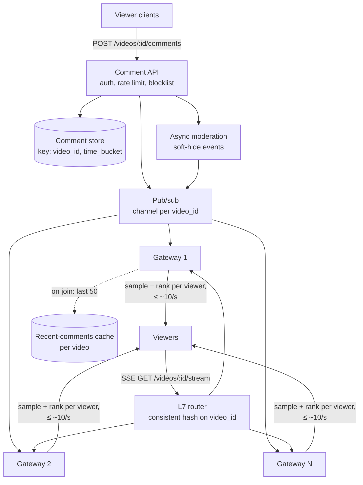
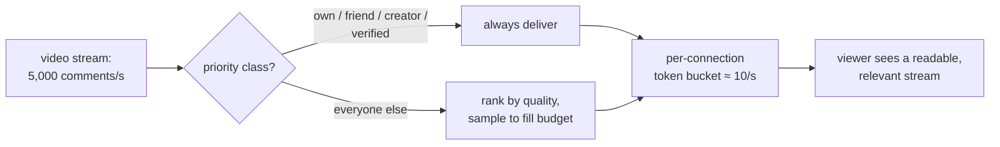

# 45 — Design Live Comments (Facebook Live / YouTube Live Chat / Twitch Chat)

> **Prerequisites:** [09 — Real-Time Systems](09-realtime-systems.md) (WebSockets/SSE, connection gateways), [DD-13 — Realtime Updates](../Deep%20Dives/13-realtime-updates.md) (the two hops: server→client and source→server), [04 — Messaging](04-messaging-event-driven.md) (pub/sub). Related: [18a §1 — WhatsApp](18a-design-chat-social.md) (the contrast case: durable, ordered, per-recipient delivery), [36 — Live Streaming](36-design-live-streaming.md) (the video next to the comments).
>
> **The prompt:** *"Design live comments for Facebook Live: viewers of a live video post comments, and every viewer sees new comments in near real time."* A Hello Interview staple. The crux is **fan-out to millions of open connections on one hot video**, and realizing that **no viewer can read more than ~10 comments a second anyway**.
>
> **Attempt first:** 35 minutes out loud before reading past this line.

## What you'll master

- The **asymmetry**: writes are tiny (thousands/s), deliveries are enormous (viewers × comments), so the design is all about the **read fan-out**.
- **SSE vs WebSocket** for a mostly-downstream stream, and why SSE is the default here.
- The **routing problem**: how a comment posted to one server reaches the thousands of gateway servers holding that video's viewers (pub/sub per video vs viewer co-location).
- **Hot-video economics**: sampling and ranking comments per viewer so 10M viewers × 5k comments/s doesn't mean 50 billion deliveries/s.
- Why this is **not chat**: ephemeral, best-effort, approximate ordering, so at-most-once delivery is a *feature*.

## In the Room — the decisive move

> *"Writes are trivial and reads are the whole problem. A viral stream might get 5,000 comments a second and have 10 million viewers, but a human can read maybe 5–10 a second, so delivering every comment to every viewer is both impossible and useless. My design: comments are written to a store keyed by video, then **published to a per-video pub/sub channel**. Viewers hold **SSE connections** to a fleet of gateway servers. Each gateway subscribes only to the channels of videos its viewers are watching, and I **route viewers of the same video to the same subset of gateways** so a hot video's fan-in stays bounded. For hot videos, each gateway **samples and ranks** down to a readable rate per viewer. Delivery is best-effort: a dropped comment is invisible, so I don't pay for ordering or exactly-once."*

### Decisions to make decisively

| Decision | Choice | Because |
|---|---|---|
| Transport | **SSE** (server→client), comment posts over plain HTTPS POST | Traffic is ~99.9% downstream; SSE is HTTP, proxy- and CDN-friendly, auto-reconnects with `Last-Event-ID` |
| Comment → gateways | **Pub/sub channel per video** (Redis pub/sub / a dedicated fan-out tier) | Gateways subscribe only to videos they serve; no broadcast to the whole fleet |
| Viewer placement | **Consistent-hash viewers by `video_id` onto a gateway subset** (expand the subset for hot videos) | Bounds how many gateways subscribe to one channel; cache locality for backfill |
| Hot-video volume | **Per-viewer rate cap with ranking/sampling at the gateway** | Humans read ~10/s; the rest is waste |
| Delivery semantics | **At-most-once, approximate time order** | Ephemeral content; reliability machinery costs more than it's worth |
| Storage | **Append-only store keyed `(video_id, time_bucket)`**, recent window cached | Replay/backfill on join and VOD replay later, not the live path |
| Moderation | **Async classifier + soft-hide**, synchronous only for cheap blocklist checks | Don't put an ML call in the 200 ms post path |

**Experience hook.** *"We learned on our chat infra that the expensive thing is connections, not messages. A gateway at 50–100k idle SSE connections is cheap; the cost appears when one hot channel makes every gateway do work for it, which is why viewer co-location matters more than the pub/sub technology."*

---

## 1. Requirements

**Functional.**
- Viewers of a live video see new comments in near real time.
- Viewers post comments (text, emoji); see their own comment immediately.
- New joiners see the **recent comments** (last ~50) immediately.
- Scroll back through older comments (paginated).
- Reactions (hearts, likes) as aggregate counts. A follow-up, but cheap to add.

**Non-functional.**
- **Latency:** post → visible to other viewers in **p99 < 2 s** (~200–500 ms typical).
- **Scale:** ~1M concurrent live videos; the long tail has a handful of viewers each; the **hottest videos have 1–10M+ concurrent viewers**.
- **Availability over consistency:** a lost comment is acceptable; a stalled stream of comments is not.

**Non-goals to name:** the video stream itself ([36](36-design-live-streaming.md)), durable chat semantics (read receipts, guaranteed delivery), and full-text search over comments.

> **Staff-level insight:** draw the line against chat explicitly. *"WhatsApp needs per-recipient durable delivery, ordering and receipts. Live comments need none of that. It's a broadcast with best-effort delivery, and saying so removes half the machinery an interviewer expects you to add."*

## 2. Back-of-envelope

| Quantity | Math | Result |
|---|---|---|
| Concurrent viewers (total) | ~1M live videos, heavy-tailed | **~100M concurrent connections** at peak |
| Gateway fleet | ~100k SSE connections per node (memory/FD-bound) | **~1,000–2,000 gateways** |
| Comment writes (total) | ~1–5% of viewers comment, ~1/min each | **~50k–100k writes/s** total; trivial per video |
| Hot video, naive deliveries | 10M viewers × 5k comments/s | **50B deliveries/s**, impossible |
| Hot video, capped | 10M viewers × ~10 comments/s shown | **100M comment deliveries/s** across ~100 gateways, i.e. ~1M/s per node, so **batch**: one SSE frame per viewer every ~500 ms carrying ~5 comments → ~200k frames/s per node |
| Comment storage | 100k/s × ~200 B × 86,400 | **~1.7 TB/day**; TTL or tier to cold storage after the VOD window |

Two conclusions. **Delivery volume is set by what you choose to show, not by how much people write**, so the per-viewer cap is the most important number in the design. **Connections are the cost unit**, so the fleet is sized by concurrent viewers.

## 3. High-level design

- **Post path:** API → auth, per-user rate limit ([22 — Rate limiting](../Deep%20Dives/22-rate-limiting.md)), cheap blocklist → append to store → publish to `video:{id}`. The poster's client renders its own comment **optimistically**, so it doesn't wait for the round trip.
- **Stream path:** the viewer opens SSE to the router, which **hashes `video_id`** to pick a gateway from the video's gateway set. The gateway subscribes to `video:{id}` once (regardless of how many of its viewers watch it) and fans out locally to its connections.
- **Join:** the gateway serves the last ~50 comments from a per-video **recent-comments cache** (a capped list), then streams live.
- **Scroll-back:** a normal paginated read against the store (cursor on `(time, comment_id)`).

## 4. Deep dive A — routing a comment to the right gateways (the crux)

Three options, in increasing order of quality:

| Option | How | Problem |
|---|---|---|
| **1. Broadcast to all gateways** | Every gateway receives every comment and drops those for videos it doesn't serve | 2,000 gateways × 100k comments/s = 200M wasted messages/s; dies immediately |
| **2. Pub/sub per video, random placement** | Viewers land on any gateway; each gateway subscribes to the channels its viewers watch | A 10M-viewer video has viewers on **every** gateway, so every gateway subscribes; the long tail spreads each 5-viewer video across 5 gateways |
| **3. Pub/sub + co-location by video** ✅ | The L7 router consistent-hashes `video_id` to a **gateway subset** sized by the video's popularity | A small video lives on 1 gateway (one subscription); a hot video gets an expanded subset of K gateways. Fan-in per channel = K, chosen, not accidental |

**Sizing the subset:** `K = ceil(concurrent_viewers / per-gateway budget for one video)`. A video starts with K=1. The router watches viewer counts and **expands** K as the video gets hot (new joiners hash across the larger set; existing connections stay put). That's [consistent hashing](05-load-balancing.md) with a per-key replica count, the same trick as hot-key replication in caches.

**At the extreme (10M+ viewers):** K ≈ 100+ gateways subscribing to one channel. Put a **fan-out relay tier** in between (pub/sub → ~10 regional relays → gateways) so no single pub/sub node pushes to hundreds of subscribers. It's a broadcast tree, like a CDN for messages.

> **Staff-level insight:** *"The pub/sub technology matters less than placement. If viewers of one video are scattered randomly, every hot video subscribes on every gateway and the fleet does O(gateways × comments) work. Consistent-hashing viewers by video ID, with a popularity-scaled subset, makes the fan-in a number I pick."*

## 5. Deep dive B — the hot video: sample, rank, aggregate

A 10M-viewer stream at 5k comments/s cannot show everything, and shouldn't try.

- **Per-viewer cap at the gateway:** each gateway receives the video's full stream once and, per connection, emits at most ~**5–10 comments/s**. That's a token bucket per connection.
- **Batch into frames:** rather than one SSE event per comment, flush one frame per connection every ~300–500 ms containing that interval's selected comments. That cuts syscalls and per-message overhead by ~5×, and the UI animates them in anyway.
- **What survives the cap — rank, don't just drop:** always show the viewer's **own** comments and replies to them, comments from **friends/followed** accounts, the creator/moderators and verified accounts; fill the rest by quality score, otherwise random sample. The ranking runs on a small window at the gateway (a few hundred candidates per second).
- **Upstream sampling:** above a threshold (say 1k comments/s), the API **pre-samples** what it publishes to the hot channel (with the priority classes always kept) and still stores 100% for replay. This also cuts gateway CPU.
- **Reactions are counters, not messages:** hearts are aggregated per video per second (an in-memory counter per gateway → a sum) and pushed as **one** "+3,214 ❤" update per second, not 3,214 events.
- **Slow clients:** if a connection's buffer backs up, **drop** its queued comments (never block the gateway's loop on one slow socket). Best-effort semantics make this free.

## 6. Deep dive C — semantics, ordering, and storage

- **Ordering:** comments carry a server timestamp plus ID; clients render roughly in order and **don't reorder late arrivals** (the stream scrolls; nobody notices a 200 ms inversion). No sequencer, no total order.
- **Delivery:** **at-most-once** on the live path. Reconnect with SSE `Last-Event-ID` → the gateway replays from the recent-comments cache if it can, otherwise starts live. Gaps are acceptable.
- **Store:** Cassandra/ScyllaDB-style `PRIMARY KEY ((video_id, bucket), comment_id)` with `comment_id` a time-ordered Snowflake ([DD-04](../Deep%20Dives/04-cassandra.md), the Discord shape). It serves scroll-back and **VOD replay** (comments re-played in sync with the recording's timeline offset), not the live fan-out.
- **Moderation:** cheap synchronous checks (blocklist, rate limit, banned user) in the post path; the **ML classifier runs async** and publishes a `hide(comment_id)` event that gateways apply. A toxic comment may be visible for ~1 s, which is the explicit trade-off for keeping the post path fast.

## 7. Failure drills — volunteer these

| Failure | Blast radius | Design answer |
|---|---|---|
| Gateway node dies | Its ~100k viewers disconnect | SSE auto-reconnects (with jitter) to another node in the video's subset; replay from the recent cache; nothing is lost that mattered |
| Pub/sub node for a hot channel dies | That video's comments stall | Replicated pub/sub / relay tier with failover; gateways resubscribe; meanwhile the stream simply pauses |
| Video goes from 1k to 5M viewers in a minute | Its gateway subset overloads | Router expands K on viewer-count thresholds; new joiners spread; reconnect storms use jittered backoff |
| Comment spam flood | Unreadable stream, store growth | Per-user and per-video rate limits, slow mode (creator-set), sampling for the hot channel |
| Reconnect storm after a regional blip | Thundering herd on gateways | Client jittered backoff; gateways admission-control new connections; the recent cache absorbs the backfill reads |
| Moderation classifier down | Toxic comments stay visible | Fail open for normal users with stricter rate limits; fall back to blocklist only; alert |

## 8. The Staff & EM layer

- **The cost line is connections.** About 100M concurrent SSE connections, roughly 1–2k gateways, is the bill. Tuning per-node connection density (kernel FD limits, memory per connection, epoll; see [24 — OS & Concurrency](24-os-concurrency.md)) is the biggest cost lever.
- **Product owns the cap.** How many comments per second to show, and the ranking classes, are product decisions with engineering defaults. Write them down so "why didn't my comment show?" has an answer.
- **Trust & safety is a partner team.** Moderation latency, appeals and creator tools (slow mode, keyword filters) are a shared roadmap.

### Altitude — the same probes at three levels

| Probe | Senior says | Staff says | EM adds |
|---|---|---|---|
| "Transport?" | WebSockets | SSE: downstream-only, HTTP-native, `Last-Event-ID` reconnect | Client/SDK team owns reconnect behaviour |
| "10M viewers on one video?" | Shard the pub/sub | Co-locate viewers by video on a scaled gateway subset + relay tree; per-viewer cap ~10/s | The cap and ranking classes as written product policy |
| "Lost comments?" | Add acks and retries | At-most-once by design; ephemeral content; reconnect replays recent | Which events (paid comments) *do* need guarantees |
| "Moderation?" | Classify before posting | Sync blocklist, async classifier + soft-hide | T&S partnership and appeal SLAs |

## 9. Follow-ups they'll ask

1. **"Paid comments / Super Chats."** Now it's money: durable, idempotent, guaranteed display, pinned for N seconds. Route them through a **separate reliable path** (a payment saga, [18c](18c-design-marketplace-money.md)), never through the sampled stream.
2. **"VOD replay with comments."** Store each comment's offset from stream start; on replay, page comments by offset alongside playback.
3. **"Live reactions at massive scale."** Per-gateway counters aggregated per second; merge in a tree; push deltas, not events.
4. **"Multi-region."** Viewers connect to the nearest region; comment publish replicates cross-region through the relay tier (~100–200 ms extra is fine for this product).
5. **"Creator moderation tools."** Slow mode (per-user posting interval), follower-only mode, keyword filters applied at the API.

## Interview Cheat-Sheet

**One-liner:** *"Tiny writes, enormous fan-out. Comments go to a store and a per-video pub/sub channel; viewers hold SSE connections to gateways that are consistent-hashed by video ID onto a popularity-scaled subset; each gateway samples and ranks to ~10 comments/s per viewer (own, friends and creator always kept); delivery is best-effort and approximately ordered; reactions are aggregated counters."*

**Numbers:** ~100M concurrent connections · ~100k connections/gateway → ~1–2k gateways · hot video 10M viewers × 5k comments/s naive = 50B/s → capped ~10/s per viewer · post→visible p99 < 2 s.

**The close:** *"The design is set by what a viewer can read, not by how much people write. Cap delivery per viewer, co-locate viewers by video so fan-in is a number I choose, and accept best-effort delivery because the content is ephemeral. Anything that needs guarantees, like paid comments, goes on a separate reliable path."*
