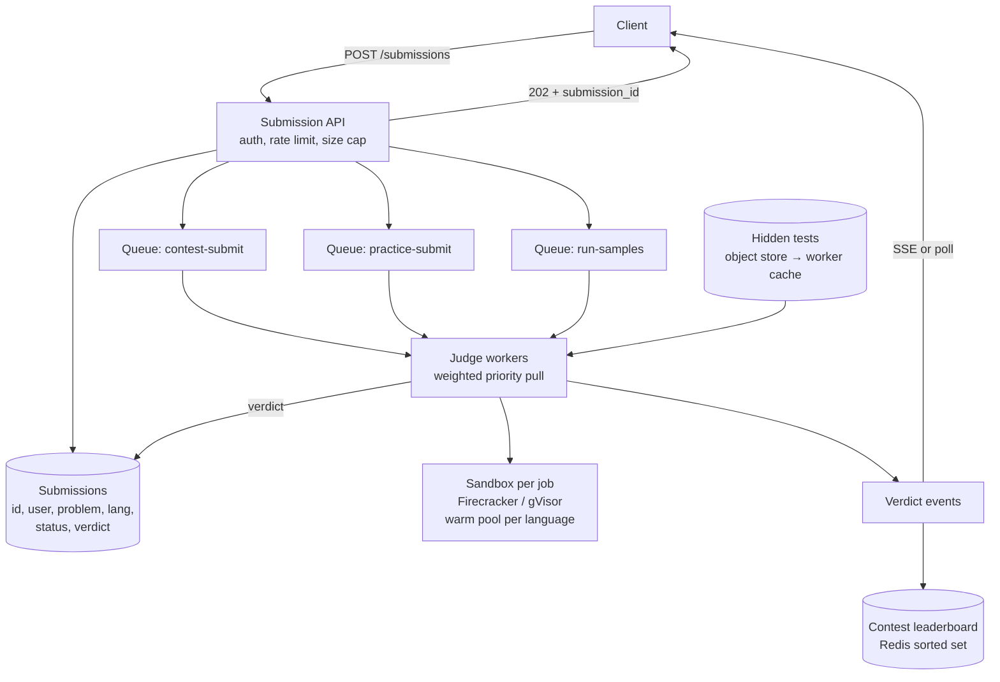
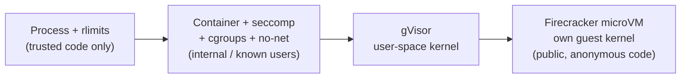

# 46 — Design an Online Judge (LeetCode / HackerRank / Codeforces)

> **Prerequisites:** [DD-19 — Long-Running Tasks](../Deep%20Dives/19-pattern-long-running-tasks.md) (202 + job ID + workers, the backbone here), [13 — Security](13-security.md) (isolation, least privilege), [24 — OS & Concurrency](24-os-concurrency.md) (cgroups, namespaces, process limits), [DD-28 — Distributed Leaderboard](../Deep%20Dives/28-distributed-leaderboard.md) (contest ranking). Related: [42 — Cluster Scheduler](42-design-cluster-scheduler.md) (the worker fleet).
>
> **The prompt:** *"Design LeetCode: users solve coding problems, submit code in many languages, get a verdict, and compete in timed contests with a live leaderboard."* A Hello Interview staple. It looks like CRUD plus a queue; the crux is **running untrusted code safely**, **fair and repeatable timing**, and **the contest spike**, when 100k people hit submit in the last ten minutes.
>
> **Attempt first:** 35 minutes out loud before reading past this line.

## What you'll master

- Why **execution is async** (submit → 202 → verdict later) and how results reach the user.
- The **sandbox ladder**: process limits → containers + seccomp → gVisor → Firecracker microVMs, and which rung matches the threat model.
- **Fair timing**: CPU-time limits, dedicated cores, and why wall-clock time on a shared box gives different verdicts for the same code.
- **The contest spike**: separate lanes for "Run" and "Submit", pre-scaled warm pools, and admission control.
- The **contest leaderboard** as a sorted set with a composite score.

## In the Room — the decisive move

> *"Everything except execution is ordinary CRUD, so I'll spend my time on three things. One: **untrusted code is the threat model**. Every submission runs in a fresh, disposable sandbox with no network, a read-only filesystem, and hard CPU, memory, process and output limits. For a public site I'd use **Firecracker microVMs or gVisor** rather than plain containers, because a container escape gives the attacker our worker host. Two: **execution is async**. Submit returns a submission ID, the job goes on a queue, a worker runs it against the hidden tests, and the verdict comes back via SSE or polling. Three: **contests are scheduled spikes**. Submit traffic in the last 10 minutes is 5–10× the average, so I pre-scale warm sandbox pools before the contest, keep 'Run sample tests' in a separate lower-priority lane from 'Submit', and measure **CPU time** rather than wall time so verdicts are fair under load."*

### Decisions to make decisively

| Decision | Choice | Because |
|---|---|---|
| Execution model | **Async: 202 + submission ID → queue → workers → verdict via SSE/poll** | Runs take 1–10 s+; synchronous requests would tie up API servers and time out |
| Isolation | **Firecracker microVM (or gVisor) per submission**, from a warm pool | Kernel-level isolation; plain Docker shares the host kernel, so one exploit owns the worker |
| Limits | **cgroups CPU-time, memory, pids; seccomp; no network; read-only FS; output cap; wall-clock kill** | Each blocks a specific attack: fork bombs, memory bombs, exfiltration, disk fill, infinite loops |
| Timing | **CPU time on a pinned core**, a few repeat runs for borderline cases | Same code must get the same verdict regardless of neighbours |
| Lanes | **Separate queues: contest-submit > practice-submit > run-samples** | The contest's correctness path must never sit behind casual "Run" clicks |
| Test cases | **Hidden tests in object storage, cached on workers; fed via stdin**, never mounted in the user's visible FS | Users must not be able to read the expected outputs |
| Leaderboard | **Redis sorted set per contest**, composite score | O(log n) updates and rank queries at contest scale |

**Experience hook.** *"It's Pattern 19 with a hostile payload: the queue-and-worker shape is standard, but the worker treats every job as an attack. That's why the sandbox is per-job and disposable rather than a long-lived container we 'clean up'."*

---

## 1. Requirements

**Functional.**
- Browse problems; view statement, examples, constraints.
- **Run** code against sample tests (quick feedback) and **Submit** against hidden tests → verdict: Accepted / Wrong Answer / Time Limit Exceeded / Memory Limit Exceeded / Runtime Error / Compile Error, plus runtime and memory.
- ~20 languages, with per-language time multipliers (Python gets more time than C++).
- **Contests:** timed, ~100k participants, live leaderboard, penalty for wrong submissions.

**Non-functional.**
- **Security first:** no submission can affect another, the host, or the network.
- Verdict latency **p95 < ~5 s** for practice; contest submissions prioritized.
- **Fairness:** the same code gets the same verdict, every time.
- Contest availability: the judge **must not fall over in the last 10 minutes**.

**Non-goals to name:** the browser code editor itself, discussion forums, and plagiarism detection (an offline follow-up).

> **Staff-level insight:** lead with the threat model, not the schema. *"The whole system exists to run arbitrary code that strangers send us. Every design choice on the execution side is a security control, and I'll name the attack each one blocks."*

## 2. Back-of-envelope

| Quantity | Math | Result |
|---|---|---|
| Practice submissions | ~1M DAU × ~5 runs+submits/day ÷ 86,400 | **~60/s** avg, ~300/s peak |
| Contest submissions | 100k participants × ~4 problems × ~3 submits, over 90 min | **~1.2M submits**; avg ~220/s, **last-10-min peak ~1–2k/s** |
| Run-samples clicks | ~3× submits during a contest | **~3–6k/s** at peak (cheap: a few tests each) |
| CPU per submit | ~50 hidden tests × ~20–50 ms CPU each + startup | **~2–3 CPU-s** per submission |
| Contest peak cores | 2k submits/s × ~2.5 CPU-s | **~5k cores** busy at the peak (plus samples) |
| Sandbox startup | Firecracker cold boot ~125 ms; warm-pool restore much less | Pre-warm per language before the contest |
| Test data | ~3k problems × ~50 tests × ~1 MB | **~150 GB**, cached hot on every worker |

Conclusions: **steady state is small**; the design is shaped by the **contest peak** (~5k cores for ~10 minutes), which is **predictable**, so you scale ahead of time rather than reactively.

## 3. High-level design

- **API** validates (code size, language, problem exists, contest open), writes a `queued` row, enqueues to the right lane, and returns **202 + submission_id** in milliseconds.
- **Judge workers** pull with weighted priority (e.g. 6:3:1 contest:practice:samples), take a warm sandbox, compile, run each test case (stop at first failure), compare output, record the verdict, and **destroy the sandbox**.
- **Delivery:** the client subscribes over SSE to its submission ID, with polling `GET /submissions/:id` as the fallback ([DD-13](../Deep%20Dives/13-realtime-updates.md)).

## 4. Deep dive A — the sandbox (the crux)

Each control blocks a named attack. Say them that way:

| Attack | Control |
|---|---|
| Infinite loop | **Wall-clock kill** (e.g. 2× the CPU limit) + **CPU-time limit** via cgroups |
| Fork bomb | **pids limit** (cgroup `pids.max`, e.g. 64) |
| Memory bomb | cgroup **memory limit** → MLE verdict, not a host OOM |
| Disk fill / giant output | **Read-only root FS**, small tmpfs scratch, **output size cap** (e.g. 64 MB → kill) |
| Exfiltration / calling home / crypto-mining | **No network namespace** (no interfaces at all) |
| Reading hidden expected outputs | Tests streamed via **stdin**; expected outputs stay outside the sandbox; the comparator runs on the worker side |
| Dangerous syscalls (ptrace, mount, kernel exploits) | **seccomp** allowlist; drop all capabilities; non-root user |
| Container escape to the host | **Hardware-virtualized boundary**: Firecracker microVM (its own guest kernel) or gVisor (user-space kernel) |
| Cross-submission contamination | **Fresh sandbox per submission**, restored from a clean snapshot; never reused |

**The isolation ladder and when to stop:**

Public, anonymous code means the top rung: AWS Lambda runs on Firecracker for the same reason. **Warm pools** make it affordable: keep N pre-booted microVMs per language (snapshot after runtime init, restore in milliseconds), and replenish asynchronously after each job destroys its VM.

> **Staff-level insight:** *"A container is not a security boundary against hostile code; it shares the host kernel. For anonymous public submissions I'd put a hypervisor boundary around each job (Firecracker from a warm snapshot pool), plus no network, seccomp and cgroup limits inside it. Defence in depth, and the sandbox is disposable, so there's no cleanup to get wrong."*

## 5. Deep dive B — fair, repeatable timing

The same solution must not flip between Accepted and TLE depending on load.

- **Measure CPU time, not wall time.** cgroup CPU accounting gives user+sys time for the process tree; wall time is only a safety kill.
- **Pin each sandbox to dedicated cores** (cpusets), no oversubscription on judge hosts, and disable turbo/frequency scaling where possible. Noisy neighbours (memory bandwidth, cache) are reduced by capping jobs per host.
- **Per-language multipliers:** the limit = base × multiplier (C++ 1×, Java 2×, Python 3–5×), calibrated by running reference solutions.
- **Borderline re-runs:** if a run lands within ~10% of the limit, re-run once or twice and take the minimum. It costs a little capacity and saves many disputes.
- **Calibrate hardware:** every judge host type runs a benchmark; limits are normalized to a reference machine, or the contest fleet is homogeneous.

## 6. Deep dive C — the contest spike and the leaderboard

**Surviving the last 10 minutes:**
- **It's a scheduled spike, so scale on the calendar, not on metrics.** Pre-provision the contest fleet (~5k cores plus headroom) and pre-warm sandbox pools per language 30 minutes before start. Reactive autoscaling is too slow for a 10-minute cliff.
- **Lane isolation:** contest-submit has reserved capacity; "Run samples" is the first thing to **degrade** (queue longer, or limit to N runs/min per user). Contest submissions never wait behind practice traffic.
- **Admission control:** a per-user submit rate limit (e.g. 1 per 10 s per problem) blocks spam and accidental double-clicks; idempotency on `(user, problem, code_hash)` deduplicates retried POSTs.
- **The queue absorbs the rest:** if submits arrive faster than workers drain, the verdict is delayed, not lost. The **submission time recorded at the API** (not at judging) is what counts for penalties.

**Leaderboard** ([DD-28](../Deep%20Dives/28-distributed-leaderboard.md)):
- ICPC-style rank: more problems solved, then lower penalty (time to solve + 20 min per wrong attempt before solving). Encode as one sortable score: `score = solved × 10⁹ − penalty_seconds`, `ZADD contest:{id} score user_id`.
- Read "my rank" with `ZREVRANK` (an index), and "top 100" with `ZREVRANGE 0 99`; show **competition ranking** for ties as `ZCOUNT(score > mine) + 1`.
- Updates happen only on an Accepted verdict (the score depends on it), so writes are ≤ submits/s, trivial for one Redis primary. Snapshot to the DB at contest end as the system of record.
- **Freeze** the public board in the last hour (a common contest rule) by serving a snapshot while internal ranks keep updating.

## 7. Failure drills — volunteer these

| Failure | Blast radius | Design answer |
|---|---|---|
| Worker host dies mid-judging | Those submissions stall | Queue visibility timeout → redelivery; judging is idempotent (same code + tests → same verdict); the submission row is the source of truth |
| Sandbox escape attempt | Potential host compromise | microVM boundary; hosts are disposable and re-imaged frequently; egress denied at the network layer too; anomaly alerts on syscall violations |
| Contest spike exceeds capacity | Verdict latency grows | Reserved contest lane; degrade samples first; the API timestamp fixes the penalty so latency doesn't change ranks |
| A problem's test data is wrong | Wrong verdicts for everyone | Versioned test sets; **rejudge** job re-queues all affected submissions at low priority; leaderboard recomputed |
| Redis leaderboard primary fails | Live board stale | Replica promotion; rebuild from Accepted submissions in the DB (it's derived state) |
| Judge timing drift on new hardware | Unfair TLEs | Per-host calibration benchmark; homogeneous contest fleet; borderline re-runs |

## 8. The Staff & EM layer

- **Security is an ongoing program, not a feature.** Sandbox hardening, kernel patch cadence, bug bounty, egress monitoring. Name an owner. This is the system's existential risk.
- **Cost is spiky and predictable.** Contest capacity is reserved for hours a week; run it on spot/preemptible capacity for practice traffic and on-demand for contests, or burst into a second cloud region.
- **Trust in verdicts is the product.** A rejudge pipeline, a public "test data updated" notice, and appeal handling matter more to users than p95 latency.

### Altitude — the same probes at three levels

| Probe | Senior says | Staff says | EM adds |
|---|---|---|---|
| "How do you run user code?" | In a Docker container | Fresh microVM per job from a warm pool; no net, seccomp, cgroups; each control mapped to an attack | Security owner, patch cadence, bug bounty |
| "Same code, different verdicts?" | Use faster machines | CPU-time on pinned cores, per-language multipliers, borderline re-runs, host calibration | A dispute/rejudge process users trust |
| "Contest spike?" | Autoscale | Calendar-driven pre-scale + warm pools, lane isolation, API-timestamped penalties | Reserved vs spot capacity and its cost |
| "Leaderboard?" | `ORDER BY` on the DB | Redis sorted set with composite score, rebuildable from the DB | Freeze rules and fairness policy |

## 9. Follow-ups they'll ask

1. **"Interactive problems / custom checkers."** The checker or interactor runs in its own sandbox and talks to the solution over pipes; floating-point and multi-answer problems use a checker instead of byte comparison.
2. **"Plagiarism detection."** Offline: normalize code (strip identifiers/whitespace), compute fingerprints (winnowing, the MOSS approach) per problem, cluster near-duplicates after the contest, and send them for human review.
3. **"Online IDE with a live terminal."** Long-lived sandboxes with a WebSocket shell: stricter idle timeouts, per-user quotas, same isolation.
4. **"Run custom input."** Same pipeline in the samples lane; the user-provided stdin is just another test case.
5. **"Global contests."** Regional judge fleets; the API timestamp is authoritative; a single leaderboard region.

## Interview Cheat-Sheet

**One-liner:** *"Async judge: submit → 202 + ID → priority lanes (contest > practice > samples) → workers run each job in a fresh Firecracker/gVisor sandbox from a warm pool with no network, seccomp, cgroup CPU/memory/pids limits, read-only FS and an output cap → verdict over SSE. Time is CPU-time on pinned cores. Contests are pre-scaled on the calendar, and the leaderboard is a Redis sorted set scoring solved × 10⁹ − penalty."*

**Numbers:** practice ~60/s · contest peak ~1–2k submits/s · ~2–3 CPU-s per submit → ~5k cores at peak · Firecracker cold boot ~125 ms (warm restore much faster) · verdict p95 < ~5 s.

**The close:** *"The CRUD is trivial; the system is a security boundary with a queue in front of it. Every sandbox control maps to a named attack, timing is made fair by measuring CPU on dedicated cores, and the contest spike is handled by scaling on the calendar and isolating lanes, with the submission timestamp recorded at the API so queueing never changes the standings."*
