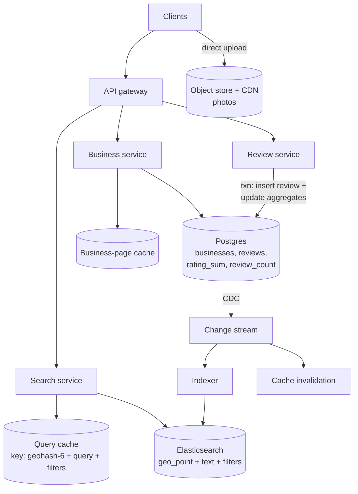

# 47 — Design Yelp (Local Business Search & Reviews)

> **Prerequisites:** [29 — Geospatial Systems](29-geospatial-systems.md) (geohash/S2, the boundary problem, point-in-polygon in §6.3), [07 — Search](07-search.md) (BM25, filters, ranking), [DD-06 — Elasticsearch](../Deep%20Dives/06-elasticsearch.md), [DD-03 — PostgreSQL](../Deep%20Dives/03-postgresql.md) (constraints, row locks). Related: [DD-18 — Large Blobs](../Deep%20Dives/18-pattern-large-blobs.md) (photos).
>
> **The prompt:** *"Design Yelp: users search for businesses near a location by name or category with filters, view a business, and leave star ratings and reviews."* A Hello Interview staple. The trap is treating it as "Uber-lite". Businesses **don't move**, so the hard parts are **combined geo + text + filter search**, **keeping average ratings correct under concurrent reviews**, and **one review per user per business**.
>
> **Attempt first:** 35 minutes out loud before reading past this line.

## What you'll master

- Why static locations change everything versus ride-hailing: **no write firehose**, so the geo index can live inside the search engine.
- **One query, three predicates**: geo radius/box + full-text/category + structured filters, executed together in Elasticsearch (or Postgres + PostGIS at smaller scale).
- **Rating aggregates** maintained incrementally and atomically (sum + count), never by recomputing `AVG()` per read.
- **One-review-per-user** as a database constraint, not an application check.
- **Ranking**: relevance × distance × a **Bayesian-average** rating so a single 5★ review doesn't top the list.

## In the Room — the decisive move

> *"Unlike Uber, the entities are static. There are maybe 10–20 million businesses and they change rarely, so the geo index doesn't need its own write path. I'll put businesses in **Elasticsearch with a `geo_point`**, so one query does the radius filter, the text match on name and category, and the structured filters (open now, price, rating) together, and the ranking blends BM25, distance decay and a **Bayesian-average** rating. Postgres is the source of truth, feeding ES via CDC. The two correctness problems are **one review per user per business**, a unique constraint, and the **average rating under concurrent reviews**: I update `rating_sum` and `review_count` in the same transaction as the review insert, so the average is always exact and reads are O(1). Searches are 100× more frequent than reviews, so search and its caching are where the capacity goes."*

### Decisions to make decisively

| Decision | Choice | Because |
|---|---|---|
| Search engine | **Elasticsearch: `geo_point` + text + filters in one query** | Geo, text and filters must be intersected together; ES does all three with cached filter bitsets |
| Small-scale alternative | **Postgres + PostGIS + `tsvector`** (if ≤ a few million businesses and modest QPS) | One system, fewer moving parts. Name the trigger for moving to ES (QPS, relevance tuning, facets) |
| Source of truth | **Postgres** (businesses, reviews, users) → **CDC → ES** | Search is a derived, rebuildable read model ([07](07-search.md) Q3) |
| Average rating | **`rating_sum`, `review_count` updated in the review's transaction** | Exact, O(1) reads; no `AVG()` scans; no lost updates (row lock or atomic increment) |
| One review per user | **`UNIQUE (business_id, user_id)`** | The constraint is the guarantee; the app check is just UX |
| Ranking rating signal | **Bayesian average** `(C·m + Σ ratings) / (C + n)` | Shrinks low-count businesses toward the global mean `m` |
| Photos | **Direct-to-object-storage upload + CDN**, metadata in Postgres | Blob pattern; never through the app servers |

**Experience hook.** *"Most of the data here fits on one decent machine: 20M businesses at ~2 KB is ~40 GB. I'd say that out loud, because it justifies a single ES cluster with replicas for read QPS instead of a geo-sharded custom index."*

---

## 1. Requirements

**Functional.**
- **Search** businesses by location (a point + radius, or the visible map box), with optional text (name, "pizza") and filters (category, open now, price level, minimum rating, distance).
- View a business: details, hours, photos, average rating, paginated reviews.
- **Write a review** (1–5 stars + text), at most **one per user per business** (editable).
- Search **within a named area** ("restaurants in the Mission"), a polygon, not a radius.

**Non-functional.**
- Search **p99 < 300 ms**; business page p99 < 200 ms.
- ~100M MAU; **read-heavy**: searches ≫ business views ≫ reviews.
- Average rating **exact** and consistent with the reviews shown (eventual within seconds is acceptable for search ranking).

**Non-goals to name:** reservations/ordering (a marketplace follow-up), ads, and the fake-review detection model (an async follow-up).

> **Staff-level insight:** say the Uber contrast early. *"No moving entities means no location firehose. The geo index is static data inside the search engine, so I'll spend my time on query execution, ranking, and the two review-integrity invariants."*

## 2. Back-of-envelope

| Quantity | Math | Result |
|---|---|---|
| Businesses | given | **~20M** |
| Business docs | 20M × ~2 KB (name, categories, geo, hours, attrs, rating) | **~40 GB**, so one ES index with a few shards fits easily; replicas for QPS |
| Searches | 100M MAU, ~30M DAU × ~5 searches/day ÷ 86,400 | **~2k QPS** avg, **~10k** at peak (dinner time, weekends) |
| Business views | ~3× searches | **~6k QPS** avg; served from cache |
| Reviews written | ~200k/day | **~2–3 writes/s**, trivial |
| Review storage | ~1B reviews × ~1 KB | **~1 TB**, partitioned by `business_id` |
| Photos | ~200M × ~500 KB | **~100 TB** in object storage behind a CDN |

Conclusions: **writes are negligible**; the work is **search QPS** (replicas + caching) and **page reads** (cache). The data is small enough that a custom geo-sharded index would be over-engineering.

## 3. High-level design



- **Search service** translates the request into one ES query and caches results keyed by **(geohash-6 cell of the search point, normalized query, filters)**. Nearby users searching "coffee" share the cache entry; the cell grid is what makes the cache hit.
- **Business service** serves pages from cache (business info + first page of reviews), invalidated by CDC events.
- **Review service** writes reviews and aggregates transactionally in Postgres; ES picks up the new rating via CDC within seconds.

## 4. Deep dive A — the search query (the crux)

One request = **filter** (no scoring, cacheable) + **score** (ranking):

```
bool:
  filter:                                     # cached bitsets, no score
    - geo_distance: { distance: 5km, location: [lng, lat] }   # or geo_bounding_box for the map view
    - term:  { categories: "pizza" }
    - range: { price_level: { lte: 2 } }
    - term:  { open_now_bucket: "<current local hour>" }       # precomputed per hour-of-week
  must:
    - multi_match: { query: "wood fired", fields: ["name^3", "categories^2", "review_snippets"] }
function_score:
  - gauss on location: { origin: [lng, lat], scale: 2km }     # distance decay
  - field_value_factor: bayes_rating (log-scaled)
  - field_value_factor: review_count (log, small weight)
```

- **Geo is a filter, distance is a score.** The radius or box *bounds the candidate set*; a **gauss decay** on distance *ranks* within it. Internally ES indexes `geo_point` with a BKD tree, so you don't hand-roll geohash neighbour scans here. (If you built it yourself: geohash-6 + 8 neighbours, [29 §3.4](29-geospatial-systems.md).)
- **Map view = bounding box**, not radius: the client sends the viewport, and the query uses `geo_bounding_box`. Zoomed-out views return **clusters/aggregations** (`geotile_grid`) instead of 10,000 pins.
- **"Open now"** is computed in the business's own timezone. Precompute an `open_hours_of_week` set per business (168 hourly buckets) at index time and filter on the current local hour-of-week; don't evaluate hours scripts per query.
- **Named areas** ("in the Mission"): look up the neighbourhood polygon and use `geo_shape`/`geo_polygon` as the filter. That's point-in-polygon ([29 §6.3](29-geospatial-systems.md#63-point-in-polygon--geofencing--the-exact-test-behind-the-index)).
- **Sparse results:** if the radius yields fewer than N results, **widen** progressively (2 → 5 → 20 km) server-side.

> **Staff-level insight:** *"Filters in filter context are cached bitsets, so the stable part (category, price, the geo cell) is reused across queries and only the text scoring runs per request. And I treat distance as a ranking signal with a decay curve, not a sort key. Sorting purely by distance shows a 2.1★ place first because it's 50 metres closer."*

## 5. Deep dive B — reviews and the average rating

**Invariant 1: one review per user per business.**
`UNIQUE (business_id, user_id)` on the reviews table. A second POST becomes an **upsert/edit** (or a 409). The app can pre-check for UX, but the constraint is what holds under races and retries.

**Invariant 2: the average is exact.** Never compute `AVG(rating)` over a billion-row table on read. Keep aggregates on the business row and update them **in the same transaction** as the review:

```sql
BEGIN;
  INSERT INTO reviews (business_id, user_id, rating, body) VALUES ($1, $2, $3, $4);   -- unique constraint fires here
  UPDATE businesses
     SET rating_sum = rating_sum + $3, review_count = review_count + 1
   WHERE id = $1;                                  -- atomic increment: no read-modify-write race
COMMIT;
-- edit: rating_sum = rating_sum - old + new (count unchanged); delete: subtract and decrement
```

The `UPDATE … SET x = x + $3` is atomic under concurrency (the row lock serializes concurrent reviewers), so two simultaneous reviews can't lose an update. The average is `rating_sum / review_count`, exact and O(1).

**Hot businesses?** At ~3 reviews/s globally, row contention is a non-issue. Name the escape hatch anyway: if one row ever became hot, buffer increments per business and apply them in batches (an async counter), accepting a few seconds of staleness ([DD-14 — Contention](../Deep%20Dives/14-pattern-contention.md)).

**Ranking uses the Bayesian average, display uses the true one:**

```
bayes = (C × m + rating_sum) / (C + review_count)      m = global mean (~3.7), C = prior weight (~10–25 reviews)
```

A new place with one 5★ review gets ≈ 3.8, not 5.0, so it can't outrank a 4.6★ place with 2,000 reviews. Display still shows "5.0 (1 review)".

**Review pages:** paginate with a keyset cursor on `(business_id, created_at, review_id)` or by "most helpful" with a precomputed score. Don't use OFFSET on popular businesses.

## 6. Deep dive C — caching and freshness

- **Search cache keyed by geohash cell**: `(geohash-6, normalized query, filters, page)` with a TTL of a few minutes. A 1.2 km cell is small enough that results are near-identical inside it. This turns 10k QPS into mostly cache hits at dinner-time peaks.
- **Business page cache** invalidated by CDC events (business edit, new review), with a short TTL as a safety net.
- **Search freshness:** a new review changes `bayes_rating` in ES within seconds via CDC. Search ranking is allowed to lag; the **business page** reads the exact aggregate from Postgres (or its invalidated cache).

## 7. Failure drills — volunteer these

| Failure | Blast radius | Design answer |
|---|---|---|
| ES cluster degraded | Search slow or down | Replicas across AZs; serve cached results for hot cells; degrade to a Postgres/PostGIS fallback for "near me" without text ranking |
| CDC lag | Search shows stale rating/hours | Ranking tolerates seconds of lag; alert on lag; the business page reads the source of truth |
| Duplicate review via double-submit | Two reviews from one user | The unique constraint rejects the second; client idempotency key for retries |
| Review-bombing (a coordinated flood) | Rating manipulation | Per-user and per-business rate limits, account-age weighting, async fraud model that hides reviews pending review |
| Reindex needed (new mapping) | Search mapping change | Alias swap with a shadow index ([07 §5.5](07-search.md)); zero downtime |
| Wrong "open now" after DST | Users arrive at a closed shop | Hours stored in local time + IANA zone; recompute hour-of-week buckets on DST transitions |

## 8. The Staff & EM layer

- **Review integrity is the business.** Trust in ratings is Yelp's product; fraud detection, moderation and legal (defamation takedowns) are standing teams. The data model must support hidden/filtered reviews that still count or don't count by policy.
- **Right-size the infrastructure.** The core dataset is ~40 GB. Resist geo-sharded custom indexes and multi-region writes; one ES cluster with replicas per region, and Postgres with read replicas, carry this. Say what would change that (international expansion, 10× QPS).
- **Owner data flows.** Business owners edit hours and photos; the claim/verification flow and edit moderation are their own workflow.

### Altitude — the same probes at three levels

| Probe | Senior says | Staff says | EM adds |
|---|---|---|---|
| "How do you find nearby businesses?" | QuadTree | ES `geo_point` filter + text + filters in one query; distance as gauss decay | Right-sizing: ~40 GB, no custom geo index |
| "Average rating?" | `AVG()` on read, or recompute in a cron | `rating_sum`/`review_count` atomically in the review txn; Bayesian average for ranking | Display vs ranking policy, written down |
| "One review per user?" | Check before insert | `UNIQUE (business_id, user_id)`; the app check is UX | Edit/delete policy and audit trail |
| "Fake reviews?" | Ban bad users | Async fraud scoring, rate limits, account-age weighting, hidden-pending-review | T&S team, legal takedown process |

## 9. Follow-ups they'll ask

1. **"Personalized results."** Re-rank the top ~100 from ES using the user's category affinities and past visits; keep the ES query unpersonalized so it stays cacheable.
2. **"Typeahead in the search box."** A separate completion service over business names and categories, biased by location cell ([DD-29](../Deep%20Dives/29-typeahead-autocomplete.md)).
3. **"Global scale."** Index per region (businesses are local, queries are local); route by the user's region; no cross-region queries needed.
4. **"Reservations / waitlists."** Now it's [contention](../Deep%20Dives/14-pattern-contention.md) over table slots: a booking with a conditional write, like the calendar's rooms ([43](43-design-calendar.md)).
5. **"Photos at scale."** Presigned direct upload, async thumbnailing, CDN, moderation queue ([DD-18](../Deep%20Dives/18-pattern-large-blobs.md)).

## Interview Cheat-Sheet

**One-liner:** *"Static entities, so no location firehose. Postgres is the source of truth with CDC into Elasticsearch, where one query does a geo filter + text + structured filters and ranks by BM25 × distance decay × Bayesian-average rating. Reviews enforce one-per-user with a unique constraint and update rating_sum/review_count in the same transaction, so averages are exact and O(1). Results are cached by geohash cell."*

**Numbers:** ~20M businesses ≈ 40 GB · ~2k search QPS avg, ~10k peak · ~3 review writes/s · ~1B reviews ≈ 1 TB · Bayesian prior C ≈ 10–25, m ≈ global mean.

**The close:** *"The data is small and static, so I avoid a custom geo index and let the search engine combine geo, text and filters. The two things I make correct by construction are one review per user (a constraint) and the average (atomic aggregates in the review transaction). Everything else is read scaling: replicas, a geohash-cell query cache, and CDC-driven invalidation."*
