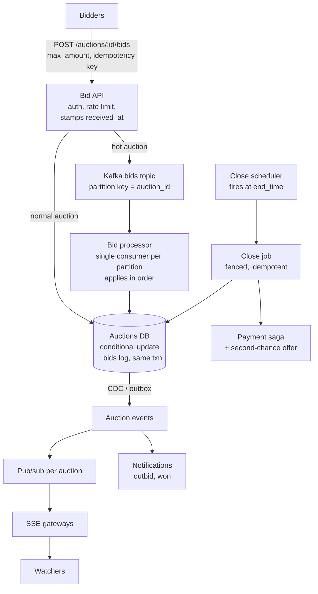
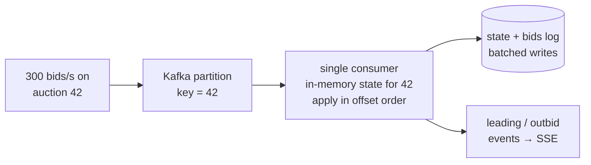

# 48 — Design an Online Auction (eBay-style)

> **Prerequisites:** [DD-14 — Contention](../Deep%20Dives/14-pattern-contention.md) (OCC vs single-writer), [DD-02 — Kafka](../Deep%20Dives/02-kafka.md) (key-partitioned ordering), [35 — Scheduler](35-design-scheduler.md) (closing auctions on time), [DD-13 — Realtime Updates](../Deep%20Dives/13-realtime-updates.md) (live price). Related: [31 — Matching Engine](31-design-matching-engine.md) (single-threaded sequencer, the extreme version), [45 — Live Comments](45-design-live-comments.md) (broadcast to watchers), [18c §5 — Payments](18c-design-marketplace-money.md).
>
> **The prompt:** *"Design an online auction like eBay: sellers list items with an end time, buyers place bids, the highest bid when the auction ends wins, and watchers see the current price update live."* A Hello Interview staple. It looks like CRUD; the crux is **bid contention on a hot auction** (never lose a bid, never accept an invalid one), **closing at exactly the right moment**, and **proxy bidding**.
>
> **Attempt first:** 35 minutes out loud before reading past this line.

## What you'll master

- **Bid acceptance under contention**: conditional writes (OCC) for the common case, and a **single-writer per auction** (Kafka partition keyed by `auction_id`) for hot ones.
- Why the **bid log is the source of truth** and the "current price" is derived state.
- **Proxy (automatic) bidding**: the auction state is the top two maximum bids, and the visible price is second-highest + increment.
- **Closing correctly**: server-side receipt time, a fenced close, and **soft close** (anti-sniping extension).
- **Live price fan-out** to watchers, and the post-auction **payment saga** with second-chance offers.

## In the Room — the decisive move

> *"There are three hard parts. First, **concurrent bids**: two people bid on the same item at the same instant and exactly one outcome must be correct, with every bid recorded. For most auctions, an **atomic conditional update** (accept only if the bid beats the current maximum and the auction is open) is enough. For the hot ones at the closing seconds I'd **serialize per auction** through a Kafka partition keyed by `auction_id`, so a single consumer applies bids in order with no lock contention. Second, **closing**: the authoritative clock is the server's receipt time, a bid counts only if it was received before `end_time`, and the close is a fenced, idempotent job. I'd also add a **soft close** that extends the auction by 2 minutes if a bid lands in the last 2 minutes, which removes sniping as a systems problem. Third, **proxy bidding**: users submit a maximum, and the price is the second-highest maximum plus one increment, so the state I protect is the top two maximum bids, not 'the price'."*

### Decisions to make decisively

| Decision | Choice | Because |
|---|---|---|
| Source of truth | **Append-only `bids` log + derived `auction` state** (current price, leader) | Every bid is auditable; the state can be recomputed from the log |
| Default bid path | **Conditional write (OCC)**: `UPDATE … WHERE id = ? AND status = 'open' AND ? > high_max` | One round trip; no locks held; right for the ~99% of auctions with low contention |
| Hot auction path | **Single writer per `auction_id`** (Kafka partition → one consumer applies bids in order) | Removes contention entirely; ordering is explicit; throughput per auction ≫ human bid rates |
| Time authority | **Server receipt timestamp** at the bid API (or the sequencer's) | Client clocks lie; the rule must be checkable |
| Ending | **Fenced close job at `end_time`** + **soft close** (extend 2 min on late bids) | Exactly-once close; sniping becomes a product rule instead of a race |
| Proxy bidding | **State = top two max bids; price = min(second max + increment, top max)** | That's eBay's model, and it's what makes concurrent bids well-defined |
| Live updates | **SSE per auction for watchers**, pub/sub channel per auction | Downstream-only broadcast ([45](45-design-live-comments.md)) |

**Experience hook.** *"It's the ticketing contention problem with a twist: instead of 'the last seat', it's 'the current maximum', and the value keeps moving. Same toolbox: a conditional write for the common case, and serialize through one writer when contention is concentrated."*

---

## 1. Requirements

**Functional.**
- Sellers create listings: item, starting price, optional reserve price, duration/end time.
- Buyers **place bids** (or a **maximum bid** for proxy bidding); see whether they are winning.
- Watchers see the **current price, bid count and time left** live.
- At end time, the **highest valid bid wins** (if above reserve); winner and seller are notified and payment begins.
- Bid history per auction (public, anonymized).

**Non-functional.**
- **Correctness:** no accepted bid is lost; no bid accepted after close; the winner is the true highest valid bid. This is a strong-consistency boundary, like money.
- Bid acknowledgement **p99 < 500 ms**; live price updates **< 1 s** to watchers.
- ~10M active auctions; hot auctions see bursts of **hundreds of bids/s** in the final seconds.

**Non-goals to name:** search/browse of listings (a [search](07-search.md) problem), shipping, and dispute resolution.

> **Staff-level insight:** draw the consistency boundary early: *"Bids and closing are strongly consistent. Listings, search, watcher counts and the live price display are eventually consistent. A watcher seeing a price 500 ms late is fine; accepting a bid after close is not."*

## 2. Back-of-envelope

| Quantity | Math | Result |
|---|---|---|
| Active auctions | given | **~10M** |
| Bids | ~100M/day ÷ 86,400 | **~1.2k bids/s** avg, ~5k/s peak (evening auction endings) |
| Hot auction | rare items, final 30 s | **~100–500 bids/s on one auction**, the contention case |
| Bid log | 100M/day × ~200 B | **~20 GB/day**, partitioned by `auction_id` |
| Watchers | popular auctions × watchers | Up to **~100k concurrent watchers** on one auction |
| Closings | 10M auctions / ~7-day avg duration | **~1.4M closes/day ≈ 16/s**, clustered at popular end times |

Conclusions: **aggregate bid throughput is modest**; the difficulty is **concentration** (hundreds of bids/s on one row in the final seconds) and **timing** at the close, not volume.

## 3. High-level design



- **Bid API** authenticates, rate-limits, applies an **idempotency key** (a retried POST must not become two bids), and stamps **`received_at`** from the server clock. That timestamp is what the close rule compares against.
- **Normal path:** a single transaction inserts into `bids` and conditionally updates `auctions`.
- **Hot path:** the auction is flagged hot (by bid rate or watcher count); bids go to Kafka keyed by `auction_id`, and one consumer per partition applies them in order. The API returns **"bid received"** immediately, and the result (leading / outbid) follows over SSE in ~100 ms.
- **Events** (via outbox/CDC) drive the live price, outbid notifications and the search index.

## 4. Deep dive A — accepting bids under contention (the crux)

**State per auction (proxy bidding model):**

```
auctions(id, status, end_time, reserve, increment,
         high_bidder, high_max,        -- top maximum bid (secret)
         second_max,                   -- second-highest maximum
         current_price,                -- visible = min(second_max + increment, high_max)
         version)
bids(auction_id, bid_id, bidder, max_amount, received_at, outcome)   -- append-only, every bid
```

**Applying a bid `b` from bidder `u` with maximum `M`** (the same logic in both paths):
- `M > high_max` (new leader): `second_max = high_max`, `high_max = M`, `high_bidder = u`, `current_price = min(old high_max + increment, M)`.
- `current_price < M ≤ high_max` (beats the price but not the secret max): the leader stays; `second_max = M`, `current_price = min(M + increment, high_max)`. The bidder is immediately **outbid**.
- `M ≤ current_price`: **rejected** (too low), but still recorded in the log with outcome `rejected`.

**Path 1 — conditional write (default):**

```sql
BEGIN;
  SELECT high_max, second_max, current_price, version FROM auctions
   WHERE id = $1 AND status = 'open' AND end_time > $received_at
   FOR UPDATE;                                   -- or read + OCC on version
  -- apply the rules above in code
  UPDATE auctions SET ..., version = version + 1 WHERE id = $1 AND version = $v;
  INSERT INTO bids (...) VALUES (...);          -- same txn: the log and the state can't diverge
COMMIT;
```

At a few bids/s per auction, the row lock is held for about a millisecond and contention is negligible.

**Path 2 — single writer for hot auctions:** at hundreds of bids/s on one row, lock waits pile up and p99 rises. So **remove the race**: route all bids for that auction into one Kafka partition. Its single consumer keeps the auction state in memory, applies bids strictly in offset order (no locks), and writes state + log in batches. One consumer can apply **tens of thousands of bids/s** for a single auction, far beyond human bidding rates. The cost is one async hop: the bidder sees "received", then "leading/outbid" over SSE.



> **Staff-level insight:** *"I start with a conditional write because it's one round trip and correct. I switch an auction to a single-writer partition only when it gets hot, because the issue isn't throughput, it's lock convoys on one row. Either way, the bid log and the state are written in the same transaction, so the price can always be recomputed from the log, and that's what support and disputes read."* That's the same ladder as [DD-14](../Deep%20Dives/14-pattern-contention.md) rung 7, taken to its conclusion in the [matching engine](31-design-matching-engine.md).

## 5. Deep dive B — closing on time, fairly

- **The rule:** a bid is valid iff `received_at < end_time`, where `received_at` is stamped by **our** API (or the sequencer), never the client. Both bid paths check it, so a bid that was in flight at the deadline is decided by that timestamp, not by which code path ran first.
- **The close job:** the [scheduler](35-design-scheduler.md) fires at `end_time` (plus a small grace period for in-flight bids, e.g. 2 s). The close is **fenced and idempotent**: `UPDATE auctions SET status='closing' WHERE id=? AND status='open'`, and only the instance that wins that transition proceeds. On the hot path the close is just another message in the same partition, so ordering against the final bids is automatic.
- **Determine the outcome:** leader with `high_max ≥ reserve` → winner at `current_price`; otherwise unsold. Write `status='closed'`, emit `auction_won` / `auction_unsold` events.
- **Soft close (anti-sniping):** if a valid bid arrives within the last N minutes, extend `end_time` by N minutes (re-arm the scheduler; the extension is part of the same transaction as the bid). Sniping bots stop being able to win by latency, and the "last-millisecond flood" turns into a series of normal bids. eBay itself uses a hard close and relies on proxy bidding instead; name both and pick one deliberately.

## 6. Deep dive C — watchers, notifications, payment

- **Live price:** each accepted bid emits an event to the auction's pub/sub channel; watchers hold **SSE** connections, and gateways fan out (the [45](45-design-live-comments.md) design at a smaller scale). Updates are coalesced to at most a few per second per auction, with the latest price winning, since watchers only need the newest value.
- **Outbid notifications:** an `outbid` event → push/email, deduplicated per (auction, user) within a window so a bidding war doesn't send 40 pushes.
- **Payment after close:** the winner gets a payment request and a deadline ([saga](18c-design-marketplace-money.md), idempotent charge). If they don't pay by the deadline, run a **second-chance offer** to the runner-up at their max bid, which is why the log keeps every bidder's maximum.
- **Search index** updates price and bid count via CDC, eventually consistent (seconds).

## 7. Failure drills — volunteer these

| Failure | Blast radius | Design answer |
|---|---|---|
| Two bids at the same instant | Wrong leader / lost bid | Row lock / OCC version, or the single-writer partition: one deterministic order, every bid logged with its outcome |
| Client retries a bid POST | Double bid | Idempotency key per bid attempt; deduplicate at the API and on the log's unique key |
| Bid processor (hot path) crashes | Hot auction paused | Kafka redelivers from the last committed offset; the consumer rebuilds state from the DB + log; applying bids is idempotent by `bid_id` |
| Close job fires twice | Double close / double charge | Fenced `open → closing` transition; payment saga keyed by `auction_id` |
| Scheduler late at end time | Bids accepted after close? | No: validity is `received_at < end_time`, independent of when the close runs; late close only delays the notification |
| Clock skew between API servers | Unfair cut-off | NTP-disciplined clocks with alerting on skew; hot path stamps time at the sequencer, so one clock decides |
| Winner doesn't pay | Seller unpaid | Payment deadline → second-chance offer to the runner-up → relist |
| Shill bidding (seller bids up own item) | Fraud | Account linkage and graph signals, bid-pattern detection, async review; the bid log is the evidence |

## 8. The Staff & EM layer

- **Correctness is the brand.** "My bid didn't count" is the worst support ticket an auction site gets. The append-only bid log with outcomes and server timestamps is what lets support answer it in a minute, so treat it as a product feature.
- **Policy decisions are engineering inputs.** Hard close vs soft close, the bid increment table, the reserve price display and second-chance rules change the system's behaviour. Get them decided by product, written down and versioned.
- **Cost profile:** modest. The DB, a small Kafka footprint for hot auctions, and an SSE fleet sized by watchers. The expensive part is trust & safety (fraud, shill bidding, counterfeit listings).

### Altitude — the same probes at three levels

| Probe | Senior says | Staff says | EM adds |
|---|---|---|---|
| "Two bids at once?" | Lock the row | Conditional write by default; single-writer partition for hot auctions; log + state in one txn | "My bid didn't count" support flow backed by the log |
| "When does the auction end?" | A cron at end time | `received_at < end_time` from the server clock; fenced idempotent close; soft close | Hard vs soft close as a written product policy |
| "Proxy bidding?" | Store the highest bid | State = top two maxima; price = second max + increment, capped at the top max | Increment table and its change process |
| "Winner doesn't pay?" | Cancel the sale | Payment saga with deadline → second-chance offer → relist | Fraud and non-payment strike policy |

## 9. Follow-ups they'll ask

1. **"Buy It Now."** An instant purchase that closes the auction: the same fenced `open → closed` transition, and it races bids under the same lock or partition.
2. **"Live auctions with an auctioneer (video)."** The single-writer sequencer becomes the core with sub-second bid windows; watchers get the video ([36](36-design-live-streaming.md)) and price events side by side.
3. **"Sealed-bid / second-price auctions."** No live price; collect bids until close, then rank. Simpler contention, but bids must be confidential until close (encrypt at rest, access-controlled).
4. **"Millions of auctions ending at 8 pm Sunday."** The scheduler shards by time bucket; closes are cheap and parallel per auction; pre-scale the notification fan-out.
5. **"Search by current price."** CDC to the search index; price is eventually consistent there, and the auction page is authoritative.

## Interview Cheat-Sheet

**One-liner:** *"The bid log is the truth and the price is derived. Accept bids with a conditional write (status open, received before end, beats the current max) that writes state + log in one transaction; route hot auctions through a Kafka partition keyed by auction ID so one consumer applies bids in order. Proxy bidding keeps the top two maxima (price = second + increment). The close is a fenced, idempotent job judged by server receipt time, optionally with a soft-close extension. Watchers get SSE; the winner gets a payment saga with a second-chance fallback."*

**Numbers:** ~10M active auctions · ~1.2k bids/s avg, ~5k peak · hot auction 100–500 bids/s · bid log ~20 GB/day · ~16 closes/s avg · bid ack p99 < 500 ms · live price < 1 s.

**The close:** *"Volume is modest; concentration and timing are the problem. So the design is a correct bid-acceptance rule applied in one deterministic order per auction, by a conditional write normally and a single writer when it's hot, a server-side clock deciding validity, and an append-only log that can explain every outcome."*
