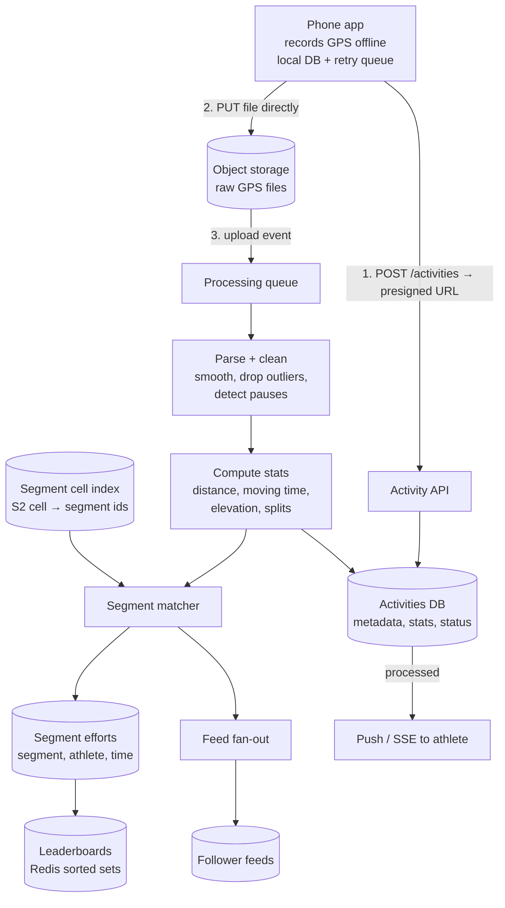
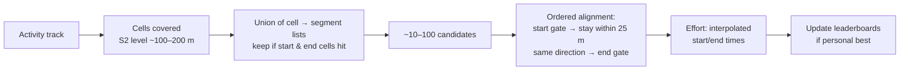

# 49 — Design Strava (Fitness Activity Tracking)

> **Prerequisites:** [29 — Geospatial Systems](29-geospatial-systems.md) (S2/geohash cells, point-in-polygon §6.3), [DD-19 — Long-Running Tasks](../Deep%20Dives/19-pattern-long-running-tasks.md) (async processing after upload), [DD-18 — Large Blobs](../Deep%20Dives/18-pattern-large-blobs.md) (the GPS file), [DD-28 — Distributed Leaderboard](../Deep%20Dives/28-distributed-leaderboard.md), [Mobile 04 — Data, Caching & Sync](../Mobile%20System%20Design/04-data-caching-sync.md). Related: [18a §4 — Twitter](18a-design-chat-social.md) (the activity feed).
>
> **The prompt:** *"Design Strava: athletes record runs and rides on their phone, upload them, see stats and a map, follow friends' activities in a feed, and compete on segment leaderboards."* A Hello Interview problem. It looks like "Uber's location firehose", but it isn't: recording is **offline and on-device**, and the server receives one **file per activity**. The crux is the **post-upload processing pipeline**, **segment matching** (which known stretches of road did this ride cover?), and **leaderboards**.
>
> **Attempt first:** 35 minutes out loud before reading past this line.

## What you'll master

- Why recording is a **client problem** (offline buffer, battery, GPS sampling) and the server gets a **completed track**, not a stream.
- The **activity pipeline**: upload → parse → clean GPS → compute stats → match segments → update leaderboards → fan out to the feed, all async.
- **Segment matching** as a filter-refine geospatial problem: cell index for candidates, then an ordered geometric alignment.
- **Segment leaderboards** with filters (age group, gender, this year), as precomputed sorted sets.
- **Privacy zones** and the "your run reveals where you live" problem, enforced on the read path.

## In the Room — the decisive move

> *"Unlike Uber, the server isn't on the hot path while someone runs. The phone records GPS locally (offline is the normal case on a trail) and uploads a compressed file at the end. So writes are about a few hundred activity files per second, not millions of pings. Everything interesting happens **after** the upload, in an async pipeline: clean the GPS, compute distance, pace and elevation, **match the track against known segments**, update those **segments' leaderboards**, and fan the activity out to followers' feeds. The two hard parts are segment matching, a filter-refine geospatial problem, and leaderboards with filters, which I precompute as sorted sets per segment per bucket. I'll also enforce **privacy zones** at read time, so a run's start and end near your home are never shown to others."*

### Decisions to make decisively

| Decision | Choice | Because |
|---|---|---|
| Recording | **On-device, offline-first; upload a compressed file at the end** | Trails have no signal; streaming every point costs battery and adds nothing |
| Upload | **Presigned direct-to-object-storage upload**, then an "activity uploaded" event | The [blob pattern](../Deep%20Dives/18-pattern-large-blobs.md): GPS files are ~50–500 KB; never through app servers |
| Processing | **Async pipeline (queue + workers)**, 202 on upload, status pushed when done | Stats and segment matching take seconds; users accept "processing…" |
| Segment candidates | **Precomputed S2 cell → segment IDs index**; a track's covered cells give candidates | Avoid testing a ride against millions of segments |
| Segment match | **Ordered alignment** (start gate → follow the polyline → end gate) with a distance tolerance | Passing through a segment's area isn't riding it; direction and order matter |
| Leaderboards | **Redis sorted set per (segment, filter bucket)**, best effort per athlete | O(log n) rank queries; filters precomputed, not computed per query |
| Feed | **Fan-out on write to followers' feeds**, pull for the rare very-large accounts | Typical athletes have hundreds of followers; pro athletes are the hybrid case |
| Privacy zones | **Stored per user; applied when serving** the track and stats to anyone else | Changing your privacy zone must retroactively hide old activities |

**Experience hook.** *"It's the same split as YouTube: the upload is a dumb file transfer, and all the value comes from the processing pipeline behind it. Making that pipeline idempotent and re-runnable is what lets you reprocess every activity when the segment-matching algorithm improves."*

---

## 1. Requirements

**Functional.**
- Record an activity (run, ride, swim) on the phone with GPS, **offline**; pause/resume; save.
- Upload and view the activity: map, distance, moving time, pace/speed, elevation gain, splits.
- **Segments:** user-created stretches of road or trail; each matched activity gets a time on that segment and a place on its **leaderboard** (overall, by age group/gender, this year, among people you follow).
- **Feed** of activities from people you follow; kudos and comments.
- **Privacy:** activity visibility (everyone / followers / only me) and **privacy zones** (hide the part of a track within a radius of home or work).
- Optional: live location sharing with chosen contacts during an activity (a safety feature).

**Non-functional.**
- Upload must **never lose an activity**, even with flaky connectivity (an athlete's 3-hour ride is irreplaceable).
- Processed and visible within **~10–30 s** of upload; feed reads p99 < 300 ms.
- ~100M users; **weekend-morning peaks** of several times the average.

**Non-goals to name:** route planning/navigation, heart-rate analytics beyond simple stats, and device integrations (Garmin sync is just another upload source).

> **Staff-level insight:** say early that this is *not* a location firehose. *"The server never sees a live stream except for the optional safety beacon. That one sentence removes the Uber architecture from the table and moves the design to the processing pipeline."*

## 2. Back-of-envelope

| Quantity | Math | Result |
|---|---|---|
| Activities uploaded | ~5M/day ÷ 86,400 | **~60/s** avg, **~300/s** at weekend-morning peaks |
| GPS points per activity | 1 point/s × ~1 h | **~3,600 points** (lat, lng, elevation, time, HR) |
| File size | ~3,600 × ~30 B, compressed | **~50–100 KB** typical; hours-long rides ~1 MB |
| Raw storage | 5M × ~100 KB | **~500 GB/day ≈ 180 TB/year** in object storage |
| Segments | user-created | **~tens of millions**, each a polyline of ~50–500 points |
| Segment checks | candidates per activity after the cell filter | **~10–100**, each a cheap alignment |
| Feed fan-out | 5M activities × ~200 followers avg | **~1B feed inserts/day ≈ 12k/s** |
| Live beacon (optional) | ~1% of active athletes × 1 ping/30 s | **trivial**, a few thousand writes/s |

Conclusions: **ingest is small**; the work is the **per-activity processing** (segment matching above all) and the **feed fan-out**, both async and horizontally scalable.

## 3. High-level design

- **Upload path:** the app saves the activity to a **local database first** (durable on the device), then requests a presigned URL and uploads with retries. The activity row is `pending` until the storage event triggers processing. An idempotency key (device-generated activity UUID) makes retried uploads safe.
- **Pipeline stages** are separate consumers so each can scale and be re-run independently. The output of each stage is stored, so reprocessing from "stats" onward doesn't re-parse.
- **Read paths:** activity page = metadata + stats + simplified polyline (downsampled for the map), with privacy zones applied; leaderboards from Redis; feeds from the feed store.

## 4. Deep dive A — the client and the upload (never lose a ride)

- **Recording:** GPS at ~1 Hz (adaptive: lower when stationary to save battery), written incrementally to an on-device database so a crash or dead battery loses at most a few seconds. Auto-pause by speed.
- **Upload as a durable outbox on the phone:** saving an activity enqueues an upload job locally. It retries with backoff on network changes and survives app restarts. The server-side **idempotency key** (the activity UUID generated on the device) means a retry after a timeout never creates a duplicate. Files over a few MB use multipart/resumable upload.
- **Device uploads from watches** (Garmin, Apple Watch) arrive via partner webhooks or file sync; they enter the same pipeline at step 3.

> **Staff-level insight:** *"The phone is the system of record until the server acknowledges the file, so the app writes locally first and treats upload as an outbox with an idempotency key. That's the only way to promise 'we never lose your ride' on a trail with no signal."* ([Mobile 04](../Mobile%20System%20Design/04-data-caching-sync.md) is the general pattern.)

## 5. Deep dive B — segment matching (the crux)

A segment is a polyline with a **start gate**, an **end gate** and a direction. "Did this ride cover segment S, and how long did it take?" for tens of millions of segments.

**Filter — find candidates cheaply:**
- Precompute an **S2 cell cover** for every segment's polyline (cells at a level of ~100–200 m), stored as `cell_id → [segment_ids]`. That's an inverted index, the same idea as a search engine's postings list.
- For a new activity, compute the set of cells its track passes through and **union** their segment lists. Then keep only segments whose **start and end cells** are both in the activity's cell set. That turns millions of segments into ~10–100 candidates.

**Refine — does the track actually ride it?**
1. **Find entry:** points on the track within a tolerance (e.g. 20–30 m, GPS noise) of the segment's start gate.
2. **Follow in order:** from each entry, walk forward along the track and check that it stays within the tolerance of the segment polyline, in the **same direction**, until it reaches the end gate. Leaving the corridor for too long (or reversing) fails the match.
3. **Time the effort:** interpolate the exact crossing times at the start and end gates (between GPS samples), giving `elapsed_time`.
4. **Multiple efforts:** laps of a track produce several efforts; keep all, rank the best.

**Robustness:** GPS drift in cities (tall buildings), tunnels with no points (interpolate across short gaps, fail on long ones), and **cheating** (a car ride logged as a bike ride: flag implausible speeds or acceleration, and let users flag efforts for review).

**Reprocessing:** when a new segment is created, it's matched against **past** activities in its area. Use the same cell index in reverse: activities indexed by cell (or a batch job over activities whose bounding box intersects the segment). This runs as a low-priority backfill.

> **Staff-level insight:** *"Segment matching is filter-refine, like retrieve-then-rank in search: an inverted index from S2 cells to segments gives a few dozen candidates, then an ordered alignment with a GPS tolerance confirms direction and order and interpolates gate-crossing times. Passing through a segment's area isn't riding it, which is why the refine step follows the polyline instead of testing points in a polygon."*

## 6. Deep dive C — leaderboards, feed, privacy

**Leaderboards** ([DD-28](../Deep%20Dives/28-distributed-leaderboard.md)):
- One **sorted set per (segment, bucket)**: `lb:{segment}:all`, `lb:{segment}:2026`, `lb:{segment}:F:35-44`, and so on. Score = **elapsed time (lower is better)**, member = athlete. `ZADD … LT` updates only if the new time beats the athlete's best ("less than" flag).
- An effort updates the overall board plus the athlete's few filter buckets (age/gender/year): a handful of `ZADD`s.
- **"Among people I follow"** can't be precomputed per viewer. Compute it on read: intersect the viewer's following list with the segment's efforts (from the effort store, indexed by segment), which is fine because the following list is hundreds, not millions.
- Most segments are small; a famous climb may have millions of efforts, so shard sorted sets by segment and cache the top-10 page.

**Feed:** fan-out on write into followers' feed lists (activity IDs), with **hybrid pull** for the few accounts with millions of followers ([18a §4](18a-design-chat-social.md)). Activities with visibility "only me" never fan out; "followers only" fan out but are hidden from public surfaces.

**Privacy zones:** the user defines circles around home and work. When serving an activity to **anyone other than its owner**, trim the track's points inside any of those circles (and the stats derived only from the trimmed part, like the start time at home). Apply this **on read**, not at upload, so changing your privacy zone fixes every past activity instantly. Segments starting inside a privacy zone are not shown on leaderboards for that effort. Heatmaps (aggregate public routes) must also exclude private and zoned data. Aggregated heatmaps have revealed sensitive locations in practice, so treat them as a privacy review item.

## 7. Failure drills — volunteer these

| Failure | Blast radius | Design answer |
|---|---|---|
| Upload fails on a trail | Activity stuck on device | Local outbox with retries; idempotency key; resumable multipart for long rides |
| Processing worker crashes mid-activity | Activity stuck "processing" | Queue redelivery; each stage idempotent (keyed by activity ID + stage); stored stage outputs |
| Segment-matching bug shipped | Wrong times on leaderboards | Versioned matcher; recompute efforts for affected segments from stored tracks; leaderboards are derived and rebuildable |
| A famous segment's leaderboard is hot | Slow reads | Cache the top-N and the athlete's own rank; sorted-set replicas for reads |
| GPS spike (teleport) | Absurd distance/speed | Outlier removal by implied speed between points before stats; flag implausible efforts |
| Weekend peak | Pipeline backlog | Autoscale on queue depth; prioritize "stats" over feed fan-out and backfills so athletes see their own result first |
| Privacy zone changed | Old activities exposed? | Read-time trimming: fixed for all past activities immediately, no reprocessing |

## 8. The Staff & EM layer

- **Privacy is a safety issue.** Location data identifies homes, routines and, in aggregate, sensitive sites. Privacy defaults, zone enforcement on every read surface (API, embeds, heatmaps, exports) and a review process for new features that use location are an org commitment, not a feature flag.
- **Leaderboard integrity is the community's trust.** Cheating detection, flagging and a review queue need owners; so do the rules when matching is reprocessed and times change.
- **Reprocessing is a capability to budget for.** Stored raw tracks plus an idempotent pipeline mean improvements (better smoothing, a new segment) can be backfilled. Size the compute for backfills separately from the live path.

### Altitude — the same probes at three levels

| Probe | Senior says | Staff says | EM adds |
|---|---|---|---|
| "How does location get to the server?" | Stream GPS over WebSocket | Record offline on device, upload one file via presigned URL; local outbox + idempotency key | "Never lose a ride" as the headline reliability promise |
| "Match a ride to segments?" | Check every segment | S2 cell inverted index → candidates → ordered alignment with tolerance, interpolated gate times | Versioned matcher + reprocessing budget |
| "Leaderboards with filters?" | `ORDER BY` on efforts | Sorted set per (segment, bucket), `ZADD LT`; "following" computed on read | Cheating review queue and its owner |
| "Privacy?" | Let users hide activities | Privacy zones trimmed on read, so changes are retroactive; exclude from heatmaps | Privacy review for every location feature |

## 9. Follow-ups they'll ask

1. **"Live tracking for safety contacts."** The phone pings every ~30 s when connected; the server keeps the latest position per activity in a TTL'd KV store and serves it over a share link with SSE. The only real-time path, and it's small.
2. **"Global heatmap."** Batch job over public, non-zoned activities: rasterize tracks into tile-level counts, render map tiles, serve from CDN. Rebuilt weekly.
3. **"Route suggestions."** Popularity-weighted graph built from the heatmap data; shortest/most-popular path queries ([29 §10](29-geospatial-systems.md)).
4. **"Challenges (run 100 km this month)."** Per-user counters updated by the stats stage; monthly windowed aggregates.
5. **"Clubs and group activities."** Detect group rides by co-located tracks in time; club feeds are another fan-out target.

## Interview Cheat-Sheet

**One-liner:** *"Not a location firehose: the phone records offline and uploads one file via presigned URL, with a local outbox and an idempotency key so a ride is never lost. An async pipeline cleans GPS, computes stats, matches segments (S2 cell → segment inverted index for candidates, then ordered alignment with a GPS tolerance), updates per-(segment, bucket) sorted-set leaderboards with ZADD LT, and fans out to followers' feeds. Privacy zones are trimmed on read so changes apply retroactively."*

**Numbers:** ~5M activities/day (~60/s avg, ~300/s peak) · ~3,600 points/h · ~100 KB/file → ~500 GB/day · tens of millions of segments → ~10–100 candidates per activity · ~1B feed inserts/day.

**The close:** *"The upload is a file transfer; the product is the pipeline behind it. I make it idempotent and re-runnable so matching can be improved and backfilled, treat segment matching as filter-refine geospatial work, precompute leaderboards per segment and bucket, and enforce privacy zones on every read surface because location data is safety data."*
