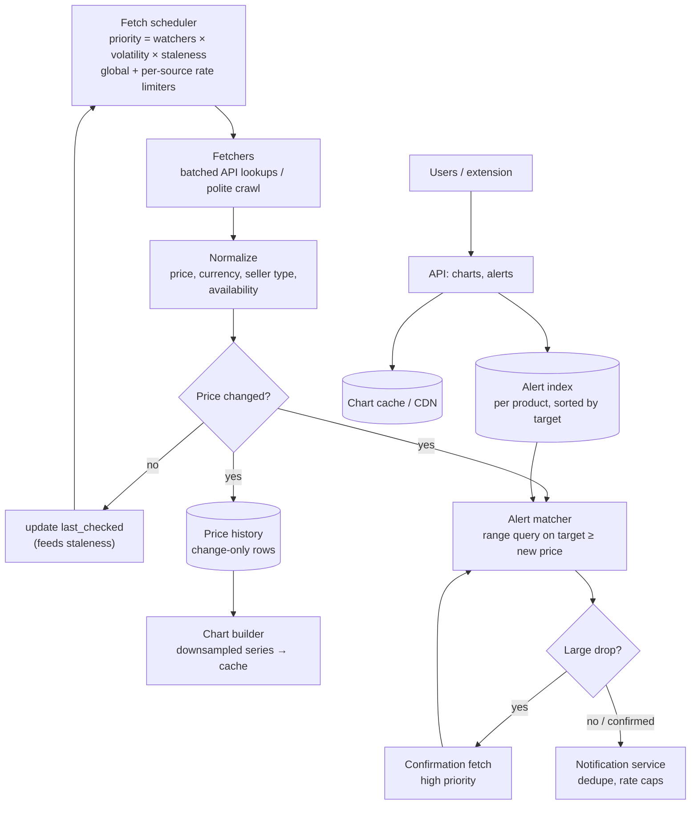
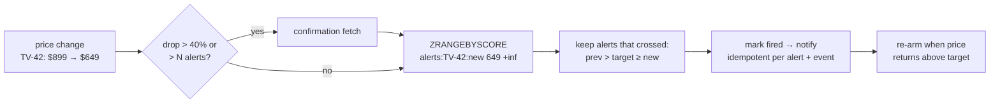

# 50 — Design a Price Tracking Service (camelcamelcamel / Honey / Keepa)

> **Prerequisites:** [18d §7 — Web Crawler](18d-design-infra-primitives.md) (frontier, politeness), [18d §4 — Notification System](18d-design-infra-primitives.md), [DD-10 — Time Series Databases](../Deep%20Dives/10-time-series-databases.md), [DD-22 — Rate Limiting](../Deep%20Dives/22-rate-limiting.md), [35 — Scheduler](35-design-scheduler.md). Related: [44 — News Aggregator](44-design-news-aggregator.md) (adaptive polling of sources).
>
> **The prompt:** *"Design a price tracker like camelcamelcamel: show price history charts for Amazon products, and let users set an alert that fires when a product drops below their target price."* A Hello Interview problem. It looks like "a crawler plus a cron job"; the crux is **spending a limited fetch budget where it matters**, **matching price changes to millions of alerts efficiently**, and **not sending false alerts**.
>
> **Attempt first:** 35 minutes out loud before reading past this line.

## What you'll master

- The **fetch budget** as the binding constraint: the retailer's API quota or politeness limits, not your servers, cap how often you can check prices.
- A **priority scheduler** that refreshes products by watchers × volatility × staleness.
- **Change-only price history** storage, and charts served from precomputed, downsampled series.
- **Alert matching as a range query**: per-product alerts indexed by target price, so a price drop finds its alerts in O(log n + k), never by scanning all alerts.
- **Alert quality**: confirmation fetches, seller/condition matching, dedupe and re-arming rules.

## In the Room — the decisive move

> *"The servers are cheap; the **fetch budget** is the constraint. Whether we use the retailer's official API or crawl, we get a fixed number of price lookups per second, so the design is a **priority scheduler** that spends them on products with many watchers or volatile prices and checks the long tail rarely. When a fetch finds a **price change**, we append it to a change-only history and run **alert matching**: each product's alerts sit in a structure sorted by target price, so a drop to $79 is a range query for alerts with target ≥ $79, which is O(log n + matches). Before notifying, we **confirm** surprising drops with a second fetch so we don't send false alerts. Charts are precomputed and cached, because history is read far more often than it changes."*

### Decisions to make decisively

| Decision | Choice | Because |
|---|---|---|
| Data source | **Official product API first** (affiliate/product APIs, batched lookups); crawling only where permitted | Terms of service and rate limits are real constraints; the API returns structured prices |
| Refresh policy | **Priority queue on score = watchers × volatility × staleness**, with per-tier minimum/maximum intervals | A fixed interval for 20M products either blows the budget or leaves popular products stale |
| History storage | **Store changes only** `(product, seller_type, ts, price)` | Prices change rarely; one row per check is ~100× wasted storage |
| Alert index | **Per-product sorted structure by target price** (Redis sorted set or `(product_id, target_price)` B-tree index) | A price drop becomes a range query over that product's alerts, not a scan |
| Alert trigger | **On price change only**, with a **confirmation fetch** for large drops | Most fetches don't change the price; bad data (a $0.01 glitch) must not page 50k users |
| Alert semantics | **Fire once, then re-arm only after the price recovers above target** (hysteresis) | Prices oscillating around the target would otherwise spam the user |
| Charts | **Precomputed downsampled series per product, cached/CDN** | Read-heavy and changes rarely |

**Experience hook.** *"It's the crawler's politeness problem turned into an economics problem: every fetch is a scarce resource, so the scheduler is effectively an allocator, and the interesting metric is 'alerts delivered late per thousand fetches', not QPS."*

---

## 1. Requirements

**Functional.**
- Track products (by URL or product ID): Amazon first; other retailers later.
- **Price history chart** per product: Amazon's own price, third-party new, used; zoomable over months/years.
- **Alerts:** user sets a target price (or a % drop) per product and price type; notified by email/push when the price is at or below target.
- Browse popular price drops ("biggest drops today").
- Optional: a browser extension that shows history on the product page.

**Non-functional.**
- **Alert latency:** popular products' drops alerted within **~1 h**; long-tail products within ~24 h. (State that this is a tiered SLO tied to the fetch budget.)
- **Alert precision:** false alerts are worse than slightly late ones.
- ~20M tracked products, ~10M users, ~50M active alerts; chart reads ≫ writes.

**Non-goals to name:** checkout/purchasing, coupon application, and price prediction ("will it drop further?") as a follow-up.

> **Staff-level insight:** name the constraint in the first two minutes. *"Our scale problem isn't storage or QPS, it's that we can only check so many prices per second. Every other decision follows from how we spend that budget."*

## 2. Back-of-envelope

| Quantity | Math | Result |
|---|---|---|
| Tracked products | given | **~20M** |
| Fetch budget | e.g. ~2,000 lookups/s (API quota or polite crawl rate), batched ~10 items per call | **~170M product checks/day** |
| If spread uniformly | 170M / 20M | **~8.5 checks per product per day**; but watcher counts are heavy-tailed, so tier it |
| Tiered | top ~1M (most watched) hourly = 24M/day; next ~5M every 4 h = 30M/day; tail ~14M daily = 14M/day | **~70M/day**, leaving headroom for confirmations and new products |
| Price changes | ~10% of products change on a given day, a few times | **~5M changes/day ≈ 60/s** |
| History storage | 5M changes/day × ~40 B | **~200 MB/day**: tiny |
| Alerts | 50M alerts, ~2.5 per watched product on average, heavy-tailed (a popular TV has 100k) | Matching runs only on the ~60 changes/s |
| Chart reads | ~10M users × ~5 views/day ÷ 86,400 | **~600 QPS** avg, cacheable |

Conclusions: everything except the **fetch budget** is small. Storage is MBs per day, alert matching runs on ~60 events/s, and charts are cacheable. The design effort goes into **scheduling** and **correctness of alerts**.

## 3. High-level design



- **Scheduler** holds each product's `next_due_at` in a priority queue (sharded by product), pops due items, and emits fetch batches within the global rate budget and **per-source rate limits** (token buckets, [DD-22](../Deep%20Dives/22-rate-limiting.md)).
- **Fetchers** call the product API in batches (or crawl with politeness and caching), and normalize into `(product, seller_type, price, currency, in_stock, observed_at)`.
- **Change detection** compares with the last known price per seller type. Only changes are stored and trigger alert matching.
- **Alert creation** also feeds the scheduler: a newly watched product gets an immediate fetch and a priority boost.

## 4. Deep dive A — spending the fetch budget (the crux)

**Priority score**, recomputed on every fetch and on watcher changes:

```
priority(p) = w1·log(1 + watchers(p))        # how many people care
            + w2·volatility(p)                # how often its price changed recently (changes / day, EWMA)
            + w3·staleness(p) / target_interval(tier)   # how overdue it is
next_due_at = last_checked + clamp(base_interval / priority, min_interval, max_interval)
```

- **Watchers** dominate: a product with 100k alerts is checked far more often than one with 1.
- **Volatility** catches products that change often (lightning deals, third-party sellers), using an exponentially weighted moving average of observed changes.
- **Floors and ceilings** per tier: no product more often than every ~15 min (budget), none less often than every ~7 days (so charts don't go blank).
- **Event boosts:** known sale events (e.g. major shopping holidays) raise priorities for the categories involved; a newly created alert triggers an immediate check.
- **Budget accounting:** the scheduler's real output is the **allocation of fetches per tier**. Track "late alerts" (a drop observed later than its tier's SLO) per tier as the metric that says whether the weights are right.
- **Crowdsourced observations:** the browser extension sees prices when users browse product pages. Treat these as **free fetches**, but **untrusted**: accept them to mark a product as "possibly changed" and schedule an authoritative check soon, rather than writing them straight into history or firing alerts.

> **Staff-level insight:** *"I treat fetches as a budget and the scheduler as an allocator. Priority is watchers × volatility × staleness with per-tier floors and ceilings, and success is measured as late alerts per tier, not fetches per second. Extension observations are hints that move a product up the queue, never ground truth."*

## 5. Deep dive B — matching price changes to alerts

**The naive version fails:** every time any price changes, scan 50M alerts. Instead, index alerts **per product by target price**:

- Redis: `ZADD alerts:{product}:{price_type} {target_price} {alert_id}`. A drop to `p` → `ZRANGEBYSCORE alerts:{product}:{price_type} p +inf` returns exactly the alerts whose target is at or above the new price. Cost: O(log n + k) for k matches.
- Or SQL: an index on `(product_id, price_type, target_price)` with `WHERE status = 'armed'`, queried with `target_price >= :p`. Either works at ~60 changes/s.
- **% drop alerts** ("tell me when it's 20% below the current price") are converted to an absolute target at creation time, so all alerts are range-queryable.

**Firing correctly:**
- **Only on a crossing:** fire when the previous price was above target and the new price is at or below it. Then mark the alert `fired`.
- **Re-arm with hysteresis:** the alert becomes armed again only after the price goes back above target (optionally by a margin), so a price flickering between $79 and $80 doesn't send ten emails.
- **Confirm big drops:** if the drop is large (say > 40%) or would fire more than N alerts, schedule an immediate **confirmation fetch** first. Data glitches (a $1 listing, a wrong currency, a different variant) are common, and a false alert to 50k users damages trust more than a 5-minute delay.
- **Match what the user asked for:** price type (Amazon vs third-party, new vs used), in-stock, and region/currency are part of the alert, so they're part of the key.
- **Big fan-outs:** a popular product dropping can match 100k alerts. Hand the matched IDs to the [notification system](18d-design-infra-primitives.md) as a batch job: chunked, deduplicated per user, rate-capped per user per day, idempotent by `(alert_id, price_event_id)`.



## 6. Deep dive C — history storage and charts

- **Change-only rows:** `(product_id, price_type, effective_from, price, in_stock)`. The price at any time is the last change before it. This is ~100× smaller than storing every check, and it's what a chart needs (step lines).
- **Keep "last checked" separately** so the UI can show "price confirmed 2 h ago" and gaps where we didn't look (don't draw a confident flat line through two weeks with no checks).
- **Storage choice:** at ~200 MB/day, Postgres partitioned by month, or a time-series database ([DD-10](../Deep%20Dives/10-time-series-databases.md)), both work. Choose the one already operated.
- **Charts are precomputed:** on each change, rebuild that product's series at a few zoom levels (1 month, 1 year, all time, downsampled to ~200 points each) along with min/max/average, and store as one cached blob per product. Chart reads are then one cache/CDN hit. The browser extension reads the same blob.
- **"Biggest drops today"** is a batch or streaming aggregate over the day's change events, refreshed every few minutes and cached.

## 7. Failure drills — volunteer these

| Failure | Blast radius | Design answer |
|---|---|---|
| Retailer API throttles or blocks us | Fetch budget collapses | Adaptive rate limiting (back off on 429/503), protect top tiers first, surface "data delayed" in the UI |
| Bad data (glitch price, wrong variant) | False alerts to many users | Confirmation fetch for large or wide-impact drops; outlier rules; per-product anomaly checks |
| Alert storm on a popular product | Notification overload, duplicate emails | Batched fan-out, per-user dedupe and daily caps, idempotency per (alert, event) |
| Scheduler shard lost | Products stop refreshing | Due times persisted with the product; rebuild the queue from the products table; staleness alerting per tier |
| Price oscillates around target | Spam | Fire on crossing only + hysteresis re-arm |
| Retailer page/API format change | Parsing failures, missing prices | Per-source health metrics (success rate, change rate vs baseline); parser versioning; alert on drift |
| Extension reports fake prices | Polluted history | Extension observations are hints only, triggering an authoritative fetch |

## 8. The Staff & EM layer

- **The data source is a business relationship.** API quotas, affiliate program rules and terms of service decide the fetch budget and what you may display. Legal review and a relationship owner come before scaling the crawler.
- **The metric is alert quality.** Track late alerts per tier and false-alert rate; both should be on the team's dashboard. A tiered SLO ("popular products within 1 h, others within 24 h") is the honest promise given the budget.
- **Cost is mostly the fetch budget** (paid API tiers or crawling infrastructure) and notifications (email/push volume). Storage and compute are rounding errors; say so.

### Altitude — the same probes at three levels

| Probe | Senior says | Staff says | EM adds |
|---|---|---|---|
| "How often do you check prices?" | Every hour for every product | Priority scheduler: watchers × volatility × staleness, tier floors/ceilings, inside the fetch budget | Tiered SLO tied to the API quota and its cost |
| "Find alerts for a price drop?" | Scan alerts | Per-product sorted set by target; range query; fire on crossing; hysteresis re-arm | Notification caps as product policy |
| "A $1 glitch?" | Alert everyone | Confirmation fetch for large/wide drops; outlier rules | False-alert rate as a tracked quality metric |
| "Storing history?" | A row per check | Change-only rows + last-checked; precomputed downsampled charts | Data-source terms decide what we can show |

## 9. Follow-ups they'll ask

1. **"Support many retailers."** A connector per source (API or crawler) behind the same normalize step; each source has its own rate limiter and health metrics; product matching across retailers (by UPC/EAN or fuzzy title match) for "cheapest anywhere".
2. **"Price prediction."** Offline model over history and seasonality; show "likely to drop" hints; never trigger alerts from predictions.
3. **"Real-time deals feed."** Stream of confirmed large drops, ranked by drop % × popularity, fanned out like a news feed ([44](44-design-news-aggregator.md)).
4. **"Multi-region / currencies."** Products are per marketplace (US, UK, DE…); alerts carry marketplace and currency; schedulers run per marketplace with separate budgets.
5. **"Browser extension at scale."** Extension reads cached chart blobs from the CDN by product ID; observations are rate-limited hints.

## Interview Cheat-Sheet

**One-liner:** *"The fetch budget is the constraint, so a priority scheduler (watchers × volatility × staleness, tier floors and ceilings) spends API lookups where people care. Prices are stored as change-only history with last-checked, charts are precomputed and cached, and each change runs a range query over that product's alerts sorted by target price, firing only on a crossing with hysteresis re-arm. Large or wide-impact drops get a confirmation fetch first, because false alerts cost more than late ones."*

**Numbers:** ~20M products · ~2k lookups/s budget (~170M/day) · tiers hourly / 4-hourly / daily · ~5M price changes/day (~60/s) · ~200 MB/day history · ~50M alerts · ~600 chart QPS, cached.

**The close:** *"Storage and compute are trivial; the system is an allocator for a scarce fetch budget plus an alert engine that must be precise. I measure it by late alerts per tier and false-alert rate, confirm surprising drops before notifying, and treat any crowdsourced price as a hint that moves a product up the queue, never as truth."*
