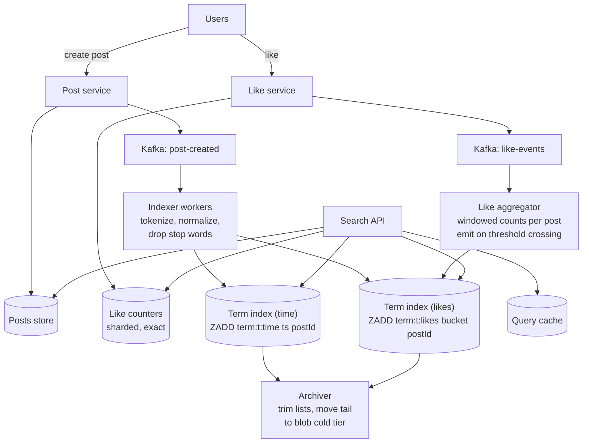
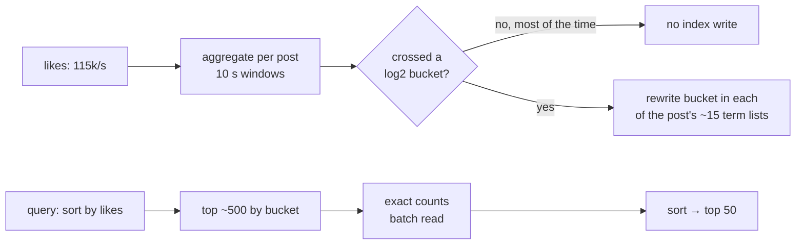

# 51 — Design Facebook Post Search (build the index yourself)

> **Prerequisites:** [07 — Search](07-search.md) (inverted index, postings, two-stage ranking, tiers §5.8), [DD-02 — Kafka](../Deep%20Dives/02-kafka.md), [DD-01 — Redis](../Deep%20Dives/01-redis.md), [Pattern 17 — Scaling Writes](../Deep%20Dives/17-pattern-scaling-writes.md) (hot keys, coalescing). Related: [21 — Build From Scratch](21-build-from-scratch.md).
>
> **The prompt:** *"Design search over Facebook posts: users search by keyword and get matching posts, sorted by recency or by likes. You may not use Elasticsearch or another search engine — build it."* A Hello Interview problem. The "no search engine" rule is the point: you must **build an inverted index**, handle a **firehose of new posts**, and deal with a **far larger firehose of like updates** that would change the sort order every millisecond.
>
> **Attempt first:** 35 minutes out loud before reading past this line.

## What you'll master

- Building an **inverted index** from primitives: term → posting list, sharded by term, fed by a stream.
- Supporting **two sort orders** (recency and likes) with **two index shapes**, and why likes are the hard one.
- **Taming like-count churn**: coalescing and threshold-based index updates, then exact re-ranking of a small candidate set.
- **Hot and huge terms**: stop words, capped hot posting lists, and a cold tier in blob storage.
- Multi-term queries (intersection), caching, and the privacy follow-up (who is allowed to see a post).

## In the Room — the decisive move

> *"Without a search engine, I'll build the core of one. Posts arrive on a Kafka topic; **indexing workers** tokenize them and append the post ID to each term's **posting list**, held in a sharded in-memory store keyed by term (Redis sorted sets as the concrete choice). For 'sort by recency' the score is the creation time, so appends are cheap and the newest are at the top. 'Sort by likes' is harder: likes arrive at maybe 20× the post rate, and updating every term's list on every like is impossible. So I **coalesce like events** in a stream job and only update the likes index when a post's count crosses a **log-scale threshold** (10, 100, 1,000…). Then I re-rank the top few hundred candidates with **exact counts** from the counter service. Posting lists are capped in memory, with the long tail in a cold tier in blob storage, because nearly all queries want recent or popular posts."*

### Decisions to make decisively

| Decision | Choice | Because |
|---|---|---|
| Index structure | **Inverted index: term → posting list of post IDs**, two lists per term (by time, by likes) | The only structure that answers keyword queries without scanning posts |
| Index store | **Sharded in-memory sorted sets keyed by term** (Redis cluster), cold tail in blob storage | Fast appends and top-K reads; memory for the hot head only |
| Sharding | **By term** (each term's list on one shard) | A single-term query hits one shard; multi-term queries touch a few, not all |
| Ingestion | **Kafka → tokenizer/indexer workers**, async | Posts appear in search within seconds; posting is never blocked by indexing |
| Likes ordering | **Coalesce + update only on log-threshold crossings; exact re-rank of the top candidates** | Cuts index writes from every like to a handful per post lifetime |
| Hot terms | **Drop stop words; cap hot lists (e.g. last 10k by time, top 10k by likes); archive the rest** | Unbounded lists for "the" or a trending hashtag would dominate memory and shards |
| Phrase/multi-word | **Intersect posting lists (shortest first); bigram terms for common phrases** | Bounded work per query |

**Experience hook.** *"This is a search engine with the hard parts exposed: postings, sharding by term, and a ranking signal that changes faster than you can reindex. The like-count trick is the same coalescing we use for any hot counter."*

---

## 1. Requirements

**Functional.**
- Create posts (text); like posts.
- **Search** posts by one or more keywords; sort by **recency** or by **like count**; paginate.
- New posts searchable within **~1 minute**; like-count ordering may lag by minutes.

**Non-functional.**
- ~1B users; search **p99 < 500 ms**.
- Highly **write-heavy** on the index side (posts *and* likes); reads ~tens of thousands QPS.
- Availability over consistency: a post appearing 30 s late in search is fine.

**Non-goals to name:** personalization and ML ranking, fuzzy/typo correction ([07 §4.3, §4.7](07-search.md)), and full privacy filtering (a follow-up; at real Facebook scale this is Unicorn, a social-graph-aware index).

> **Staff-level insight:** call out the asymmetry immediately: *"The post firehose is manageable; the like firehose is the design problem, because it changes the sort key. I'll index time cheaply and treat likes as a slowly updated hint plus exact re-ranking."*

## 2. Back-of-envelope

| Quantity | Math | Result |
|---|---|---|
| New posts | ~500M/day ÷ 86,400 | **~6k posts/s**, ~20k/s peak |
| Index writes (time order) | 6k posts/s × ~15 distinct terms | **~90k list appends/s** |
| Likes | ~10B/day ÷ 86,400 | **~115k likes/s**, ~500k/s peak |
| Naive likes-index writes | 115k likes/s × 15 terms per post | **~1.7M sorted-set updates/s**, unaffordable for a signal that's allowed to lag |
| Thresholded likes-index writes | ~6–8 threshold crossings per *popular* post lifetime, most posts never pass 10 | **~tens of thousands/s** |
| Hot index memory | e.g. 1M active terms × 2 lists × ≤10k entries × ~16 B | **~hundreds of GB** across a Redis cluster; long tail archived |
| Searches | ~1B/day | **~12k QPS** avg, ~50k peak |

Conclusions: index *appends* are fine at ~90k/s on a sharded cluster. The like stream must be **reduced by ~two orders of magnitude** before it touches the index, and memory must be **capped per term**.

## 3. High-level design

- **Indexer:** consumes posts, tokenizes (lowercase, strip punctuation, stem), drops stop words, emits bigrams for common phrases, and appends the post ID to each term's lists. Term → shard by consistent hashing.
- **Like aggregator:** a stream job keyed by post ID keeps a running count and emits an update to the likes index **only** when the count crosses a log-scale threshold. The exact count lives in the counter service.
- **Search API:** look up the term list(s), take the top candidates, intersect for multi-term queries, re-rank by exact likes if needed, hydrate post content, return a cursor.

## 4. Deep dive A — building the index and querying it (the crux)

**Posting lists:**
- `term:{t}:time` sorted set, score = creation timestamp. New posts are appended at the top, and "newest first" is `ZREVRANGE … 0 49`.
- `term:{t}:likes` sorted set, score = like **bucket** (plus a time tiebreaker), updated rarely (§5).
- Store only post IDs (8 B) and the score: the list is an index, not the data.

**Single-term query:** one shard, one `ZREVRANGE` (or `ZREVRANGEBYSCORE` with a cursor for the next page). Hydrate the 50 post IDs from the posts store (batched multi-get, cached).

**Multi-term query ("taylor swift tour"):**
1. Look up each term's list size; start from the **shortest** (rarest) term.
2. Fetch the top ~N (e.g. 1,000–5,000) candidates from that list in the requested order.
3. Check membership of each candidate in the other terms' lists (`ZSCORE` pipelines, or fetch and intersect in memory). This is AND = intersect-shortest-first, the [search engine's rule](07-search.md).
4. If too few results survive, extend deeper into the shortest list, up to a bound.
- **Bigrams** for frequent phrases (`taylor_swift`) turn common two-word queries into a single-list lookup.

**Pagination:** a cursor carrying `(score, post_id)` of the last item, so the next page is a range query from there, stable even as new posts arrive.

> **Staff-level insight:** *"This is retrieve-then-rank in miniature: the posting list of the rarest term gives a bounded candidate set, the other terms filter it, and the expensive signal, exact like counts, is applied to a few hundred candidates instead of being kept perfectly sorted for every term."*

## 5. Deep dive B — likes: the sort key that won't sit still

Keeping `term:t:likes` exactly sorted would mean ~1.7M index writes/s. The fix has three parts:

1. **Coalesce:** the aggregator (keyed by post ID, [Flink](../Deep%20Dives/07-flink.md)-style or Kafka Streams) sums likes per post in ~10 s windows. A viral post getting 5,000 likes/s produces one count update per window, not 5,000.
2. **Threshold-based index updates:** the likes index stores a **bucket**, `floor(log2(likes))` or powers of 10 for coarser buckets. A post's entries in its terms' lists are rewritten only when it moves to a new bucket. A post with 1M likes crosses ~20 power-of-2 thresholds in its lifetime, so ~20 × 15 = 300 index writes in total instead of 15M.
3. **Exact re-rank at query time:** fetch the top ~500 candidates from the bucketed list (they're correct to within a factor of 2), read their **exact** counts from the counter service in one batch, sort, return the top 50.

**Write-hot counters:** the counter service itself shards hot post counters (`post:123#0..k`) and sums on read ([Pattern 17](../Deep%20Dives/17-pattern-scaling-writes.md)).

## 6. Deep dive C — hot terms, memory, and the cold tier

- **Stop words** ("the", "a", "and") are never indexed: they match everything and carry no signal.
- **Huge terms** (a trending hashtag, "happy birthday") still produce enormous lists. **Cap** each hot list in memory: e.g. the newest 10k entries in the time list and the top 10k in the likes list. That covers nearly every real query, since users read a few pages.
- **Cold tier:** the archiver moves older entries to blob storage as immutable, time-partitioned segments per term (`term/t/2026-11/segment-0042`). Deep-pagination or date-range queries ("posts about X from 2024") read the cold segments, a slower path that's acceptable for a rare request.
- **Hot-term shards:** a term's list lives on one shard, so a viral term concentrates writes. Split the hot term's time list by time bucket (`term:t:time:{hour}`) across shards; queries read the newest buckets first.
- **Query cache:** popular queries (trending topics) cached for ~10–30 s keyed by normalized query + sort + page; the first page is the hot one.

## 7. Failure drills — volunteer these

| Failure | Blast radius | Design answer |
|---|---|---|
| Index shard (Redis) lost | Terms on it return nothing | Replicas with failover; the index is derived, so rebuild from Kafka (retention) + posts store |
| Indexer lag | New posts not yet searchable | Autoscale on consumer lag; freshness SLO alert; search still works on older data |
| Viral term melts its shard | Slow queries for that term | Time-bucket the hot term across shards; cache its first page |
| Like-aggregator restart | Bucket updates delayed | Checkpointed state; the exact re-rank hides bucket lag |
| Post deleted or edited | Stale or forbidden results | Delete events remove IDs from term lists; hydration drops missing/forbidden posts as a safety net |
| Reindex needed (new tokenizer) | Old and new tokens disagree | Build a new index generation from the log; switch reads atomically (alias-swap equivalent) |

## 8. The Staff & EM layer

- **"Build it" is a scoping conversation.** In practice you'd use Elasticsearch or an in-house engine (Facebook built Unicorn). Say the build-vs-buy line out loud, then build it because the interviewer asked; that shows judgment and depth.
- **Privacy is the real hard part at Facebook scale.** Most posts aren't public, so the index must know who may see each post. Options: post-filtering candidates by an ACL check (simple, wasteful for restrictive queries), or indexing visibility as terms and intersecting with the viewer's social graph (Unicorn's approach). Name it as the biggest follow-up.
- **Cost:** memory for hot lists dominates; caps and the cold tier are the cost levers.

### Altitude — the same probes at three levels

| Probe | Senior says | Staff says | EM adds |
|---|---|---|---|
| "No Elasticsearch — how?" | `LIKE '%term%'` on posts | Inverted index: term → sorted posting lists, sharded by term, fed by Kafka | Build-vs-buy stated, then built |
| "Sort by likes?" | Update the index on every like | Coalesce + log-bucket thresholds + exact re-rank of top candidates | Freshness SLO for like ordering |
| "'the' or a trending hashtag?" | Index it anyway | Stop words; cap hot lists; time-bucket hot terms; cold tier in blob storage | Memory budget per term class |
| "Private posts?" | Ignore | ACL post-filter vs visibility-aware index (Unicorn-style) | Privacy review as a launch gate |

## 9. Follow-ups they'll ask

1. **"Privacy-aware search."** Post-filter with batched ACL checks for broad audiences; for friends-only posts, index by author and intersect with the viewer's friend list (bounded: hundreds to thousands).
2. **"Fuzzy and typo tolerance."** A spell-correction service in front ([07 §4.7](07-search.md)); n-gram terms for prefix matching.
3. **"Hashtags and mentions."** Index as distinct term types (`#tour`, `@user`) with their own lists.
4. **"Relevance ranking."** Add a stage-2 re-ranker over the candidates (text match quality, author affinity, engagement), the [two-stage pipeline](07-search.md).
5. **"Search over billions of old posts."** The cold tier becomes a real tiered index ([07 §5.8](07-search.md)): hot recent tier in memory, older tiers on SSD/blob, queried only when needed.

## Interview Cheat-Sheet

**One-liner:** *"Kafka-fed indexer workers build an inverted index: per term, a time-sorted list and a likes-bucket list in a term-sharded Redis cluster. Likes are coalesced per post and only update the index on log-scale threshold crossings; queries take the top few hundred candidates from the rarest term's list, intersect with the others, re-rank by exact like counts, and paginate with a (score, id) cursor. Stop words are dropped, hot lists are capped, and the tail lives in a cold tier in blob storage."*

**Numbers:** ~6k posts/s × ~15 terms ≈ 90k appends/s · ~115k likes/s → naive 1.7M index writes/s → thresholded ~tens of thousands/s · ~12k search QPS · hot lists capped ~10k entries per order.

**The close:** *"The post stream is easy; the like stream is the design. I keep the time index exact and cheap, keep the likes index approximate on purpose, and fix the approximation with an exact re-rank on a few hundred candidates. Everything else is bounding memory: stop words, caps and a cold tier."*
