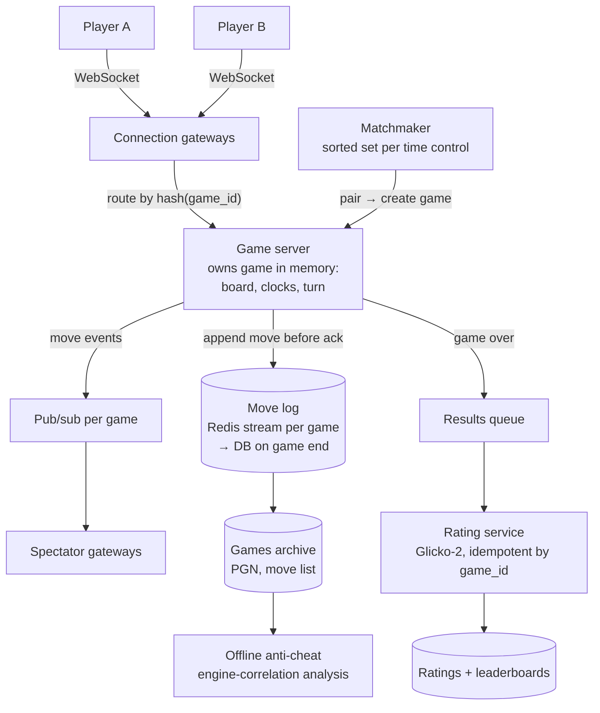

# 52 — Design Online Chess (Chess.com / Lichess)

> **Prerequisites:** [09 — Real-Time Systems](09-realtime-systems.md) (WebSockets, presence), [41 — Multiplayer Game Backend](41-design-multiplayer-game.md) (server authority, the contrast case), [DD-28 — Distributed Leaderboard](../Deep%20Dives/28-distributed-leaderboard.md) (ratings), [DD-14 — Contention](../Deep%20Dives/14-pattern-contention.md) (matchmaking claims). Related: [45 — Live Comments](45-design-live-comments.md) (spectator fan-out).
>
> **The prompt:** *"Design online chess: players get matched with an opponent of similar rating, play a timed game in real time, and their rating updates afterwards. Spectators can watch live games."* A Hello Interview problem. Unlike an action game it has **no tick loop**: moves are rare discrete events. The crux is **matchmaking by rating**, **server-authoritative moves with fair clocks**, and **game-state durability** when a server dies mid-game.
>
> **Attempt first:** 35 minutes out loud before reading past this line.

## What you'll master

- **Matchmaking** as pools per time control, sorted by rating, with a search window that widens over wait time, and an atomic pair claim.
- Why a game is **pinned to one server** (routing by game ID) and how its state survives that server dying.
- **Fair clocks**: the server keeps time, measures each move's elapsed time, and compensates for network lag within a bound.
- **Rating updates** (Elo/Glicko-2) as an idempotent post-game transaction.
- **Spectating** and **anti-cheat** as separate, slower paths that never touch the move path.

## In the Room — the decisive move

> *"Chess is a turn-based game with very low message rates, a move every few seconds per game, so the challenge isn't throughput, it's **correctness and fairness**. Players hold WebSockets to a game server; each game is **owned by one server process**, routed by game ID, which validates every move against the rules (server-authoritative) and **keeps both clocks**. Every accepted move is **appended to a durable move log** before it's acknowledged, so if the server dies, another one rebuilds the position by replaying the moves and the game continues. Matchmaking keeps a **pool per time control sorted by rating** and pairs players within a window that widens the longer they wait. Ratings update in an **idempotent transaction** keyed by game ID when the game ends. Spectators get moves through pub/sub, and cheat detection runs offline."*

### Decisions to make decisively

| Decision | Choice | Because |
|---|---|---|
| Transport | **WebSocket per player** (moves both ways, clock sync, opponent presence) | Bidirectional and low-latency; message rate is tiny |
| Game ownership | **One game server process owns a game; route by `hash(game_id)`** | One place validates moves and runs the clocks; no distributed consensus per move |
| Authority | **Server validates every move** (legal, correct turn, game not over) | Clients can't be trusted; illegal moves rejected |
| Durability | **Append each move to a durable log (Redis stream / DB) before acknowledging** | A server crash loses no accepted move; the position is recomputable from the move list |
| Clocks | **Server-side clocks; deduct elapsed time between move receipts, with bounded lag compensation** | Clients can't lie about time; network latency shouldn't cost honest players |
| Matchmaking | **Sorted set per (time control, variant) by rating; widening window; atomic pair-claim** | O(log n) neighbour search; no double-matching |
| Ratings | **Glicko-2 (or Elo) update in one transaction, idempotent by game ID** | A retried "game over" event must not apply the rating change twice |

**Experience hook.** *"It's the opposite of a shooter's netcode: no prediction or interpolation, because a move is a discrete validated event. The real-time problem is just 'send a 20-byte move and update two clocks', and the engineering is in durability and fairness."*

---

## 1. Requirements

**Functional.**
- **Matchmaking:** pick a time control (bullet 1+0, blitz 3+2, rapid 10+0…); get paired with someone of similar rating, quickly.
- **Play:** make moves; see the opponent's moves immediately; clocks count down; increments added per move; resign, offer draw, abort, claim timeout.
- Game ends on checkmate, stalemate, resignation, timeout, draw agreement or rules (threefold repetition, 50-move rule).
- **Ratings** update after rated games; leaderboards per time control.
- **Spectate** live games; review finished games (move list, PGN export).
- Reconnect to an in-progress game after a network drop.

**Non-functional.**
- Move delivery **p99 < 200 ms** within a region.
- **Clock fairness:** network latency should not decide bullet games.
- **No lost games:** a server failure mid-game must not end or corrupt the game.
- Scale: ~10M games/day, ~500k concurrent games at peak.

**Non-goals to name:** the chess engine for analysis (an offline service), puzzles, and tournaments (a follow-up).

> **Staff-level insight:** say early that the message rate is trivial (*"500k games × one move every ~10 s is 50k moves/s globally"*) so the design effort goes to clocks, durability and matchmaking, not throughput.

## 2. Back-of-envelope

| Quantity | Math | Result |
|---|---|---|
| Games | ~10M/day | **~115 new games/s** avg, ~500/s peak |
| Concurrent games | peak | **~500k** → ~1M concurrent player connections + spectators |
| Moves | ~80 plies per game × 10M | **~800M moves/day ≈ 10k/s** avg, ~50k/s peak |
| Move size | from-square, to-square, promotion, timestamps | **~20–50 B** |
| Game storage | 80 moves × ~50 B + metadata | **~5 KB/game → ~50 GB/day**, ~18 TB/year |
| Game servers | ~50k concurrent games per server (memory-light, low message rate) | **~10–20 servers** for games; connection gateways sized by sockets |
| Matchmaking | ~500 match requests/s peak per region | Small sorted sets per time control |

Conclusions: compute and bandwidth are small. The design is about **correctness under failure**, **fair time**, and **fast, fair pairing**.

## 3. High-level design

- **Gateways** hold player sockets and forward game messages to the owning game server, found by consistent hashing on `game_id` (or a lookup in a game → server registry).
- **Game server** holds the authoritative state: position, side to move, both clocks, move history. It validates a move, updates clocks, **appends to the log**, then broadcasts to both players and to the spectator channel.
- **End of game:** result written to the DB with the full move list; a results event triggers the rating update.

## 4. Deep dive A — matchmaking by rating

- **Pools:** one Redis sorted set per `(time control, variant, rated?)`, member = player, score = rating, plus a hash with `joined_at`.
- **Matcher loop** (one matcher per pool shard, so pairing is serialized per pool): for each waiting player, look for opponents within `rating ± window(wait_time)`, where the window starts tight (e.g. ±50) and widens over time (±100 after 5 s, ±200 after 10 s…). Prefer the closest rating, then the longest wait.
- **Atomic pair-claim:** a Lua script removes both players from the pool **only if both are still present**, so a player who cancelled or was matched elsewhere can't be double-paired ([DD-14](../Deep%20Dives/14-pattern-contention.md) rung 1). The matcher then creates the game and notifies both.
- **Fairness extras:** color assignment balancing (track recent colors), avoid immediate rematches unless requested, region preference for latency in bullet.
- **Scale:** pools are small (thousands of waiting players per time control); one Redis shard per region handles it. Sharding by time control is natural.

## 5. Deep dive B — moves, clocks and fairness (the crux)

**Move handling on the owning server:**
1. Check it's this player's turn and the game is active.
2. Validate legality with a rules library (this server is the referee).
3. **Clock update** (below).
4. **Append** `(ply, move, clock_after, server_ts)` to the game's durable log; on success, acknowledge to the mover and push to the opponent and spectators.

**Clock rules — the server keeps time:**
- When the server **sends** the opponent's move to player A (or when A's turn starts), it records `turn_started_at`. When A's move **arrives**, elapsed = `received_at − turn_started_at`; deduct it from A's clock and add the increment.
- **Lag compensation:** that elapsed time includes A's network round trip, which unfairly penalizes players far from the server (fatal in bullet). The client measures its own think time (from rendering the opponent's move to sending its own) and sends it with the move. The server credits back `min(server_elapsed − client_think, lag_cap)` — the difference is network time — subject to a **per-game lag-compensation budget** so a cheating client can't claim unlimited "lag". Lichess-style designs use this approach.
- **Flagging (timeout):** the server sets a timer for the side to move; if it fires before a move arrives, the server ends the game on time (respecting the rule that a flag only wins if the opponent has mating material).
- **Clock display:** clients render a local countdown and resync from server clock values sent with every move, so displays don't drift.

**Premoves** (queued moves for bullet) are just a client-side feature; the server sees an immediately sent move after the opponent's.

> **Staff-level insight:** *"The server is the only clock. It measures time between sending a position and receiving the reply, then credits back measured network time within a capped budget, so a player 200 ms away isn't losing bullet games to physics, and a cheating client can't buy unlimited time. Flags are server timers, never client claims."*

## 6. Deep dive C — durability, failover, spectators, ratings

**Surviving a game-server crash:**
- Every accepted move is in the **move log** before it's acknowledged, so the log is the truth and the server's memory is a cache.
- The game → server mapping lives in a registry with **leases** (a game server holds a lease per game shard). If a server dies, its lease expires and another server takes the shard, **replays each game's move log** to rebuild position and clocks (recomputing clock values from the logged `clock_after` and the time the outage took), and resumes. Players' clients reconnect to the gateway, which routes them to the new owner.
- **Fairness during failover:** freeze both clocks from the last logged move until the new owner is serving the game, so an outage doesn't flag anyone.
- **Fencing:** the new owner's lease epoch is written with each move append, so a zombie old server can't append moves after losing ownership.

**Reconnect (the common case):** a player's socket drops; the server keeps the game and their clock running (they're still on move if it was their turn); on reconnect the client fetches the current position and clocks and resumes. Long disconnects let the opponent claim a win after a grace period.

**Spectators:** game servers publish moves to `game:{id}` channels; spectator gateways subscribe and fan out. Top-board broadcasts of major events can add a deliberate delay (minutes) to prevent outside assistance. Popular games are the [hot-channel case](45-design-live-comments.md): co-locate viewers by game ID.

**Ratings:** on game end, a results event (game ID, players, result, rated?) goes to a queue; the rating service computes **Glicko-2** updates (rating, deviation, volatility) and writes both players' new ratings plus a `rating_applied(game_id)` row **in one transaction**, so a redelivered event is a no-op. Leaderboards per time control are sorted sets updated from the same transaction's outbox.

## 7. Failure drills — volunteer these

| Failure | Blast radius | Design answer |
|---|---|---|
| Game server crashes | Its in-progress games pause | Lease expiry → new owner replays move logs; clocks frozen during takeover; fenced appends |
| Player network drop | Their clock keeps running | Reconnect resumes; abandonment grace period; lag compensation only for measured lag |
| Two matchers pair the same player | Double game | Atomic pair-claim Lua script; one matcher per pool shard |
| "Game over" event delivered twice | Double rating change | Idempotent rating transaction keyed by game ID |
| Clock disputes ("I had time!") | Trust | Server-authoritative clocks; per-move timestamps logged for review |
| Engine-assisted cheating | Fair-play trust | Offline analysis of move accuracy vs engine and timing patterns; reports; review queue; rating refunds for victims |
| Region outage | Games in that region | Games are short; resume from move logs in another region if replicated, otherwise abort unrated games with clear messaging |

## 8. The Staff & EM layer

- **Fair play is the product's trust.** Anti-cheat (statistical engine-correlation, behavioral signals, human review) is a dedicated team with appeals and rating restoration; it shapes what data the game server must log (per-move timestamps, client events).
- **Latency is a fairness issue, not a speed issue.** Regional game servers, matchmaking by region for bullet, and lag compensation policies are product decisions with measurable outcomes (flag rates by ping bucket).
- **Cost is low.** Small fleets of game servers and gateways; storage of move lists is cheap. The expensive parts are anti-cheat analysis (engine compute) and people.

### Altitude — the same probes at three levels

| Probe | Senior says | Staff says | EM adds |
|---|---|---|---|
| "Who validates moves?" | The client | Server-authoritative, one owner per game, move appended before ack | Rules library ownership, test suites |
| "Clocks?" | Client sends remaining time | Server measures elapsed between send and receipt; bounded lag compensation; server-side flag timers | Fairness metric: flag rate by ping |
| "Server dies mid-game?" | Game lost | Move log + leased ownership + replay; clocks frozen during failover; fenced appends | Incident policy for aborted games |
| "Matchmaking?" | First come, first served | Sorted set per time control, widening rating window, atomic pair-claim | Pairing-quality metrics vs wait time |

## 9. Follow-ups they'll ask

1. **"Tournaments (arenas, Swiss)."** A tournament service runs pairing rounds (Swiss pairing rules, or arena "pair whoever's free"), creates games through the same path, and keeps standings as a sorted set.
2. **"Correspondence chess (days per move)."** No sockets needed; moves via API, push notifications, durable timers per game ([35](35-design-scheduler.md)).
3. **"Post-game analysis."** Queue the finished game to an engine-analysis worker pool (CPU-heavy, cacheable by position hash); results attached to the game.
4. **"Global players, bullet fairness."** Place the game server in the region between the two players, or the region of the higher-latency player; matchmaking prefers same-region opponents for bullet.
5. **"Bots and engines as opponents."** Bot players connect through the same API with a bot flag; computer-opponent games are unrated or rated separately.

## Interview Cheat-Sheet

**One-liner:** *"Turn-based, tiny message rate: players hold WebSockets, each game is owned by one server (routed by game ID) that validates moves, keeps both clocks, and appends every move to a durable log before acknowledging, so a crashed server's games are rebuilt by replay under a fenced lease with clocks frozen. Matchmaking is a sorted set per time control with a widening rating window and an atomic pair-claim; ratings update idempotently by game ID; spectators get moves via pub/sub; anti-cheat runs offline."*

**Numbers:** ~10M games/day · ~500k concurrent games · ~10k moves/s avg, ~50k peak · ~5 KB per game · move p99 < 200 ms.

**The close:** *"Throughput is trivial, so I spend the design on fairness and failure: a server-authoritative clock with bounded lag compensation, a move log that makes every game survive its server, and matchmaking that trades a few seconds of waiting for a fair rating gap."*
