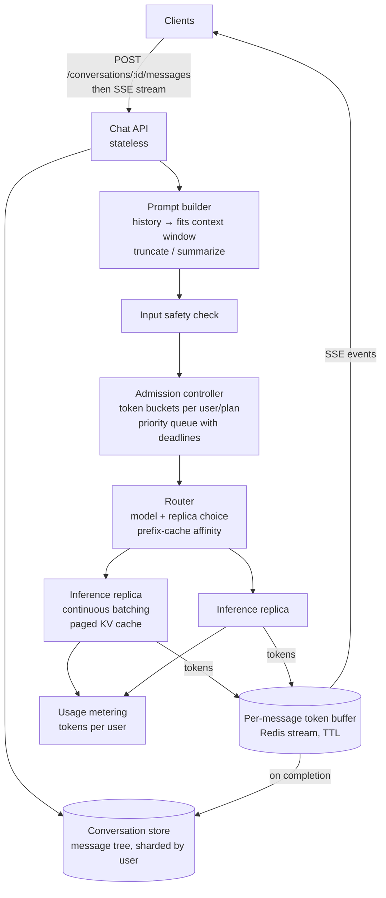

# 53 — Design a ChatGPT-style LLM Chat App

> **Prerequisites:** [17 — AI Systems](17-ai-systems.md) (RAG, tools, LLM caching and cost), [17b — ML Serving Infrastructure](17b-ml-serving-infrastructure.md) (batching, GPU fleets, canaries), [DD-13 — Realtime Updates](../Deep%20Dives/13-realtime-updates.md) (SSE), [DD-22 — Rate Limiting](../Deep%20Dives/22-rate-limiting.md). Related: [18a §1 — WhatsApp](18a-design-chat-social.md) (conversation storage, the contrast case).
>
> **The prompt:** *"Design ChatGPT: users have conversations with an AI model, responses stream back token by token, conversations are saved, and the service must handle millions of users on a limited GPU fleet."* A Hello Interview problem. Everything except inference is a normal chat app; the crux is **GPU capacity as the scarce resource**, **streaming responses reliably**, and **fair admission** when demand exceeds the fleet.
>
> **Attempt first:** 35 minutes out loud before reading past this line.

## What you'll master

- Why the system is **bounded by GPU tokens per second**, and how to do the capacity math in tokens, not requests.
- **Streaming** with SSE, and making a stream **resumable** after a dropped connection.
- The **inference tier**: continuous batching, the KV cache, prefix (prompt) caching, and routing requests to model replicas.
- **Admission control and fairness**: token-based rate limits, priority by plan, and graceful degradation (queue, smaller model, shed free tier).
- **Conversation storage** as a tree of messages (regenerate and edit create branches), and **context-window management**.

## In the Room — the decisive move

> *"The web tier is an ordinary chat app; the system is shaped by the **GPU fleet**, which is expensive, fixed in the short term, and measured in **tokens per second**. A user message goes to a stateless chat API that loads the conversation, builds the prompt within the model's context window, and sends it through an **admission controller**: per-user token budgets, priority by plan, and a queue with a deadline. A **router** sends it to a model replica, where an inference server like vLLM runs **continuous batching** with a paged KV cache, and **prefix caching** reuses the computation for shared system prompts and earlier turns. Tokens stream back over **SSE**. I also write them to a short-lived per-message buffer, so a client that drops can resume the stream, and the finished message is saved to the conversation store. When demand exceeds capacity I degrade in order: queue briefly, route free users to a smaller model, then shed free-tier traffic, never paid traffic first."*

### Decisions to make decisively

| Decision | Choice | Because |
|---|---|---|
| Unit of capacity | **Tokens per second per GPU** (prefill and decode separately) | Requests vary 100× in cost; QPS is meaningless here |
| Streaming | **SSE** from the chat API, tokens as events | One-way server push, HTTP-friendly, reconnect with `Last-Event-ID` |
| Resumability | **Per-message token buffer** (Redis stream, TTL ~minutes) written as tokens are generated | A dropped connection resumes instead of regenerating (which costs GPU) |
| Inference serving | **Inference server with continuous batching + paged KV cache** (vLLM / TensorRT-LLM / TGI class) | Batching is the throughput multiplier; static batching wastes GPU on padding |
| Prefix caching | **Reuse KV cache for shared prefixes** (system prompt, earlier turns); route a conversation to the replica that has its prefix | Long conversations re-send the whole history every turn |
| Admission | **Token-bucket limits per user and per plan + priority queue with deadlines** | Fairness and protecting paid users when demand exceeds supply |
| Degradation ladder | **Queue → smaller/faster model for free tier → shed free tier → shorten max output** | Keeps the service up and paid users whole |
| Conversation model | **Message tree** (`parent_id`), current leaf per conversation | Regenerate and edit create branches without losing history |

**Experience hook.** *"It's the same economics as the price tracker or an ad exchange: a scarce resource, priced per unit, so the core service is an allocator. Everything about fairness and degradation follows from treating GPU tokens as the budget."*

---

## 1. Requirements

**Functional.**
- Start a conversation; send a message; get a **streamed** response; stop generation.
- Conversation history (list, rename, delete, search); **regenerate** a response and **edit** a previous message (branching).
- Attachments (files, images) and tools (web search, code execution) — follow-ups.
- Plans: free and paid tiers with different limits and models.

**Non-functional.**
- **Time to first token (TTFT) p95 < ~1 s** under normal load; steady token streaming (e.g. ≥ 20 tokens/s per stream).
- ~100M weekly users; **peaks follow time zones** (work hours).
- Never lose a completed response; tolerate a dropped connection mid-stream.
- **Cost efficiency**: GPU utilization is the main cost lever.

**Non-goals to name:** model training, the safety models' internals (they're a service we call), and the RAG/tools details ([17](17-ai-systems.md)).

> **Staff-level insight:** convert requirements to **tokens** at once: *"TTFT is governed by prefill (input tokens) and queueing; streaming speed by decode (output tokens per second per request); fleet size by total output tokens per second at peak. I'll size everything in those units."*

## 2. Back-of-envelope

All inference figures are assumptions to state out loud; real numbers depend heavily on the model and hardware.

| Quantity | Math | Result |
|---|---|---|
| Messages | ~30M DAU × ~15 messages/day ÷ 86,400 | **~5k messages/s** avg, ~15k/s peak |
| Output tokens | ~500 per response | **~2.5M output tokens/s** avg, ~7.5M/s peak |
| Input tokens (prefill) | ~2,000 per request (system prompt + history) | **~10M input tokens/s** avg; prefix caching removes much of it |
| GPU throughput (assumption) | a large model with continuous batching: ~1–3k output tokens/s per GPU | **~3–7k GPUs** at peak for decode alone, before redundancy |
| Concurrent streams | 15k/s × ~20 s per response | **~300k concurrent SSE streams** |
| Conversation storage | ~450M messages/day × ~2 KB | **~1 TB/day** of text |

Conclusions: the **GPU fleet is the cost and the constraint** (thousands of GPUs), while the web tier, storage and streaming are routine. Every percent of GPU utilization or cache hit rate is real money.

## 3. High-level design

- **Chat API** authenticates, appends the user message to the conversation tree, builds the prompt, and opens the SSE response.
- **Admission controller** decides now / queue / degrade / reject based on the user's token budget, plan priority and current fleet load.
- **Router** picks the model (by plan and request) and the replica: least-loaded among those likely to hold the conversation's prefix in KV cache.
- **Inference replicas** stream tokens into the per-message buffer; the API relays them to the client; completion writes the assistant message to the store and records usage.

## 4. Deep dive A — the inference tier (the crux)

- **Two phases per request:** **prefill** processes all input tokens in parallel (compute-bound; sets TTFT) and **decode** generates output tokens one at a time (memory-bandwidth-bound; sets tokens/s). Long prompts make TTFT worse; long outputs hold a batch slot longer.
- **Continuous batching:** instead of waiting for a fixed batch to finish, the server **adds new requests and removes finished ones at every decode step**, so GPUs stay full despite wildly different output lengths. This is the single biggest throughput lever versus naive batching.
- **KV cache:** each in-flight request keeps attention keys and values for every token so far, and GPU memory for it limits concurrency per replica. **Paged** KV cache (vLLM's PagedAttention) allocates it in blocks, cutting fragmentation and fitting more concurrent requests.
- **Prefix caching:** the system prompt and earlier conversation turns are identical between consecutive requests of the same conversation. Keeping their KV blocks cached on a replica, and **routing the conversation back to that replica** (affinity by conversation ID, with fallback), skips most prefill. It cuts TTFT and GPU cost substantially for long chats.
- **Disaggregation (scale option):** separate prefill and decode onto different GPU pools so long prompts don't stall token streaming for everyone.
- **Fleet operations:** models are deployed as replica groups; new model versions roll out by **canary on quality and latency metrics** ([17b](17b-ml-serving-infrastructure.md)); autoscaling is slow (minutes to load weights), so capacity is planned for peaks and reshuffled between models by time of day.

> **Staff-level insight:** *"Throughput comes from continuous batching and KV-cache efficiency, and cost from prefix caching. So the router isn't round-robin: it sends a conversation back to the replica holding its prefix. And I size the fleet in output tokens per second at peak, because that's what decode actually consumes."*

## 5. Deep dive B — streaming, resumability and stop

- **SSE stream per response:** events carry `{message_id, seq, token_text}`; the final event carries usage and finish reason.
- **Resumable:** the inference replica writes tokens to a **per-message buffer** (Redis stream keyed by message ID, TTL ~10 minutes). The API relays from the buffer, not from the replica directly. If the client's connection drops, it reconnects with `Last-Event-ID: seq` and the API replays from the buffer, then continues live. Regenerating instead would cost the GPU time again and give a different answer.
- **Decoupled from the client:** generation continues even if the client disconnects (the result is saved to the conversation), unless the user pressed **stop**.
- **Stop generation:** the client calls `POST /messages/:id/stop`; the API sets a cancel flag that the inference server checks every decode step and **evicts the request from the batch**, freeing its KV cache immediately. Stopping is worth implementing because abandoned long generations waste GPU.
- **Connection scale:** ~300k concurrent SSE streams across stateless API nodes; long-lived HTTP connections need tuned load-balancer idle timeouts and heartbeats ([DD-13](../Deep%20Dives/13-realtime-updates.md)).

## 6. Deep dive C — admission, fairness, conversations

**Admission control:**
- **Token-based limits**, not request-based: each user has a token bucket per window (e.g. tokens/3 h by plan), debited by estimated tokens at admission and corrected with actual usage at completion.
- **Priority queue with deadlines:** paid requests ahead of free; each queued request has a deadline (e.g. a few seconds for interactive use); past it, return a clear "at capacity" response rather than a 60-second hang.
- **Degradation ladder** when the fleet is saturated: (1) queue briefly; (2) route free tier to a smaller, cheaper model; (3) reduce max output tokens; (4) shed free-tier requests with a retry-after. Paid and API-contract traffic is protected. ([28 — load shedding](28-designing-for-failure.md))
- **Abuse:** bot traffic and scraping are a real cost; rate limits by account, IP and device fingerprint, plus anomaly detection on token usage.

**Conversation storage:**
- **Message tree:** `messages(conversation_id, message_id, parent_id, role, content, model, created_at)`. **Regenerate** adds a sibling assistant message under the same parent; **edit** adds a new user message as a sibling of the old one. The conversation stores `current_leaf_id`, and the visible thread is the path from root to leaf.
- **Shard by user ID** (all of a user's conversations together); the conversation list is a per-user index sorted by last activity.
- **Context-window management:** the prompt builder walks the path from leaf to root and includes turns until the token budget is reached; older turns are **summarized** (a cheap model writes a running summary stored with the conversation) or retrieved by relevance (RAG over the conversation) for very long chats.
- **Privacy:** conversations are sensitive personal data, so encryption at rest, deletion that actually propagates (including caches and buffers), and user controls over training use ([13b](13b-data-compliance-privacy.md)).

## 7. Failure drills — volunteer these

| Failure | Blast radius | Design answer |
|---|---|---|
| Inference replica crashes mid-generation | Those streams stop | Router retries the request on another replica (from the start, or from the generated prefix as context); client sees a brief pause via the buffer |
| Client connection drops | User loses the stream | Resume from the token buffer with `Last-Event-ID`; generation continued server-side |
| Demand spike (launch day, viral feature) | Queues and timeouts | Degradation ladder: queue with deadlines → smaller model for free tier → shed free tier; paid protected |
| New model version regresses quality | Bad answers at scale | Canary by quality/latency metrics, automatic rollback; per-model routing lets you pull one version |
| KV-cache memory exhaustion on a replica | Requests evicted or OOM | Admission considers replica memory headroom; cap max context and output per plan |
| Safety service down | Can't screen inputs/outputs | Fail closed for high-risk categories, degrade gracefully otherwise; alert |
| Conversation store partition slow | Can't load history | Cache recent conversations; the prompt builder can proceed with the client-supplied recent turns as a fallback |

## 8. The Staff & EM layer

- **Unit economics is the strategy.** Cost per million tokens, GPU utilization, prefix-cache hit rate and the free-to-paid ratio are leadership metrics. A 10% utilization gain is a budget line, so the platform team's roadmap is economic.
- **Capacity is planned, not autoscaled.** GPUs are bought or reserved months ahead; model launches need capacity plans; time-of-day shifting between models and regions is an operations discipline.
- **Quality is an SLO too.** Latency SLOs (TTFT, tokens/s) sit next to quality evaluations and safety metrics for each model version; releases are gated on all of them ([17](17-ai-systems.md) evals).

### Altitude — the same probes at three levels

| Probe | Senior says | Staff says | EM adds |
|---|---|---|---|
| "How many GPUs?" | Requests/s ÷ requests per GPU | Output tokens/s at peak ÷ tokens/s per GPU with continuous batching; prefill separately; prefix-cache savings | Reserved capacity plan and cost per M tokens |
| "Streaming?" | WebSocket | SSE + per-message token buffer for resume; stop evicts from the batch | Abandoned-generation waste as a metric |
| "Too much demand?" | Autoscale | Token-bucket admission, priority with deadlines, degradation ladder | Which tier gets degraded, as written policy |
| "Long conversations?" | Send the whole history | Context budget: recent turns + running summary/RAG; prefix caching with replica affinity | Privacy and deletion guarantees |

## 9. Follow-ups they'll ask

1. **"File uploads and RAG."** Presigned upload → parse/chunk/embed pipeline → per-user vector index → retrieved chunks added to the prompt ([17](17-ai-systems.md), [DD-11](../Deep%20Dives/11-vector-databases.md)).
2. **"Tools (web search, code execution)."** The model emits a tool call; the orchestrator runs it (code in a sandbox, see [46](46-design-online-judge.md)), appends the result, and continues generation: a loop with step limits and timeouts.
3. **"Shared conversation links."** Snapshot the path to a read-only, unguessable URL; it's a copy, so later edits don't leak.
4. **"Multi-region."** Inference in several regions; route by latency and available capacity; conversation data stays in its home region for residency.
5. **"API product for developers."** Same inference tier, separate admission pools and contractual rate limits, usage metering for billing.

## Interview Cheat-Sheet

**One-liner:** *"A normal chat app in front of a scarce GPU fleet sized in output tokens per second. Prompts are built within the context window (recent turns + summary), admitted by token-bucket limits and priority queues with deadlines, routed to replicas with prefix-cache affinity, and served with continuous batching and a paged KV cache. Tokens stream over SSE from a per-message buffer so streams resume after a drop and stop frees the batch slot. Conversations are a message tree for regenerate and edit, and overload degrades free tier first."*

**Numbers (state as assumptions):** ~5k messages/s avg · ~500 output and ~2,000 input tokens per request · ~2.5M output tokens/s avg · ~1–3k output tokens/s per GPU → thousands of GPUs · ~300k concurrent streams · TTFT p95 < ~1 s.

**The close:** *"Everything except inference is standard. The design is an allocator for GPU tokens: size in tokens, maximize batching and prefix-cache reuse, admit fairly with a degradation ladder that protects paid users, and make streams resumable so a dropped connection never costs a second generation."*
