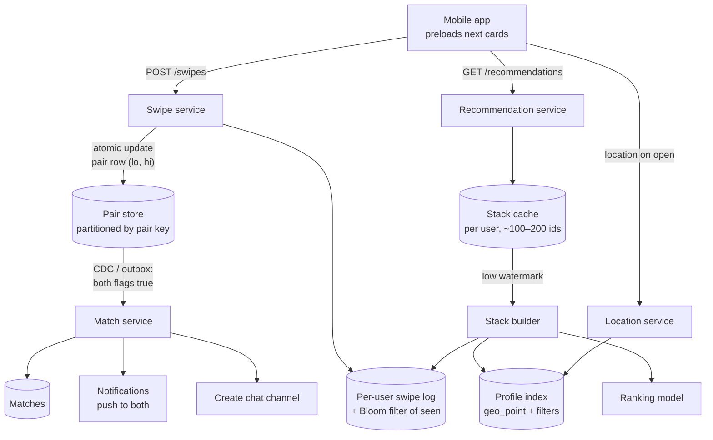

# 54 — Design Tinder (Location-Based Matching)

> **Prerequisites:** [29 — Geospatial Systems](29-geospatial-systems.md) (geohash/S2, proximity), [DD-14 — Contention](../Deep%20Dives/14-pattern-contention.md) (the mutual-swipe race), [DD-12 — Big-Data Structures](../Deep%20Dives/12-big-data-structures.md) (Bloom filters for seen-filtering), [DD-06 — Elasticsearch](../Deep%20Dives/06-elasticsearch.md), [18d §4 — Notifications](18d-design-infra-primitives.md). Related: [18a §1 — WhatsApp](18a-design-chat-social.md) (chat after a match), [47 — Yelp](47-design-yelp.md) (geo + filter queries).
>
> **The prompt:** *"Design Tinder: users create profiles with preferences, see a stack of nearby people who match their preferences, swipe right or left, and get notified of a match when two people swipe right on each other."* A Hello Interview problem. The crux is a **huge swipe write volume**, **detecting a match exactly once** when both people swipe at the same moment, and **serving a fresh, never-repeating recommendation stack** quickly.
>
> **Attempt first:** 35 minutes out loud before reading past this line.

## What you'll master

- **Swipe storage** at tens of thousands of writes per second, partitioned so the match check is a single-key lookup.
- **The mutual-swipe race**: why "write my swipe, then check theirs" misses matches, and the **one-row-per-pair** fix that makes match creation atomic.
- **Precomputed recommendation stacks**: geo + preference filtering, ranking, and refilling asynchronously.
- **Never show someone twice**: seen-filtering with per-user Bloom filters backed by the swipe store.
- **Location privacy**: why exact distances leak location, and how to coarsen them.

## In the Room — the decisive move

> *"Two hot paths. **Swipes** are a firehose, tens of thousands per second, and every right swipe needs a match check. The naive version (write my swipe, then look up whether they swiped right on me) has a race: if both people swipe at the same instant, each check runs before the other's write is visible and the match is missed. So I store swipes **per unordered pair**: one row keyed by `(min(a,b), max(a,b))` with two direction flags, updated atomically. The update that sets the second flag is the one that **creates the match**, exactly once. **Recommendations** are the other path: computing 'nearby people who fit my preferences and haven't been seen' on every swipe is too expensive, so I **precompute a stack** of ~100–200 candidates per user from a geo + filter query, rank it, cache it, and refill in the background when it runs low. A per-user **Bloom filter** of seen profiles keeps repeats out cheaply."*

### Decisions to make decisively

| Decision | Choice | Because |
|---|---|---|
| Swipe record | **One row per unordered pair `(lo, hi)`** with `lo_likes_hi`, `hi_likes_lo` flags | Both swipes touch the same row, so the match decision is a single atomic update |
| Swipe store | **Partitioned KV / wide-column** (DynamoDB / Cassandra-style) keyed by the pair, plus a per-user swipe log for history | High write rate; single-key access; conditional updates |
| Match creation | **The conditional update that makes both flags true emits the match** (via an outbox/CDC event) | Exactly one match, even when both swipes arrive together |
| Recommendations | **Precomputed stack per user** (~100–200 candidates) in a cache, refilled asynchronously | Real-time geo + ranking per swipe is too costly; users swipe fast |
| Candidate query | **Geo filter (S2/geohash or ES `geo_point`) + preference filters (age, gender, distance) + ranking** | Same shape as [Yelp](47-design-yelp.md): a geo filter plus structured filters |
| Seen filter | **Per-user Bloom filter of swiped profile IDs**, backed by the pair store for exact checks | Cheap "definitely not seen"; a false positive only hides one candidate |
| Location shown | **Coarsened distance** ("3 km away", rounded and fuzzed), never exact | Exact distances allow trilateration of someone's location |

**Experience hook.** *"The pair-row trick is the general fix for 'two parties must both agree' races. Make the agreement a single row that both writes touch, so the database's row atomicity decides who completed it."*

---

## 1. Requirements

**Functional.**
- Profiles: photos, bio, age, gender; **preferences** (age range, genders, max distance); location updated from the device.
- **Recommendation stack**: nearby people matching mutual preferences, not previously swiped, ranked.
- **Swipe** right (like) or left (pass); optional super-like.
- **Match** when both like each other; both notified immediately; chat unlocked.
- Unmatch, block, report.

**Non-functional.**
- Swipe acknowledgement p99 < 200 ms; the next card is instant (preloaded).
- **Exactly-once match** creation and notification; never miss a mutual like.
- ~50M DAU; billions of swipes/day; matches are rare relative to swipes.
- Location privacy and safety are first-class.

**Non-goals to name:** the chat system itself ([18a](18a-design-chat-social.md)), paid features' billing, and the ranking model internals.

> **Staff-level insight:** name the two paths and their consistency needs: *"Swipes and matches need exact correctness for a pair. Recommendations are a best-effort, eventually consistent cache. I'll design them separately."*

## 2. Back-of-envelope

| Quantity | Math | Result |
|---|---|---|
| Swipes | ~50M DAU × ~40 swipes/day ÷ 86,400 | **~2B swipes/day ≈ 23k/s** avg, ~100k/s peak (evenings) |
| Right-swipe share | assume ~30% | **~7k likes/s** needing match checks |
| Matches | small fraction of likes | **~tens of millions/day**; notifications in the hundreds per second |
| Pair rows | ~2B swipes/day, ~1 row per new pair | **~2B new rows/day × ~50 B ≈ 100 GB/day**; TTL or archive very old passes |
| Stack refills | ~40 swipes/day ÷ ~100 per stack | **~0.5 refills per user per day** → ~25M stack builds/day ≈ 300/s |
| Location updates | on app open / significant movement | **~a few thousand/s**: users move slowly |

Conclusions: the **swipe write path** needs a horizontally partitioned store with conditional updates; recommendations are **batch-like** (hundreds of stack builds per second), not per swipe.

## 3. High-level design



- **Swipe service:** a swipe is one atomic update on the pair row, plus an append to the swiper's swipe log (for history and the seen filter). A right swipe that completes the pair emits a match event.
- **Match service:** consumes match events, writes the match, notifies both users (push), and creates the chat channel; idempotent by pair key.
- **Recommendation service:** serves from the user's precomputed stack; when the stack drops below a watermark (say 20 left), it triggers an async rebuild.
- **Profile index:** profiles with location and attributes in a geo-capable search index, updated from profile and location changes.

## 4. Deep dive A — swipes and exactly-once matches (the crux)

**The race with per-direction rows:**
1. Alice likes Bob: write `(alice → bob, like)`, then check `(bob → alice)` → not there yet.
2. Bob likes Alice at the same time: write `(bob → alice, like)`, then check `(alice → bob)` → may also not be visible yet (replication lag, or both checks ran before either write landed).
3. Result: **no match**, even though both liked each other. Or with a different interleaving, both create a match → **duplicate**.

**The fix — one row per pair:**

```
key   = (lo = min(alice, bob), hi = max(alice, bob))
row   = { lo_likes_hi: bool|null, hi_likes_lo: bool|null, matched_at: ts|null }

Alice (lo) likes Bob (hi):
  UPDATE pair SET lo_likes_hi = true
   WHERE key = (lo, hi)
  RETURNING hi_likes_lo            -- atomic per row (DynamoDB UpdateItem with ReturnValues, Cassandra LWT, Postgres row)
  if hi_likes_lo == true AND matched_at is null:
     conditional set matched_at = now() WHERE matched_at IS NULL   → emit MATCH (exactly one writer succeeds)
```

- Both swipes serialize on **the same row**, so whichever update runs second sees the other's flag. There's no window where both miss.
- The `matched_at IS NULL` condition guarantees **one** match event even if both requests see the other flag in some retry scenario.
- Emit the match through an **outbox/CDC** from the same write, so "match recorded" and "match event published" can't diverge ([Pattern 15](../Deep%20Dives/15-pattern-multi-step-processes.md)).
- **Partitioning:** the pair key hashes across the cluster. No hot keys in practice, since a pair has at most two writes (plus unmatch).
- **The per-user swipe log** (partitioned by swiper) is written alongside for "who have I liked" and for rebuilding the Bloom filter; it doesn't decide matches.

> **Staff-level insight:** *"Two independent writes plus a read can't decide a two-party agreement; the read races the other write. Put both parties' decisions in one row keyed by the unordered pair, update atomically, and let the conditional update that completes the pair be the single creator of the match."*

## 5. Deep dive B — recommendation stacks

**Building a stack (async, ~300/s):**
1. **Candidate retrieval:** geo filter (within the user's max distance, from the user's last location) + mutual preference filters (my preferences match them *and* theirs match me: age range and genders in both directions) + activity filter (active recently). In a geo-capable search index this is one query ([47 — Yelp](47-design-yelp.md) shape).
2. **Seen filter:** drop candidates in the user's **Bloom filter** of swiped IDs (~10 bits per entry: 10k swipes ≈ 12 KB). A false positive only hides one candidate, which is harmless. For heavy users, back it with an exact check against the swipe log.
3. **Rank:** a ranking model scores likelihood of mutual interest (activity, preference fit, distance, freshness) and enforces diversity and fairness constraints so a few profiles don't get all the exposure.
4. **Store** the top ~100–200 IDs as the user's stack (Redis list), with a TTL so stale stacks (the user moved, profiles went inactive) get rebuilt.

**Serving:** the app fetches cards in pages of ~10–20 and **preloads images**, so the next swipe is instant. Each swipe pops from the stack; at the low watermark, an async rebuild fills it.

**Freshness:** a candidate may swipe on *you* while you still have them in your stack, which is fine. A candidate who deletes their account or blocks you must vanish: hydration at serve time drops deleted/blocked profiles.

**Boosted and super-like visibility** are ranking inputs, not separate systems.

## 6. Deep dive C — location, privacy and safety

- **Location updates** happen on app open or significant movement, written to the profile index (geo field). Moving slowly means the geo index has modest write volume.
- **Never expose exact distance.** If the API returns precise distances, an attacker can query from three spoofed locations and **trilaterate** someone's position, which is a known class of vulnerability in dating apps. Round distances (to whole km or coarser), add noise, compute them server-side from a **coarsened stored location** (e.g. snapped to a grid cell), and rate-limit location changes to block spoofing sweeps.
- **Blocking and reporting** take effect immediately in both directions: the block list is checked at stack build and at serve time, and a block also hides existing matches and chats.
- **Abuse:** rate limits on swipes (bots swipe right on everyone), photo moderation on upload, and spam detection in chats.

## 7. Failure drills — volunteer these

| Failure | Blast radius | Design answer |
|---|---|---|
| Both users swipe right simultaneously | Missed or duplicate match | Pair row + atomic update + `matched_at IS NULL` condition |
| Swipe request retried after a timeout | Double swipe | Idempotent by (swiper, swipee): setting a flag to true twice is a no-op |
| Match event published twice | Duplicate notifications | Match service idempotent by pair key; notification dedupe |
| Stack builder lags behind | User runs out of cards | Low watermark triggers early; fallback to a smaller synchronous query |
| Profile index (geo) degraded | Stacks can't refill | Serve existing stacks (they last ~a day of swiping); widen TTLs; alert |
| Location spoofing / trilateration | Privacy breach | Coarsened stored location, rounded and fuzzed distances, rate-limited location changes |
| Hot profile receives many likes | Lots of pair rows touched | Each pair is its own row, so no single hot key; notification batching for the popular user |

## 8. The Staff & EM layer

- **Safety and privacy are the product's license to operate.** Location coarsening, blocking, reporting, photo moderation and abuse detection need owners, metrics and response SLAs. Bring trust & safety into design reviews for every feature that exposes data.
- **Ranking fairness is a policy decision.** Who gets shown to whom (exposure distribution, new-user boosts, diversity) shapes the marketplace. Write the policy down and measure it, because a ranking change can silently starve a segment of users.
- **Cost profile:** the swipe store (writes) and the stack builders (index queries + ranking) dominate; images go through a CDN. Precomputing stacks trades storage for much cheaper serving.

### Altitude — the same probes at three levels

| Probe | Senior says | Staff says | EM adds |
|---|---|---|---|
| "Detect a match?" | On a like, check if they liked you | One row per unordered pair, atomic update, conditional match creation, outbox event | Exactly-once match as a tested invariant |
| "Show nearby people?" | Query the DB on each swipe | Precomputed ranked stack per user, async refill at a low watermark | Ranking fairness policy and metrics |
| "Don't show someone twice?" | Check the swipe table per candidate | Per-user Bloom filter at build time, backed by the swipe log | — |
| "Distance?" | Show exact distance | Coarsened location, rounded/fuzzed distance; trilateration risk named | Privacy review as a launch gate |

## 9. Follow-ups they'll ask

1. **"Chat after a match."** A per-match conversation in the chat system ([18a](18a-design-chat-social.md)); unmatch deletes or hides it for both.
2. **"Passport (swipe in another city)."** Stack builds use a chosen location instead of the device's; same pipeline, different origin point.
3. **"Who liked me (paid feature)."** Query pair rows where the other user's flag is true and mine is null: needs a secondary index or a per-user "liked by" log written alongside.
4. **"Undo last swipe."** Allowed within a short window if no match was created: reset the flag with a conditional update; push the profile back onto the stack.
5. **"Global scale."** Users are local, so partition stacks and indexes by region; pair store can be global or regional with cross-region pairs routed to one home region.

## Interview Cheat-Sheet

**One-liner:** *"Swipes go to one row per unordered pair with two direction flags, updated atomically; the conditional update that sets the second like creates the match exactly once and emits it via an outbox to notifications and chat. Recommendations are precomputed stacks of ~100–200 candidates from a geo + mutual-preference query, seen-filtered with a per-user Bloom filter, ranked, cached and refilled asynchronously. Distances are coarsened so no one can trilaterate a location."*

**Numbers:** ~2B swipes/day (~23k/s avg, ~100k/s peak) · ~30% likes · pair rows ~100 GB/day · stack builds ~300/s · Bloom filter ~12 KB per 10k swipes.

**The close:** *"Two paths with different contracts: the pair row makes matches exact under any interleaving, and the precomputed stack makes browsing fast and cheap while tolerating staleness. Location privacy is a design constraint, not a feature: never return a distance precise enough to locate someone."*
