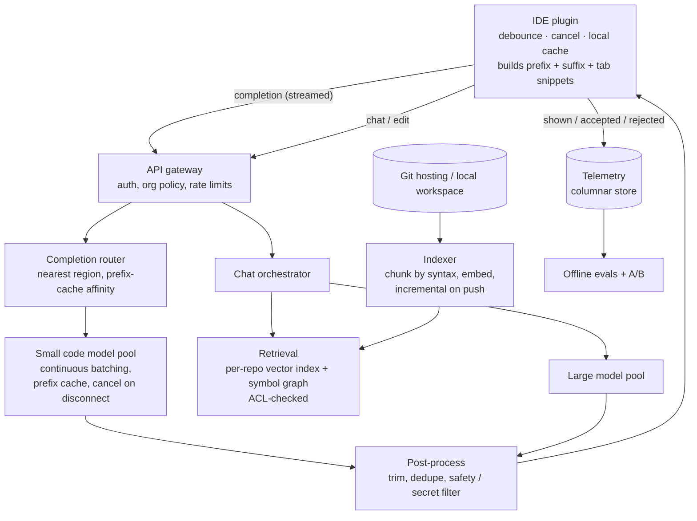
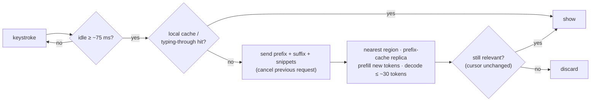

# 55 — Design an AI Code Assistant (Copilot / Cursor-style)

> **Prerequisites:** [53 — ChatGPT-style LLM Chat](53-design-chatgpt.md) (GPU tokens as the budget, batching, prefix caching), [17 — AI Systems](17-ai-systems.md) (RAG, evals, serving), [17b — ML Serving Infrastructure](17b-ml-serving-infrastructure.md), [DD-11 — Vector Databases](../Deep%20Dives/11-vector-databases.md). Related: [46 — Online Judge](46-design-online-judge.md) (sandboxing code), [13b — Data Compliance](13b-data-compliance-privacy.md).
>
> **The prompt:** *"Design an AI code assistant like GitHub Copilot: as a developer types in their IDE, suggest completions inline; also support a chat that can answer questions about the repository."* A Grokking and Hello Interview-era prompt. It looks like "ChatGPT in an editor", but the constraint is different: **inline completion has a latency budget of a few hundred milliseconds and fires on almost every keystroke**. The crux is the **latency budget**, **what context to send**, and **wasting as little GPU as possible on suggestions nobody sees**.
>
> **Attempt first:** 35 minutes out loud before reading past this line.

## What you'll master

- Why **inline completion** and **chat** are two different products with different models, budgets and routing.
- The **latency budget** end to end, and the client-side tricks (debounce, cancellation, caching) that decide it.
- **Context assembly**: prefix and suffix (fill-in-the-middle), open tabs, and repository retrieval, inside a small token budget.
- **Serving economics**: a small fast model for completions, a large one for chat, prefix caching, and cancelling abandoned requests.
- **Measuring quality** by acceptance and retention of suggestions, and the **privacy/tenant-isolation** rules around customers' code.

## In the Room — the decisive move

> *"There are two paths and I'll design them separately. **Inline completion** fires on nearly every pause in typing and has to appear in about 300 ms or the developer has already moved on, so it uses a **small, fast code model** in a region near the user, with a prompt built on the client from the code **before and after the cursor** plus a few relevant snippets. Most requests are obsolete before they finish, so the client **debounces and cancels**, and the server drops cancelled work immediately. **Chat and agent** requests tolerate seconds, so they go to a **larger model** with **repository retrieval** over a per-repo index. The hard parts are the latency budget, choosing what context fits in a small prompt, and economics: suggestions shown versus GPU spent. I'll measure quality by **acceptance rate and whether accepted code survives**, and I'll treat customer code as sensitive: no cross-tenant leakage, no training on it without consent."*

### Decisions to make decisively

| Decision | Choice | Because |
|---|---|---|
| Two paths | **Completion path (small model, ~300 ms) and chat path (large model, seconds)**, separate pools | Different latency budgets and cost per request; one must not starve the other |
| Completion trigger | **Client debounce (~50–100 ms after typing stops) + cancel on next keystroke** | Most keystroke-triggered requests are stale before they return |
| Prompt format | **Fill-in-the-middle**: prefix + suffix around the cursor, plus top snippets from open tabs | Code after the cursor constrains the answer as much as code before it |
| Context source (completion) | **Built on the client** from the open file and recent tabs; no server-side retrieval on the hot path | A network round trip to a vector index doesn't fit in 300 ms |
| Context source (chat) | **Per-repo index** (embeddings + symbol graph), access-checked retrieval | Questions span the whole repository |
| Region | **Serve completions from the nearest region** with GPUs | Network round trip is a fixed slice of the budget |
| Caching | **Client-side completion cache** keyed by a hash of the nearby context; **server prefix cache** for the file prefix | The same position is requested repeatedly as the user types and deletes |
| Quality metric | **Acceptance rate + retained characters** (accepted code still present after N minutes) | Shown-but-ignored suggestions are cost with no value |
| Customer code | **Not stored beyond the request by default; tenant-scoped indexes; opt-in for any training use** | Source code is the customer's most sensitive data |

**Experience hook.** *"It's a typeahead problem with a GPU behind it. The same rules apply: debounce on the client, cancel aggressively, cache by prefix, and keep the hot path free of anything that needs a second network hop."*

---

## 1. Requirements

**Functional.**
- **Inline completion:** as the developer types, show a greyed-out suggestion (a line or a block); accept with Tab, partially accept, or ignore.
- **Chat:** ask questions about the code, with answers grounded in the repository ("where is the retry logic?").
- **Edits / agent actions:** apply a described change across files (a follow-up; same serving tier as chat).
- Works across editors through a plugin; supports many languages.
- Admin controls for organisations: which repositories are indexed, data-retention settings, usage reporting.

**Non-functional.**
- **Completion latency: p50 ≈ 200 ms, p95 < ~500 ms** end to end. Chat: time to first token ≈ 1 s.
- Scale: ~1M daily active developers; completions fire many times a minute per developer.
- **Privacy:** no cross-tenant leakage of code; clear retention; regional data residency for enterprises.
- **Cost:** GPU spend per accepted suggestion is the number leadership watches.

**Non-goals to name:** training the code model, the editor's UI rendering, and CI integration.

> **Staff-level insight:** split the product in the first minute. *"Completion is a latency problem with a tiny prompt; chat is a retrieval problem with a big one. Designing one pipeline for both gives you a completion that's too slow or a chat that's too shallow."*

## 2. Back-of-envelope

Inference numbers are assumptions to say out loud; they vary by model and hardware.

| Quantity | Math | Result |
|---|---|---|
| Completion triggers | 1M developers × ~4 active hours × ~10 debounced triggers/min | **~2.4B/day ≈ 30k/s** average, **~100k/s** at peak (work hours overlap) |
| After client cache + cancellation | assume ~50% never reach a GPU or are cancelled early | **~50k/s** peak that complete |
| Completion tokens | ~1,500 tokens in (prefix + suffix + snippets), ~30 out | Prefill-dominated: **input tokens are the cost**, which is what prefix caching attacks |
| Chat requests | ~20/developer/day | **~230/s** average: small in count, large per request (~8k in, ~500 out) |
| Latency budget (completion) | 300 ms total | Network ~60 · queue ~20 · prefill ~100 · decode ~30 tokens ≈ 100 · post-process ~20 |
| Repo index | ~1M repos × ~50k chunks × 1 KB vectors (float32, 256–384 dims) | **~50 TB** of vectors if everything were indexed; index only active repos, quantize |
| Telemetry | shown / accepted / rejected events | **~billions/day** into a columnar store |

Conclusions: completions are **high-QPS, tiny-output, prefill-heavy**; the levers are cancellation, caching and a small model. Chat is low-QPS and expensive per call. The **network round trip is ~20% of the completion budget**, which forces regional serving.

## 3. High-level design

- **IDE plugin** owns the completion experience: when to ask, what context to send, and whether to show the answer. It is as much a part of the system as the servers.
- **Completion path:** gateway → router → small-model pool → light post-processing → stream back. No database or retrieval call on this path.
- **Chat path:** orchestrator retrieves repository context (with access checks), builds a prompt, calls the large model, streams the answer with file citations.
- **Indexer** keeps a per-repository index up to date from pushes (or from the local workspace for unpublished code).
- **Telemetry** records what was shown and what the developer did with it; this is the quality signal.

## 4. Deep dive A — the completion latency budget (the crux)

**On the client (where most of the win is):**
- **Debounce:** wait ~50–100 ms after the last keystroke before asking. Without it, a fast typist generates 10 requests per second, nearly all wasted.
- **Cancel:** every new keystroke cancels the in-flight request. The transport must make cancellation cheap and visible to the server (HTTP/2 stream reset or a WebSocket message), so the server **stops generating** instead of finishing work nobody will see.
- **Typing-through:** if the user types characters that match the start of the current suggestion, keep showing the remainder locally. No request needed.
- **Local cache:** key = hash of (file, a window of text before the cursor). Deleting and retyping hits the cache.
- **Skip obvious non-moments:** mid-word in a comment, after a closing brace with nothing to add, or in files the org excluded.

**On the server:**
- **Small code model** tuned for fill-in-the-middle, quantized, served with continuous batching ([53](53-design-chatgpt.md) §4). Batching windows are tiny (a few ms) because the budget is.
- **Prefix caching with affinity:** consecutive requests from one editor share almost the entire prefix. Route a session to the replica that already holds that prefix's KV cache, so prefill covers only the new characters. This is the main cost lever, because completion requests are ~98% input tokens.
- **Short outputs, early stop:** cap at a line or a small block; stop at syntactic boundaries (end of statement, dedent). Longer "next edit" suggestions run only when the user pauses longer.
- **Cancel on disconnect** frees the batch slot immediately.
- **Regional pools:** route to the nearest region with capacity; fall back to a farther region rather than queueing past the budget. If the budget is already blown, **return nothing**: a late suggestion is worse than none.

> **Staff-level insight:** *"Most completion requests are obsolete before they finish, so the cheapest GPU-second is the one I never spend: debounce, cancel on the next keystroke and stop generation server-side, and reuse the prefix cache for everything that does run. And I'd rather show nothing than show a suggestion 800 ms late."*

## 5. Deep dive B — context: what goes in the prompt

The model only knows what's in the prompt, and the completion prompt is small.

**Completion (assembled on the client, ~1–2k tokens):**
1. **Suffix** (code after the cursor) and **prefix** (code before it), nearest lines first. Fill-in-the-middle formatting tells the model where the hole is.
2. **Snippets from other open or recently edited files**, chosen by cheap similarity (token overlap or a local embedding) to the code around the cursor. Recently viewed files predict what's relevant.
3. **Signatures of imported symbols** (from the language server), so the model calls real functions with real parameters.
4. A **token budget** split across these, trimmed from the far end first.

**Chat and agent (assembled on the server, ~8–30k tokens):**
- **Chunk by syntax, not by lines:** functions, classes and their docstrings, using a parser (tree-sitter-style), so retrieved chunks are complete units.
- **Hybrid retrieval:** embeddings for "where do we handle retries?" plus exact/symbol search for identifiers ([07 — Search](07-search.md) hybrid + RRF), then a **symbol graph** hop (definitions, callers) to pull in what the hit depends on.
- **Incremental indexing:** on push, re-embed only changed files (content-hashed chunks). Unpublished local changes are indexed on the developer's machine or sent as explicit context.
- **Access control at query time:** retrieval is filtered by the caller's repository permissions, checked against the source of truth, never trusted from the index alone ([DD-11](../Deep%20Dives/11-vector-databases.md) filtered search).

**Post-processing on both paths:** trim to a syntactic boundary, drop a suggestion that repeats existing code, filter secrets and known-vulnerable patterns, and (where the product promises it) suppress long verbatim matches against public code.

## 6. Deep dive C — quality, cost and privacy

**Measuring quality without labels:**
- **Acceptance rate** (accepted ÷ shown) is the headline, but it can be gamed by showing only trivial completions.
- **Retained characters:** how much accepted text is still in the file after 30 s / 5 min. This is the metric that tracks real usefulness.
- **Latency to show** and **shown rate** (how often a request produced anything). A model that is 2% better but 100 ms slower can lose on acceptance.
- **Offline evals** before any rollout: held-out completion tasks and repository-level benchmarks; then **A/B by developer** with guardrail metrics ([17](17-ai-systems.md) §6).

**Cost levers, in order:** cancellation → client cache → prefix caching → small model for completions → cap output length → route "easy" chat questions to a smaller model (a **model cascade**) → reserved capacity for the baseline with burst for peaks.

**Privacy and tenancy (enterprise buyers ask this first):**
- **Prompts are processed in memory and not stored** by default; telemetry records events and lengths, not code, unless the organisation opts in.
- **Indexes are per tenant** (per organisation, often per repository), encrypted, in the customer's chosen region, and deletable on request.
- **No training on customer code without explicit opt-in.**
- **Prompt caches are scoped per tenant**, so a cached prefix can never serve another customer.
- **Content exclusions:** admins mark files or repositories that must never be sent.

## 7. Failure drills — volunteer these

| Failure | Blast radius | Design answer |
|---|---|---|
| Completion pool saturated at 10 am | Suggestions arrive late | Past the budget, return nothing; shed by lowering trigger frequency via remote config; reserve chat capacity separately |
| Region loses GPUs | Latency rises for that region's users | Route to the next-nearest region; accept ~50 ms more; client keeps typing-through and cache working |
| Client bug sends a request per keystroke | Request flood | Per-user and per-org rate limits at the gateway; server-side debounce (drop superseded requests per session) |
| Cancellation not propagated | GPUs finish abandoned work | Treat disconnect/stream reset as cancel; metric: tokens generated for cancelled requests |
| Index stale after a big merge | Chat cites deleted code | Incremental indexing on push with a freshness SLO; show the indexed commit in answers; fall back to live file reads |
| Retrieval returns code the user can't access | Data leak | ACL filter at query time against the source of truth; per-tenant indexes |
| Model update regresses quality | Acceptance drops | Canary by developer cohort, watch acceptance and retention, auto-rollback |
| Suggestion contains a secret or unsafe pattern | Security incident | Post-generation filters; never index secrets files; exclusions |

## 8. The Staff & EM layer

- **The client team is half the system.** Debounce, cancellation, caching and context selection live in the plugin, across several editors. Ship them behind remote config so behaviour can change without a plugin release.
- **Unit economics drive the roadmap.** GPU cost per active developer against the subscription price is thin; every lever in §6 is a margin lever. Track cost per accepted suggestion.
- **Trust is the enterprise sale.** Retention, residency, training opt-in and exclusions need written, auditable answers before a large customer signs. Legal and security review are launch gates.
- **Evaluation is a standing function.** Model swaps are frequent; an offline eval harness plus cohort A/B is what makes them safe.

### Altitude — the same probes at three levels

| Probe | Senior says | Staff says | EM adds |
|---|---|---|---|
| "How fast must completion be?" | Use a fast model | Budget the 300 ms: network, queue, prefill, decode; debounce + cancel; show nothing if late | Latency SLO per region as a product metric |
| "What do you send the model?" | The current file | FIM prefix + suffix + tab snippets + symbol signatures within a token budget; retrieval only for chat | Exclusion and retention policy |
| "Cost?" | Autoscale GPUs | Cancellation, client cache, prefix caching with affinity, small model, cascade | Cost per accepted suggestion vs price |
| "Is it good?" | Ask users | Acceptance + retained characters, offline evals, cohort A/B with rollback | Eval team and release gates |

## 9. Follow-ups they'll ask

1. **"Multi-file edits / agent mode."** A loop: plan → retrieve → edit → run tests in a sandbox ([46](46-design-online-judge.md)) → iterate, with step limits and human approval for commands; long-running, so it's a durable workflow ([DD-37](../Deep%20Dives/37-temporal-durable-execution.md)).
2. **"Self-hosted for a bank."** Same architecture inside the customer's VPC with their GPUs; smaller models; no telemetry leaves.
3. **"Next-edit prediction."** Predict the next *location* and change from the recent edit history; a second model with the diff stream as context.
4. **"Personalisation."** Per-repo style via retrieval, not per-user fine-tuning; cheaper and reversible.
5. **"Offline / flaky network."** A small on-device model for single-line completions; server for everything else.

## Interview Cheat-Sheet

**One-liner:** *"Two paths. Inline completion is a 300 ms problem: the plugin debounces, cancels and caches, sends fill-in-the-middle context built locally, and a small code model in the nearest region answers with prefix caching, returning nothing if late. Chat is a retrieval problem: a per-tenant repository index (syntax chunks, hybrid search, symbol graph, ACL-checked) feeds a larger model. Quality is acceptance plus retained code; customer code is never stored or trained on by default."*

**Numbers (state as assumptions):** ~1M developers · ~100k completion triggers/s at peak, about half cancelled or cached · ~1.5k tokens in / ~30 out per completion · budget ≈ 300 ms (network 60, prefill 100, decode 100) · chat ~230/s at ~8k tokens in.

**The close:** *"It's typeahead with a GPU behind it. I win latency and cost on the client first, keep the completion hot path free of retrieval and storage, send the model the code on both sides of the cursor, and judge it by whether accepted code survives. Chat gets the big model and the repository index; and no design is finished until tenant isolation and retention are written down."*
