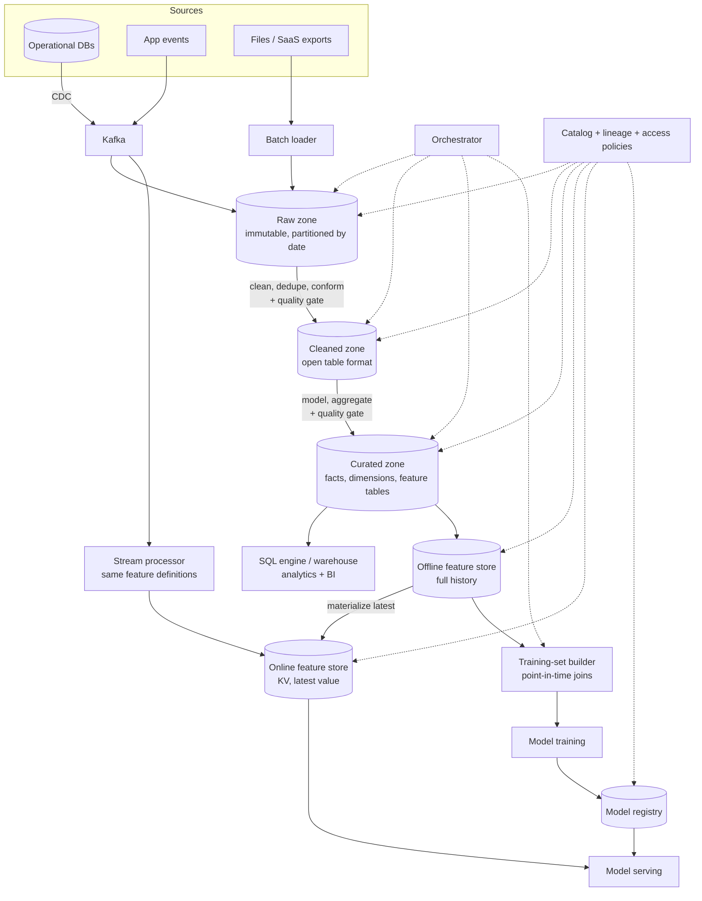
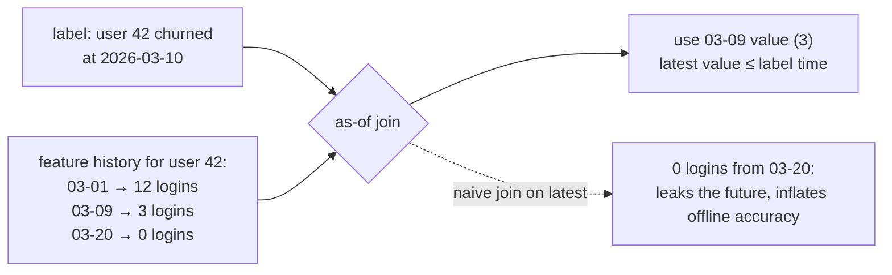

# 56 — Design a Data Platform for AI/ML

> **Prerequisites:** [16 — Data Processing](16-data-processing.md) (batch vs stream, lakehouse, ELT, schema evolution), [17b — ML Serving Infrastructure](17b-ml-serving-infrastructure.md) (feature stores, training-serving skew), [DD-39 — Change Data Capture](../Deep%20Dives/39-change-data-capture.md), [DD-02 — Kafka](../Deep%20Dives/02-kafka.md), [13b — Data Compliance](13b-data-compliance-privacy.md). Related: [35 — Scheduler](35-design-scheduler.md), [DD-20 — ClickHouse](../Deep%20Dives/20-clickhouse.md).
>
> **The prompt:** *"Design the data infrastructure for a company's AI/ML systems: ingest data from many sources, make it usable for analytics and model training, and serve features to models online."* It looks like "draw Kafka, Spark and a warehouse". The crux is **one definition of each feature for both training and serving**, **knowing where every column came from** (so you can reproduce a model and honour a deletion request), and **keeping bad data from reaching models silently**.
>
> **Attempt first:** 35 minutes out loud before reading past this line.

## What you'll master

- The **layered layout**: ingestion → raw / cleaned / curated zones on object storage → warehouse and feature store → training and online serving.
- **Open table formats** (Iceberg/Delta) and why "files in a bucket" needs a transaction log to be a database.
- The **offline/online feature split**, **point-in-time-correct** training sets, and the **training-serving skew** problem.
- **Catalog, lineage and data quality gates** as the control plane that makes the platform trustworthy.
- **Deletion and reproducibility**: two requirements that pull in opposite directions, and how to satisfy both.

## In the Room — the decisive move

> *"I'll organise this in layers on object storage. **Ingestion** has two paths: a streaming path through Kafka for events and database changes (CDC), and a batch path for files and third-party exports. Everything lands **unchanged in a raw zone**, so any downstream table can be rebuilt. Jobs promote data to a **cleaned zone** and then a **curated zone**, stored in an **open table format** so readers get atomic commits, schema evolution and time travel. On top sit a **warehouse engine** for analytics and a **feature store** with two faces: an **offline store** for building training sets and an **online key-value store** for serving in milliseconds. The hard part isn't the pipeline, it's trust: **one feature definition computed the same way for training and serving**, **point-in-time joins** so training never sees the future, a **catalog with lineage** so we can reproduce a model and find every copy of a user's data, and **quality checks that block bad data** before a model trains on it."*

### Decisions to make decisively

| Decision | Choice | Because |
|---|---|---|
| Storage | **Object storage + an open table format** (Iceberg or Delta), not a proprietary warehouse as the only copy | Cheap at petabyte scale; many engines can read it; atomic commits and time travel |
| Zones | **Raw (immutable) → cleaned → curated** | Raw is the replayable source; each promotion is a tested, repeatable job |
| Ingestion | **CDC + events through Kafka; batch loads for files and SaaS exports** | Streams for freshness and ordering; batch for sources that only export files |
| Transform style | **ELT**: load raw, transform inside the platform with versioned SQL/Spark | Raw data is kept, and transformations can be re-run as logic changes |
| Feature store | **Offline (columnar, history) + online (KV, latest value), fed by one definition** | The only reliable cure for training-serving skew |
| Training sets | **Point-in-time joins** on event timestamps | Joining the latest feature value to an old label leaks the future |
| Orchestration | **A DAG orchestrator** with data-aware dependencies, retries and backfills | Pipelines are graphs with reruns, not cron lines |
| Governance | **Central catalog + column-level lineage + quality gates between zones** | Reproducibility, impact analysis, deletion, and not training on broken data |

**Experience hook.** *"The pipeline is the easy part. Every platform I've seen struggle did so on the same two questions: 'which data was this model trained on?' and 'why is this feature different in production than in training?' The catalog, lineage and a single feature definition answer both."*

---

## 1. Requirements

**Functional.**
- Ingest from operational databases, event streams, logs, files and third-party APIs.
- Store raw and refined data; support SQL analytics and BI.
- Let data scientists **define features once** and use them for training (history) and serving (latest value).
- Build **reproducible training datasets**; track which data and code produced each model.
- Serve features online to models; support batch scoring.
- Discover datasets (search, owners, documentation); control access; delete a user's data on request.

**Non-functional.**
- Scale: petabytes stored, ~10 TB/day ingested, hundreds of pipelines, thousands of features.
- **Freshness tiers:** streaming features in seconds; batch tables hourly or daily.
- **Online feature reads: p99 < 10 ms.**
- **Correctness:** no silent schema breaks; no training on data that failed quality checks.
- Cost-aware: storage tiering and compute that scales to zero.

**Non-goals to name:** model training infrastructure and serving themselves ([17b](17b-ml-serving-infrastructure.md)), BI tool choice, and the labelling workflow.

> **Staff-level insight:** name the real requirements, which are trust requirements: *"reproducible, consistent between training and serving, and deletable. A design that only moves bytes fast doesn't meet any of the three."*

## 2. Back-of-envelope

| Quantity | Math | Result |
|---|---|---|
| Ingest | given | **~10 TB/day**; events ≈ 1 KB → ~10B events/day ≈ **~115k events/s** avg, ~500k/s peak |
| Raw zone growth | 10 TB/day compressed ~4× in columnar form | **~2.5 TB/day ≈ 0.9 PB/year**; tier to infrequent-access after 90 days |
| Curated zone | typically 20–30% of raw volume | **~200–300 TB/year** of query-ready tables |
| Kafka | 500k msgs/s peak × 1 KB × RF 3, 7-day retention | **~900 TB** of broker storage, or tiered storage to shrink it |
| Online feature store | 100M entities × 200 features × ~20 B | **~400 GB**: fits a small KV cluster in memory/SSD |
| Online reads | 20k predictions/s × ~5 entity lookups | **~100k reads/s**, p99 < 10 ms |
| Training set build | join 1B labels to 50 feature tables point-in-time | Hours of batch compute: the expensive, cacheable job |

Conclusions: **storage is cheap and big; the online store is small and latency-critical.** The costly compute is transformation and training-set joins, so those need caching, incremental processing and scheduling off-peak.

## 3. High-level design

- **Ingestion** lands data unchanged in the **raw zone**, with schema captured in a registry at the door.
- **Zone promotion** jobs clean (types, dedupe, conform keys), then model (facts, dimensions, feature tables). Each promotion passes a **quality gate**.
- **Serving surfaces:** a SQL engine for analysts, the **offline feature store** for training, the **online feature store** for inference.
- **Control plane:** the orchestrator runs the graph; the catalog knows every dataset, its owner, schema, lineage and access policy.

## 4. Deep dive A — the lake: zones and table formats

**Why three zones.**
- **Raw:** exactly what arrived, append-only, partitioned by ingestion date. It's the insurance policy: when transformation logic turns out to be wrong, you re-run from here.
- **Cleaned:** typed, deduplicated, with consistent keys and time zones. One table per source entity.
- **Curated:** business-level tables (orders fact, user dimension) and feature tables, documented and owned.

**Why an open table format.** Parquet files in a bucket have no transactions: a reader can see half a write, two writers can clobber each other, and renaming a column means rewriting everything. A table format adds a **metadata log** over the files:

| Capability | What it gives you |
|---|---|
| **Atomic commits** (snapshot isolation) | Readers see a complete version or the previous one, never a partial write |
| **Schema evolution** | Add, rename or reorder columns without rewriting data files |
| **Time travel** | Query the table as of a snapshot: the basis of reproducible training sets |
| **Hidden partitioning + file statistics** | Engines skip files using min/max stats without users knowing the layout |
| **Row-level deletes and merges** | Upserts from CDC and deletion requests without full rewrites |

**The operational chores it creates:** streaming writers produce thousands of small files, so **compaction** jobs merge them; **snapshot expiry** removes old versions (and must, for deletions to actually take effect); and a layout that matches query filters (partition by date, cluster by a high-cardinality key) decides scan cost.

**Lambda vs Kappa here:** prefer one streaming definition with replay from Kafka or the raw zone for backfills, over two codebases that drift ([16 §6.1](16-data-processing.md)).

## 5. Deep dive B — the feature store and skew (the crux)

**The problem.** A model is trained on features computed by a batch SQL job and served with features computed by application code. The two implementations differ subtly (a time-zone boundary, a null default, a 7-day window that's really 6.9 days), and the model quietly performs worse in production than offline. That's **training-serving skew**, and it's the most common ML platform failure.

**The fix: one definition, two materializations.**
- A feature is defined **once**: entity key, transformation, window, and time semantics.
- The platform computes it into the **offline store** (every historical value with its timestamp) and the **online store** (the latest value per entity, in a low-latency KV store).
- **Batch features** (30-day spend) are computed by scheduled jobs and loaded to both. **Streaming features** (clicks in the last 5 minutes) are computed by a stream processor writing to the online store and logging to the offline store.
- **Log what was served.** At inference, record the feature vector actually used. Training on served features removes skew by construction, and comparing them to the offline values is the skew monitor.

**Point-in-time correctness.** A training example is (entity, label, **label time**). The feature value joined to it must be the value **as of that time**, not today's value:

A naive join gives the model information from after the event it's predicting. Offline metrics look excellent and production doesn't match. The training-set builder does an **as-of join** per feature table, usually with a small lag to mimic real availability delay.

**Freshness and the online store:** each feature has a declared freshness target; the platform monitors staleness (now − last update) per feature and alerts on breaches, since a stale feature silently degrades predictions.

> **Staff-level insight:** *"Skew and leakage are the two ways an ML platform lies to you, and both are data-engineering bugs, not modelling bugs. One feature definition materialized to offline and online stores handles skew; as-of joins on event time handle leakage; and logging served features gives me a monitor for both."*

## 6. Deep dive C — catalog, lineage, quality, deletion

**Catalog.** Every dataset is registered with owner, schema, description, sensitivity tags (PII, financial) and freshness. Without it people rebuild tables that exist and train on tables nobody owns.

**Lineage.** Captured automatically from the orchestrator and query engines: which jobs read and wrote which tables, down to **column level**. It answers three questions:
- **Impact:** "if I change this column, which dashboards, features and models break?"
- **Reproducibility:** "exactly which table snapshots, feature versions and code produced model v12?" Record snapshot IDs and code versions in the **model registry**.
- **Deletion:** "where are all copies of this user's data?"

**Quality gates.** Checks run between zones and **block promotion** on failure: schema matches the contract, row counts within expected bounds, null and uniqueness constraints, distribution drift against a baseline. A failed gate quarantines the batch and pages the owner; downstream keeps serving yesterday's data. Stale-but-correct beats fresh-but-wrong. Pair this with **schema contracts at ingestion** so a producer's breaking change is rejected at the door ([16 §6.5](16-data-processing.md)).

**Deletion vs reproducibility.** A user asks to be erased; a model's training set must be reproducible. Both can hold:
- Find copies via lineage and PII tags. Delete rows in table-format tables with row-level deletes, then **expire old snapshots and compact**, or the data is still in older files.
- Purge the online store and feature logs by key; for Kafka, rely on retention or compaction with tombstones.
- For reproducibility, keep the **recipe** (snapshot IDs, code, feature versions) and accept that a rebuilt set omits erased users. For models, record which were trained on affected data and apply the retraining policy ([13b](13b-data-compliance-privacy.md)).
- **Crypto-shredding** (per-user keys destroyed on deletion) helps where physical purge across many copies is slow.

## 7. Failure drills — volunteer these

| Failure | Blast radius | Design answer |
|---|---|---|
| Upstream team renames a column | Pipelines break or, worse, silently produce nulls | Schema contract at ingestion rejects it; lineage shows who's affected |
| A bad batch (duplicates, a currency unit change) | Wrong features, wrong predictions | Quality gate blocks promotion; quarantine; serve previous snapshot |
| Streaming job lags | Online features go stale | Per-feature freshness monitoring; models degrade to batch-only features or defaults |
| Backfill after a logic fix | Hours of compute, risk of double counting | Recompute from raw into a new snapshot, swap atomically; idempotent, partition-scoped jobs |
| Small-files explosion | Queries slow, metadata bloats | Scheduled compaction and snapshot expiry |
| Online store node loss | Feature lookups fail | Replicated KV store; serving falls back to default values with a flag |
| Offline accuracy great, production poor | Model underperforms | Suspect leakage or skew: check as-of joins and compare served vs offline feature values |
| Deletion request | Compliance exposure | Lineage-driven purge + snapshot expiry; audit record of completion |

## 8. The Staff & EM layer

- **A platform is a product with internal customers.** Self-service onboarding, documentation and paved paths matter more than a clever engine. Measure adoption: time for a new team to ship its first feature to production.
- **Ownership is the scaling limit.** Central platform team owns the tooling; domain teams own their datasets and their quality (the data-mesh idea, [16 §6.2](16-data-processing.md)). An unowned table is a liability.
- **Cost attribution.** Tag storage and compute by team and pipeline; show teams their bill. Unattributed spend only grows.
- **Build vs buy.** Managed warehouse and orchestrator are usually bought; the feature definitions, contracts and quality rules are yours. Open table formats keep the storage decision reversible.

### Altitude — the same probes at three levels

| Probe | Senior says | Staff says | EM adds |
|---|---|---|---|
| "Where does data live?" | A data lake on S3 | Raw / cleaned / curated zones in an open table format: atomic commits, schema evolution, time travel | Storage tiering and cost attribution |
| "Features for training vs serving?" | Compute them in both places | One definition, offline + online materialization, log served features | Skew as a monitored platform metric |
| "Build a training set?" | Join features to labels | As-of joins on event time to prevent leakage; snapshot IDs recorded | Reproducibility as a release requirement |
| "A user asks to be deleted?" | Delete the row | Lineage finds copies; row deletes + snapshot expiry; online store, logs, Kafka; retrain policy | Compliance SLA and audit trail |

## 9. Follow-ups they'll ask

1. **"Add embeddings and a vector index."** An embedding pipeline with model-versioned vectors, re-embedding on model change, and a vector store as another serving surface ([DD-11](../Deep%20Dives/11-vector-databases.md)).
2. **"Real-time features at 1 ms."** Precompute into the online store; co-locate with serving; avoid on-request aggregation.
3. **"Monitoring models in production."** Log predictions and features; detect data and concept drift against the training baseline; alert and trigger retraining.
4. **"Multi-region and residency."** Region-pinned zones for regulated data, with aggregates (not rows) crossing borders.
5. **"Unstructured data for LLMs."** Documents, images and transcripts land in the raw zone with metadata in the catalog; chunking and embedding are curated-zone jobs like any other.

## Interview Cheat-Sheet

**One-liner:** *"Streams and batch land unchanged in a raw zone on object storage; tested jobs promote data to cleaned and curated zones in an open table format (atomic commits, schema evolution, time travel). A feature store materializes one feature definition to an offline history store and an online KV store, training sets use as-of joins, and served features are logged to detect skew. A catalog with lineage and quality gates makes it reproducible, safe to change, and deletable."*

**Numbers:** ~10 TB/day in (~115k events/s avg) · ~0.9 PB/year raw after compression · online store ~400 GB, ~100k reads/s at p99 < 10 ms · batch freshness hourly/daily, streaming features in seconds.

**The close:** *"Moving the bytes is the easy 30%. The platform earns its keep on trust: one feature definition for training and serving, point-in-time joins so models never see the future, gates that stop bad data, and lineage that can both reproduce a model and find every copy of a user's data when they ask to be forgotten."*
