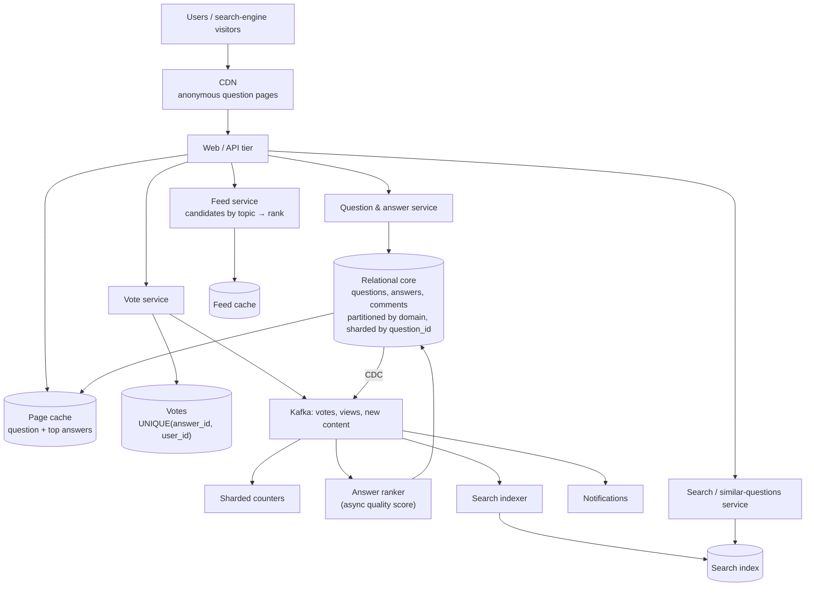
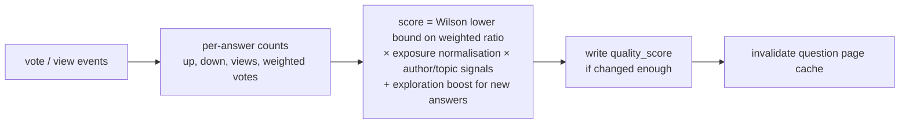

# 57 — Design Quora (Q&A Platform)

> **Prerequisites:** [18a — Chat & Social](18a-design-chat-social.md) (feeds and fan-out), [07 — Search](07-search.md) (duplicate detection, ranking), [06 — Databases](06-databases.md) (partitioning), [DD-12 — Big-Data Structures](../Deep%20Dives/12-big-data-structures.md), [Pattern 17 — Scaling Writes](../Deep%20Dives/17-pattern-scaling-writes.md). Related: [44 — News Aggregator](44-design-news-aggregator.md) (interest-based feeds), [51 — Post Search](51-design-post-search.md).
>
> **The prompt:** *"Design Quora: users ask questions, write answers, upvote and comment, search existing questions, and get a personalised feed."* A Grokking chapter. It looks like "Twitter with longer posts", but the content model is different: **value lives in old content found through search**, a question's **answers must be ranked by quality, not time**, and the feed follows **topics and interests** more than people. The crux is **answer ranking**, **not asking the same question twice**, and a **read-heavy, long-tail workload**.
>
> **Attempt first:** 35 minutes out loud before reading past this line.

## What you'll master

- Why a Q&A site's traffic is **long-tail and search-driven**, and what that does to caching and storage.
- **Answer ranking** as a quality score that resists early-vote bias, not a sort by votes.
- **Duplicate-question detection** at ask time and merging afterwards.
- An **interest-based feed**: candidate generation by topic, then ranking; pull, not fan-out-on-write.
- Scaling the relational core with **vertical partitioning first, then sharding**, and moving counters and background work off the request path.

## In the Room — the decisive move

> *"Three things make this different from a social feed. First, **most traffic lands on old question pages from search engines**, so it's extremely read-heavy with a long tail: I'll render question pages from a cache and CDN and treat the database as the miss path. Second, **answers are ranked by quality**: a sort by upvotes is wrong, because early answers collect votes just for being first, so I'll use a score that accounts for vote count, voter credibility and exposure, computed asynchronously and stored per answer. Third, the **feed is interest-based**: users follow topics more than people, so I'll generate candidates by topic and rank on read instead of fanning out writes. I'd also check for **duplicate questions when someone asks**, because ten copies of one question split the answers. Storage starts as a relational core, split by **functional area first** and sharded only where one area outgrows a node; vote and view counts go through a queue to sharded counters."*

### Decisions to make decisively

| Decision | Choice | Because |
|---|---|---|
| Question page serving | **Cached, pre-assembled page (question + top answers) behind a CDN for anonymous traffic** | Most views are logged-out, from search engines, on old content |
| Answer order | **Stored quality score per answer, recomputed asynchronously** | Sorting by votes at read time is slow and biased toward early answers |
| Vote/view counts | **Event → queue → sharded counters → periodic aggregate** | A viral answer must not hammer one row ([Pattern 17](../Deep%20Dives/17-pattern-scaling-writes.md)) |
| One vote per user | **`UNIQUE (answer_id, user_id)` vote row** | The constraint is the guarantee; the counter is derived |
| Feed | **Pull: candidates by followed topics/people, ranked on read, cached briefly** | Topic follows make fan-out-on-write enormous and wasteful |
| Duplicates | **Search for similar questions at ask time; merge duplicates with redirects** | One canonical question concentrates answers and search ranking |
| Core storage | **Relational, vertically partitioned by domain, then sharded by `question_id` where needed** | Relational access patterns; split the hot domains before sharding everything |
| Search | **Separate search index fed by CDC** | Question text search and "similar questions" are search-engine workloads |

**Experience hook.** *"The mistake is to copy the Twitter design. Here a question written in 2015 can be today's most-viewed page, so the system is closer to a searchable knowledge base with a ranking problem than to a timeline."*

---

## 1. Requirements

**Functional.**
- Ask a question (with topics); write, edit and delete answers; comment.
- Upvote and downvote answers (one vote per user per answer).
- **Search** questions; see **similar questions** while asking.
- **Question page:** the question with answers **ranked by quality**.
- **Feed:** personalised by followed topics, people and past interests.
- Notifications ("your question got an answer").

**Non-functional.**
- ~300M monthly visitors, most anonymous; **read:write ≈ 1000:1** on question pages.
- Question page **p99 < 300 ms**; available under traffic spikes from search or social links.
- Eventual consistency is fine for counts, ranking and feed; a user must **see their own answer and vote immediately**.
- Content quality and abuse resistance (spam, vote rings) are product-critical.

**Non-goals to name:** monetisation/ads, the ML ranking models' internals, and moderation tooling beyond the hooks.

> **Staff-level insight:** state the workload shape early. *"Reads dwarf writes, most readers are anonymous, and the popular pages are old. That says cache and CDN first, and it says ranking can be asynchronous."*

## 2. Back-of-envelope

| Quantity | Math | Result |
|---|---|---|
| Page views | ~300M monthly visitors × ~10 views ÷ 30 days | **~100M views/day ≈ 1.2k/s** average, ~5k/s peak |
| Share anonymous | ~80%+ from search engines | **~1k/s cacheable** at the edge |
| New questions | ~100k/day | **~1.2/s** |
| New answers | ~300k/day | **~3.5/s** |
| Votes | ~10M/day | **~115/s** average; bursts on viral answers |
| Text storage | 100M questions + 300M answers × ~2 KB | **~800 GB**: small; fits a modest relational cluster |
| Search index | 100M questions × ~1 KB | **~100 GB** |
| Feed requests | ~20M DAU logged-in × ~5/day | **~1.2k/s** |

Conclusions: **data is small, reads are large and cacheable, writes are tiny.** The engineering effort goes to serving cached pages, ranking quality and search, not write scaling. Votes are the only bursty write.

## 3. High-level design

- **Read path:** CDN → page cache → database on a miss. Logged-in views add personal bits (your vote, follow state) with a small separate call, so the big page stays cacheable.
- **Write path:** questions and answers go to the relational core; votes write a vote row and emit an event.
- **Async consumers** update counters, recompute answer scores, index for search and send notifications.
- **Feed** is computed on read from topic and people follows, then cached for minutes.

## 4. Deep dive A — answer ranking (the crux)

**Why not sort by upvotes.** The first answer is seen by everyone, so it collects votes regardless of quality; a better answer posted a week later never catches up. A single early downvote can also bury a good answer. Sorting by "upvotes − downvotes" rewards being early and being short.

**A quality score instead:**
- **Use the lower bound of a confidence interval on the upvote ratio** (the Wilson score), not the raw ratio: 5 up / 0 down ranks below 480 up / 20 down, because there's less evidence. This fixes the "one vote, 100%" problem.
- **Normalise by exposure:** votes per view, not votes. An answer shown 100 times with 30 upvotes is stronger than one shown 100,000 times with 300.
- **Weight votes by voter credibility:** an upvote from someone with a strong record in that topic counts more than one from a new account. This also blunts vote rings.
- **Author and content signals:** topic expertise, answer completeness, and edits; a small freshness boost so new answers get **exploration traffic** and can prove themselves.
- **Penalties:** collapsed or reported content, and policy violations.

**Computing it:** votes and views arrive on Kafka; a ranker recomputes an answer's score when its counts change materially and writes `quality_score` on the answer row. The question page reads answers **already ordered by an index on `(question_id, quality_score DESC)`**. A change in order invalidates that question's page cache.

**Read-your-writes:** the author's new answer and the voter's own vote are overlaid on the page from the write response or a session cache, so they see their action at once even though ranking and counts lag by seconds.

> **Staff-level insight:** *"Ranking answers by raw votes measures who posted first. I'd rank on the lower bound of the upvote ratio, normalised by how often the answer was shown and weighted by voter credibility, and I'd deliberately give new answers some exposure so the system can learn about them. It's computed asynchronously and stored, so the read is an index scan."*

## 5. Deep dive B — duplicates, search and the feed

**Duplicate questions.** "How do I learn Python?" gets asked thousands of ways. Duplicates split answers and dilute search ranking.
- **At ask time:** as the user types, query the search index for similar titles (lexical match plus embedding similarity, [07 §6](07-search.md)) and show "Is your question one of these?". This prevents most duplicates for free.
- **After posting:** a background job flags likely duplicates by embedding similarity; confirmed pairs are **merged**: one canonical question, the other redirects to it (permanent redirect for search engines), answers move over, and an alias map keeps old links working.
- Near-duplicate detection on text (SimHash/MinHash, [44 §4](44-design-news-aggregator.md)) catches copy-paste spam.

**Search.** Question text and topics are indexed from CDC. Ranking blends text relevance with question quality (answer count, views, best answer score). Search is also the entry point for most traffic from external search engines, so **stable, canonical URLs** and fast cached pages matter as much as the on-site search.

**The feed is pull, not push.**
- A user follows **topics** (some with millions of followers) and a few people. Fan-out-on-write for a popular topic would copy every new answer to millions of feeds, most never read.
- **On read:** gather candidates from followed topics and people (recent and high-quality answers per topic, kept as small per-topic lists), plus recommendations from interest similarity; **rank** by predicted interest × answer quality × freshness; apply a seen-filter; cache the result for a few minutes.
- This is the [news aggregator](44-design-news-aggregator.md) pattern: precompute per segment (here, per topic), personalise with a thin re-rank.

## 6. Deep dive C — storage and scaling the core

- **Start relational.** Questions, answers, comments, users and topics have relational access patterns (answers by question, questions by topic, content by author) and need constraints. The whole text corpus is under a terabyte.
- **Vertical partitioning first.** As features grow, a few tables take most queries. Move domains onto separate database clusters: content (questions, answers), social graph (follows), votes, notifications. Joins across domains move into the application. This relieves hot instances without the complexity of sharding everything. (Grokking calls this *vertical sharding*; Quora's own engineering posts describe doing exactly this on MySQL.)
- **Then shard the domains that outgrow a node**, by `question_id` for content (a question and its answers stay together) and by `user_id` for votes-by-user lookups, with a second index or table for the other access path.
- **Counters and derived data off the request path.** View and vote counts go event → Kafka → sharded counters → periodic write-back; the page shows an approximate count from cache.
- **Background work on a durable queue**, not in-memory queues on app servers: an app-server crash must not drop pending work, and low-priority jobs must not compete with user requests ([Pattern 19](../Deep%20Dives/19-pattern-long-running-tasks.md)).
- **Caching layers:** CDN for anonymous pages; an object cache with batched multi-key reads for page assembly; short-TTL feed cache. Invalidate question pages on new answers, edits or a ranking change, driven by CDC.
- **Storage engine note:** for write-heavy key-value data (counters, feature data for ranking), an LSM-based engine gives better write throughput and compression than a B-tree, with more predictable tail latency than a wide-column store on a JVM. Name the reason, not just the product.

## 7. Failure drills — volunteer these

| Failure | Blast radius | Design answer |
|---|---|---|
| A question goes viral | Read spike on one page | CDN + page cache absorb it; counters are sharded; the DB sees only misses |
| Ranker falls behind | Answer order is stale | Pages keep the last stored order; freshness alert on ranker lag; exploration boost still applies when it catches up |
| Vote ring upvotes spam | Bad answer ranks first | Credibility-weighted votes, rate limits, graph-based ring detection, async demotion |
| Cache invalidation missed | Old answers shown | CDC-driven invalidation plus a TTL backstop |
| Duplicate merge goes wrong | Answers attached to the wrong question | Merges are reversible records (alias map + move log); human review for high-traffic questions |
| Search index down | Search and "similar questions" fail | Question pages still serve from cache/DB; asking proceeds without the duplicate hint |
| One content shard is hot | Latency for its questions | Cache hides most reads; split the shard; the long tail keeps hot keys rare |

## 8. The Staff & EM layer

- **Quality is the product and it needs people.** Ranking, spam and duplicate handling need labelled evaluation sets, policy owners and review queues, not only models.
- **Search-engine traffic is the growth engine and a dependency.** Page speed, canonical URLs and uptime for crawlers are business metrics; a slow cached page costs traffic.
- **Sequence the scaling work.** Cache and CDN first, vertical partitioning second, sharding third. Proposing shards on day one for a sub-terabyte dataset is over-engineering.
- **Cost is modest.** The expensive parts are the ML ranking pipeline and moderation staff, not storage or serving.

### Altitude — the same probes at three levels

| Probe | Senior says | Staff says | EM adds |
|---|---|---|---|
| "How do you order answers?" | By upvotes | Wilson lower bound, exposure-normalised, credibility-weighted, with exploration; stored score | Quality metrics and an eval set |
| "The feed?" | Fan out like Twitter | Pull: per-topic candidate lists, rank on read, cache briefly | Which signals product is allowed to optimise |
| "Scale the database?" | Shard by user ID | Cache first; partition by domain; shard content by question ID only when needed | Sequencing and migration risk |
| "Duplicate questions?" | Let users report them | Similar-question search at ask time; async detection; merge with redirects | Merge policy and reversibility |

## 9. Follow-ups they'll ask

1. **"Notifications at scale."** "Your question got an answer" is small fan-out; "new answer in a topic you follow" needs digests and frequency caps ([18d §4](18d-design-infra-primitives.md)).
2. **"Spaces / communities."** A community is another candidate source for the feed and another access-control scope.
3. **"Answer drafts and collaborative edits."** Versioned content with an edit log; last-writer-wins per section is enough.
4. **"Multi-language."** Per-language indexes and duplicate detection; cross-language linking by embedding similarity.
5. **"AI-generated answers."** Retrieval over the existing corpus with citations to human answers ([17 §2](17-ai-systems.md)); label them and rank them through the same quality pipeline.

## Interview Cheat-Sheet

**One-liner:** *"A searchable knowledge base with a ranking problem. Question pages are pre-assembled and served from cache and CDN because traffic is anonymous, read-heavy and long-tail. Answers carry a stored quality score (Wilson lower bound, exposure-normalised, credibility-weighted, with exploration) recomputed asynchronously from vote and view events. Duplicate questions are caught at ask time by similarity search and merged with redirects. The feed is pulled by topic and ranked on read. Storage is relational, partitioned by domain first and sharded by question ID later, with counters and background work on a queue."*

**Numbers:** ~100M page views/day (~1.2k/s, ~80% anonymous) · ~1.2 questions/s, ~3.5 answers/s, ~115 votes/s · text corpus < 1 TB · search index ~100 GB · read:write ≈ 1000:1.

**The close:** *"The data is small and the writes are tiny, so I don't lead with sharding. I lead with what makes Q&A different: old content is the hot content, so cache it; answer order is the product, so rank by evidence-adjusted quality and store the score; and the same question must live in one place, so detect duplicates before they're posted."*
