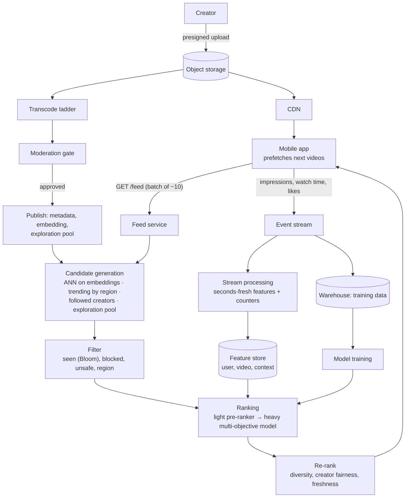
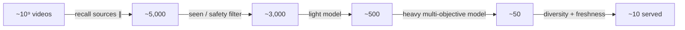

# 58 — Design TikTok (Short-Video Backend)

> **Prerequisites:** [18b §1 — YouTube](18b-design-media-productivity.md) (upload, transcode, CDN), [17b — ML Serving Infrastructure](17b-ml-serving-infrastructure.md) (recsys serving, feature stores), [DD-18 — Large Blobs](../Deep%20Dives/18-pattern-large-blobs.md), [DD-12 — Big-Data Structures](../Deep%20Dives/12-big-data-structures.md), [34 — Real-Time Analytics](34-design-realtime-analytics.md). The client side of this design is [Mobile 25 — TikTok](../Mobile%20System%20Design/25-tiktok-short-video.md).
>
> **The prompt:** *"Design TikTok: users upload short videos and scroll an endless, personalised 'For You' feed."* It looks like "YouTube with shorter videos". The differences decide the design: the feed is **recommendation-driven, not follow-driven**, a session consumes **a new video every few seconds**, and playback must start **instantly** or the user swipes away. The crux is the **recommendation serving funnel**, the **feedback loop** that feeds it, and **prefetching** the next videos.
>
> **Attempt first:** 35 minutes out loud before reading past this line.

## What you'll master

- Why a recommendation feed has **no fan-out problem** and a hard **candidate → rank → re-rank** latency budget instead.
- The **real-time feedback loop**: watch-time events updating features and counters within seconds.
- **Cold start** for new videos and new users, handled by deliberate exploration traffic.
- The **upload pipeline** (transcode ladder, moderation gate) and **instant playback** (small first segment, prefetch, CDN).
- How this differs from YouTube and from a follow-based feed like Twitter.

## In the Room — the decisive move

> *"The feed isn't built from who you follow, so there's no fan-out to design. Every request asks: **out of hundreds of millions of videos, which ten should this person see next?** That's a serving funnel: **candidate generation** pulls a few thousand videos from several sources (embedding similarity, trending in your region, followed creators, fresh uploads being explored), a **ranking model** scores them for predicted watch time and engagement, and a **re-rank** applies diversity and safety rules. It has to finish in about 200 ms. The second half is the **feedback loop**: every swipe and watch-through is an event that updates user and video features within seconds, because the signal from the last three videos is the best predictor of the next one. Videos are delivered like YouTube, with one twist: the client **prefetches the next few videos** so a swipe plays instantly. New videos get a small guaranteed audience so the system can learn whether they're good."*

### Decisions to make decisively

| Decision | Choice | Because |
|---|---|---|
| Feed model | **Recommendation funnel per request**; no precomputed per-user timeline | The candidate pool is global and the best signal is seconds old |
| Candidate generation | **Several recall sources merged**: two-tower embedding ANN, trending by region, followed creators, exploration pool | No single source finds everything; each covers the others' blind spots |
| Ranking | **A multi-objective model on ~1–2k candidates**: watch-time, completion, like, share, skip | Ranking the whole corpus is impossible; ranking only by likes ignores what people watch |
| Feedback | **Streaming pipeline: events → features and counters in seconds** | In-session behaviour is the strongest signal |
| Batch size | **Return ~8–10 videos per request; client asks again before running out** | Bounded ranking cost; fresh signal for the next batch |
| Cold start | **Guaranteed exploration impressions for new videos; popularity + onboarding signals for new users** | Otherwise new content never gets data and the system only shows old hits |
| Playback | **Small first segment + prefetch next 2–3 videos + CDN** | Time-to-first-frame decides whether the user stays |
| Upload | **Presigned direct upload → transcode ladder → moderation gate → publish** | The blob pattern; nothing is recommended before it passes moderation |
| Seen filter | **Per-user Bloom filter of recently served videos** | Cheap "never show twice" across sessions |

**Experience hook.** *"It's a search engine where the query is the user. The same retrieve-then-rank funnel, the same latency budget split, the same rule that the ranker can only pick from what retrieval surfaced."*

---

## 1. Requirements

**Functional.**
- Upload a short video (seconds to a few minutes) with caption, sound and hashtags.
- **For You feed:** endless vertical scroll of recommended videos.
- **Following feed:** videos from followed creators (the easy, secondary feed).
- Like, comment, share, follow; view counts.
- Search by hashtag, sound or text (a follow-up).

**Non-functional.**
- ~1B DAU; ~1 hour per user per day; a new video every ~10–20 s.
- **Feed request p99 < ~300 ms**; **time-to-first-frame < ~200 ms** on swipe.
- Recommendations react to in-session behaviour within seconds.
- Global delivery; high availability (a degraded feed is acceptable, an empty one is not).
- Safety: nothing is distributed before moderation.

**Non-goals to name:** the ranking model's architecture and training, live streaming ([36](36-design-live-streaming.md)), creator monetisation, and video editing tools.

> **Staff-level insight:** say what's absent. *"There's no fan-out on write here, because the feed isn't a function of the follow graph. All the difficulty moves to read time: a recommendation funnel under a latency budget, fed by a feedback loop."*

## 2. Back-of-envelope

| Quantity | Math | Result |
|---|---|---|
| Video views | 1B DAU × ~200 videos/day | **~200B views/day ≈ 2.3M/s** average |
| Feed requests | 200 videos ÷ ~10 per batch = 20 requests/user/day | **~20B/day ≈ 230k/s** average, **~600k/s** peak |
| Ranking work | 230k req/s × ~1,500 candidates scored | **~350M model scores/s**: needs batched GPU/accelerated inference and a cheap first-stage ranker |
| Engagement events | ~5 events per view (impression, progress, finish, like…) | **~1T events/day ≈ 12M/s**: the largest stream in the system |
| Uploads | ~30M videos/day | **~350/s** |
| Storage | 30M × ~15 MB (all renditions) | **~450 TB/day ≈ 160 PB/year** before tiering |
| Egress | 2.3M concurrent-ish streams × ~1.5 Mbps | **~3–4 Tbps**: a CDN/peering problem, the dominant cost |
| Video embeddings | ~10B videos × 64 dims × 1 byte (quantized) | **~640 GB**: an ANN index that fits in memory across a cluster |

Conclusions: **reads are recommendation compute**, not database lookups; the **event stream is enormous** and drives everything; **egress** is the bill. Uploads are comparatively small.

## 3. High-level design

- **Feed service** runs the funnel for each batch and returns video IDs with playback URLs.
- **Event stream** carries every impression and watch signal to a stream processor that refreshes features, and to the warehouse for training.
- **Upload pipeline** transcodes, moderates, computes the video's embedding and places it in the exploration pool.
- **CDN** serves video segments; the app prefetches ahead of the user.

## 4. Deep dive A — the recommendation funnel (the crux)

**Budget:** ~200 ms for the whole funnel, so each stage must cut the set by an order of magnitude or more.

| Stage | Input → output | How | Budget |
|---|---|---|---|
| **Candidate generation** | ~10⁹ videos → ~5,000 | Parallel recall sources (below) | ~30 ms |
| **Filter** | 5,000 → ~3,000 | Seen filter, blocks, safety, region/age rules | ~5 ms |
| **Pre-rank** | 3,000 → ~500 | A small, cheap model (or the retrieval score) | ~20 ms |
| **Rank** | 500 → ~50 | A large multi-objective model with full features, batched on accelerators | ~80 ms |
| **Re-rank** | 50 → ~10 | Diversity (no three videos from one creator or sound), freshness, fairness, ad slots | ~10 ms |

**Recall sources, merged:**
- **Embedding similarity (two-tower):** a user tower and a video tower trained so that the dot product predicts engagement. Video embeddings sit in an **ANN index** (HNSW or IVF-PQ, [DD-11](../Deep%20Dives/11-vector-databases.md)); the user embedding is computed at request time from recent behaviour and used as the query.
- **Item-to-item:** videos similar to the ones the user just watched to the end.
- **Trending by region and language:** top-K lists from the streaming counters.
- **Followed creators' recent uploads.**
- **Exploration pool:** new videos that need impressions (§5).

**Ranking objective:** predict several outcomes (finish, rewatch, like, share, follow, quick-skip as a negative) and combine them with weights product controls. Optimising likes alone favours bait; watch-time alone favours long videos. Training uses **logged served features** to avoid training-serving skew ([56 §5](56-design-ml-data-platform.md)).

**Degradation ladder** when ranking capacity is short: shrink the candidate set → skip the heavy ranker and use the pre-ranker → serve regional trending lists from cache. The feed never comes back empty.

> **Staff-level insight:** *"It's retrieve-then-rank with a budget per stage. Recall has to be wide and cheap, because the ranker can't pick a video recall never surfaced; the heavy model only sees a few hundred candidates; and the last step isn't a model at all, it's rules for diversity. When capacity is short I drop stages from the expensive end, and the fallback is a cached trending list, never an empty screen."*

## 5. Deep dive B — the feedback loop and cold start

**Seconds-fresh signals.** The strongest predictor of what a user wants next is what they did with the last few videos. So:
- The app sends **impression, play-progress, finish, skip, like, share** events (batched, compressed, with client timestamps and an idempotency key per event).
- A **stream processor** ([DD-07](../Deep%20Dives/07-flink.md)) updates, within seconds: the user's recent-interest features (a rolling embedding of recently finished videos), per-video counters (impressions, finishes, likes, by region), and creator stats.
- The next feed request reads those features from the online store. Batching 10 videos per request means the loop closes about every two minutes of viewing at worst, and the client can request early after strong signals (several skips in a row).
- **Counting at this scale:** per-video counters are sharded and coalesced ([Pattern 17](../Deep%20Dives/17-pattern-scaling-writes.md)); "trending" is a streaming top-K (Count-Min + heap, [DD-12](../Deep%20Dives/12-big-data-structures.md)); unique viewers use HyperLogLog. Displayed counts are approximate and eventually consistent.

**Cold start for videos.** A new video has no engagement data, so a model trained on engagement will never pick it. The fix is **staged exploration**: every approved video gets a small guaranteed batch of impressions (a few hundred) targeted by its content embedding (computed from frames, audio and text at upload). If its completion and engagement rates beat the threshold for its cohort, it graduates to a larger pool, and so on. This is a bandit-style explore/exploit trade, and it's what lets an unknown creator's video spread.

**Cold start for users.** With no history: use region, language, device and onboarding choices to pick popular, diverse videos; weight in-session signals heavily, since after ten videos there is a usable profile.

**Feedback loops are a risk as well as a feature.** A recommender trained on its own output narrows what people see. Exploration traffic, diversity rules in re-rank, and holdout groups that get a non-personalised feed keep it measurable.

## 6. Deep dive C — upload and instant playback

**Upload (≈350/s):**
- **Presigned, resumable upload** direct to object storage ([DD-18](../Deep%20Dives/18-pattern-large-blobs.md)); the app compresses before upload.
- **Transcode ladder:** several resolutions and bitrates, segmented for adaptive streaming. Short videos make this cheaper than YouTube's, since a whole video is a handful of segments, and the pipeline is a queue of idempotent jobs ([Pattern 19](../Deep%20Dives/19-pattern-long-running-tasks.md)).
- **Moderation gate:** automated classifiers (and hash-matching against known-bad content) run before publish; borderline cases go to human review. Status stays `pending` until approved.
- **On publish:** compute the content embedding, write metadata, add to the ANN index (incremental insert) and to the exploration pool.

**Playback:**
- **First segment small and fast:** the first second or two is encoded so it can start immediately at a conservative bitrate; quality steps up after.
- **Prefetch:** the feed response includes URLs for the whole batch, and the client downloads the first segment of the next 2–3 videos while the current one plays, bounded by network type and battery ([Mobile 25](../Mobile%20System%20Design/25-tiktok-short-video.md)).
- **CDN:** popular videos are cached at the edge; the long tail is served from regional origins. Since recommendations decide what gets watched, the ranker's top picks for a region can be **pre-warmed** at that region's edges.
- **Storage tiering:** most views happen in a video's first days; older, rarely watched videos move to cheaper storage with fewer renditions.

## 7. Failure drills — volunteer these

| Failure | Blast radius | Design answer |
|---|---|---|
| Ranking service overloaded | Slow or failed feed requests | Degradation ladder: fewer candidates → pre-ranker only → cached regional trending |
| Feature store unavailable | Rankers lack fresh features | Serve with default or last-known features; mark requests so training excludes them |
| Event pipeline lag | Recommendations stop reacting | Buffer in the log; feed still works on older features; alert on lag as a product SLO |
| ANN index stale or a shard down | Fewer embedding candidates | Other recall sources cover; query remaining shards; rebuild from the embedding store |
| A harmful video slips through and goes viral | Safety incident | Kill switch removes it from all recall sources and the CDN in minutes; reports fast-track review |
| Region CDN degraded | Playback stalls | Multi-CDN with client-side fallback; lower starting bitrate |
| Client replays events after a reconnect | Inflated counts | Idempotency key per event; dedupe in the stream processor |
| Popularity feedback loop | Feed homogenises | Exploration quota, diversity re-rank, holdout measurement |

## 8. The Staff & EM layer

- **The recommender is the product, so its objective is a leadership decision.** What the ranking weights optimise (watch time, satisfaction, creator diversity) shapes user wellbeing and the creator economy. It needs explicit ownership and guardrail metrics, not just an engineering default.
- **Cost is egress and inference.** Bitrate ladders, prefetch aggressiveness and CDN contracts are the egress levers; candidate counts and model size are the inference levers. Both trade directly against engagement, so they're decided with data.
- **Trust & safety gates distribution.** Moderation latency sets time-to-publish; under-investing shows up as incidents.
- **Experimentation is the operating system.** Every ranking change ships through A/B tests with holdouts; the platform for that is a first-class system ([37](37-design-feature-flags.md)).

### Altitude — the same probes at three levels

| Probe | Senior says | Staff says | EM adds |
|---|---|---|---|
| "How is the feed built?" | Precompute timelines | Per-request funnel: multi-source recall → filter → pre-rank → rank → re-rank, with a budget per stage | Who owns the objective function |
| "How does it react so fast?" | Retrain the model often | Streaming features updated in seconds; in-session signals; request early on strong signals | Event-lag as a product SLO |
| "New video with no data?" | Show it to followers | Staged exploration impressions targeted by content embedding; graduate on performance | Creator-fairness policy |
| "Instant playback?" | Use a CDN | Small first segment, prefetch the next videos, edge pre-warming, multi-CDN | Egress cost vs engagement trade |

## 9. Follow-ups they'll ask

1. **"The Following feed."** A normal timeline: fan-out on write for typical creators, pull for very large ones ([18a §4](18a-design-chat-social.md)).
2. **"Search by sound or hashtag."** An inverted index over captions, hashtags and sound IDs, ranked by engagement ([51](51-design-post-search.md)).
3. **"Duets / remixes."** A video references another's media; the transcode pipeline composes them; attribution lives in metadata.
4. **"Comments at scale."** Per-video comment store ranked by likes; live counts via sharded counters.
5. **"Data residency."** User data and event processing pinned per region; models trained per region or with privacy-preserving aggregation ([13b](13b-data-compliance-privacy.md)).

## Interview Cheat-Sheet

**One-liner:** *"No fan-out: each feed request runs a funnel over a global corpus. Several recall sources (two-tower ANN, trending, follows, an exploration pool) produce a few thousand candidates, a seen/safety filter and a light model cut them to hundreds, a multi-objective ranker picks ~50, and a rule-based re-rank returns ~10. A streaming feedback loop turns watch events into features within seconds, new videos get staged exploration impressions, and playback is instant because the client prefetches the next videos from the CDN."*

**Numbers:** ~1B DAU · ~200B views/day · ~230k feed requests/s (10 videos each) · ~12M events/s · ~350 uploads/s · ~450 TB/day stored · funnel budget ≈ 200 ms · egress in Tbps.

**The close:** *"I'd spend the whiteboard on the read path: a recall-wide, rank-narrow funnel with a per-stage budget and a degradation ladder; a feedback loop measured in seconds; and exploration so new content can earn distribution. Upload and delivery are the YouTube pipeline with shorter files and aggressive prefetch."*
