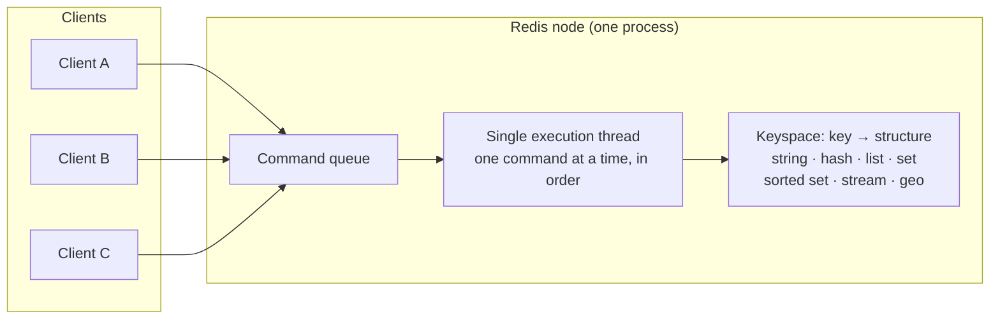
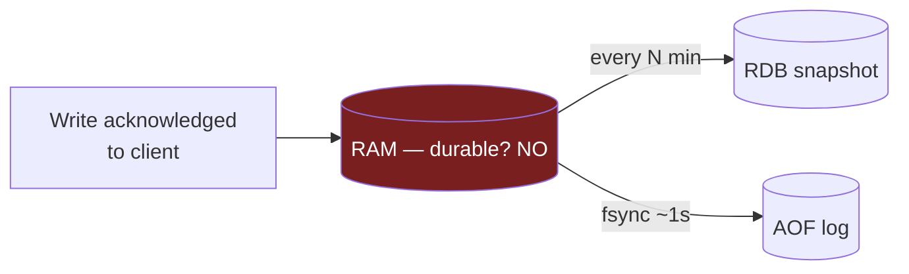
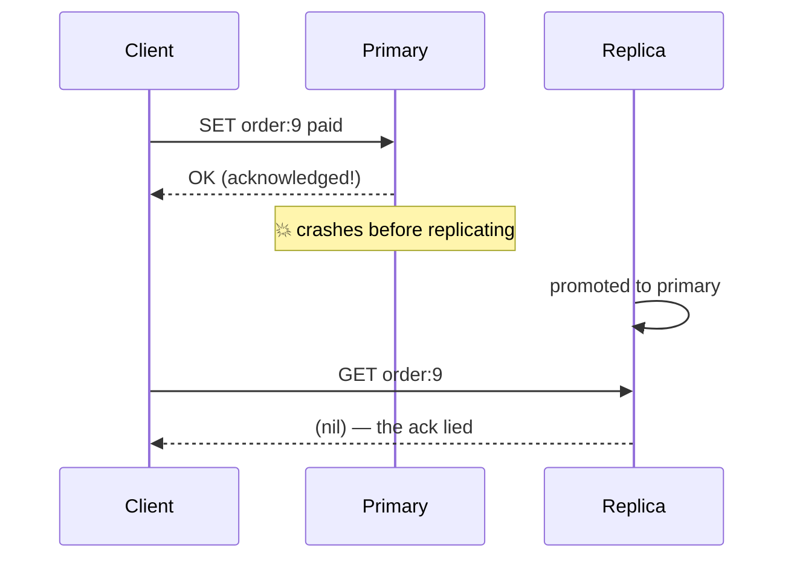
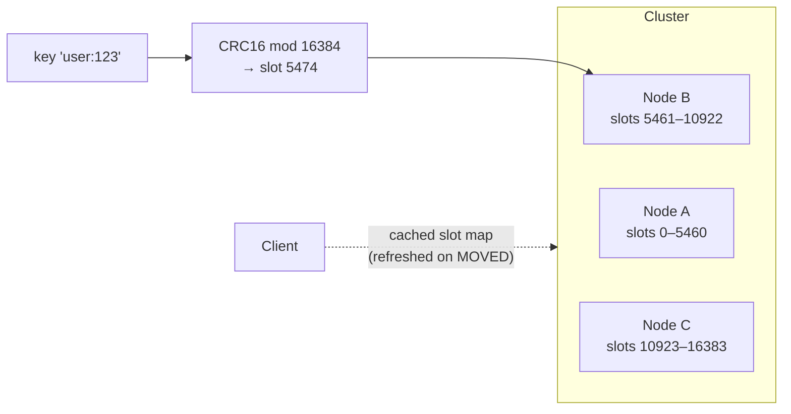
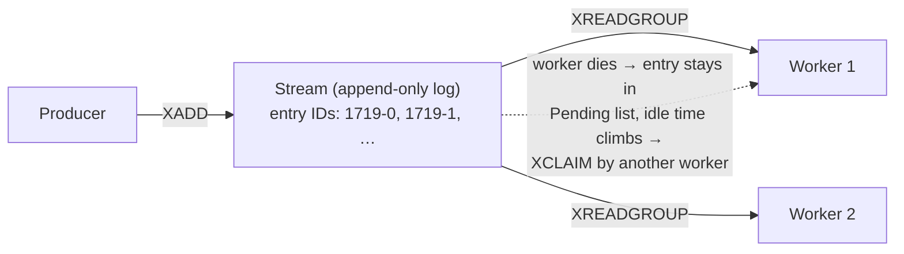
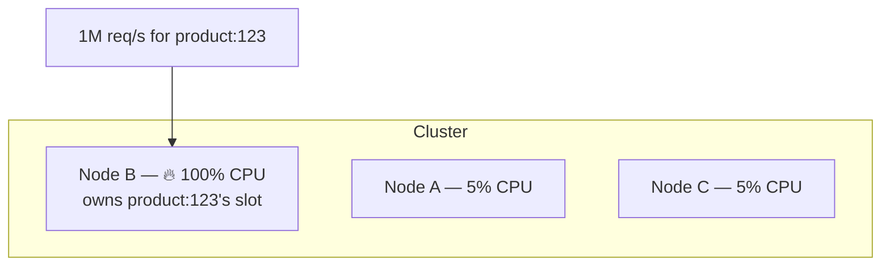

# Deep Dive 01 — Redis

> **Source:** [Redis Deep Dive w/ an Ex-Meta Senior Manager — Hello Interview](https://youtu.be/fmT5nlEkl3U) (+ their written deep dive).
> **Prerequisites:** [03 — Caching](../Core%20Course/03-caching.md) · [02 — Distributed Systems](../Core%20Course/02-distributed-systems.md). Pairs with [09 — Real-Time Systems](../Core%20Course/09-realtime-systems.md) and [18d — Infra Primitives](../Core%20Course/18d-design-infra-primitives.md).

## What you'll master

Redis is the single most name-dropped technology in system-design interviews — which means it's also where interviewers probe hardest. Saying "I'll cache it in Redis" is table stakes; a Staff candidate can explain *why the single-threaded model makes locks unnecessary*, *exactly which writes vanish when a primary dies*, *how 16,384 hash slots route a key*, and can reach for Redis as a **lock**, **leaderboard**, **rate limiter**, **geo index**, **queue**, or **pub/sub bus** — each with its failure mode pre-loaded.

By the end of this note you will be able to:

- Explain the **single-threaded, in-memory execution model** and why it makes every command atomic without locks.
- State the **durability contract** honestly: RDB vs AOF, what each loses on a crash, and why Redis is never a system of record.
- Walk through **replication (async) and Redis Cluster** (hash slots, MOVED redirects, hash tags) on a whiteboard.
- Deploy Redis for **7 distinct use cases** with the exact commands and the one failure mode each carries.
- Handle the **hot key problem** with three mitigations and their trade-offs.
- Say **when NOT to use Redis** — the fastest credibility win in the room.

---

## Table of Contents

0. [In the Room — Staff-Level Delivery](#in-the-room--staff-level-delivery)
1. [The Mental Model](#1-the-mental-model)
2. [Persistence & Durability](#2-persistence--durability)
3. [Replication & Redis Cluster](#3-replication--redis-cluster)
4. [Performance Numbers](#4-performance-numbers)
5. [The Seven Use Cases](#5-the-seven-use-cases)
   - [5.1 Cache](#51-cache)
   - [5.2 Distributed Lock](#52-distributed-lock)
   - [5.3 Leaderboard](#53-leaderboard-sorted-sets)
   - [5.4 Rate Limiter](#54-rate-limiter)
   - [5.5 Proximity Search](#55-proximity-search-geospatial)
   - [5.6 Streams — Queues & Event Sourcing](#56-streams--queues--event-sourcing)
   - [5.7 Pub/Sub](#57-pubsub)
6. [The Hot Key Problem](#6-the-hot-key-problem)
7. [When NOT to Use Redis](#7-when-not-to-use-redis)
8. [Interview Cheat-Sheet](#interview-cheat-sheet)

---

## In the Room — Staff-Level Delivery

### Decisions to make decisively

| Decision | Default position (say this) | One-line justification | Revisit trigger |
|----------|------------------------------|------------------------|-----------------|
| **Cache engine** | **Redis, cache-aside, TTL + `allkeys-lru`** | One engine covers cache + the four other structures I'll inevitably need | Pure ephemeral strings at extreme multicore throughput → Memcached defensible |
| **Distributed lock** | **Redis `SET NX EX` as an *efficiency* lock only** | Async replication means a failover can silently drop the lock — fine for dedup, not for correctness | Correctness-critical mutual exclusion → DB row lock or ZooKeeper/etcd |
| **Queue** | **Redis Streams for modest background jobs; Kafka for the real firehose** | Streams gives consumer groups + claims cheaply, but durability is only as good as AOF | Long retention, replay, multiple independent consumers, >100k msg/s → Kafka |
| **Ranking / top-K** | **Sorted set (`ZADD`/`ZRANGE`), capped with `ZREMRANGEBYRANK`** | O(log N) inserts and range reads at memory speed — purpose-built | Full historical ranking / analytics → OLAP store, keep Redis for the live window |
| **Real-time fan-out** | **Redis Pub/Sub for fire-and-forget; pair with Streams if offline delivery matters** | At-most-once by design; offline subscribers miss messages | Delivery guarantees needed → Streams / Kafka / push-notification fallback |
| **Scaling reads** | **Cluster + hash-tag key design first, replicas second** | Redis scales when most requests touch one node; key layout is the design decision | A single hot key emerges → §6 mitigations |

### Altitude — name-and-move-on vs deep-dive

**Name and move on (one sentence each):**
- "In-memory, single-threaded, so every command is atomic" — don't lecture on epoll.
- The data-structure list (string, hash, list, set, sorted set, stream, geo). Enumerate, move.
- Redis vs Memcached — land on Redis, move (full table lives in [03 — Caching §6](../Core%20Course/03-caching.md)).

**Deep-dive — spend your minutes here:**
- **Durability & failover** (§2–3): what acknowledged writes are lost on crash / failover — this is the probe behind every "I'll use Redis" claim.
- **The lock failure mode** (§5.2): primary dies after granting a lock, replica promotes without it → two holders. Knowing this cold separates Staff from Senior.
- **Hot keys** (§6): why adding nodes doesn't help one slot.

### Experience hooks

- *"We treat Redis locks as efficiency, not correctness — they stop duplicate work; the database constraint is what guarantees it."*
- *"Our rule of thumb: one Redis node ≈ 100k ops/s, so I size the cluster from the QPS estimate first and worry about memory second — it's almost always throughput-bound key design, not RAM, that bites."*
- *"We got burned by a hot key on a viral item — cluster was 10 nodes, but the load was all on one slot. More nodes did nothing; a local L1 cache on app servers fixed it in an afternoon."*

---

## 1. The Mental Model

Redis is an **in-memory, single-threaded data-structure store** written in C. Not "a cache" — a *data-structure server*: you speak commands over TCP that manipulate structures living in RAM.



**Why single-threaded matters (the insight, not the trivia):**

1. **Every command is atomic.** `INCR`, `ZADD`, a Lua script — nothing interleaves. No locks, no races *within one node*. This is why Redis is the go-to for counters, rate limiters, and locks.
2. **The mental model is simple.** You can replay any sequence of commands in your head and know the exact state. Newer versions offload I/O and background work to helper threads, but the model stays: *one command at a time, in order*.
3. **The corollary:** one slow command (`KEYS *`, a huge `ZRANGE`, an expensive Lua script) blocks *everything*. Latency spikes across all clients. Never run O(N)-over-the-keyspace commands on a hot path — `SCAN`, not `KEYS`.

**The structures and what they're for:**

| Structure | Core ops | Interview use |
|-----------|----------|---------------|
| String | `GET/SET/INCR` | cache values, counters, locks |
| Hash | `HSET/HGET` | objects (user profile fields) |
| List | `LPUSH/RPOP` | simple queues, recent-N lists |
| Set | `SADD/SISMEMBER` | dedup, membership, tags |
| **Sorted set** | `ZADD/ZRANGE` | **leaderboards, sliding windows, delay queues** |
| **Stream** | `XADD/XREADGROUP` | **queues with consumer groups, event log** |
| Geospatial | `GEOADD/GEOSEARCH` | proximity search (geohash on a sorted set) |

> **Staff-level insight:** the reason Redis is such a versatile interview tool is that its structures map 1:1 to the data structures you'd reach for in code (map, list, set, heap-ish sorted set). If you can say *"in a single process I'd use a sorted set — Redis gives me that same structure, shared and atomic, at memory speed"*, you can derive almost every use case below from first principles instead of memorizing them.

---

## 2. Persistence & Durability

Redis **deliberately trades durability for speed**. Two persistence modes, both lossy by default:

| Mode | How it works | What a crash loses | Cost |
|------|--------------|--------------------|------|
| **RDB** (snapshot) | Fork + dump the whole keyspace to disk periodically | Everything since the last snapshot (minutes) | Cheap; fork memory spike on big instances |
| **AOF** (append-only file) | Log every write; **fsync once per second** by default | Up to ~1s of *acknowledged* writes | Slower; bigger files; rewrite compaction |
| AOF `always` | fsync every write | ~Nothing | Kills the performance that justified Redis — almost nobody runs this |



**The sentence to say in the room:** *"Redis acknowledges writes from RAM — with default settings a crash loses up to a second of acknowledged writes, and a failover can lose more. So it's never my system of record; it's a performance layer in front of one."*

- Want Redis semantics *with* real durability? Name **AWS MemoryDB** — Redis-compatible, writes to a distributed transaction log before acking; slower writes, but survives node loss.

---

## 3. Replication & Redis Cluster

### Replication — asynchronous, and that's the whole story

Primary acks the client **before** replicas receive the write. Primary dies → replica promotes → **recently acknowledged writes simply vanish**.



This one diagram is behind three interview probes: cache inconsistency after failover (fine — it's a cache), the **lock failure mode** (§5.2), and why Redis can't be a ledger (§7).

### Redis Cluster — how sharding actually works

- The keyspace is divided into **16,384 hash slots**: `slot = CRC16(key) mod 16384`.
- Each slot is owned by exactly one node; slots migrate when you add/remove nodes.
- **Clients are smart:** they cache the slot→node map and connect *directly* to the right node — no proxy hop. If a slot moved, the node replies `MOVED`, the client refreshes its map and retries.



**Key design is the scaling decision.** Redis assumes most operations touch **one node**. Multi-key ops (transactions, Lua, `MGET`) only work when all keys share a slot. Force that with **hash tags**: only the `{...}` part is hashed — `{user:123}:profile`, `{user:123}:posts`, `{user:123}:counts` all land on the same node.

> **Staff-level insight:** when an interviewer asks "how does Redis scale?", the weak answer is "add more nodes." The strong answer is: *"Redis scales when the key design keeps each request on one node — I'd choose key names and hash tags up front so related data co-locates, and I'd accept that cross-slot operations are effectively forbidden."* Scaling Redis is a **data-modeling** decision, not a provisioning one.

---

## 4. Performance Numbers

Quote these; they anchor every capacity estimate (cross-ref [30 — Capacity Estimation](../Core%20Course/30-capacity-estimation.md)):

| Metric | Number to say |
|--------|---------------|
| Throughput, single node | **~100k writes/s** (reads similar or better) |
| Command execution | **microseconds** (it's a memory operation) |
| Client-observed read | **sub-millisecond** (network dominates) |
| Batching | `MGET` / pipelining → many commands, **one round trip** |

Consequence worth saying aloud: patterns that are catastrophic against a database — e.g. an N+1 read pattern — are merely *suboptimal* against Redis, because each round trip is sub-ms. Still pipeline, but it changes what you must optimize.

> **2026 currency (say this if asked "Redis or Valkey?"):** Redis's core is single-threaded for command execution, but since v6 it offloads network I/O to helper threads, and Redis 8 / Valkey 8 push single-node throughput toward **~1M ops/s** with enhanced I/O threading — the old flat "~100k ops/s" is now the *floor*, not the ceiling. Licensing: Redis moved off BSD to source-available (RSALv2/SSPLv1) in 2024, the Linux Foundation forked the last open build as **Valkey** (now the default engine story at AWS ElastiCache / GCP Memorystore), and Redis 8 (May 2025) **re-added an open-source license (AGPLv3)**. In an AWS design, "Valkey" is now the current word; treat Redis/Valkey as interchangeable for design purposes and name the fork so you sound current.

---

## 5. The Seven Use Cases

### 5.1 Cache

The default deployment. Cache keys → Redis keys, values → strings/hashes.

- **Staleness:** TTL on every key (`SET k v EX 3600`) — with jitter (see [03 — Caching §5.5](../Core%20Course/03-caching.md)).
- **Memory pressure:** `maxmemory` + `allkeys-lru` → it behaves like a big LRU map.
- Pattern, invalidation, stampede depth: that's [Module 03](../Core%20Course/03-caching.md)'s territory — this note adds the *engine* internals.

### 5.2 Distributed Lock

```
SET lock:order:9 <my-random-token> NX EX 30
```
- `NX` — only set if absent (atomic acquire, thanks single thread)
- `EX 30` — auto-expiry so a crashed holder can't deadlock everyone
- **Random token + Lua release** — release must check the token before `DEL`, else you delete a lock that expired and was re-acquired by someone else:

```lua
if redis.call("GET", KEYS[1]) == ARGV[1] then return redis.call("DEL", KEYS[1]) end
```

**The failure mode (know this cold):** lock is granted on the primary → primary dies before replicating → replica promotes *without the lock* → second client acquires it → **two lock holders**. Redlock (acquire on a majority of independent nodes) tries to fix this and is famously controversial (Kleppmann's critique: no fencing tokens, clock assumptions).

> **The line to say:** *"I treat a Redis lock as an efficiency tool that occasionally fails, not a correctness guarantee. It prevents duplicate work; if two holders would corrupt data, the real guard is a database constraint / row lock, or a consensus store like ZooKeeper with fencing tokens."*

### 5.3 Leaderboard (Sorted Sets)

Ranked data with O(log N) updates and range queries — at 100k ops/s this is what purpose-built looks like.

```
ZADD leaderboard 1523 user:42        # score = likes / points / karma
ZINCRBY leaderboard 1 user:42        # atomic increment
ZRANGE leaderboard 0 9 REV WITHSCORES  # top 10
ZREMRANGEBYRANK leaderboard 0 -1001  # cap: keep only top 1000
```

Use for: top-K posts, trending hashtags, game leaderboards, priority queues, **delay queues** (score = execute-at timestamp — cross-ref [35 — Scheduler](../Core%20Course/35-design-scheduler.md)).

### 5.4 Rate Limiter

Two designs — name both, pick per requirement (cross-ref [11 — Reliability](../Core%20Course/11-reliability.md)):

**Fixed window** — counter per user per window:
```
INCR rate:user:42:2026-07-03-10-15   → if result == 1, EXPIRE 60; reject if > limit
```
Wrap the INCR+EXPIRE in Lua so the expiry is set exactly once (atomically) — otherwise a crash between the two commands leaves an immortal counter. Weakness: 2× burst at window boundaries.

**Sliding window** — sorted set per user, timestamps as scores, all in one Lua script:
```
ZREMRANGEBYSCORE key 0 (now - window)   # drop old entries
ZCARD key                                # count remaining
if under limit → ZADD key now request-id
```
Exact, no boundary burst; costs memory per request. Single-threaded execution makes the whole check-and-add race-free.

### 5.5 Proximity Search (Geospatial)

```
GEOADD drivers -122.41 37.77 driver:88
GEOSEARCH drivers FROMLONLAT -122.40 37.78 BYRADIUS 5 km ASC
```

Internally: **geohash encoded into a sorted-set score** — nearby points sort nearby. Search = O(log M) seek + filter grid candidates to the exact radius. For *why* geohash works and when to reach for S2/quadtrees instead, see [29 — Geospatial](../Core%20Course/29-geospatial-systems.md).

### 5.6 Streams — Queues & Event Sourcing

Append-only log + **consumer groups** = a lightweight work queue:



- `XADD` append · `XREADGROUP` each entry delivered to **one** worker in the group · `XACK` on completion.
- **Failure recovery:** unacked entries sit in a **pending entries list** with idle time; another worker `XCLAIM`s stuck ones. That's redelivery → **at-least-once** → *workers must be idempotent*.
- **Durability caveat:** entries are only as durable as §2 says — default settings can lose the most recent entries on crash.

**Streams vs Kafka (the expected comparison):** Streams for modest-scale background jobs where you already run Redis — one less system. Kafka when you need long retention, replay, many independent consumer groups, or durable throughput at scale ([04 — Messaging](../Core%20Course/04-messaging-event-driven.md)).

### 5.7 Pub/Sub

`PUBLISH channel msg` / `SUBSCRIBE channel` — fire-and-forget broadcast.

- **At-most-once, zero persistence.** No subscriber listening → message vanishes. Offline = missed.
- Cheap channels: connection overhead is **per node, not per channel** — millions of channels ≠ millions of connections.
- Since Redis 7: **sharded pub/sub** (`SPUBLISH`/`SSUBSCRIBE`) routes channels by hash slot, so capacity scales with cluster nodes (classic pub/sub broadcast to every node did not).

Classic interview slot: **chat/WebSocket fan-out across app servers** — which server holds user B's socket? All servers subscribe for their connected users; Redis routes the message ([09 — Real-Time](../Core%20Course/09-realtime-systems.md), [18a — Chat](../Core%20Course/18a-design-chat-social.md)). Need offline delivery? Pair with Streams or the message DB — pub/sub is only the live path.

---

## 6. The Hot Key Problem

Cluster of 10 nodes, one viral key → **one slot, one node melts** while nine idle. Provisioning doesn't help; the load isn't spreadable by hashing.



| Mitigation | How | Trade-off |
|------------|-----|-----------|
| **Client-side / L1 cache** | App servers cache hot items in-process with short TTL | Staleness up to TTL; per-node coherence. Usually the first, best fix for read-hot |
| **RESP3 server-assisted client caching** (`CLIENT TRACKING`) | Redis 6+ *tracks* which keys each client cached and pushes an **invalidation message** when they change — a native L1 without the TTL-staleness gamble | Needs a RESP3-capable client + invalidation-handling code; per-key tracking has memory cost on the server (or use broadcast mode). The modern answer to "how do you keep the L1 coherent?" |
| **Key copies** | Write `product:123:1..10` (different slots); readers pick a random suffix | Must detect hot keys + maintain the copy list; writes ×N |
| **Read replicas** | Serve reads from each shard's replicas | Multiplies read capacity only; client config; does nothing for write-hot |

Write-hot key (e.g. a global counter)? None of the above help — **shard the counter** (`count:123:{0..9}`, increment one at random, sum on read).

> **Staff-level insight:** interviewers reward *proactively* naming the hot key risk when you introduce Redis into a fan-out-heavy design ("celebrity problem"), before being asked. One sentence: *"Uniform hashing assumes uniform access — a viral key breaks that, so I'd put a short-TTL L1 on the app tier for the head of the distribution."*

---

## 7. When NOT to Use Redis

The fastest credibility win is knowing the boundaries:

1. **System of record.** Async replication + relaxed fsync = acknowledged writes can vanish. Ledgers, orders, balances → a real database.
2. **Datasets that don't fit RAM economically.** RAM is ~10–30× the cost of SSD per GB. Cache the working set, not the corpus.
3. **Query flexibility.** No joins, no secondary-index-rich ad-hoc queries, no cross-slot multi-key ops in cluster mode. If the access pattern isn't key-shaped, Redis isn't the store.
4. **Durable, replayable, long-retention streams.** That's Kafka.

---

## Interview Cheat-Sheet

**One-liner:** *"In-memory, single-threaded data-structure server — every command atomic, ~100k ops/s/node, sub-ms reads; deliberately trades durability for speed, so it's a performance layer, never the system of record."*

**Numbers:** ~100k writes/s/node · µs command execution · sub-ms network read · 16,384 hash slots · AOF default fsync = 1s of loss.

**Structure → use case (recite):** string→cache/counter/lock · hash→object · sorted set→leaderboard/sliding-window/delay-queue · geo→proximity · stream→work queue · pub/sub→live fan-out.

**The four probes and your answers:**

| Probe | Answer |
|-------|--------|
| "What if Redis dies?" | Cache: degrade to DB (thundering-herd guard). Lock/queue: acknowledged state can be lost — that's why locks here are efficiency-only and workers are idempotent |
| "How does it scale?" | Cluster hash slots + smart clients; **key design keeps requests single-node** (hash tags); replicas for read fan-out |
| "Two clients race on X?" | Single-threaded ⇒ each command atomic; compose multi-step check-and-act in a Lua script |
| "One key goes viral?" | L1 client cache → key copies → replicas; write-hot → sharded counters |

**Say-verbatim lines:**
- *"Redis locks are an efficiency tool that occasionally fails, not a correctness guarantee."*
- *"Scaling Redis is a data-modeling decision — key layout — not a provisioning one."*
- *"Pub/sub is at-most-once; anything that must survive a disconnect goes through Streams or the DB."*
