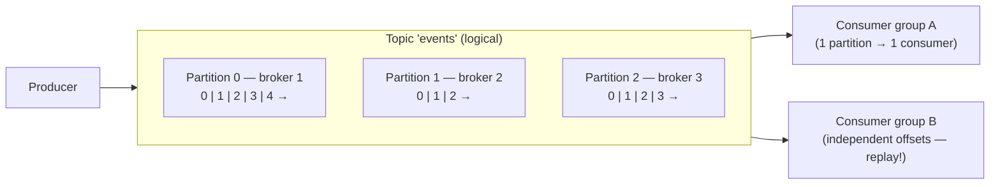
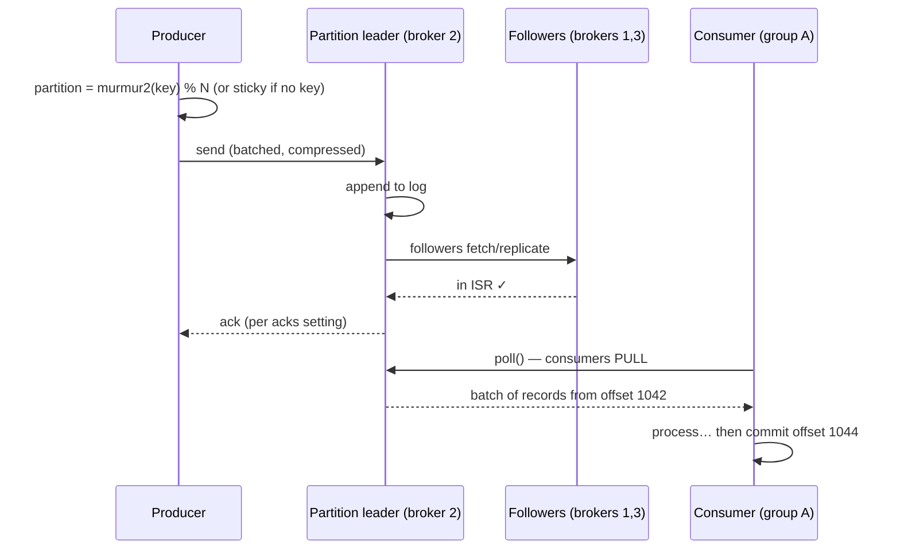
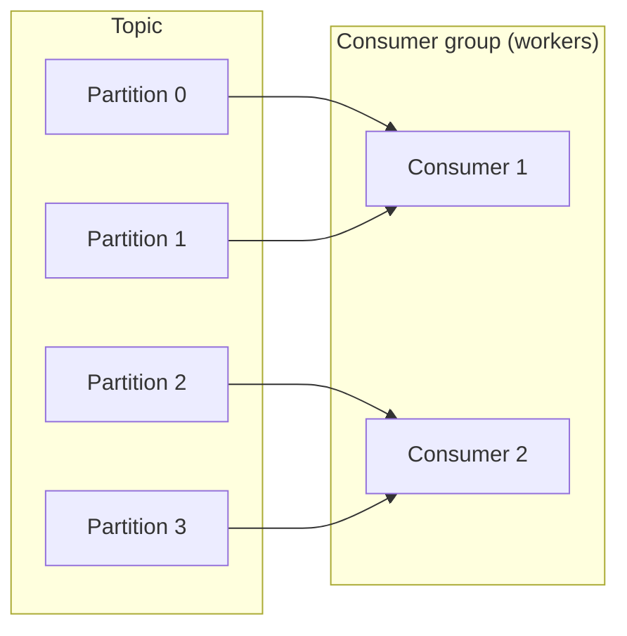
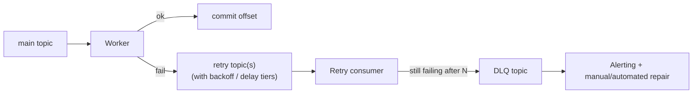

# Deep Dive 02 — Kafka

> **Source:** [Kafka System Design Deep Dive w/ an Ex-Meta Staff Engineer — Hello Interview](https://www.youtube.com/watch?v=DU8o-OTeoCc) (+ their written deep dive).
> **Prerequisites:** [04 — Messaging & Event-Driven](../Core%20Course/04-messaging-event-driven.md) · [02 — Distributed Systems](../Core%20Course/02-distributed-systems.md). Pairs with [16 — Data Processing](../Core%20Course/16-data-processing.md), [34 — Real-Time Analytics](../Core%20Course/34-design-realtime-analytics.md), [39 — IoT Ingestion](../Core%20Course/39-design-iot-ingestion.md), and [DD-01 — Redis](01-redis.md) (Streams comparison).

## What you'll master

Kafka shows up in almost every high-throughput design — and interviewers know candidates treat it as a magic pipe. The probes are predictable: *"what's your partition key?"*, *"what happens when a consumer dies mid-message?"*, *"one ad-id is 40% of your traffic — now what?"*. A Staff candidate answers all three without blinking, because they think of Kafka as what it actually is: **a partitioned, replicated, append-only log** — not a queue with extra steps.

By the end of this note you will be able to:

- Draw the **broker / topic / partition / offset / consumer-group** model and walk a message end-to-end.
- Choose a **partition key** deliberately — the one decision that determines ordering, parallelism, and hot spots.
- Explain **replication honestly**: leaders, ISR, `acks=all`, and what each `acks` level can lose.
- Quote the **numbers** that size a design: ~1M msg/s per broker, ~1TB practical storage, 1 MB message cap, 7-day default retention.
- Handle the **operational probes**: consumer rebalancing, commit timing, retries + DLQ (which Kafka does *not* give you), hot partitions.
- State **delivery guarantees** precisely — at-least-once by default, what idempotent producers and transactions actually add.
- Pick **Kafka vs SQS vs Redis Streams vs RabbitMQ** with a one-line justification each.

---

## Table of Contents

0. [In the Room — Staff-Level Delivery](#in-the-room--staff-level-delivery)
1. [The Mental Model — a Partitioned Log](#1-the-mental-model--a-partitioned-log)
2. [Life of a Message](#2-life-of-a-message)
3. [Partitioning & Keys — the One Decision That Matters](#3-partitioning--keys--the-one-decision-that-matters)
4. [Replication & Durability](#4-replication--durability)
5. [Performance Numbers & Why It's Fast](#5-performance-numbers--why-its-fast)
6. [Queue vs Stream — the Two Deployments](#6-queue-vs-stream--the-two-deployments)
7. [Consumers — Groups, Rebalancing, Commit Timing](#7-consumers--groups-rebalancing-commit-timing)
8. [Delivery Guarantees](#8-delivery-guarantees)
9. [Retries, Errors & Dead Letter Queues](#9-retries-errors--dead-letter-queues)
10. [Hot Partitions](#10-hot-partitions)
11. [Kafka vs the Alternatives](#11-kafka-vs-the-alternatives)
12. [When NOT to Use Kafka](#12-when-not-to-use-kafka)
13. [Interview Cheat-Sheet](#interview-cheat-sheet)

---

## In the Room — Staff-Level Delivery

### Decisions to make decisively

| Decision | Default position (say this) | One-line justification | Revisit trigger |
|----------|------------------------------|------------------------|-----------------|
| **Partition key** | **The entity whose events must stay ordered** (user-id, chat-id, order-id) | Same key → same partition → per-entity ordering for free; anything coarser risks hot spots, anything finer loses ordering | A single entity dominates traffic → §10 mitigations |
| **acks** | **`acks=all` + replication factor 3** | Losing acknowledged events is the one unforgivable failure; the latency cost is milliseconds | Lossy-tolerable telemetry firehose → `acks=1` and say why it's acceptable |
| **Delivery guarantee** | **At-least-once + idempotent consumers** | Exactly-once end-to-end is a myth across system boundaries; dedup at the sink is simpler and honest | Kafka-to-Kafka pipelines (Streams/Flink) → transactions are real there |
| **Commit timing** | **Commit offsets *after* the work is done** | Early commit = lost messages on crash; late commit = duplicates — and duplicates are recoverable, losses aren't | Very expensive processing → checkpoint progress externally |
| **Retries** | **Retry topic(s) + DLQ — Kafka gives you neither** | A poison message must not block the partition behind it | Low volume + built-in retry wanted → SQS was the right tool |
| **Queue tech** | **Kafka when ordering, replay, or >~100k msg/s matter; SQS otherwise** | Managed SQS erases ops burden and has retries/DLQ built in; Kafka earns its complexity only at scale or when the log semantics matter | Multiple independent readers of the same events → Kafka (fan-out is free) |

### Altitude — name-and-move-on vs deep-dive

**Name and move on (one sentence each):**
- Brokers/topics/partitions vocabulary. Define, move — everyone knows the words.
- "Pub/sub decouples producers from consumers." Yes. Move.
- ZooKeeper vs KRaft — **KRaft is the only mode now: ZooKeeper was removed entirely in Kafka 4.0 (March 2025)**. Say "metadata lives in a KRaft quorum, ZooKeeper is gone as of 4.0" — framing KRaft as a future/optional thing dates you two years.

**Deep-dive — spend your minutes here:**
- **Partition key choice** (§3) — say it *unprompted* the moment you draw Kafka. This is the #1 signal.
- **Failure semantics** (§7–8) — consumer crash before/after commit, producer retry duplicates, rebalancing pauses.
- **Hot partitions** (§10) — the scaling probe that follows every "hash by ad-id" answer.

### Experience hooks

- *"On our chat platform every message event is keyed by conversation-id — per-conversation ordering is the product requirement; global ordering is not, and saying that out loud is what keeps the design scalable."*
- *"We commit offsets after the webhook fires, not before — we accepted duplicate webhook deliveries and gave customers an idempotency key, because a dropped event is a support ticket and a duplicate is a no-op."*
- *"Our DLQ consumer pages us at N messages/hour — a poison message once blocked a partition for 40 minutes because retry logic was in-line; retry topics fixed that permanently."*

---

## 1. The Mental Model — a Partitioned Log

Kafka is **not a queue** — it's an **append-only log, split into partitions, replicated across brokers**. Consumers don't remove messages; they carry a bookmark (**offset**) along an immutable sequence. Everything else follows from this.

The vocabulary, precisely:

| Term | What it is | The nuance interviewers listen for |
|------|-----------|-------------------------------------|
| **Broker** | One Kafka server; stores partitions, serves clients | Scaling unit for storage + throughput |
| **Topic** | *Logical* grouping of messages | "A topic is logical; a **partition is physical**" |
| **Partition** | Ordered, immutable append-only log on disk | **Ordering exists only within a partition** — never across |
| **Offset** | Message's sequential position in its partition | Consumer state *is* just an offset — that's why replay is trivial |
| **Consumer group** | Set of consumers sharing the work | Each partition → exactly **one** consumer per group; groups are independent |
| **Controller** | Elected broker managing metadata/leadership | **KRaft** (Kafka's own Raft) — the only mode since 4.0 removed ZooKeeper (March 2025) |

> **Staff-level insight:** the log model is *why* Kafka has its superpowers. Multiple independent consumer groups = free fan-out (each keeps its own offset). Replay = rewind an offset. Ordering = positions in a file. When you explain Kafka features as consequences of "it's a partitioned log," you sound like you've operated it, not read about it.

---

## 2. Life of a Message

Points that earn credit:
- **Consumers pull; brokers don't push.** Pull lets consumers control their own rate — natural backpressure.
- A message = key, value, timestamp, headers. The **key is optional** — no key means sticky/round-robin spreading (max parallelism, no ordering).
- Producers **batch and compress** (GZIP/Snappy/LZ4/zstd) — a big part of the throughput story.

---

## 3. Partitioning & Keys — the One Decision That Matters

`partition = hash(key) % num_partitions` (murmur2). Same key → same partition → **strict order for that key**. This single line decides your ordering guarantee, your parallelism ceiling, and your hot-spot risk.

**How to choose (say this framework):**

1. **What must be ordered?** Key by that entity — and *only* that. Chat: conversation-id. Ride tracking: driver-id. Ad clicks: ad-id.
2. **Is any key a whale?** If one entity can dominate traffic, you've designed a hot partition (§10) — address it now, unprompted.
3. **No ordering requirement?** Send **no key** — sticky partitioning spreads load evenly and you keep maximum parallelism.

Also know: partition count is your **parallelism ceiling** (consumers in a group ≤ partitions get work), it's painful to change later (`hash % N` changes ⇒ key→partition mapping breaks ⇒ ordering breaks during transition), so **over-provision partitions up front** (e.g. 3× expected consumer count).

> **Staff-level insight:** the question "do we *actually* need ordering?" is worth asking in the room. Global ordering forces one partition = one consumer = no scale. Almost every real requirement is *per-entity* ordering, which partitioning gives you for free. Catching an interviewer's "ordered" requirement and narrowing it to "ordered per X" is a visible seniority move.

---

## 4. Replication & Durability

Each partition has a **leader** (serves all writes) and **followers** (replicate from the leader). Followers that are caught up form the **ISR — in-sync replica set**. Leader dies → controller promotes an ISR member.

| Setting | Ack returned when | Can lose acknowledged data? | Use |
|---------|-------------------|------------------------------|-----|
| `acks=0` | Immediately (fire-and-forget) | Yes, easily | Metrics you can drop |
| `acks=1` | Leader has written | Yes — leader dies before followers fetch | Loss-tolerant firehose |
| **`acks=all`** | **All ISR members have it** | **No** (with RF=3, `min.insync.replicas=2`) | **Default for anything that matters** |

- **Replication factor 3** is the standard: survive one broker loss with room to spare.
- Retention is **time/size-based, not consumption-based**: `retention.ms` (default **7 days**) / `retention.bytes`. Messages don't disappear when read — that's what enables replay and multiple groups.
- The honest availability line: *"Kafka is usually described as always available, sometimes consistent — with `acks=all` + `min.insync.replicas` you buy back the consistency at a latency cost."*

Contrast with [Redis' async replication](01-redis.md#3-replication--redis-cluster): Kafka with `acks=all` is the thing Redis deliberately isn't — a log you can treat as durable.

**The three internals an operator will probe past ISR (say these before you're asked):**
- **High-watermark (HW).** Consumers can only read up to the HW = the lowest offset replicated across *all* ISR members. So a record the leader has but followers don't is invisible to consumers — which is exactly why a failover can't "lose" data a consumer already saw.
- **Leader epoch.** Each leadership term has a monotonically increasing epoch stamped into the log. On failover a follower uses the epoch to find the correct divergence point and **truncate** any uncommitted tail (KIP-101) — this is what prevents divergent logs after a leader bounce, and it fences a **zombie leader** (an old partitioned leader whose stale-epoch writes are rejected).
- **Transaction fencing.** Exactly-once (`transactional.id`) works because the coordinator bumps a **producer epoch**; a zombie producer that resumes after its replacement started is fenced by its now-stale epoch, so it can't double-commit. The idempotent producer (PID + sequence number) closes the simpler retry-duplicate window at the single-partition level.

---

## 5. Performance Numbers & Why It's Fast

| Metric | Number to say |
|--------|---------------|
| Throughput, single broker | **~1M messages/s** (very hardware/size dependent — say so) |
| Practical storage per broker | **~1TB** of *local* hot data before you shard — but **tiered storage (KIP-405, GA in 3.9, late 2024)** offloads older segments to S3/object storage, so "long retention → add brokers" is no longer forced; retention and broker count decouple |
| Message size | Keep **< 1 MB** (`message.max.bytes`); big payloads → **S3 + pointer in Kafka** |
| Default retention | **7 days** |
| Replication factor | **3** |

Why a disk-based system is this fast (one breath each): **sequential appends** (disks are fast when you never seek) · **zero-copy** (`sendfile` from page cache to socket, skipping user space) · **batching + compression** end-to-end.

Capacity math you'll actually do in the room ([30 — Capacity Estimation](../Core%20Course/30-capacity-estimation.md)): *"Peak 500k events/s ÷ ~1M/s per broker ⇒ one broker could carry it, three for RF and headroom — Kafka is not the bottleneck here, let's move on."* That sentence — sizing it and *dismissing* it — is Staff behavior.

---

## 6. Queue vs Stream — the Two Deployments

Same log, two usage patterns — name which one you're doing:

| | **As a queue** (async work) | **As a stream** (continuous processing) |
|---|------------------------------|------------------------------------------|
| Consumers | One group of workers | Multiple independent groups; stream processors (Flink/Kafka Streams) |
| Goal | Decouple, absorb bursts, retry | Real-time aggregation, fan-out, replay |
| Classic problems | Video transcoding, webhook dispatch, order pipeline | [Ad-click aggregation](../Core%20Course/34-design-realtime-analytics.md), [IoT telemetry](../Core%20Course/39-design-iot-ingestion.md), CDC, feeds |

The **burst-absorber** framing is the most common interview deployment: traffic spikes 10×, Kafka soaks up the backlog, workers drain at their own pace, nothing falls over — and the backlog depth *is* your health metric (consumer lag).

> **2026 currency — the "Kafka isn't a real queue" line now needs a caveat.** Historically each partition went to exactly one consumer per group, so per-message-ack queue semantics (SQS-style) were impossible and the honest answer was "use SQS for a work queue." **KIP-932 "Queues for Kafka" (share groups)** — early-access in 4.0, maturing through 4.x — adds multiple consumers per partition with per-record acknowledgement, i.e. genuine queue semantics on Kafka. Say the old trade-off *and* that share groups are closing the gap; don't assert "Kafka can never be a queue" to an interviewer running 4.1.

---

## 7. Consumers — Groups, Rebalancing, Commit Timing

- **Rebalancing:** consumer joins/dies (missed heartbeats) → group coordinator reassigns partitions. The new owner resumes from the **last committed offset**. *Currency:* the old eager protocol stopped the whole group ("stop-the-world"); cooperative-sticky assignment reduced that, and **KIP-848 (the new broker-driven consumer-group protocol, default in 4.x)** removes the global sync barrier so a join/leave no longer pauses unaffected members. Say "incremental cooperative rebalancing via KIP-848," not "the group pauses."
- **Commit timing is the failure-semantics dial:**
  - Commit **before** processing → crash loses the message (**at-most-once**).
  - Commit **after** processing → crash re-delivers it (**at-least-once**) — the correct default; pair with idempotent processing.
- More consumers than partitions → the extras sit **idle**. Parallelism ceiling = partition count (§3).

---

## 8. Delivery Guarantees

**Default reality: at-least-once.** Two duplicate sources: producer retries (send succeeded, ack lost) and consumer redelivery after crash-before-commit.

What the knobs actually buy:

- **Idempotent producer** (`enable.idempotence=true`): broker dedups producer retries via sequence numbers. Kills *producer-side* duplicates; effectively free — turn it on (default in modern Kafka).
- **Transactions**: atomic writes across partitions + offset commits ⇒ **exactly-once within Kafka-to-Kafka pipelines** (Kafka Streams/Flink `read → process → write`).
- **The boundary truth**: the moment a consumer touches an external system (DB write, API call, email), exactly-once is gone — that side effect and the offset commit can't be atomic. **Idempotent sinks / dedup keys** are the real-world answer.

Say it in one line: *"At-least-once with idempotent consumers — I don't claim exactly-once across system boundaries, I design the sink so duplicates are no-ops."*

---

## 9. Retries, Errors & Dead Letter Queues

**Kafka has no built-in consumer retry or DLQ** (unlike SQS) — you build the pattern:

- **Why not retry in place?** A poison message would block its whole partition — everything behind it waits. Move it aside, keep the log flowing.
- Tiered retry topics (`retry-1m`, `retry-10m`, …) approximate delayed retries with backoff.
- **DLQ needs an owner:** monitoring, alert threshold, replay tooling. An unwatched DLQ is a silent data-loss pit.
- Producer-side retries *are* built in (`retries`, with idempotence preventing duplicates).

---

## 10. Hot Partitions

The scaling probe. Keyed by ad-id and one campaign goes viral → one partition takes 40% of traffic → its consumer melts while the rest idle. (Same disease as [Redis' hot key](01-redis.md#6-the-hot-key-problem) — uniform hashing assumes uniform access.)

| Mitigation | How | Cost |
|------------|-----|------|
| **Drop the key** | No key → sticky/round-robin spread | Lose ordering for everything — only if ordering wasn't needed |
| **Salt the whales** | Hot keys become `adid-0..9` (compound key) | Consumers must re-aggregate across salts; need hot-key detection |
| **Compound key by a second dimension** | `ad-id + region` / `+ user-segment` | Ordering now only per sub-key — check that's acceptable |
| **Backpressure** | Slow the producer when partition lag passes a threshold | Latency for the hot entity; protects the rest |

> **Staff-level insight:** the strongest form is *pre-empting* it: "I'm keying by ad-id for per-ad ordering — and that creates a hot-partition risk for viral ads, so the aggregation layer accepts salted sub-keys for the top-N ads." One breath, both halves. Waiting to be asked costs you the point.

---

## 11. Kafka vs the Alternatives

| | Pick it when | One-line against |
|---|--------------|-------------------|
| **Kafka** | Ordering, replay, multiple readers, >~100k msg/s, long retention | Ops burden (self-hosted); no built-in retry/DLQ; overkill for small queues |
| **SQS** | "Just a work queue" on AWS — retries, DLQ, visibility timeout built in | No ordering at scale (FIFO caps throughput), no replay, no fan-out (needs SNS) |
| **Redis Streams** | Modest queue and you already run Redis — one less system | Durability only as good as Redis persistence ([DD-01 §5.6](01-redis.md#56-streams--queues--event-sourcing)) |
| **RabbitMQ** | Complex routing (topics/headers exchanges), per-message ack, low latency | Throughput ceiling; queues aren't replayable logs |
| **Kinesis** | Kafka semantics, fully managed, AWS-native | Per-shard caps (1 MB/s in, 2 MB/s out), cost at scale, vendor lock-in |

Default script: **managed + simple → SQS; log semantics or scale → Kafka; already-in-Redis and modest → Redis Streams.**

---

## 12. When NOT to Use Kafka

1. **Request/response.** It's a log, not an RPC transport — nobody waits on a Kafka round trip.
2. **Small-scale async work.** A few hundred msg/s with retries wanted → SQS/RabbitMQ; Kafka's ops tax isn't earned.
3. **A database.** Long retention ≠ queryable; no indexes, no point reads. (Log-compacted topics as changelog/state backup — yes; primary store — no.)
4. **Guaranteed-latency delivery.** Consumer lag is a feature (buffering), which means delivery time is unbounded under backlog.

---

## Interview Cheat-Sheet

**One-liner:** *"Kafka is a partitioned, replicated, append-only log — ordering per partition, consumers track offsets, retention is time-based not consumption-based, which is why replay and multi-consumer fan-out are free."*

**Numbers:** ~1M msg/s per broker · ~1TB practical/broker · <1 MB messages (S3 + pointer above that) · RF=3, `acks=all`, `min.insync.replicas=2` · 7-day default retention.

**The decision that matters:** partition key = the entity that needs ordering; partition count = parallelism ceiling (over-provision, it's painful to change); no ordering need → no key.

**The four probes and your answers:**

| Probe | Answer |
|-------|--------|
| "Consumer dies mid-message?" | Uncommitted offset → redelivered to the rebalanced owner → at-least-once → idempotent processing |
| "Message fails repeatedly?" | No built-in retry: retry topics with backoff tiers → DLQ with alerting — never block the partition |
| "One key dominates traffic?" | Salt the hot key / compound key / drop keying if ordering isn't real — and re-aggregate downstream |
| "Exactly-once?" | Idempotent producer kills retry dupes; transactions = Kafka-to-Kafka only; across boundaries → idempotent sinks |

**Say-verbatim lines:**
- *"Ordering exists only within a partition — so I key by the entity that needs it and nothing coarser."*
- *"I commit offsets after processing: duplicates are recoverable, losses aren't."*
- *"Exactly-once ends at Kafka's edge — my sink is idempotent instead."*
