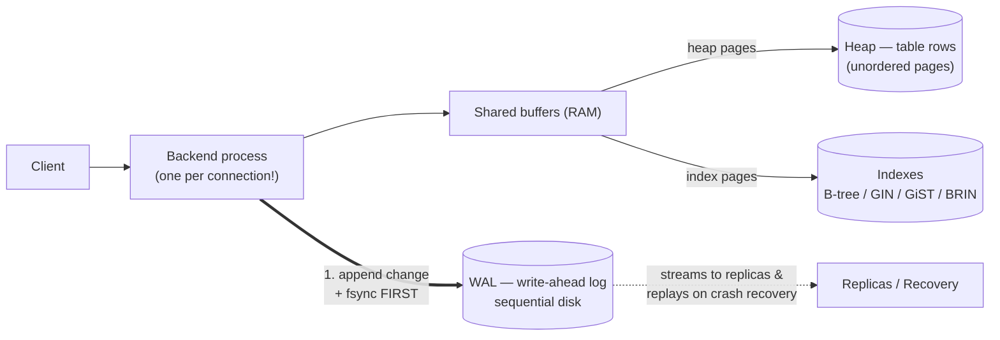
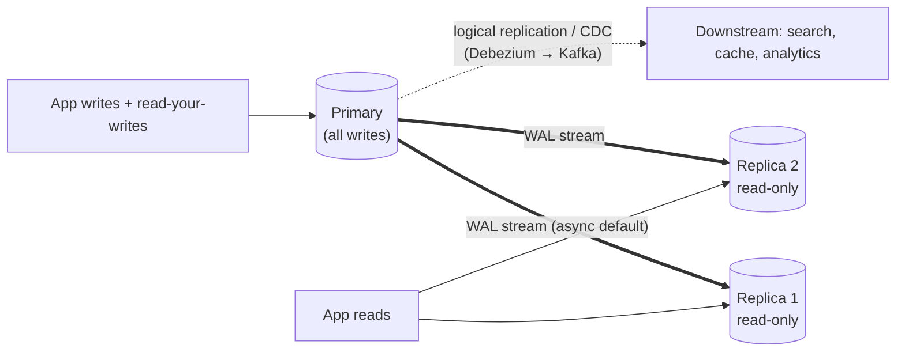
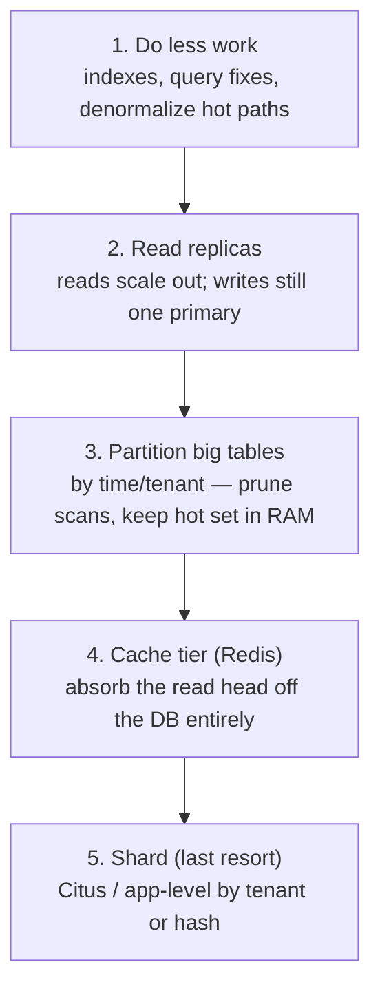

# Deep Dive 03 — PostgreSQL

> **Source:** [Hello Interview — PostgreSQL Deep Dive](https://www.hellointerview.com/learn/system-design/deep-dives/postgres) (their written guide; no public video for this one) + standard Postgres internals.
> **Prerequisites:** [06 — Databases](../Core%20Course/06-databases.md) · [01 — Fundamentals](../Core%20Course/01-fundamentals.md). Pairs with [02 — Distributed Systems](../Core%20Course/02-distributed-systems.md) (isolation/consensus), [32 — Migrations](../Core%20Course/32-migrations.md), and [DD-04/05 — Cassandra/DynamoDB](00-INDEX.md) as the contrast cases.

## What you'll master

Postgres is the **default answer** — the interesting question is when to *leave* it. Interviewers don't want DBA trivia; they want architectural judgment: can it handle these relationships, this write rate, this consistency need — and the two classic failure modes are diving into MVCC internals when nobody asked, or hand-waving "NoSQL scales better" without numbers. A Staff candidate says *"Postgres until proven otherwise"* and can name exactly what would prove otherwise.

By the end of this note you will be able to:

- Reason from the **mental model**: heap tables + MVCC + WAL — and derive vacuum, replication, and crash recovery from it.
- Pick the **right index type** (B-tree, GIN, GiST, BRIN, partial, covering) for a query in one sentence each.
- State **transaction/isolation behavior** precisely: Read Committed default, `SELECT FOR UPDATE`, `SKIP LOCKED`, serializable, and constraints-as-backstop.
- Walk the **scaling ladder** in order — indexes → replicas → partitioning → cache → shard — and defend stopping early.
- Quote the **numbers**: point reads sub-ms, ~10k+ simple writes/s per node, hundreds (not thousands) of connections, single-digit-TB comfort zone.
- Use the **Swiss-army features** that delete whole boxes from your diagram: JSONB, full-text search, `SKIP LOCKED` queues, LISTEN/NOTIFY, PostGIS.

---

## Table of Contents

0. [In the Room — Staff-Level Delivery](#in-the-room--staff-level-delivery)
1. [The Mental Model — Heap + MVCC + WAL](#1-the-mental-model--heap--mvcc--wal)
2. [Read Performance — Indexes](#2-read-performance--indexes)
3. [Write Performance](#3-write-performance)
4. [Transactions, Isolation & Locks](#4-transactions-isolation--locks)
5. [Replication & High Availability](#5-replication--high-availability)
6. [The Scaling Ladder](#6-the-scaling-ladder)
7. [The Swiss-Army Features](#7-the-swiss-army-features)
8. [When NOT to Use Postgres](#8-when-not-to-use-postgres)
9. [Interview Cheat-Sheet](#interview-cheat-sheet)

---

## In the Room — Staff-Level Delivery

### Decisions to make decisively

| Decision | Default position (say this) | One-line justification | Revisit trigger |
|----------|------------------------------|------------------------|-----------------|
| **Primary datastore** | **Postgres** | Relational data, ACID, and 30 years of tooling; every alternative is a specialization you adopt when a number forces you | A measured limit (write rate, size, geo-distribution) — not a vibe |
| **Isolation level** | **Read Committed (the default) + explicit row locks where it matters** | Serializable everywhere is a latency/retry tax; targeted `FOR UPDATE` on the few contended paths is cheaper and clearer | Genuine cross-row invariants under concurrency → Serializable on those transactions |
| **Correctness guard** | **Unique constraints + FKs in the DB, not only app checks** | The database is the last line that survives every buggy code path and race | — (this one doesn't move) |
| **Connections** | **PgBouncer from day one** | Postgres forks a process per connection; hundreds is fine, thousands is an outage | — |
| **Read scaling** | **Read replicas + accept the lag, route read-your-writes to primary** | Async replication lag is small but real; pretending it's zero creates "where's my post?" bugs | Sub-ms global reads needed → cache tier, not more replicas |
| **Sharding** | **Not yet.** Partition + replicas + cache carry you to ~single-digit TB and 10k+ writes/s | Sharding costs you cross-shard transactions and joins — the very reasons you chose Postgres | Sustained writes beyond one primary's ceiling, or data past comfortable single-node size |

### Altitude — name-and-move-on vs deep-dive

**Name and move on (one sentence each):**
- ACID definitions, "B-tree is O(log n)", SQL basics — assumed knowledge; reciting it reads junior.
- MVCC/WAL internals — *one* sentence to justify a behavior (e.g. "readers don't block writers"), then move. Don't lecture on tuple headers.
- Normalization theory. Nobody at Staff level is asked 3NF.

**Deep-dive — spend your minutes here:**
- **The scaling ladder** (§6) — this is the actual question behind "will Postgres scale?": show the ordered escalation and where the requirement lands on it.
- **Concurrency under contention** (§4) — double-booking, double-spending, inventory: `FOR UPDATE` vs constraint vs serializable, and which you'd pick.
- **Replication lag semantics** (§5) — read-your-writes, failover data loss with async replicas.

### Experience hooks

- *"Our rule is Postgres until proven otherwise — every service starts there, and two of ours have earned their way out (one write-rate, one search). The burden of proof is on leaving."*
- *"We got bitten by connection storms during a deploy — 2k app pods each opening 10 connections. PgBouncer in transaction mode fixed it; now the DB sees 80 connections, period."*
- *"Our booking path relies on a unique constraint, not application logic — the app check is UX, the constraint is correctness. It's caught every race a load test threw at it."*

---

## 1. The Mental Model — Heap + MVCC + WAL

Three pieces explain almost every Postgres behavior:



1. **Heap tables** — rows live unordered in 8 KB pages; indexes point into the heap. (Contrast MySQL/InnoDB, which clusters rows by primary key.)
2. **MVCC — multi-version concurrency control.** An `UPDATE` doesn't overwrite: it writes a **new row version**, and each transaction sees the versions visible to its snapshot. Consequences, derived not memorized: **readers never block writers** (huge for mixed workloads) · dead versions accumulate → **VACUUM** cleans them (autovacuum; neglect = bloat and, eventually, transaction-ID wraparound pain) · long-running transactions hold back cleanup.
3. **WAL — write-ahead log.** Every change is appended + fsynced to a sequential log *before* the data pages change. One log gives you three features: **crash recovery** (replay), **replication** (ship it), **point-in-time restore** (archive it). Durability is real on ack — the contrast with [Redis' relaxed fsync](01-redis.md#2-persistence--durability).

> **Staff-level insight:** WAL is the same idea as [Kafka's log](02-kafka.md#1-the-mental-model--a-partitioned-log) — an append-only, replayable source of truth. Saying "Postgres replication and CDC are just consumers of the WAL, like Kafka consumers on a topic" ties your whole stack story together — and explains why Debezium/CDC exists at all.

---

## 2. Read Performance — Indexes

Default: every query you care about is served by an index; a sequential scan on a big table in a hot path is a design bug. The menu (one sentence each):

| Index | Use it for | The one thing to say |
|-------|-----------|----------------------|
| **B-tree** (default) | Equality + ranges + ORDER BY | 99% of indexes; O(log n); what `CREATE INDEX` gives you |
| **Multi-column B-tree** | `WHERE a = ? AND b > ?` | **Column order matters**: leftmost-prefix rule — index (a,b) serves a-only, not b-only |
| **GIN** | JSONB containment, arrays, **full-text search** | Inverted index — "Elasticsearch's trick, inside Postgres" |
| **GiST / SP-GiST** | Geospatial (PostGIS), ranges, nearest-neighbor | The extensible tree family |
| **BRIN** | Huge append-only tables queried by time | Tiny index over page ranges — time-series tables' friend |
| **Partial** | `WHERE status = 'pending'` on a mostly-done table | Index only the hot slice — smaller, faster, cheaper writes |
| **Covering (`INCLUDE`)** | Read-heavy hot queries | Index-only scans — never touch the heap |

Two probes to pre-empt:
- **"Why not index everything?"** Every index is a write amplifier (each INSERT/UPDATE maintains all of them) and RAM competitor. Index the access paths you have, not the ones you imagine.
- **"How do you know it's using the index?"** `EXPLAIN ANALYZE` — saying it (and "the planner picks by estimated cost, stale stats mislead it") signals you've actually debugged one.

Numbers: point reads on an indexed key are **sub-millisecond** from buffer cache; a well-indexed single node comfortably serves **tens of thousands of reads/s**.

---

## 3. Write Performance

The write path: WAL append + fsync (sequential, fast) → data pages in memory → flushed lazily at checkpoints. So writes are cheaper than intuition suggests — but each one also pays **index maintenance × N indexes** and **MVCC garbage** for updates.

| Metric | Number to say |
|--------|---------------|
| Simple writes, single node | **~5–20k TPS** comfortably on good hardware (I/O + contention dependent — say so) |
| Point read, indexed, cached | **< 1 ms** |
| Connections | **Hundreds, not thousands** — process per connection → **PgBouncer** |
| Comfortable single-node size | **Up to single-digit TB** with discipline (partitioning, BRIN, archiving) |
| Replica lag (async, healthy) | **Milliseconds to low seconds** |

Levers when write-bound, in order: batch inserts (multi-row `INSERT`/`COPY`) · drop unused indexes · partition so hot data + indexes stay RAM-resident · move blob-ish payloads to object storage · only then talk sharding (§6).

---

## 4. Transactions, Isolation & Locks

Where interviews are won: the **double-booking / double-spend / inventory** probe. Know the toolbox and choose:

| Tool | What it does | When it's the answer |
|------|--------------|----------------------|
| **Read Committed** (default) | Each statement sees committed data; no dirty reads | Fine for most paths — say it's the default, don't upgrade blindly |
| **`SELECT … FOR UPDATE`** | Row lock — concurrent claimants queue | **The workhorse**: seat booking, wallet debit, inventory decrement |
| **`FOR UPDATE SKIP LOCKED`** | Grab unlocked rows, skip contended ones | **Job queue in Postgres** — N workers, no coordinator, no double-processing |
| **Unique / FK / CHECK constraints** | DB-enforced invariants | The **backstop** that survives every app bug — always present |
| **Repeatable Read** | Whole-transaction snapshot | Multi-statement reads needing one consistent view (reports) |
| **Serializable (SSI)** | True serializability; aborts conflicting txns | Cross-row invariants no row lock can cover — **must retry on 40001** |
| **Advisory locks** | App-defined named locks | Cross-table critical sections; cousin of [Redis locks](01-redis.md#52-distributed-lock) but consistent with your data |

The answer that scores on double-booking, verbatim: *"Transaction: `SELECT the seat FOR UPDATE`, check it's free, insert the booking — concurrent buyers serialize on the row lock. And a unique constraint on (event, seat) as the backstop, so even a code path that forgets the lock can't corrupt the invariant."*

> **Staff-level insight:** this is Postgres' real moat in interviews. Every "prevent X from happening twice" requirement is a one-liner here, and a distributed-locks-and-sagas adventure in most NoSQL stores. When correctness-under-concurrency is the crux, *that's* your argument for Postgres — not "I know SQL."

---

## 5. Replication & High Availability



- **Streaming (physical) replication** ships WAL to byte-identical replicas. **Async by default** → two consequences to state unprompted: **replica lag** (a user can miss their own just-written post → route read-your-writes to the primary or session-pin briefly) and **failover can lose the last moments** of acknowledged writes (RPO > 0).
- **Synchronous replication** (`synchronous_standby_names`): zero-loss ack at a latency cost — usually applied to one standby, or `ANY 1 (…)` quorum. Say the trade, pick per data class.
- **Failover is orchestrated, not native** — Patroni (consensus via etcd/ZK - [DD-08's territory](00-INDEX.md)) or the cloud's managed HA (RDS/Aurora/Cloud SQL). In an interview: "managed Postgres, multi-AZ, automated failover" and move on.
- **Logical replication / CDC**: decode the WAL into row-change events → Debezium → [Kafka](02-kafka.md) → search index, caches, warehouses. This is the standard "keep Elasticsearch in sync" answer and the backbone of [migration patterns](../Core%20Course/32-migrations.md).

### 5.5 Operational hazards — the third-why probes that separate "used it" from "read about it"

An interviewer who *runs* Postgres will push past features into failure modes. The three that catch people:

- **Replication-slot bloat (the Debezium footgun).** A logical replication slot (what CDC/Debezium uses) makes the primary **retain WAL until the consumer has read it**. If your Debezium connector is down over the weekend, WAL accumulates and **fills the primary's disk → the database stops accepting writes**. Say it unprompted: cap it with **`max_slot_wal_keep_size`** (drops the slot rather than killing the primary) and alarm on `pg_replication_slots` retained bytes. "A dead CDC consumer can take down the source DB" is the operator-grade sentence.
- **Vacuum, bloat, and transaction-ID wraparound.** MVCC's dead tuples are reclaimed by **autovacuum**, which is *single-threaded per table* and can fall behind on a high-churn table — table + index **bloat** (the table is 4× its data), and in the extreme, the 32-bit transaction counter approaches **wraparound**, forcing an anti-wraparound vacuum that can't be skipped (and historically took sites down). The chain that causes it: a **long-running transaction or an abandoned replication slot holds back the xmin horizon**, so autovacuum *can't* reclaim tuples even while it runs. The fixes to name: tune `autovacuum_vacuum_cost_limit`/scale factors on hot tables, kill zombie long transactions, and monitor `age(datfrozenxid)`. HOT updates + a lower `fillfactor` reduce the churn in the first place.
- **PgBouncer transaction-mode caveats.** Connection pooling is mandatory (each Postgres connection is a full backend *process*, ~1–2k is the practical ceiling), but **transaction-mode pooling breaks anything that relies on session state**: prepared statements, `SET`/session GUCs, advisory locks, and `LISTEN/NOTIFY` — because a client doesn't own a fixed backend between statements. Don't recommend PgBouncer transaction mode *and* `LISTEN/NOTIFY` in the same breath (a real contradiction to avoid). Use session mode where you need session state, or route those paths around the pooler.

---

## 6. The Scaling Ladder

The "will it scale?" answer is an *ordered escalation* — each rung is cheaper than the next, and you climb only when measurement forces you:



- Rungs 1–4 are cheap, reversible, and carry you to **~10k+ writes/s, 100k+ reads/s (with cache), single-digit TB** — which covers the overwhelming majority of interview problems. Do the [BOTEC](../Core%20Course/30-capacity-estimation.md), show the requirement fits, stop climbing.
- **Rung 5 costs you the product**: cross-shard joins and transactions — the reasons you picked Postgres — plus resharding pain and fan-out queries. Name a shard key (tenant-id, user-id), how you'd route, and that you'd re-evaluate the store choice (maybe the workload *is* [Cassandra](00-INDEX.md)-shaped) before paying it.

> **Staff-level insight:** "NoSQL scales better" is the junior line. The Staff line is: *"one Postgres primary gives me ~10k writes/s; the requirement is 800/s peak — we're two orders of magnitude inside the envelope, so choosing anything more exotic is unjustified complexity."* Numbers, envelope, decision.

---

## 7. The Swiss-Army Features

Each of these deletes a box from the architecture diagram — deploy them by name:

- **JSONB + GIN**: schemaless attributes inside a relational row — "document store for the flexible 20%, relations for the 80%." Kills the "we need Mongo for flexible fields" argument.
- **Full-text search** (`tsvector` + GIN): ranked, language-aware search. The move: *"Postgres FTS until search is a product pillar — then CDC into Elasticsearch"* ([07 — Search](../Core%20Course/07-search.md)).
- **`SKIP LOCKED` job queue**: transactional background jobs with zero extra infrastructure — the job enqueues **atomically with** the business write. Right up until throughput demands [Kafka/SQS](02-kafka.md).
- **LISTEN/NOTIFY**: lightweight pub/sub from the DB — cache invalidation hints, "wake the worker" pings.
- **PostGIS**: production-grade geospatial ([29 — Geospatial](../Core%20Course/29-geospatial-systems.md)) — proximity search without a specialized store.

The theme to say out loud: **every box you don't add is a failure mode you don't own.** One database doing five jobs adequately beats five perfect specialized systems you have to keep consistent — until a specific number says otherwise.

### 7.1 The `SKIP LOCKED` work queue — the mechanics

The one-liner above gets probed: *"OK, show me the claim query. What happens when a worker dies?"* Here is the full shape.

```sql
CREATE TABLE jobs (
  id           bigserial PRIMARY KEY,
  queue        text        NOT NULL,
  status       text        NOT NULL DEFAULT 'ready',   -- ready | running | done | dead
  run_at       timestamptz NOT NULL DEFAULT now(),     -- delayed jobs + retry backoff
  attempts     int         NOT NULL DEFAULT 0,
  locked_until timestamptz,                            -- the lease
  payload      jsonb       NOT NULL
);
-- partial index: the claim only ever looks at ready rows, so it stays small and O(log n)
CREATE INDEX jobs_claimable ON jobs (queue, run_at) WHERE status = 'ready';

-- ENQUEUE — in the SAME transaction as the business write (this is the whole point)
BEGIN;
  INSERT INTO orders (...) VALUES (...);
  INSERT INTO jobs (queue, payload) VALUES ('send_receipt', '{"order_id": 42}');
COMMIT;

-- CLAIM — each worker, N in parallel, no coordinator
UPDATE jobs
   SET status = 'running', attempts = attempts + 1,
       locked_until = now() + interval '5 minutes'
 WHERE id IN (
   SELECT id FROM jobs
    WHERE queue = 'send_receipt' AND status = 'ready' AND run_at <= now()
    ORDER BY run_at
    LIMIT 10
    FOR UPDATE SKIP LOCKED)          -- rows another worker is claiming are skipped, not waited on
RETURNING id, payload;
```

**Two ways to hold a job, and which to pick:**

| Style | How | Crash behaviour | Use when |
|---|---|---|---|
| **Lock-for-duration** | Claim with `FOR UPDATE SKIP LOCKED` and keep the transaction open while the job runs; delete/mark done and commit | Worker dies → transaction aborts → lock released, job instantly claimable | Jobs that take **milliseconds to a few seconds** |
| **Claim-and-lease** (above) | Commit the claim immediately with `locked_until`; a **reaper** resets `running` rows whose lease expired back to `ready` | Worker dies → job reappears after the lease | Anything longer: avoids long transactions (below) |

**Completion and failure:** success → `status='done'` (or `DELETE`). Failure → `status='ready', run_at = now() + backoff(attempts)`. When `attempts > max`, set `status='dead'`: that's your **DLQ**, with an alert, exactly as in [Pattern 19](19-pattern-long-running-tasks.md). The lease makes delivery **at-least-once** (a slow-but-alive worker can overlap its own redelivery), so handlers still need idempotency keys.

**The gotchas, each a real probe:**
- **Long transactions hold back VACUUM.** An open transaction pins the xmin horizon, so dead tuples *across the whole database* can't be cleaned. Lock-for-duration with a 10-minute job is a bloat incident. That's why leases exist.
- **Queue tables churn.** Every claim and completion is an UPDATE, i.e. a new tuple version. Tune autovacuum aggressively on `jobs`, keep the partial index, and either delete done rows promptly or **partition by day and drop old partitions**.
- **Ordering is best-effort.** `SKIP LOCKED` deliberately skips, so there's no strict FIFO, and per-key ordering needs an extra "one running job per key" guard.
- **Don't busy-poll.** Use `LISTEN/NOTIFY` (`NOTIFY jobs` in the enqueue transaction) to wake idle workers, with a slow poll as the safety net.
- **Connections.** Every worker holds a connection; lock-for-duration pins one for the job's lifetime. Go through PgBouncer and size the pool deliberately.

**Real tech:** this is the engine inside **Oban** (Elixir), **good_job / Solid Queue / Que** (Ruby), **River** (Go), **graphile-worker / pg-boss** (Node). Name one to show it's a mainstream pattern, not a hack.

**When to graduate** to [SQS / Kafka](02-kafka.md): sustained throughput in the **several-thousand jobs/s** range where queue churn starts competing with OLTP on the primary · you need **fan-out or replay** (that's a log, not a queue) · consumers in other teams or services should not need DB credentials. Until one of those is true, *"the job commits atomically with the order"* beats the dual-write problem that a separate broker introduces (the [outbox](02-kafka.md) exists to solve exactly that).

> **Staff-level insight:** the strongest argument for this pattern isn't "fewer boxes", it's **transactional enqueue**. With a separate broker, "write the order, then publish the job" is a dual write that loses or duplicates jobs on a crash between the two steps, and the standard fix (an outbox table plus a relay) is literally a Postgres queue table anyway. Say: *"The job row commits with the order, so no order can exist without its receipt job. Workers claim with `SKIP LOCKED` and a lease, a reaper handles dead workers, and dead-lettering is a status. I'd move to SQS when we pass a few thousand jobs/s or need fan-out."*

---

## 8. When NOT to Use Postgres

The credibility section — know what proves "otherwise":

1. **Sustained write firehose beyond one primary** (100k+ writes/s: telemetry, clickstream, IoT) → log-structured stores built to partition: [Cassandra](00-INDEX.md), or [Kafka](02-kafka.md) + OLAP.
2. **Simple key-value access at extreme scale + single-digit-ms SLOs everywhere** → [DynamoDB](00-INDEX.md)/Cassandra; you're paying for relational machinery you don't use.
3. **Analytics over billions of rows** (column scans, aggregations) → columnar OLAP: ClickHouse/BigQuery/Snowflake ([34 — Real-Time Analytics](../Core%20Course/34-design-realtime-analytics.md)). Row storage is the wrong shape.
4. **Multi-region active-active writes** → Postgres has no native multi-master; that's Spanner/CockroachDB/Dynamo-style territory — see the full treatment in [DD-34 — NewSQL / Distributed SQL](34-newsql-distributed-sql.md) (TrueTime vs bounded-clock-skew, 2PC-over-consensus, the latency you pay).
5. **Search as the product** → Elasticsearch via CDC; FTS is the bridge, not the destination.

---

## Interview Cheat-Sheet

**One-liner:** *"Postgres until proven otherwise — MVCC so readers never block writers, WAL for real durability and replication, and constraints that make concurrency-correctness a one-liner. What proves otherwise is a number: sustained writes past one primary, single-digit-TB outgrown, or an OLAP/search-shaped workload."*

**Numbers:** point read <1 ms · ~5–20k simple writes/s/node · tens of thousands reads/s · hundreds of connections (PgBouncer, always) · single-digit-TB comfort zone · async replica lag ms–seconds.

**Index menu (recite):** B-tree default · multi-column = leftmost prefix · GIN = JSONB/FTS · GiST = geo · BRIN = big time-series · partial = hot slice · covering = index-only scans.

**The four probes and your answers:**

| Probe | Answer |
|-------|--------|
| "Two users book the last seat?" | `SELECT FOR UPDATE` + unique constraint backstop — lock is the mechanism, constraint is the guarantee |
| "Will it scale?" | The ladder: indexes → replicas → partition → cache → shard-last; BOTEC the requirement onto a rung and stop |
| "Replica returns stale data?" | Async lag is real: read-your-writes to primary, session pinning, or sync replication for the class of data that can't tolerate it |
| "Why not NoSQL?" | Show the envelope: requirement is N writes/s vs ~10k+ capacity; relational integrity and transactions are features I'd have to rebuild |
| "Background jobs without Kafka?" | `SKIP LOCKED` queue: job row commits with the business write, workers claim with a lease + reaper, `status='dead'` is the DLQ; graduate at several k jobs/s or when fan-out/replay is needed |

**Say-verbatim lines:**
- *"The app check is UX; the constraint is correctness."*
- *"Sharding costs me the reasons I chose Postgres — it's the last rung, not the second."*
- *"Every box I don't add is a failure mode I don't own."*
