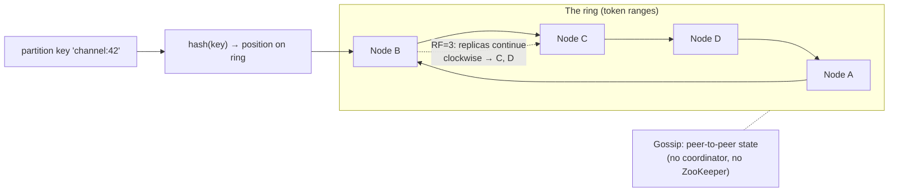
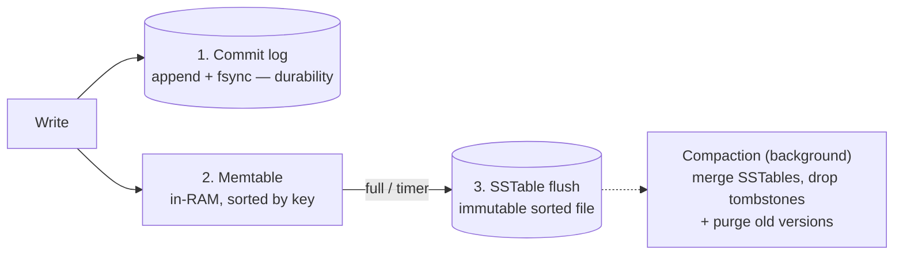
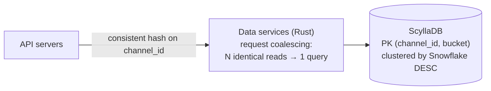

# Deep Dive 04 — Cassandra

> **Source:** [Cassandra Deep Dive w/ an Ex-Meta Staff Engineer — Hello Interview](https://www.youtube.com/watch?v=TD3-INhm60Q) (+ their written deep dive).
> **Prerequisites:** [06 — Databases](../Core%20Course/06-databases.md) · [02 — Distributed Systems](../Core%20Course/02-distributed-systems.md) (CAP, quorums, consistent hashing). Pairs with [DD-03 — PostgreSQL](03-postgresql.md) (the contrast case), [DD-02 — Kafka](02-kafka.md) (LSM ↔ log kinship), and [18a — Chat & Social](../Core%20Course/18a-design-chat-social.md) (its home turf).

## What you'll master

Cassandra is what you reach for when you've *outgrown* the [Postgres envelope](03-postgresql.md#6-the-scaling-ladder) on writes — and the interview probes test whether you understand the price. Saying "Cassandra scales writes" is table stakes; a Staff candidate designs the **partition key with bucketing** unprompted, states the **quorum math** (R + W > N), and knows the anti-patterns (queues, read-before-write, unbounded partitions) that melt real clusters.

By the end of this note you will be able to:

- Draw the **masterless ring**: consistent hashing, vnodes, gossip — and why there's no failover story (nothing to fail over *from*).
- Model data **query-first**: partition key vs clustering key, and the Discord-style `(channel_id, bucket)` pattern for bounded partitions.
- Explain **why writes are so fast** (LSM: commit log → memtable → SSTable) and what reads pay for it (bloom filters, compaction, tombstones).
- Do **tunable consistency** precisely: RF, consistency levels, R + W > N, hinted handoff, last-write-wins.
- Name the **anti-patterns** before the interviewer does — and when the honest answer is "use Postgres/DynamoDB instead."

---

## Table of Contents

0. [In the Room — Staff-Level Delivery](#in-the-room--staff-level-delivery)
1. [The Mental Model — a Masterless Ring](#1-the-mental-model--a-masterless-ring)
2. [The Data Model — Query-First, Partition-Key-First](#2-the-data-model--query-first-partition-key-first)
3. [The Write Path — Why Writes Fly (LSM)](#3-the-write-path--why-writes-fly-lsm)
4. [The Read Path — What Reads Pay](#4-the-read-path--what-reads-pay)
5. [Replication & Tunable Consistency](#5-replication--tunable-consistency)
6. [Partition Sizing & Hot Partitions](#6-partition-sizing--hot-partitions)
7. [Anti-Patterns — the Cluster-Melters](#7-anti-patterns--the-cluster-melters)
8. [Cassandra vs the Alternatives](#8-cassandra-vs-the-alternatives)
9. [When NOT to Use Cassandra](#9-when-not-to-use-cassandra)
10. [Case Study — How Discord Stores Trillions of Messages](#10-case-study--how-discord-stores-trillions-of-messages)
11. [Interview Cheat-Sheet](#interview-cheat-sheet)

---

## In the Room — Staff-Level Delivery

### Decisions to make decisively

| Decision | Default position (say this) | One-line justification | Revisit trigger |
|----------|------------------------------|------------------------|-----------------|
| **When to pick it** | **Write-heavy, availability-first, known access patterns** (messages, feeds, telemetry) | LSM writes + masterless ring = linear write scaling with no failover pause | Need transactions, ad-hoc queries, or strong consistency by default → stay in Postgres |
| **Partition key** | **The query's left-hand side + a time bucket if it grows forever** — `((channel_id, bucket), message_id DESC)` | One partition = one node visit = fast; unbounded partitions are a time bomb | Partition projected >~100 MB → bucket smaller |
| **Consistency level** | **`LOCAL_QUORUM` reads and writes** for user data | R + W > N gives read-your-writes without cross-DC latency | Telemetry/counters → `ONE` and say you're accepting staleness |
| **Replication** | **RF=3, NetworkTopologyStrategy** | Survive a node *and* a rack; SimpleStrategy is for laptops | Multi-region → per-DC RF (`dc1:3, dc2:3`) |
| **Second access pattern** | **Denormalize — write a second table** | Disk is cheap; scatter-gather isn't. Query-first modeling means one table per query | Low-QPS admin lookup → SAI index is acceptable |
| **Deletes** | **Design them out** (TTL, bucket-drop) rather than row-delete at volume | Deletes are tombstone *writes* — mass deletes make reads slower, not storage smaller | Occasional deletes → fine; queue-like churn → wrong database |

### Altitude — name-and-move-on vs deep-dive

**Name and move on (one sentence each):**
- "Dynamo's ring + Bigtable's storage engine" — the lineage, one breath.
- Gossip/vnodes/phi-accrual failure detection — name them as "how the ring self-manages," elaborate only if probed.
- CQL looks like SQL — say it, warn it doesn't join, move.

**Deep-dive — spend your minutes here:**
- **Partition key design + bucketing** (§2, §6) — this is 80% of using Cassandra well, and the #1 probe.
- **Quorum math** (§5) — R + W > N, and what breaks at `ONE`/`ONE`.
- **The LSM trade** (§3–4) — writes are cheap *because* reads pay (multiple SSTables, compaction debt, tombstones).

### Experience hooks

- *"On our chat platform the message table is textbook Cassandra: keyed by conversation, clustered by message-id descending, time-bucketed so a viral group chat can't grow one partition forever — same shape as Discord's design."*
- *"We learned partition discipline the hard way: one tenant's unbounded event stream hit multi-GB in a single partition and every read of it timed out. Bucketing by month fixed it — and now partition-size is a lint rule in schema review."*
- *"We run LOCAL_QUORUM both ways for user-facing data — the day we tried ONE/ONE to shave latency, support tickets about 'my message vanished then reappeared' arrived within the hour."*

---

## 1. The Mental Model — a Masterless Ring

Cassandra = **Dynamo's distribution + Bigtable's storage engine**: every node is equal (no primary, no failover), data placement via **consistent hashing** on a ring, cluster state via **gossip**.



- **Consistent hashing**: key hashes to a ring position; walk clockwise to find the owner. Node joins/leaves remap only a neighbor's slice — not `hash % N`'s wholesale reshuffle ([05 — Load Balancing](../Core%20Course/05-load-balancing.md) covers the general technique).
- **Vnodes**: each physical node owns many small token ranges, so load spreads evenly and a beefy machine can own proportionally more.
- **Gossip + phi-accrual failure detection**: nodes learn topology and detect failures peer-to-peer — no master to elect, no [ZooKeeper](00-INDEX.md) to consult.
- **Any node can coordinate** any request — clients connect anywhere; the coordinator forwards to replicas.

> **Staff-level insight:** the killer sentence is about what's *absent*: "There's no failover, because there's nothing to fail over — a node dying just means its replicas answer; writes it missed catch up via hinted handoff. Availability isn't a feature bolted on, it's the shape of the system." That's the CAP trade stated as architecture, not acronym.

---

## 2. The Data Model — Query-First, Partition-Key-First

You don't model entities and then query them (relational thinking) — **you start from the query and build the table that answers it in one partition.**

```sql
CREATE TABLE messages (
  channel_id  bigint,
  bucket      int,          -- e.g. 10-day window (Discord's trick)
  message_id  timeuuid,
  author_id   bigint,
  body        text,
  PRIMARY KEY ((channel_id, bucket), message_id)
) WITH CLUSTERING ORDER BY (message_id DESC);
```

| Concept | Role | The nuance |
|---------|------|------------|
| **Partition key** `(channel_id, bucket)` | *Where* the data lives — hashed to the ring | The query must supply it, or you scatter-gather the cluster |
| **Clustering key** `message_id DESC` | *Order* within the partition — sorted on disk | "Latest 50 messages" = one sequential read; ordering is free |
| **Wide rows** | Sparse columns, each value timestamped | No nulls stored; conflicts resolve **last-write-wins** by timestamp |
| **Keyspace** | DB-level unit owning replication config | Where RF and NetworkTopologyStrategy live |

**Multiple access patterns → multiple tables.** Need messages-by-channel *and* recent-messages-by-author? Write both tables (fan-out at write time). Denormalization isn't a workaround — it *is* the data model. (Materialized views and SAI indexes exist to soften this; treat them as conveniences for low-QPS paths, not the backbone.)

> **Staff-level insight:** in the room, *narrate the query before the table*: "The product query is 'latest N messages in a channel' — so the partition key is channel, clustered by message-id descending, bucketed by time so partitions stay bounded." Deriving the schema from the query, aloud, is exactly the skill this database exists to reward — it's the same discipline as [Kafka's partition-key choice](02-kafka.md#3-partitioning--keys--the-one-decision-that-matters), one layer down the stack.

---

## 3. The Write Path — Why Writes Fly (LSM)

Cassandra never updates in place — the storage engine is a **log-structured merge tree**:



- Every write = **one sequential log append + one memory insert**. No read, no seek, no in-place page edit — this is why a node sustains **~10k+ writes/s** and the cluster scales linearly by adding nodes.
- An "update" is just a newer timestamped write; the *ordering of updates* determines row state. A "delete" is a **tombstone** — also a write.
- **Compaction** is the deferred bill: background merging of SSTables reclaims space and purges tombstones. It costs I/O continuously — the system trades foreground write latency for background work.

Kinship worth saying: commit log ≈ [Postgres WAL](03-postgresql.md#1-the-mental-model--heap--mvcc--wal) ≈ [Kafka's log](02-kafka.md#1-the-mental-model--a-partitioned-log) — everything fast and durable is an append-only log underneath. Cassandra just refuses to ever pay the random-write cost, and shifts it to reads and compaction.

---

## 4. The Read Path — What Reads Pay

A row's fragments may live in the memtable **and** several SSTables (newest write wins per column). A read must merge them:

1. Check **memtable** (newest data).
2. **Bloom filters** — per-SSTable probabilistic "definitely not here" checks — prune the candidate files ([34 — Real-Time Analytics](../Core%20Course/34-design-realtime-analytics.md) reuses the same structure).
3. Read surviving SSTables newest→oldest via their partition indexes (key → byte offset), merge by timestamp.

Consequences to state:
- **Reads are good, not magical**: single-digit-ms when partitions are healthy and compaction keeps SSTable-count low. The LSM trade is *asymmetric* — writes optimal, reads adequate.
- **Tombstones haunt reads**: a deleted row still costs scan work until compaction purges it. Mass-delete patterns make reads *slower* over time — the root of the queue anti-pattern (§7).

---

## 5. Replication & Tunable Consistency

**Replication:** RF=3 with **NetworkTopologyStrategy** (rack- and DC-aware; per-DC counts like `'dc1':3, 'dc2':3`). Replicas = the next RF nodes clockwise (topology-adjusted).

**Consistency is per-request, not per-database** — the dial from CAP theory made concrete:

| Level | Ack from | Meaning |
|-------|----------|---------|
| `ONE` | 1 replica | Fastest; stale reads and vanished-then-reappearing writes possible |
| `QUORUM` | ⌊N/2⌋+1 | The workhorse; **`LOCAL_QUORUM`** = quorum within the local DC (no WAN wait) |
| `ALL` | every replica | Strongest and most fragile — one dead node fails the request; almost never right |

**The math to say:** with RF=3, quorum writes (2) + quorum reads (2) ⇒ **R + W > N** ⇒ every read overlaps at least one node that took the write ⇒ **read-your-writes** — while still tolerating a node down. `ONE`/`ONE` is when you've chosen raw speed and accepted staleness — say the acceptance out loud.

**Repair machinery** (name, one breath): **hinted handoff** — coordinator stores writes for a down node, replays on recovery · **read repair** — divergent replicas fixed opportunistically during reads · **anti-entropy repair** — scheduled Merkle-tree reconciliation. Conflicts resolve **last-write-wins** per column — which is also the warning: no multi-row transactions, no compare-and-swap in the normal path (lightweight transactions exist via Paxos, at several× the cost — if you need them often, wrong database).

### 5.5 The gc_grace / zombie-resurrection probe (the canonical Cassandra "gotcha")

The question a Cassandra operator *will* ask: *"a node was down for two weeks, you didn't run repair, and after it rejoined a deleted row came back — why?"* The answer ties tombstones and repair together:

- A delete writes a **tombstone**, kept only for **`gc_grace_seconds`** (default **10 days**), then purged by compaction.
- Repair must **propagate that tombstone to every replica within gc_grace**. If a replica misses the tombstone (it was down) *and* gc_grace elapses on the others so the tombstone is compacted away, that replica still holds the **old live value** — and on the next read/repair it **resurrects the deleted row (a "zombie")**.
- The rule to say: **run full repair on every node at least once per `gc_grace_seconds`** (i.e. weekly for the 10-day default). Lowering gc_grace to "save space" without tightening the repair cadence is exactly how teams cause zombies.

> **Staff-level insight:** *"Deletes in Cassandra are the operationally dangerous write, not the cheap one — a tombstone is a distributed promise that must reach every replica before gc_grace expires, or a down node resurrects the data. So I run repair within the gc_grace window, and at volume I design deletes out entirely (TTL + TWCS) so tombstones age out with whole SSTables instead of haunting reads."*

### 5.6 Compaction strategy is a design decision (STCS / LCS / TWCS)

Naming the compaction strategy is a strong "I've operated this" signal — the default (STCS) is wrong for two common shapes:

| Strategy | Best for | Trade |
|---|---|---|
| **STCS** (size-tiered, default) | Write-heavy, general | Fewest writes; but reads may touch many SSTables, and space amplification spikes during big compactions |
| **LCS** (leveled) | Read-heavy, update-heavy | Bounded SSTables-per-read (predictable read latency); pays **more write I/O** (higher write amplification) |
| **TWCS** (time-window) | **Time-series + TTL data** | Groups data into time windows and **drops whole expired SSTables** — the correct answer for the bucketed time-series tables Cassandra is famous for; never run STCS on TTL'd time-series |

The pairing to state: **time-series/TTL data → TWCS**, because expiry then reclaims an entire SSTable at once instead of scattering tombstones through size-tiered files.

---

## 6. Partition Sizing & Hot Partitions

The operational probe. A partition lives **entirely on its replica nodes** — it is the unit of locality *and* the unit of trouble:

- **Size guidance: keep partitions under ~100 MB** (and comfortably fewer than ~100k rows). Multi-GB partitions cause slow reads, compaction pain, and heap pressure.
- **Unbounded growth is a design bug**: `channel_id` alone means a busy channel's partition grows forever. **Bucket by time** — Discord's `(channel_id, bucket)` with 10-day windows — so each partition has a bounded lifetime; queries walk buckets newest-first.
- **Hot partitions** — same disease as [Kafka's](02-kafka.md#10-hot-partitions) and [Redis'](01-redis.md#6-the-hot-key-problem): a celebrity entity concentrates load on RF nodes. Mitigations: finer/composite partition key, salt the whales (`key-0..9` + merge on read), cache the hot head in [Redis](01-redis.md).

> **Staff-level insight:** volunteer the projection: *"1k messages/day/channel × 200 bytes × 10-day bucket ≈ 2 MB per partition — two orders of magnitude inside the 100 MB guidance; a viral channel at 100× is still fine."* Thirty seconds of [BOTEC](../Core%20Course/30-capacity-estimation.md) on partition size is the single strongest Cassandra-competence signal available in an interview.

---

## 7. Anti-Patterns — the Cluster-Melters

Name these *before* the interviewer does:

1. **Queue-in-Cassandra.** Enqueue = write, dequeue = delete = tombstone; readers scan ever-growing tombstone graveyards for the few live rows. Queues are [Kafka/SQS's](02-kafka.md) job.
2. **Read-before-write / check-then-act.** "Read, decide, write" races under last-write-wins; there's no cheap lock. If the workload is conditional updates, that's [Postgres row locks](03-postgresql.md#4-transactions-isolation--locks) or DynamoDB conditional writes.
3. **Unbounded partitions.** §6. Every "…and it grows forever" key needs a bucket.
4. **Secondary indexes as a primary access path.** Classic 2i queries fan out to every node. Denormalize into a second table; keep SAI for genuinely low-QPS lookups.
5. **Treating CQL like SQL.** No joins, no ad-hoc aggregations, `ALLOW FILTERING` is a full-cluster scan with a confession attached. If the queries aren't known up front, the model can't be query-first — wrong database.

---

## 8. Cassandra vs the Alternatives

| | Pick it when | One-line against |
|---|--------------|-------------------|
| **Cassandra** | Write-heavy + availability-first + known queries; multi-DC active-active; you can operate it (or use Astra/Keyspaces) | Ops burden; no transactions; query rigidity |
| **DynamoDB** ([DD-05](00-INDEX.md)) | Same data model, zero ops, pay-per-request, conditional writes built in | Cost at sustained high throughput; AWS lock-in; item/partition-throughput caps |
| **ScyllaDB** | Cassandra API, C++ rewrite, ~5–10× per-node throughput, lower tail latency | Smaller ecosystem; same modeling constraints |
| **HBase** | Bigtable-style with **strong consistency** per row + range scans; Hadoop gravity | Master-based (failover pauses); ops-heavy; weaker multi-DC story |

Default script: **AWS + don't want ops → DynamoDB; self-hosted / multi-cloud / multi-DC writes → Cassandra; Cassandra-but-faster → ScyllaDB.**

---

## 9. When NOT to Use Cassandra

1. **Strong consistency or transactions by default** — banking, inventory, booking. Last-write-wins and LWT-as-exception don't cut it → [Postgres](03-postgresql.md)/Spanner.
2. **Ad-hoc or evolving queries** — query-first modeling assumes you *know* the queries; exploratory workloads → relational or OLAP.
3. **Read-dominated workloads at modest scale** — you're paying the LSM read tax and ops burden for write scaling you don't need → Postgres + replicas + cache.
4. **Small scale, full stop.** A three-node distributed database to serve 200 writes/s is résumé-driven design — the [YAGNI](../Core%20Course/20-staff-execution.md) tell.

---

## 10. Case Study — How Discord Stores Trillions of Messages

> **Sources:** Discord engineering blog, *"How Discord Stores Billions of Messages"* (2017) and *"How Discord Stores Trillions of Messages"* (2023). Figures below are as Discord reported them. Quote them as "roughly", not as precise specs.

This is the best real-world arc for a chat-storage round, because it shows the **whole life** of a Cassandra decision: why they chose it, the schema that made it work, what broke at 100× the scale, and what they changed. Most candidates know only the schema.

**Act 1 — the choice (2015–2017).** Discord started on MongoDB. Once the message collection outgrew RAM, latency became unpredictable. The workload was **write-heavy, read-recent, append-only, and keyed by channel**, the textbook profile (§0 decisions table). They moved to Cassandra on a small cluster (on the order of a dozen nodes) holding billions of messages.

**The schema** (the §2/§6 reflex, applied):

```
PRIMARY KEY ((channel_id, bucket), message_id)   -- clustered DESC by message_id
  message_id = Snowflake (time-ordered, unique)  → "newest first" is a clustering scan
  bucket     = fixed time window derived from the Snowflake timestamp (~10 days)
```

Bucketing bounds partition size, so a busy channel can't grow one partition forever. Reading history walks buckets newest-first until the page is full.

**The Act 1 lessons that still get asked:**
- **Tombstone graveyards.** A public channel where most messages had been deleted forced reads to scan huge numbers of tombstones to find a few live rows, causing GC pressure and timeouts (the §5.5 failure). Fixes: shorten `gc_grace_seconds` (safe *only* because repair ran reliably inside that window) and skip known-empty buckets.
- **Nulls are tombstones.** Writing `null` columns writes tombstones. They changed writes to send **only non-null columns**.
- **Eventual consistency in practice:** a concurrent edit and delete could resurrect a partial row under last-write-wins. They handled it at read time by dropping rows missing a required column.

**Act 2 — what broke at trillions (2017–2022).** The cluster grew to roughly **177 nodes**, and operating it became the problem rather than the data model:
- **Hot partitions.** A huge server's channel concentrated reads on one partition's RF replicas. Because consistency was quorum, *a slow replica slowed every query routed to it*, and the latency spread across the cluster (the §6 disease, at scale).
- **JVM GC pauses** caused unpredictable tail latency, and on-call spent its time rebooting nodes and nursing them back.
- **Compaction fell behind**, so reads touched more SSTables and got slower, which caused more load: a slow-burn feedback loop.

**Act 3 — the fix was two moves, not one.**
1. **ScyllaDB** (the §8 "Cassandra-but-faster" row): same data model and CQL, C++ with no GC, shard-per-core. Reported result: about **72 nodes** replaced 177, with **p99 reads around 15 ms** (versus roughly 40–125 ms before) and **p99 writes a steady ~5 ms**.
2. **A data-services layer in Rust between the API and the database.** This is the part that matters for interviews. Requests are **routed by consistent hashing on `channel_id`**, so every request for one channel lands on the same data-service instance, which performs **request coalescing**: if 1,000 users open the same hot channel at once, *one* database query runs and all 1,000 waiters get its result. This protects the database from hot partitions *regardless of which database is behind it*.

**The migration:** a purpose-built Rust migrator copied trillions of messages at a reported **~3.2M messages/s** and finished in **about 9 days**, using the standard expand/contract shape: dual-write new data, backfill history, validate by sampled comparison reads, then cut over ([32 — Migrations](../Core%20Course/32-migrations.md)).



> **Staff-level insight:** the lesson to say in the room isn't "ScyllaDB is faster than Cassandra." It's: *"The schema was right from day one, with bounded, time-bucketed partitions. What failed at 100× was **hot-partition read amplification and operational toil**. The structural fix was a **coalescing layer routed by the partition key**, which makes a hot channel cost one query instead of a thousand; swapping in a GC-free engine was the second lever."* That's the general move for any celebrity/hot-key read problem: **route by key, then coalesce** ([03 — Caching](../Core%20Course/03-caching.md) single-flight is the same idea). Experience hook: *"we put a single-flight layer keyed by entity ID in front of our hottest table, Discord-style, and p99 stopped tracking the biggest tenant's traffic."*

---

## Interview Cheat-Sheet

**One-liner:** *"Masterless Dynamo-style ring with a Bigtable LSM engine — writes are a log append so they scale linearly; consistency is a per-request dial (LOCAL_QUORUM both ways gives read-your-writes); the whole game is partition-key design: query-first, time-bucketed, bounded."*

**Numbers:** ~10k+ writes/s/node, linear with nodes · single-digit-ms reads on healthy partitions · partitions **<100 MB / <100k rows** · RF=3, `LOCAL_QUORUM` (2 of 3) · quorum rule **R + W > N**.

**Schema reflex (recite):** `PRIMARY KEY ((entity_id, time_bucket), clustering_id DESC)` — partition = the query's WHERE, clustering = its ORDER BY, bucket = its growth bound.

**The four probes and your answers:**

| Probe | Answer |
|-------|--------|
| "A node dies?" | Nothing elects, nothing pauses — replicas serve, hinted handoff replays missed writes on recovery; that's why quorum, not ALL |
| "Why are writes so fast?" | Commit-log append + memtable insert — never read, never seek; compaction pays the bill in the background |
| "One channel goes viral?" | Time-bucketed partition key bounds size; salt or cache the truly hot head; show the partition-size BOTEC |
| "Can I update if unchanged / lock a row?" | Not cheaply — LWW races and LWTs are expensive Paxos; frequent conditional writes mean Postgres or DynamoDB instead |
| "What happens at Discord scale?" | Schema survives (`(channel_id, bucket)`, Snowflake DESC); hot partitions + GC + compaction debt break ops → coalescing data-service routed by `channel_id` + ScyllaDB (~177 → ~72 nodes, p99 reads ~15 ms) |

**Say-verbatim lines:**
- *"You don't model the data, you model the queries — one table per access pattern; disk is cheap, scatter-gather isn't."*
- *"There's no failover because there's nothing to fail over — availability is the architecture, and eventual consistency is its price."*
- *"Every partition key gets a growth story: mine is bounded by the time bucket."*
