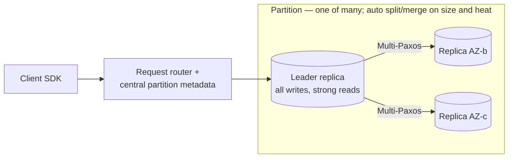

# Deep Dive 05 — DynamoDB

> **Source:** [DynamoDB Deep Dive w/ an Ex-Meta Staff Engineer — Hello Interview](https://www.youtube.com/watch?v=2X2SO3Y-af8) (+ their written deep dive).
> **Prerequisites:** [06 — Databases](../Core%20Course/06-databases.md) · [DD-04 — Cassandra](04-cassandra.md) (shared data model — read it first; this note leans on the contrast). Pairs with [14 — Cloud](../Core%20Course/14-cloud.md) and [30 — Capacity Estimation](../Core%20Course/30-capacity-estimation.md) (cost math).

## What you'll master

DynamoDB is Cassandra's data model with the opposite operational philosophy: **AWS runs it, you pay per request, and the limits are contractual**. That changes what interviewers probe — less "how does the ring work," more "what's your key design, what does it cost, and what happens at 3,001 RCU on one partition?" A Staff candidate treats the published limits as *design inputs* and knows the two features Cassandra can't match: **conditional writes** and **zero-ops autoscaling**.

By the end of this note you will be able to:

- Design **partition key + sort key** schemas for real access patterns (composite keys, hierarchies, time series) and defend Query-never-Scan.
- Choose **LSI vs GSI** correctly and state the GSI trap: eventually consistent, separately provisioned, and able to backpressure the base table.
- Quote the **contractual numbers**: 400 KB items, 3,000 RCU / 1,000 WCU per partition, RCU/WCU definitions, and rough $/million requests.
- Use **conditional writes and transactions** — the concurrency story Cassandra's last-write-wins can't offer.
- Deploy the **ecosystem** by name: Streams (CDC), DAX, Global Tables, TTL — each deleting a box from your diagram.
- Argue **DynamoDB vs Cassandra** in one breath and know when cost kills it.

---

## Table of Contents

0. [In the Room — Staff-Level Delivery](#in-the-room--staff-level-delivery)
1. [The Mental Model — a Managed, Leader-Based KV](#1-the-mental-model--a-managed-leader-based-kv)
2. [Key Design & Access Patterns](#2-key-design--access-patterns)
3. [Indexes — LSI vs GSI](#3-indexes--lsi-vs-gsi)
4. [Consistency, Conditional Writes & Transactions](#4-consistency-conditional-writes--transactions)
5. [Capacity, Cost & the Contractual Numbers](#5-capacity-cost--the-contractual-numbers)
6. [Hot Partitions & Write Sharding](#6-hot-partitions--write-sharding)
7. [The Ecosystem — Streams, DAX, Global Tables, TTL](#7-the-ecosystem--streams-dax-global-tables-ttl)
8. [DynamoDB vs Cassandra (and Friends)](#8-dynamodb-vs-cassandra-and-friends)
9. [When NOT to Use DynamoDB](#9-when-not-to-use-dynamodb)
10. [Interview Cheat-Sheet](#interview-cheat-sheet)

---

## In the Room — Staff-Level Delivery

### Decisions to make decisively

| Decision | Default position (say this) | One-line justification | Revisit trigger |
|----------|------------------------------|------------------------|-----------------|
| **When to pick it** | **On AWS + key-shaped access + no ops appetite** | Single-digit-ms at any scale with zero cluster management; the limits are documented, not discovered | Not on AWS / need open-source portability → [Cassandra](04-cassandra.md); relational access → [Postgres](03-postgresql.md) |
| **Key design** | **PK = the query's entity, SK = its order/hierarchy** — same query-first reflex as Cassandra | Query with keys is ms and cheap; Scan is a table-wide bill | A second access pattern → GSI, not Scan |
| **Capacity mode** | **On-demand** to start | Pay-per-request, zero capacity planning; switch to provisioned when traffic is proven-steady | Predictable sustained load → provisioned (+autoscaling) is ~5–7× cheaper |
| **Consistency** | **Eventually consistent reads** (half-price, any replica) + **conditional writes** where correctness matters | Most reads tolerate ~ms staleness; invariants belong on the write path, not the read path | Read-your-write UX need → strongly consistent read (2× RCU) or DAX-bypass |
| **Concurrency** | **`ConditionExpression` (optimistic, per-item) first; transactions only for true multi-item invariants** | Conditional writes are cheap CAS; `TransactWriteItems` costs ~2× and adds latency | Cross-item atomicity genuinely required → transaction, ≤100 items |
| **Single-table design** | **Know it, don't perform it** — one table per aggregate is fine in interviews | Single-table optimizes for GSI reuse and ops minimalism; it obscures the design conversation an interview is *for* | An access pattern that genuinely needs item collections co-located |

### Altitude — name-and-move-on vs deep-dive

**Name and move on (one sentence each):**
- The Dynamo-paper lineage ("the 2007 paper inspired Cassandra; the product is leader-based, not the paper") — one breath of history, no more.
- 3-AZ replication, encryption, VPC endpoints — "managed durability," move.
- PartiQL — it's sugar over Query/Scan; don't let SQL syntax fool you into relational claims.

**Deep-dive — spend your minutes here:**
- **Key + GSI design against stated access patterns** (§2–3) — this is the whole interview use of DynamoDB.
- **The per-partition limits and hot keys** (§5–6) — 3,000 RCU / 1,000 WCU is where "infinitely scalable" meets physics.
- **Cost as a first-class constraint** (§5) — the probe that separates "used it" from "sized it."

### Experience hooks

- *"We model DynamoDB tables in a design doc as a list of access patterns first — table and GSIs fall out of that list. If a new pattern shows up post-launch, that's a GSI backfill, which is why the list gets adversarial review."*
- *"A marketing campaign once pinned one tenant's partition at the 1,000 WCU ceiling — the fix was write-sharding that tenant's key with a suffix and merging on read. Adaptive capacity isolates the heat; it doesn't raise the per-key ceiling."*
- *"Our idempotency layer is one conditional write: `attribute_not_exists(pk)` on the request-id. No locks, no read-first — the database rejects the duplicate for us."*

---

## 1. The Mental Model — a Managed, Leader-Based KV

The data model is Cassandra's; the architecture is *not* the masterless ring. Know the difference — it's a favorite probe:

- **Tables → items → attributes.** Primary key = **partition key** (hashed to a partition) + optional **sort key** (B-tree-ordered within the partition). Schema is flexible per item; items are capped at **400 KB**.
- **Each partition = a 3-replica Paxos group across 3 AZs** with a **leader**: writes go to the leader, eventually-consistent reads can hit any replica, strongly-consistent reads hit the leader. Contrast [Cassandra](04-cassandra.md#1-the-mental-model--a-masterless-ring): leader-based consensus vs masterless quorums — which is exactly *why* DynamoDB can offer strong reads and conditional writes cheaply.
- **Partitions split and merge automatically** (by size and by heat) under a central metadata service. You never see nodes — only the two knobs (keys, capacity) and the published limits.

> **Staff-level insight:** the one-liner that shows you know both systems: *"DynamoDB took Dynamo's data model and Cassandra's use cases, but swapped the masterless ring for per-partition Paxos leadership — trading 'always writable anywhere' for strong reads, CAS, and transactions. Same table shape, opposite CAP corner."*

---

## 2. Key Design & Access Patterns

Same religion as [Cassandra §2](04-cassandra.md#2-the-data-model--query-first-partition-key-first): **enumerate the queries, derive the keys.** The API enforces it:

- **`Query`** — needs the partition key, optionally sort-key conditions (`=`, `<`, `BETWEEN`, `begins_with`) — milliseconds, pay only for what you read.
- **`Scan`** — reads the entire table. In an interview, Scan in a hot path is an auto-fail; say it preemptively.

The three composite-key patterns to have ready:

| Pattern | Keys | Serves |
|---------|------|--------|
| **Entity + time series** | PK `chat:42`, SK `msg#<timestamp>` | "Latest N messages" — `Query … ScanIndexForward=false LIMIT N` |
| **Hierarchy in the sort key** | PK `user:7`, SK `order#2026#07#04#1234` | Prefix queries at any depth via `begins_with` |
| **Sparse/overloaded keys** | PK `tenant:9`, SK `profile` / `sub#stripe` / `device#ios#…` | One partition holds an entity's whole aggregate — the heart of single-table design |

**On single-table design** (the community's favorite debate): packing all entities into one table with overloaded keys maximizes GSI reuse and minimizes ops — and makes schemas unreadable. Interview stance: *mention* it ("I'd consider single-table if access patterns interleave entities"), then use one-table-per-aggregate so the design stays legible. Nobody fails for two tables; people fail for unexplainable keys.

Unbounded-growth discipline also carries over: a busy entity's partition wants a **time bucket** in the PK for the same reasons as [Cassandra §6](04-cassandra.md#6-partition-sizing--hot-partitions) — plus item-collection limits when LSIs are involved (10 GB).

---

## 3. Indexes — LSI vs GSI

Second access pattern? You don't get to re-key the table — you add an index:

| | **LSI** | **GSI** |
|---|---------|---------|
| Keys | Same PK, **different SK** | **Any PK + SK** |
| Infrastructure | Co-located; **shares** table throughput | **Separate replicas**, separately provisioned |
| Consistency | Can serve **strong** reads | **Eventually consistent, always** |
| Limits | Create at table-creation only; 10 GB per key value | Up to 20; add anytime (backfill) |

**Default to GSI** — LSIs' creation-time-only rule and 10 GB collection cap make them a niche tool (strong-consistency-on-alternate-sort-key is the one real use).

The GSI facts interviewers fish for:
1. **It's a materialized copy** — writes to the base table are asynchronously replicated to each GSI (a write costs WCUs on the table *and* every GSI it projects into).
2. **It lags** — read-after-write against a GSI can miss; design flows accordingly.
3. **An under-provisioned GSI throttles the base table** — the classic invisible-coupling outage. Provision GSIs like the tables they are.

---

## 4. Consistency, Conditional Writes & Transactions

Per-request dial, like Cassandra — but with a stronger top end:

- **Eventually consistent read** (default): any replica, **0.5 RCU**/4 KB, ~ms staleness window.
- **Strongly consistent read**: leader only, **1 RCU**/4 KB — "reflects all successful writes before the read." Not available on GSIs or from DAX.
- **Conditional writes** — the crown jewel vs Cassandra's [last-write-wins](04-cassandra.md#7-anti-patterns--the-cluster-melters): `ConditionExpression: attribute_not_exists(pk)` (idempotency, claim-a-username), `version = :expected` (optimistic locking), `balance >= :amount` (no overdraft). **Check-and-act is a first-class, single-request operation.**
- **Transactions**: `TransactWriteItems` / `TransactGetItems` — up to **100 items across tables**, serializable, ~**2× the WCU/RCU cost** + latency. Use for true multi-item invariants (transfer between two items); don't scatter them as a comfort blanket.

The line to say: *"Invariants go on the write path as condition expressions — I almost never need a strongly consistent read, because I never read-then-decide; the write itself decides."*

---

## 5. Capacity, Cost & the Contractual Numbers

DynamoDB is the one database where **cost math is part of the design review** — capacity units are the pricing *and* the throttling model:

| Fact | Number |
|------|--------|
| **1 WCU** | 1 write/s of ≤1 KB |
| **1 RCU** | 1 strong read/s of ≤4 KB (= 2 eventual reads) |
| **Item size cap** | **400 KB** (big payloads → S3 + pointer — same rule as [Kafka's 1 MB](02-kafka.md#5-performance-numbers--why-its-fast)) |
| **Per-partition ceiling** | **3,000 RCU / 1,000 WCU** — per partition, hence per hot key |
| Rough on-demand price | **~$0.125 / M strong reads (4 KB), ~$0.625 / M writes (1 KB)** — us-east-1, after AWS's Nov-2024 ~50% on-demand cut; eventual reads are half again |
| Modes | **On-demand** (pay-per-request) vs **provisioned** (reserve + autoscale; ~5–7× cheaper if utilized) |

Worked BOTEC to perform in the room: *chat app, 10k msg/s peak, 300-byte messages (≤1 KB = 1 WRU each) → 10k WCU on-demand ≈ 10k writes/s × $0.625/M ≈ **$0.00625/s ≈ ~$16k/month at sustained peak** — comfortable. Push the same design to a 100k writes/s firehose and it's ~$160k/month, and *that's* where provisioned capacity or Cassandra-on-your-own-metal enters the conversation.* That sentence — throughput → dollars → architecture consequence — is the single strongest DynamoDB signal you can send. The honest answer to "why doesn't everyone just use DynamoDB" is calibrated: **on-demand is cheap for bursty and moderate workloads; only at true firehose write volume (100k+ writes/s sustained) does the pay-per-request premium become the largest line item.** (Don't quote the old "six-figure at 10k writes/s" scare — after the 2024 price cut it's wrong by ~9×.)

Also: reads bill for the **full item** regardless of `ProjectionExpression` — another nudge to keep items small and split hot attributes from cold blobs.

---

## 6. Hot Partitions & Write Sharding

Same disease, third appearance ([Redis](01-redis.md#6-the-hot-key-problem), [Kafka](02-kafka.md#10-hot-partitions), [Cassandra](04-cassandra.md#6-partition-sizing--hot-partitions)) — with a managed twist:

- **Adaptive capacity** automatically isolates hot keys onto their own partitions and shifts throughput toward heat — modern DynamoDB absorbs most skew *up to the ceiling*.
- **The ceiling is per-key physics**: one partition key can never exceed **3,000 RCU / 1,000 WCU**. A single viral entity hits it no matter what the table is provisioned at.

Mitigations (recite in order): **write sharding** — suffix the key (`item#42_0..9`), spread writes, fan-in on read · **read caching** — DAX or [Redis](01-redis.md) absorbs the read head · **re-examine the key** — often the hot key is an aggregate that should be decomposed (a global counter → sharded counters, again).

---

## 7. The Ecosystem — Streams, DAX, Global Tables, TTL

Each one deletes a box from the architecture diagram — deploy by name:

- **DynamoDB Streams** — ordered per-key CDC feed of every change, 24 h retention, Lambda-triggerable. *The* answer for "keep Elasticsearch/cache/analytics in sync" — DynamoDB's [WAL-as-API](03-postgresql.md#5-replication--high-availability), no Debezium needed.
- **DAX** — managed write-through/read-through cache, **microsecond** reads, API-compatible. Caveats: eventual-only (skips strong reads), separate client, and often a plain Redis tier you control is the better-understood choice — say why you'd pick which.
- **Global Tables** — multi-region **active-active** replication (built on Streams), local read/write latency everywhere. Default conflict resolution is **last-write-wins**, so the classic advice is to keep concurrent cross-region writes to the *same item* out of the design. As of 2025, AWS also offers **multi-region strong consistency** for Global Tables (opt-in, higher write latency) — so cross-region single-item safety is now a *choice you can buy*, not an absolute law; name both and pick per workload ([28 — Designing for Failure](../Core%20Course/28-designing-for-failure.md) territory).
- **TTL** — free, background per-item expiry. Sessions, idempotency keys, and the [Cassandra delete-problem](04-cassandra.md#7-anti-patterns--the-cluster-melters) designed away — expiry instead of mass deletes.

---

## 8. DynamoDB vs Cassandra (and Friends)

| Axis | **DynamoDB** | **Cassandra** |
|------|--------------|---------------|
| Ops | Zero — serverless | You run the ring (or pay Astra/Keyspaces) |
| Architecture | Per-partition **Paxos leader** | **Masterless** quorums |
| Strong ops | Strong reads, **conditional writes, transactions** | Quorum reads; LWT only (expensive) |
| Throughput model | **Contractual**: RCU/WCU, 3k/1k per partition, throttle at the line | Whatever your nodes can do; you find limits empirically |
| Cost shape | Per-request — cheap bursty, expensive sustained | Per-node — expensive to start, cheap at sustained scale |
| Portability | AWS only | Open source, runs anywhere |

Decision script (extends [DD-04 §8](04-cassandra.md#8-cassandra-vs-the-alternatives)): **on AWS and want zero ops → DynamoDB · sustained multi-DC write firehose where cost/portability rule → Cassandra · need CAS/transactions on a KV model → DynamoDB is the only one of the two that does it natively.**

---

## 9. When NOT to Use DynamoDB

1. **Relational access patterns** — joins, ad-hoc queries, evolving schemas → [Postgres](03-postgresql.md). Don't rebuild joins client-side and call it scale.
2. **Sustained massive write volume where cost compounds** — do the §5 math; at millions of sustained writes/s the bill dwarfs a self-run cluster.
3. **Off-AWS or portability-constrained** — it's a proprietary service; Cassandra/Scylla are the escape hatch.
4. **Analytics** — Scan-and-aggregate is the anti-pattern; Stream/export into OLAP ([34 — Real-Time Analytics](../Core%20Course/34-design-realtime-analytics.md)).
5. **Items over 400 KB / large blobs** — S3 + pointer, always.

---

## Interview Cheat-Sheet

**One-liner:** *"Managed key-value store — Cassandra's data model on per-partition Paxos leaders, so you get strong reads, conditional writes, and transactions with zero ops; the limits are contractual (400 KB items, 3k RCU/1k WCU per partition) and the real design constraint is the per-request bill."*

**Numbers:** 400 KB item cap · 3,000 RCU / 1,000 WCU per partition (= per hot key) · 1 WCU = 1 KB write/s, 1 RCU = 4 KB strong read/s (eventual = half) · ~$0.125/M strong reads, ~$0.625/M writes on-demand (post-2024 cut) · transactions ≤100 items at ~2× cost · Streams = 24 h CDC.

**Key-design reflex (recite):** PK = the entity the query names · SK = its order or hierarchy (`begins_with`) · second pattern → GSI (eventual, separately provisioned, can throttle the base table) · Scan = never in a hot path.

**The four probes and your answers:**

| Probe | Answer |
|-------|--------|
| "One item goes viral?" | Adaptive capacity isolates heat but the 3k/1k per-key ceiling is physics → write-shard the key, cache the read head |
| "Race on the same item?" | `ConditionExpression` — CAS in one request; no read-then-decide, no locks |
| "GSI returns stale/missing item?" | GSIs are async materialized copies — eventual by contract; route read-after-write to the base table |
| "Why not always DynamoDB?" | Do the cost BOTEC aloud: sustained writes × $0.625/M — bursty and moderate workloads love it; only true firehoses (100k+ writes/s sustained ≈ six figures/month) tip toward provisioned or self-run |

**Say-verbatim lines:**
- *"Invariants go on the write path — the condition expression decides, so I never read-then-decide."*
- *"DynamoDB's limits are contractual rather than empirical — I design to the published ceilings instead of discovering them at 3 a.m."*
- *"Same table shape as Cassandra, opposite CAP corner."*
