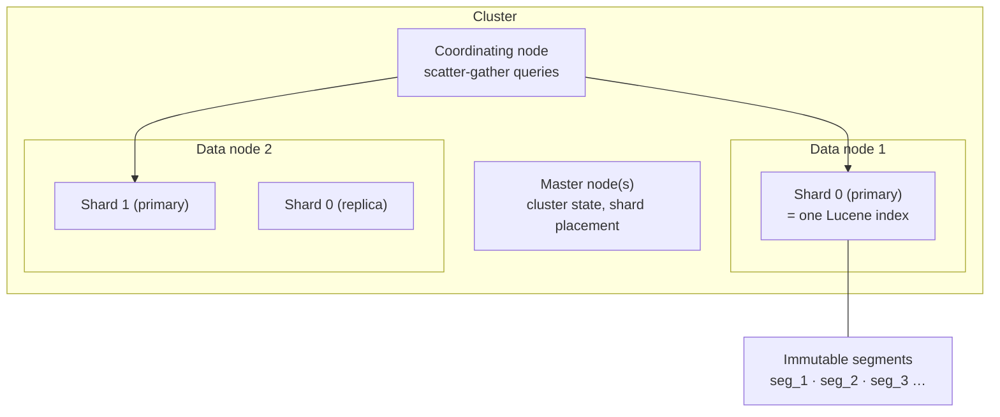
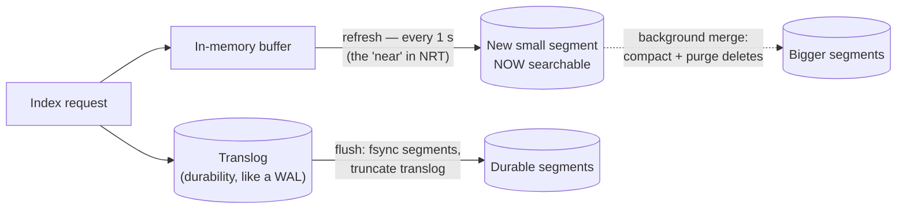
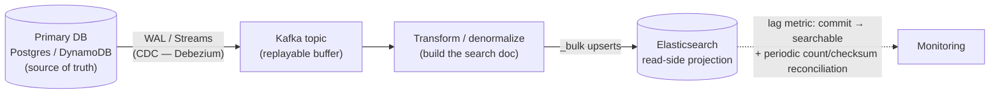

# Deep Dive 06 — Elasticsearch

> **Source:** [Elasticsearch Deep Dive w/ an Ex-Meta Senior Manager — Hello Interview](https://www.youtube.com/watch?v=PuZvF2EyfBM) (+ their written deep dive).
> **Prerequisites:** [07 — Search](../Core%20Course/07-search.md) (inverted index, ranking) · [06 — Databases](../Core%20Course/06-databases.md). Pairs with [DD-03 — PostgreSQL](03-postgresql.md) (FTS-as-bridge + CDC source), [DD-02 — Kafka](02-kafka.md) (the sync pipeline), and [29 — Geospatial](../Core%20Course/29-geospatial-systems.md).

## What you'll master

Elasticsearch enters every design the moment the interviewer says "users can search…" — and the probes test whether you know what you just bought: a **second, eventually-consistent copy of your data** with its own failure modes. A Staff candidate deploys it as a **read-side projection fed by CDC**, never a primary store, and can explain *why* it's fast (immutable segments + inverted index) and *why* it's stale (the refresh interval is a design decision, not a bug).

By the end of this note you will be able to:

- Draw the hierarchy — **cluster → index → shards (1:1 Lucene) → immutable segments** — and derive ES's strengths and weaknesses from segment immutability alone.
- Explain the **two index structures**: inverted index (search) and doc values (sort/aggregate) — and why `text` vs `keyword` mapping matters.
- Walk the **write path**: buffer → refresh (~1 s, the "near" in near-real-time) → translog durability → segment merge; and why updates are expensive (soft-delete + reinsert).
- Run the **query path**: coordinating node scatter-gather, `bool` query anatomy (`must` scores, `filter` caches), BM25 in one sentence.
- Paginate correctly — **`search_after` (+ PIT)**, never deep `from/size` — and quote the 10,000-hit line.
- Design the **CDC sync pipeline** and state its consistency contract out loud.

---

## Table of Contents

0. [In the Room — Staff-Level Delivery](#in-the-room--staff-level-delivery)
1. [The Mental Model — Segments All the Way Down](#1-the-mental-model--segments-all-the-way-down)
2. [The Two Index Structures & Mappings](#2-the-two-index-structures--mappings)
3. [The Write Path — Refresh, Translog, Merge](#3-the-write-path--refresh-translog-merge)
4. [The Query Path — Scatter-Gather & Scoring](#4-the-query-path--scatter-gather--scoring)
5. [Pagination Done Right](#5-pagination-done-right)
6. [Scaling — Shards, Replicas, Tiers](#6-scaling--shards-replicas-tiers)
7. [Keeping ES in Sync — the CDC Pipeline](#7-keeping-es-in-sync--the-cdc-pipeline)
8. [Elasticsearch vs the Alternatives](#8-elasticsearch-vs-the-alternatives)
9. [When NOT to Use Elasticsearch](#9-when-not-to-use-elasticsearch)
10. [Interview Cheat-Sheet](#interview-cheat-sheet)

---

## In the Room — Staff-Level Delivery

### Decisions to make decisively

| Decision | Default position (say this) | One-line justification | Revisit trigger |
|----------|------------------------------|------------------------|-----------------|
| **When to add ES** | **When search is a product pillar** — full-text, facets, fuzzy, relevance ranking at scale | Below that bar, [Postgres FTS](03-postgresql.md#7-the-swiss-army-features) serves without a second datastore to keep consistent | Search over ~small/static data → don't add the box at all |
| **Role in the architecture** | **Read-side projection only** — the DB owns truth, ES serves queries, CDC connects them | ES's durability/consistency story isn't a system-of-record's; drift is a *when*, not an *if* | — (this one doesn't move) |
| **Mapping** | **Explicit mappings; `keyword` for filters/sorts, `text` for searched prose; map only what's searched** | Wrong type = wrong data structure = broken filters or wasted RAM | Schema-on-write too rigid for a field → dynamic mapping on that subtree, eyes open |
| **Pagination** | **`search_after` with a stable sort tiebreaker** | `from/size` re-collects everything before your page — dies by ~10k hits | Page-jumping UX genuinely required → capped `from/size` for the first pages only |
| **Consistency to promise** | **"Searchable within ~seconds, results may trail writes"** | Refresh interval + CDC lag are real; promising read-your-writes from ES is a lie | Read-your-own-write needed (e.g. "my new post in my profile") → serve that view from the DB, not ES |
| **Freshness vs throughput** | **Default 1 s refresh; raise it (30 s+) for heavy ingest** | Every refresh cuts a segment — small segments tax merge and query alike | True NRT product need → keep 1 s and pay with more nodes |

### Altitude — name-and-move-on vs deep-dive

**Name and move on (one sentence each):**
- "Distributed orchestration over Lucene" — the framing sentence, then specifics.
- Node roles (master/data/coordinating/ingest) — name them as "control plane vs data plane," move.
- TF-IDF/BM25 formula details — "term frequency up, common-across-corpus down, field length normalized" is all the room needs.

**Deep-dive — spend your minutes here:**
- **The sync pipeline** (§7) — how data gets in, what lags, what drifts, how you detect it. This is where real systems break.
- **Segment immutability** (§1, §3) — it explains write cost, update cost, caching, and why ES hates write-heavy workloads. One concept, five consequences.
- **Pagination + the 10k line** (§5) — the "page 500" probe is a favorite.

### Experience hooks

- *"Our search cluster is rebuildable from the source DB by design — when a mapping change or drift bug hits, we reindex into a new index and flip an alias. Treating ES as disposable is what makes it safe."*
- *"We track one metric religiously: CDC lag from DB commit to searchable-in-ES. When it grows, search 'loses' fresh content and support tickets say 'my listing disappeared' — it didn't, it just never arrived."*
- *"An engineer once 'fixed' slow ingest by refreshing on every write — indexing throughput fell off a cliff from segment churn. We went the other way: 30 s refresh on the bulk path, and the product honestly labels results as updated-within-a-minute."*

---

## 1. The Mental Model — Segments All the Way Down

Elasticsearch = **a distributed coordination layer around Lucene**. The hierarchy:

- **Index** → split into **shards** (each shard = a full Lucene index) → each shard is a stack of **immutable segments**.
- **Node roles**: master (cluster state, elections), data (hot/warm/cold tiers), coordinating (fan out queries, merge results), ingest (transform on the way in).
- **Replicas**: HA *and* read throughput — each replica independently serves queries (Y replicas ≈ Y× read capacity).

**Segment immutability is the load-bearing design choice.** Derive everything from it:
- Writes never modify existing files → fast sequential indexing (the [LSM kinship](04-cassandra.md#3-the-write-path--why-writes-fly-lsm) — same trade as Cassandra).
- A **delete** is a tombstone mark; an **update = soft-delete + reindex the whole document** → rapid-update workloads create merge debt — *this* is why ES hates write-churn.
- Immutable files cache perfectly (OS page cache does the heavy lifting), compress well, and never race with readers.
- Background **merges** compact segments and purge deleted docs — the deferred bill, again.

> **Staff-level insight:** "immutable segments" is the one concept that explains ES's entire personality — fast reads, painful updates, refresh latency, merge I/O. Explaining the *personality from the mechanism* is what separates "I've called the API" from "I know the system."

---

## 2. The Two Index Structures & Mappings

Per field, Lucene maintains different structures for different access patterns — your **mapping** decides which get built:

| Structure | Answers | Built for field type |
|-----------|---------|----------------------|
| **Inverted index** | "which docs contain *term*?" — term → posting list of doc IDs | `text` (analyzed) and `keyword` (exact) |
| **Doc values** | "what's doc 42's value?" — columnar, per-field | sorting, aggregations, faceting |
| **BKD trees** | numeric ranges, **geo** (`geo_point`/`geo_shape`) | numbers, dates, coordinates |

The mapping decision that matters — **`text` vs `keyword`**:
- `text` → run through an **analyzer** (tokenize, lowercase, strip stems: "Running Shoes!" → `run`, `shoe`) → full-text searchable via `match`.
- `keyword` → indexed **whole and untouched** → exact filters, terms aggs, sorting (`status = "active"`, `brand = "Nike"`).
- Classic bug to name: filtering on a `text` field "randomly fails" because you're matching analyzed tokens, not the literal value. Fields often need both (`title` as text + `title.raw` as keyword).

And the denormalization rule carries over from [Cassandra](04-cassandra.md#2-the-data-model--query-first-partition-key-first): **one query should return the result** — embed what the results page needs (title, price, thumbnail) rather than joining after search.

---

## 3. The Write Path — Refresh, Translog, Merge

Three separate clocks — keep them distinct under probing:

1. **Refresh (default 1 s)** — buffer → new searchable segment. *This* is why a write isn't searchable instantly: **near-real-time means searchable within the refresh interval.** Heavy ingest → raise it to 30 s+ and say what the product tolerates.
2. **Translog** — every op appended for crash recovery (the [WAL pattern](03-postgresql.md#1-the-mental-model--heap--mvcc--wal), third appearance); fsync on request by default.
3. **Flush + merge** — segments fsynced, translog truncated; merges run continuously in the background and are the hidden I/O cost of update-heavy indices.

Also in the toolbox: **`_bulk`** for ingestion (never document-at-a-time at volume) and **optimistic concurrency** via document versions/seq_no — the same [conditional-write instinct](05-dynamodb.md#4-consistency-conditional-writes--transactions), applied to reindexing races.

---

## 4. The Query Path — Scatter-Gather & Scoring

A search hits a **coordinating node**, which fans out to one copy of every shard, collects each shard's top-K doc IDs + scores, merges, then fetches the winners' documents (query-then-fetch):

- **`bool` query anatomy** — the workhorse; the distinction to say out loud:
  - `must` / `should` → contribute to **relevance scoring** (BM25).
  - `filter` / `must_not` → **yes/no, no scoring — and cacheable**. Put every structural predicate (status, price range, tenant!) in `filter`; it's both faster and cached as a bitset.
- **BM25** in one sentence: *"term frequency saturates, rarity across the corpus boosts, long fields are normalized — tunable per field with boosts."*
- Fuzzy (`fuzziness: AUTO`), prefix, and `nested` queries (for arrays-of-objects like reviews) exist — name them when the requirement appears, don't tour them.
- **Aggregations** run on doc values and power facets ("brand: 12 hits, color: 5") and analytics — same scatter-gather, bucket-merge at the coordinator.

---

## 5. Pagination Done Right

The "page 500" probe:

| Method | How | Verdict |
|--------|-----|---------|
| **`from/size`** | Every shard collects `from+size` docs; coordinator sorts the union | Fine for page 1–5; **degrades hard and is capped ~10,000 hits** (`index.max_result_window`) |
| **`search_after`** | Cursor = last hit's sort values (with `_id` tiebreaker); each page is a fresh top-K *after* the cursor | **The default** — O(page) forever; no random access |
| **+ PIT** | Point-in-time snapshot ID keeps the view consistent while paging | Add when concurrent writes must not shift/duplicate results (exports, crawls) |

The reason, in one line: *"page 10,000 via `from` makes every shard score and sort 10,000+size docs just to throw them away — `search_after` makes each page a fresh bounded query."* Infinite scroll = `search_after`, always.

---

## 6. Scaling — Shards, Replicas, Tiers

- **Shard sizing guidance: ~10–50 GB per shard.** Too many small shards → per-shard overhead (memory, cluster state, merge churn); too few huge ones → no parallelism and painful recovery/rebalance.
- **Primary shard count is fixed at index creation** — resharding = reindex into a new index behind an **alias** (aliases are the zero-downtime lever: reindex, verify, flip — the [expand-migrate-contract](../Core%20Course/32-migrations.md) pattern in miniature).
- **Time-series data → index-per-period** (`logs-2026.07`) + ILM rolling **hot → warm → cold/frozen** node tiers — recent data on fast hardware, old data cheap ([12 — Observability](../Core%20Course/12-observability.md)'s storage story).
- **Replicas scale reads** linearly-ish; writes cost on every replica.
- Hot-spot story ([fourth appearance](05-dynamodb.md#6-hot-partitions--write-sharding)): default routing spreads docs randomly — but custom routing by tenant creates whale-tenant hot shards; the fix is again finer routing keys or dedicated indices for whales.

### 6.5 The JVM-heap probe — the #1 way an ES operator breaks your answer

Elasticsearch runs on the JVM, and **heap is the resource that actually falls over** — an operator will ask "your aggregation OOM'd a data node, why?" The chain to know:

- **Heap ≤ ~30–32 GB, and ~50% of RAM.** Above ~32 GB the JVM loses **compressed ordinary object pointers (compressed oops)**, so a 64 GB heap can hold *fewer* usable objects than a 30 GB one — never set heap above ~31 GB. The other half of RAM is left for the **OS filesystem cache**, which is what actually serves Lucene segment reads fast.
- **`fielddata` on text fields is the classic OOM.** Sorting/aggregating on an analyzed `text` field builds an in-memory fielddata structure per unique term — unbounded, on-heap. The fix is to aggregate on **`keyword`/`doc_values`** (columnar, off-heap, on disk) instead; doc_values are on by default for non-text types and are why aggregations *usually* don't touch the heap.
- **Circuit breakers** (`indices.breaker.*`) abort a request that would exceed a heap fraction rather than let it OOM the node — so a giant aggregation returns a `CircuitBreakingException` instead of taking the cluster down. Name them as the safety net; the *design* fix is still doc_values + bounded aggregation cardinality.
- **High cardinality is the hidden cost** — a `terms` agg over millions of buckets, or deep nested aggs, blow heap even on doc_values. Bound the buckets; for unique-count use **cardinality agg (HLL under the hood)**, not exact.

> **Staff-level insight:** *"The resource I size ES around is heap, not disk — cap it near 31 GB for compressed oops, leave the rest of RAM for the filesystem cache, aggregate on doc_values not fielddata so the work stays off-heap, and lean on circuit breakers so a pathological query fails one request instead of the node."* That sentence signals you've operated a cluster, not just queried one.

---

## 7. Keeping ES in Sync — the CDC Pipeline

The architecture question hiding inside every "add search" requirement:

The points that score:
- **Why CDC and not dual-write from the app**: dual-writes drift on partial failure (DB commits, ES call fails — now what?). The [WAL/Streams](03-postgresql.md#5-replication--high-availability) is the one ordered, replayable truth; [Kafka](02-kafka.md) buffers and lets you **replay to rebuild the index** — reindexing is just "consume from offset 0."
- **State the contract**: *"search trails the DB by refresh + pipeline lag — seconds normally; the UX is designed for that, and read-your-own-writes views come from the DB."*
- **Drift is a when**: monitor lag *and* reconcile (periodic counts/checksums); keep the full-rebuild path exercised.
- Updates must be **idempotent upserts keyed by doc ID** (at-least-once delivery, [as always](02-kafka.md#8-delivery-guarantees)).

---

## 8. Elasticsearch vs the Alternatives

| | Pick it when | One-line against |
|---|--------------|-------------------|
| **Elasticsearch** | Search is a pillar: full-text + facets + fuzzy + geo + aggs at scale | A whole second distributed system to run and keep in sync |
| **OpenSearch** | AWS's 2021 fork; now materially diverged (segment replication, remote-backed storage) | No longer "same engine" — 4+ years of drift. And **ES re-added an open-source license (AGPLv3) in 8.16, late 2024**, so the old "ES is SSPL, OpenSearch is the OSS one" line is stale in *both* directions; say "ES or OpenSearch, both open source again, pick on managed-service and feature fit" |
| **Postgres FTS** ([DD-03 §7](03-postgresql.md#7-the-swiss-army-features)) | Search is a *feature*: one datastore, transactional freshness | Relevance tuning, typo-tolerance, facets, and scale ceilings arrive fast |
| **Algolia / Typesense** | Product search UX fast: managed, typo-tolerant, instant | Cost at scale, less analytical/agg power, data residency |
| **Vector DBs / hybrid** | Semantic "meaning" search, RAG ([17 — AI Systems](../Core%20Course/17-ai-systems.md)) | Different problem; note ES does kNN/hybrid now — name it, don't detour |

Escalation script: **Postgres FTS → Elasticsearch when search becomes a pillar → hybrid/vector when "matches words" stops being the requirement.**

---

## 9. When NOT to Use Elasticsearch

1. **As the primary datastore.** No transactions, relaxed durability defaults, split-brain history — it's a projection, not a source of truth. The moment someone says "we'll just store it in ES," ask where the rebuild comes from.
2. **Write-heavy / rapid-update workloads.** Every update is delete+reindex; merge debt compounds — counters and hot mutable rows belong in [Redis](01-redis.md)/[Postgres](03-postgresql.md).
3. **Small or static datasets.** A `LIKE`/FTS query or an in-memory index beats operating a cluster.
4. **Strong-consistency reads.** Refresh + CDC lag make "searchable now" a lie by design; if the requirement is read-your-writes, serve it from the DB.
5. **Joins.** Denormalize at index time or don't use ES; `nested`/`parent-child` are escape hatches with real costs, not a relational model.

---

## Interview Cheat-Sheet

**One-liner:** *"Distributed Lucene: indexes split into shards, shards made of immutable segments — inverted index for matching, doc values for sorting/faceting, BM25 for ranking. It's a read-side projection fed by CDC: searchable within seconds, never the source of truth."*

**Numbers:** refresh **1 s** default (NRT = "within refresh") · shards **~10–50 GB** each · `from/size` capped **~10k** hits → `search_after` · replicas ≈ ×read throughput · primary shard count fixed at creation → alias + reindex.

**Mapping reflex (recite):** `text` = analyzed, for `match` · `keyword` = exact, for `filter`/sort/aggs · structural predicates in `filter` (cached, unscored) · embed what the results page shows.

**The four probes and your answers:**

| Probe | Answer |
|-------|--------|
| "Why isn't my write searchable?" | Refresh interval — segments cut every ~1 s; that's the NRT contract, tune per product |
| "Page 500 of results?" | `search_after` cursor (+ PIT for a stable view) — `from/size` re-collects and dies at the 10k window |
| "How does ES stay in sync with the DB?" | CDC → Kafka → idempotent bulk upserts; monitor commit→searchable lag; rebuild = replay the topic |
| "Why not just use ES for everything?" | Update-hostile storage, no transactions, eventual by design — it's the query layer, the DB is the truth |

**Say-verbatim lines:**
- *"Immutable segments are the whole personality: fast reads, expensive updates, and a refresh clock."*
- *"ES is rebuildable by design — if I can't reindex from the source of truth, I've built it wrong."*
- *"Filters filter, queries score — structure goes in `filter` where the bitset cache lives."*
