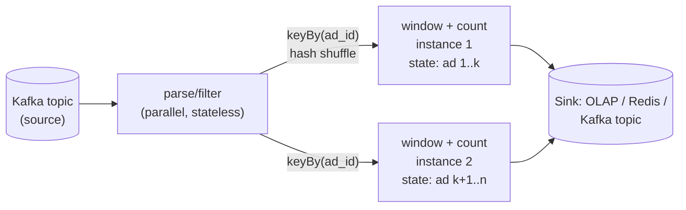
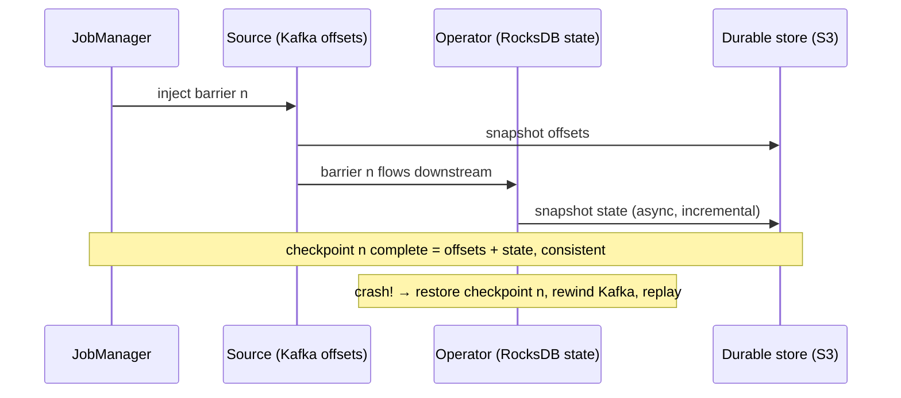

# Deep Dive 07 — Flink

> **Source:** [Hello Interview — Flink Deep Dive](https://www.hellointerview.com/learn/system-design/deep-dives/flink) (written guide; no public video) + standard Flink internals.
> **Prerequisites:** [DD-02 — Kafka](02-kafka.md) (Flink is almost always downstream of it) · [16 — Data Processing](../Core%20Course/16-data-processing.md) (batch vs stream, lambda/kappa). Pairs with [34 — Real-Time Analytics](../Core%20Course/34-design-realtime-analytics.md) (the canonical Flink interview problem) and [23 — Distributed Computation](../Core%20Course/23-distributed-computation.md).

## What you'll master

Flink appears the moment a design needs **stateful computation over a stream** — windowed counts, sessionization, fraud rules, top-K. The trap is treating it as a magic box: interviewers immediately probe the three things that make naive stream processing hard — **a worker crashes mid-window** (where did the counts go?), **you add a worker** (who moves the state?), and **an event arrives late** (is the window already closed?). Flink is the answer to exactly those three, and a Staff candidate can say *how*.

By the end of this note you will be able to:

- Frame the **gate question first**: "do I really need sub-second results, or is a batch job fine?" — and only then reach for Flink.
- Draw the **dataflow model**: sources → operators → sinks, keyed streams, JobManager/TaskManagers, parallelism.
- Explain **state + checkpoints**: local RocksDB state, barrier snapshots, and recovery = restore + rewind Kafka offsets.
- Handle **time correctly**: event time vs processing time, watermarks, allowed lateness — the topic that exposes bluffers fastest.
- Choose **windows** (tumbling / sliding / session) per requirement in one sentence each.
- State the **exactly-once contract honestly** — internal exactly-once effect, end-to-end only with transactional/idempotent sinks.

---

## Table of Contents

0. [In the Room — Staff-Level Delivery](#in-the-room--staff-level-delivery)
1. [The Gate Question — Do You Even Need Streaming?](#1-the-gate-question--do-you-even-need-streaming)
2. [The Mental Model — a Distributed Dataflow](#2-the-mental-model--a-distributed-dataflow)
3. [The Three Hard Problems (and the Naive Consumer)](#3-the-three-hard-problems-and-the-naive-consumer)
4. [State & Checkpoints — How Nothing Is Lost](#4-state--checkpoints--how-nothing-is-lost)
5. [Time — Event Time, Watermarks, Lateness](#5-time--event-time-watermarks-lateness)
6. [Windows](#6-windows)
7. [Exactly-Once, Honestly](#7-exactly-once-honestly)
8. [Flink vs the Alternatives](#8-flink-vs-the-alternatives)
9. [When NOT to Use Flink](#9-when-not-to-use-flink)
10. [Interview Cheat-Sheet](#interview-cheat-sheet)

---

## In the Room — Staff-Level Delivery

### Decisions to make decisively

| Decision | Default position (say this) | One-line justification | Revisit trigger |
|----------|------------------------------|------------------------|-----------------|
| **Stream or batch** | **Batch unless the product consumes results in seconds-to-minutes** | Streaming buys latency with a large complexity tax (state, time, ops); don't pay it for a daily report | Dashboard/alerting/abuse-detection genuinely acts on fresh data → stream |
| **Engine** | **Flink for stateful streaming; plain Kafka consumers for stateless transforms** | If there's no window/join/accumulator, a consumer group is the whole answer | State enters the requirement → Flink (or Kafka Streams if you're JVM-light and modest-scale) |
| **Time semantics** | **Event time + watermarks, always** | Processing time gives different answers on every replay/backlog — event time is the only defensible aggregate | Pure infra metrics where wall-clock is the meaning → processing time, say why |
| **State backend** | **RocksDB, incremental checkpoints to S3** | State beyond RAM (large keyspaces, long windows) with bounded recovery time | Small hot state, lowest latency → heap backend |
| **Delivery guarantee** | **Exactly-once *effect* into idempotent/upsert sinks** | Two-phase-commit sinks exist (Kafka txn) but add latency and failure modes; upserts are simpler and honest | True transactional sink need + tolerance for commit latency → 2PC |
| **Late events** | **Watermark + allowed lateness for the common tail; side-output the stragglers** | Bounds correctness loss without holding windows open forever | Billing-grade completeness → reconcile with a batch pass ([lambda-ish](../Core%20Course/16-data-processing.md)) |

### Altitude — name-and-move-on vs deep-dive

**Name and move on (one sentence each):**
- "Flink = stateful stream processor, usually reading Kafka" — the placement sentence.
- JobManager/TaskManager/slots — "coordinator + workers," move on unless asked to size it.
- DataStream vs Table/SQL API — mention Flink SQL exists (interviewers like hearing aggregations can be SQL), don't tour APIs.

**Deep-dive — spend your minutes here:**
- **Checkpoint/recovery story** (§4) — "worker dies mid-window" is *the* Flink probe; barriers + offset rewind is the answer.
- **Watermarks** (§5) — the sharpest knowledge test in streaming; get the one-sentence definition exact.
- **The keyed-stream shuffle** (§2–3) — why the same key must reach the same operator instance, and what that implies for hot keys ([fifth appearance](06-elasticsearch.md#6-scaling--shards-replicas-tiers)).

### Experience hooks

- *"Our webhook-delivery counters started as a consumer with an in-memory map — first deploy wiped ten minutes of counts and taught us why checkpointed state exists. We moved the aggregation into Flink and deploys stopped being data-loss events."*
- *"The bug that sold me on event time: a consumer backlog made 'requests per minute' spike to zero then 3× — processing time was measuring our lag, not our traffic."*
- *"We keep a rule of thumb: if the operator has no keyed state, it doesn't deserve Flink — half our 'streaming jobs' are honest consumer groups."*

---

## 1. The Gate Question — Do You Even Need Streaming?

Before any Flink box appears, ask it aloud: **"who consumes this result, and how fresh must it be?"**

- Results read by a human tomorrow → **batch** (Spark/SQL over the warehouse) — cheaper, simpler, replayable by nature.
- Results feeding a dashboard, alert, abuse rule, or product surface within seconds-to-minutes → **streaming** — and now the three hard problems of §3 are yours, so Flink earns its box.

Saying this gate *before* introducing Flink is itself the signal — it's the [YAGNI move](../Core%20Course/20-staff-execution.md) applied to data infrastructure. Latency requirements are the crux; everything else is implementation.

---

## 2. The Mental Model — a Distributed Dataflow

A Flink job is a **dataflow graph** — sources → operators → sinks — where each operator runs at some **parallelism**, and **keyed streams** route records so that *all events for one key hit the same operator instance* (which is what makes per-key state possible):

- **Runtime**: a **JobManager** (coordinator: scheduling, checkpoints, failover) and **TaskManagers** (workers with task slots). Scale = raise operator parallelism across more slots.
- **`keyBy` is Flink's partition-key moment** — the same decision as [Kafka's](02-kafka.md#3-partitioning--keys--the-one-decision-that-matters) and [Cassandra's](04-cassandra.md#2-the-data-model--query-first-partition-key-first), now for *compute*: the key determines locality of state, parallelism ceiling, and hot-spot risk. A whale key (one viral ad) concentrates on one instance → pre-aggregate in two stages (salted partial counts → merge), the [same medicine as everywhere else](02-kafka.md#10-hot-partitions).
- Sources/sinks are usually [Kafka](02-kafka.md); sinks also Redis/OLAP/S3. Flink is the compute between two logs.

---

## 3. The Three Hard Problems (and the Naive Consumer)

The strongest way to justify Flink in the room: start from the naive design and let it fail. *"Suppose I just write a Kafka consumer with a hashmap of counts…"*

| Problem | How the naive consumer fails | What Flink does |
|---------|------------------------------|-----------------|
| **1. State survives crashes** | Process dies → hashmap gone; re-reading the topic from the start is slow and may be trimmed | **Checkpointed state** (§4): restore snapshot + rewind offsets → resume as if nothing happened |
| **2. State moves when you scale** | Add a consumer → rebalance reassigns partitions, but the *hashmap doesn't follow* — counts split/duplicate | State is **keyed and owned by the framework** — rescaling redistributes state with the keys |
| **3. Out-of-order events** | "5-minute window" over arrival time — backlogs and retries silently corrupt every aggregate | **Event time + watermarks** (§5): windows close on data completeness, not wall clock |

That progression — naive → failure → mechanism — is worth two minutes of any interview that touches streaming; it shows you know *why* the framework exists, not just its name.

---

## 4. State & Checkpoints — How Nothing Is Lost

- **State lives locally** with each operator instance (in-heap or **RocksDB** on local disk for state bigger than RAM — GBs to TBs across a job), so reads/updates are local-speed, not a network hop to Redis.
- **Checkpoints**: the JobManager injects **barriers** into the stream; as each barrier flows through the graph, every operator snapshots its state (asynchronously, incrementally for RocksDB) to durable storage (S3/HDFS), and the source records its **Kafka offsets** in the same snapshot. Result: one *consistent global snapshot* = "state as of offset N," taken without stopping the stream (the Chandy-Lamport idea, name it if probed).
- **Recovery**: restore the last completed checkpoint, **rewind Kafka to the snapshotted offsets**, reprocess. Everything after the checkpoint replays; state and input position move *together* — that's the whole trick.
- **Savepoints** = manual checkpoints for deploys, rescaling, and job upgrades — the reason Flink jobs can be re-versioned without losing a month of window state.

> **Staff-level insight:** the sentence that lands: *"a checkpoint binds 'where I am in the input' and 'what I've computed' into one atomic unit — recovery is just restoring both and replaying the gap. Every stream processor that claims exactly-once is doing some version of this."*

**Aligned vs unaligned checkpoints — the backpressure death-spiral probe.** The operator question: *"why do your checkpoints time out exactly when the job is under load?"* In the default **aligned** checkpoint, an operator with multiple inputs must **wait for the barrier on every input channel before snapshotting** (barrier alignment). Under **backpressure**, a barrier can be stuck for a long time behind a queue of buffered data on a slow channel → checkpoint duration balloons → checkpoints start timing out → the job can't make a successful checkpoint → on any failure it rewinds further → *worse* backpressure. **Unaligned checkpoints** break the spiral: the barrier overtakes the buffered in-flight data and that data is snapshotted *as part of the checkpoint*, so checkpoint time decouples from backpressure. The trade: unaligned checkpoints store the in-flight buffers, so they're larger. Say it: *"under backpressure I switch to unaligned checkpoints so checkpoint time stops tracking queue depth, accepting bigger snapshots."* (Buffer debloating is the complementary lever — cap in-flight data so alignment is cheap.)

> **2026 currency:** **Flink 2.0 (2025)** introduced **disaggregated state** (ForSt state backend) — state lives on object storage rather than local RocksDB disk, so state size decouples from local disk and rescaling/recovery get cheaper. If you describe state as "local RocksDB, GBs-to-TBs on the TaskManager's disk," add "…or disaggregated onto S3 in Flink 2.0, which is where cloud deployments are heading."

---

## 5. Time — Event Time, Watermarks, Lateness

The bluffer-detector topic. Get these three definitions crisp:

- **Processing time** = when the machine sees the event. Cheap, but backlogs and retries change your answers — replays don't reproduce.
- **Event time** = when the event actually happened (producer timestamp). The only basis on which "clicks between 12:00–12:05" has a stable meaning.
- **Watermark** = a marker flowing with the stream asserting **"no events older than T are still coming"** (in practice: max seen timestamp minus a bounded-lateness allowance). Watermarks are *the tradeoff dial*: how long you wait for stragglers = latency you add for correctness. When the watermark passes a window's end, the window fires.

Late events (arriving after the watermark): **allowed lateness** re-fires the window with corrections for a grace period; beyond that, **side-output** the stragglers to a dead-letter-ish stream — count them, don't silently drop them ([the DLQ instinct](02-kafka.md#9-retries-errors--dead-letter-queues), applied to time). Billing-grade completeness → nightly batch reconciliation on top.

**The idle-partition trap (watermarks' #1 production bug — volunteer it).** The watermark for an operator is the **minimum** across all its input partitions — so **one silent Kafka partition stalls the whole watermark**, and windows never fire even though data is flowing on the other partitions. A low-traffic keyspace, an off-hours source, or an over-provisioned partition count all trigger it, and the symptom ("my dashboard just stopped updating at 2am") looks nothing like a watermark bug. The fix is **`withIdleness(...)`** — mark a partition idle after a timeout so it's excluded from the watermark minimum until data resumes. Naming this unprompted is a strong event-time-competence signal, because it's the bug that only bites people who've actually run Flink.

---

## 6. Windows

One sentence each, pick per requirement:

| Window | Shape | Use |
|--------|-------|-----|
| **Tumbling** | Fixed, non-overlapping (every 5 min) | Metrics, [ad-click counts](../Core%20Course/34-design-realtime-analytics.md), rate reports |
| **Sliding** | Fixed size, overlapping (5 min, every 1 min) | Smooth trends, "requests in the last N minutes" alerting |
| **Session** | Gap-based per key (closes after 30 min idle) | User sessionization, engagement runs — *the one only event-time + state can do well* |

All windows here are **keyed** (per ad, per user); state = the open windows' accumulators. Long windows over huge keyspaces are exactly the "state bigger than RAM" case RocksDB backends exist for.

---

## 7. Exactly-Once, Honestly

Same honesty framework as [Kafka §8](02-kafka.md#8-delivery-guarantees) — one level up the stack:

- **Within Flink**: checkpoints give **exactly-once *state* semantics** — replayed events after recovery don't double-count, because state rewinds *with* the offsets.
- **Into the sink** is where it gets real: replay means the sink sees some outputs twice. Options, in order of preference: **idempotent/upsert sinks** (write keyed aggregates — the replay overwrites itself; simple, fast, usually right) · **transactional two-phase-commit sinks** (e.g. Kafka transactions tied to checkpoint completion — true end-to-end exactly-once, at the cost of commit latency and heavier failure handling).
- The line to say: *"exactly-once state inside, effectively-once outside — I make the sink an upsert so replays are no-ops, and reach for 2PC sinks only when the output must be a clean event stream."*

---

## 8. Flink vs the Alternatives

| | Pick it when | One-line against |
|---|--------------|-------------------|
| **Flink** | Large keyed state, event-time correctness, low latency at scale — streaming as a first-class system | Ops weight: a cluster, checkpoints, savepoint discipline |
| **Kafka Streams** | Modest stateful processing *inside your service* — a library, no cluster | State scales with your app instances; weaker event-time/ops tooling at big scale |
| **Spark Structured Streaming** | Your org is Spark/batch-first; micro-batch latency (~seconds) is fine | Micro-batch, not per-event; streaming bolted onto a batch engine |
| **Plain consumers + Redis** | Stateless transforms, or trivial counters where [Redis atomicity](01-redis.md#54-rate-limiter) suffices | You've just hand-rolled §3's three problems the moment state grows |
| **Managed (Kinesis Data Analytics / Ververica)** | Flink semantics without running the cluster | Cost + version lag; same concepts, so design talk is unchanged |

Decision script: **stateless → consumer group · small stateful in-service → Kafka Streams · serious stateful/event-time → Flink · already-Spark shop with seconds-latency tolerance → Spark SS.**

---

## 9. When NOT to Use Flink

1. **The product doesn't consume real-time results** — the §1 gate. A cron + SQL is not a lesser answer; it's the right one.
2. **Stateless pipe work** — filter/enrich/route is a consumer group's job; Flink there is pure ops tax.
3. **Tiny scale** — thousands of events/minute with simple counts → [Redis counters](01-redis.md#53-leaderboard-sorted-sets) or a DB and move on.
4. **As a database** — Flink state is queryable-ish but it's an engine's working memory, not a serving layer; results land in [Redis](01-redis.md)/OLAP for reads.
5. **Team can't own it** — a stream processor with neglected checkpoints/savepoints becomes an unrecoverable black box; managed Flink or batch beats a haunted cluster ([19 — Leadership trade-offs](../Core%20Course/19-leadership-tradeoffs.md)).

---

## Interview Cheat-Sheet

**One-liner:** *"Flink is stateful stream compute between two logs — keyed streams give per-key local state (RocksDB), checkpoint barriers bind state to Kafka offsets so recovery is restore-and-replay, and event time + watermarks make window results mean something under disorder."*

**Numbers/facts:** checkpoints every seconds–minutes, async + incremental · state GBs–TBs via RocksDB · per-event latency ms (vs Spark micro-batch ~seconds) · watermark delay = your latency-vs-completeness dial · savepoints = deploys without state loss.

**The design reflex (recite):** gate on latency need → source = Kafka → `keyBy` the aggregation entity → window (tumbling/sliding/session) → upsert sink → name the late-event policy.

**The four probes and your answers:**

| Probe | Answer |
|-------|--------|
| "Worker dies mid-window?" | Restore last checkpoint (state + offsets are one atomic snapshot), rewind Kafka, replay the gap — no loss, no double-count |
| "Event arrives late?" | Watermarks bound the wait; allowed lateness re-fires with corrections; beyond that, side-output and count — never silently drop |
| "Exactly-once?" | Exactly-once state internally; end-to-end via upsert sinks (default) or 2PC/Kafka-txn sinks (when the output must be a clean stream) |
| "One key is 40% of traffic?" | Keyed state concentrates it on one instance — two-stage aggregation: salted partial counts, then merge |

**Say-verbatim lines:**
- *"Batch unless someone acts on the result in seconds — streaming's complexity has to be bought by a latency requirement."*
- *"A checkpoint ties together where I am in the input and what I've computed — recovery is restoring both."*
- *"Processing time measures my lag; event time measures my traffic."*
