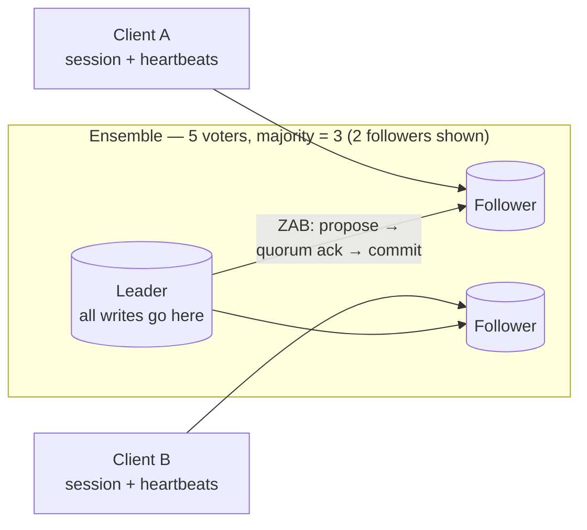
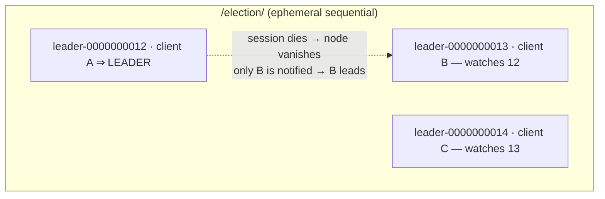

# Deep Dive 08 — ZooKeeper (& etcd)

> **Source:** [Hello Interview — ZooKeeper Deep Dive](https://www.hellointerview.com/learn/system-design/deep-dives/zookeeper) (written guide; no public video) + standard coordination-system internals.
> **Prerequisites:** [02 — Distributed Systems](../Core%20Course/02-distributed-systems.md) (consensus, quorums, linearizability). Pairs with [DD-01 — Redis](01-redis.md#52-distributed-lock) (the locks contrast), [DD-02 — Kafka](02-kafka.md) (famously de-ZooKeeper'd), [35 — Scheduler](../Core%20Course/35-design-scheduler.md) (leader election), [21 — Build From Scratch](../Core%20Course/21-build-from-scratch.md) (lock service).

## What you'll master

ZooKeeper is the box you draw when the design needs **a small amount of truth that everyone agrees on**: who's the leader, who holds the lock, which workers are alive, what's the current config. Interviewers use it to test whether you understand *coordination* — the difference between a [Redis lock that occasionally fails](01-redis.md#52-distributed-lock) and a consensus-backed lock with **fencing tokens**; between "highly available" and "consistent when it counts." A Staff candidate also knows the modern footnote: new systems mostly reach for **etcd** (or embed Raft), and Kafka spent a decade removing ZooKeeper — and can say why.

By the end of this note you will be able to:

- Draw the **ensemble**: leader + followers, ZAB atomic broadcast, majority quorums, and why it's 3 or 5 nodes, never 2 or 4.
- Use the **znode data model** (persistent / ephemeral / sequential + watches + sessions) as a construction kit.
- Build the four **recipes** on a whiteboard: leader election, distributed lock (with fencing), service discovery / group membership, config distribution.
- State the **consistency contract** precisely: linearizable writes, ordered-but-possibly-stale reads, `sync()` when it matters.
- Argue **ZooKeeper vs etcd vs Redis vs "just use the database"** — and when the answer is *no coordinator at all*.

---

## Table of Contents

0. [In the Room — Staff-Level Delivery](#in-the-room--staff-level-delivery)
1. [The Mental Model — a Consensus-Replicated Tree](#1-the-mental-model--a-consensus-replicated-tree)
2. [The Construction Kit — ZNodes, Ephemerals, Watches, Sessions](#2-the-construction-kit--znodes-ephemerals-watches-sessions)
3. [The Ensemble — ZAB, Quorums, Sizing](#3-the-ensemble--zab-quorums-sizing)
4. [The Consistency Contract](#4-the-consistency-contract)
5. [The Four Recipes](#5-the-four-recipes)
6. [Fencing Tokens — the Lock Story Done Right](#6-fencing-tokens--the-lock-story-done-right)
7. [The Modern Landscape — etcd, KRaft, and Who Still Uses ZK](#7-the-modern-landscape--etcd-kraft-and-who-still-uses-zk)
8. [When NOT to Use a Coordinator](#8-when-not-to-use-a-coordinator)
9. [Interview Cheat-Sheet](#interview-cheat-sheet)

---

## In the Room — Staff-Level Delivery

### Decisions to make decisively

| Decision | Default position (say this) | One-line justification | Revisit trigger |
|----------|------------------------------|------------------------|-----------------|
| **When a coordinator appears** | **Only when correctness needs agreement**: leader election, exactly-one-holder locks, membership | Consensus is expensive and a new ops surface; most "coordination" is really just a DB row or a Redis key | Efficiency-only dedup → [Redis lock](01-redis.md#52-distributed-lock); single-writer via DB → [row lock](03-postgresql.md#4-transactions-isolation--locks) |
| **Which coordinator** | **etcd for new builds; ZooKeeper when the ecosystem demands it** (Kafka<3.x, HBase, Solr) | Same guarantees; etcd = Raft + gRPC + leases, simpler ops, the Kubernetes standard | Managed offering available (e.g. cloud lock services) → take it |
| **Lock correctness** | **Consensus lock + fencing token checked at the resource** | The lock alone can't save you — a paused client can wake up post-expiry; the token check at the *storage* is what's airtight | Resource can't check tokens → make the operation idempotent instead |
| **Ensemble size** | **5 nodes for production** (3 for small) | Majority quorum: 5 survives 2 failures; even numbers add cost, not tolerance | Read-heavy at huge scale → observers (non-voting replicas) |
| **What lives in it** | **Tiny, slow-changing truth** — leadership, membership, config; KBs not MBs | It's a consensus log, not a database; every write is a quorum round-trip | Anything high-throughput or large → it doesn't belong here |
| **Watches** | **Use as change *hints*, then re-read** | Watches are one-shot and can coalesce; treating them as a reliable event stream drops changes | Need a real event stream → CDC/[Kafka](02-kafka.md) |

### Altitude — name-and-move-on vs deep-dive

**Name and move on (one sentence each):**
- ZAB vs Raft vs Paxos taxonomy — "leader-based consensus protocols, same family; ZK speaks ZAB, etcd speaks Raft." Done. ([02](../Core%20Course/02-distributed-systems.md) has the depth if the interview *is* consensus.)
- The filesystem-like API (`create/get/set/delete/exists`) — one breath.
- History (2008, Hadoop ecosystem) — skip unless asked why Kafka left.

**Deep-dive — spend your minutes here:**
- **Ephemeral znodes + sessions** (§2) — the primitive everything else is built from; "what happens when the leader's machine dies" is answered *here*.
- **Fencing tokens** (§6) — the answer that upgrades every distributed-lock conversation from senior to staff.
- **Herd effects & watch semantics** (§5) — sequential-node locks exist precisely to avoid thundering herds; knowing that is an operator's tell.

### Experience hooks

- *"Our schedulers do leader election through the coordination service, but the real protection is the fencing token on every write — the day a GC pause made an old leader wake up and keep writing, the token check at the store rejected it. Election picks a leader; fencing makes it safe."*
- *"We treat watches as 'go look again,' never as the data — a reconnect can coalesce three changes into one notification, and code that assumed one-watch-per-change lost updates in prod."*
- *"The coordination cluster holds kilobytes and does a few hundred writes a day — the moment someone proposed putting feature-flag evaluations through it, we moved that to a [config-push pipeline](../Core%20Course/37-design-feature-flags.md). Consensus is for agreement, not traffic."*

---

## 1. The Mental Model — a Consensus-Replicated Tree

ZooKeeper is **a tiny filesystem-like tree, replicated by consensus, with liveness attached**:

Three ideas compose into everything:

1. **A replicated znode tree** — hierarchical paths (`/locks/orders`, `/election/leader`) each holding a small blob (≤1 MB hard cap; KBs in practice) + version numbers.
2. **Consensus underneath** — every write is atomically broadcast (ZAB) and committed only when a **majority** acks: the tree survives minority failure and never forks.
3. **Liveness built in** — clients hold **sessions** kept alive by heartbeats; session death (crash, partition, GC pause past the timeout) automatically deletes that client's **ephemeral znodes**. *This* is the magic ingredient: the data structure itself knows who's alive.

> **Staff-level insight:** the framing that lands: *"ZooKeeper isn't a database — it's a metadata heart. It stores almost nothing, slowly, but what it stores is agreed on by a majority and tied to liveness. That combination — consensus + ephemerality + watches — is the minimal kit from which every coordination pattern is built."*

---

## 2. The Construction Kit — ZNodes, Ephemerals, Watches, Sessions

Four primitives; every recipe in §5 is just an arrangement of them:

| Primitive | What it does | Why it matters |
|-----------|--------------|----------------|
| **Persistent znode** | Stays until deleted | Config, structure (`/services/payments/…`) |
| **Ephemeral znode** | **Auto-deleted when its creator's session dies** | Presence: "this node exists ⟺ that worker is alive" |
| **Sequential znode** | Name gets a monotonic counter suffix (`lock-0000000042`) | Global ordering: fair queues, election ranking, **fencing numbers** |
| **Watch** | One-shot notification that a znode changed | Change propagation without polling — but a *hint*, not a stream: re-read after firing, re-register, accept coalescing |

Plus **sessions**: the client-side heartbeat contract. The subtlety interviewers respect: a client can be *alive but partitioned or paused* — its session expires, its ephemerals vanish, someone else becomes leader… and then the original wakes up **still believing it's the leader**. ZooKeeper can't fix that; the *system around it* must — via fencing (§6). Naming this failure unprompted is the difference between using the tool and understanding it.

---

## 3. The Ensemble — ZAB, Quorums, Sizing

- **One leader, N followers.** Reads are served by any node (fast, possibly slightly stale); writes are forwarded to the leader and **ZAB**-broadcast: propose → majority ack → commit, in strict order. Epochs prevent split-brain across leader changes (same shape as Raft's terms — say "ZAB ≈ Raft's cousin; ZK predates Raft").
- **Majority quorums** ⇒ odd sizes: **3 tolerates 1 failure, 5 tolerates 2**; 4 nodes still only tolerate 1 (majority = 3) — even numbers buy risk, not resilience. During a partition, only the majority side accepts writes: **CP by design** — the minority side goes read-only/unavailable rather than fork the truth.
- **Performance shape**: reads scale with nodes and are cheap; **writes cost a quorum round-trip** (~ms) and *degrade* as you add voters. That's why observers (non-voting read replicas) exist, and why the data must stay tiny.
- Availability corollary worth saying: a coordinator outage must not stop the data plane — well-designed systems **degrade statically** (keep last-known leaders/config) when ZK is down ([28 — static stability](../Core%20Course/28-designing-for-failure.md)).

---

## 4. The Consistency Contract

Precise version, because "it's strongly consistent" is half-wrong:

- **Writes: linearizable.** Single global order via the leader; all-or-nothing.
- **Reads: sequentially consistent, possibly stale.** Your read from a follower may lag the newest commit — but you'll never see things *out of order*, and you'll never see your own writes regress (session guarantee).
- Need a read that reflects everything committed? **`sync()` then read** — pay a round-trip for linearizable-in-practice reads. (etcd equivalents: linearizable reads by default, serializable reads as the cheap option.)
- **Total order is the product.** Every update gets a monotonically increasing transaction id (zxid) — the reason ZK can hand out the **monotonic tokens** that make fencing work.

---

## 5. The Four Recipes

The whiteboard patterns — each one sentence of mechanism + one failure note:

**1. Leader election.** Everyone creates an **ephemeral sequential** node under `/election/`; **lowest number = leader**; each node watches *only its predecessor* (not the leader!) so a leader death wakes exactly one successor — no thundering herd. Failure note: deposed-leader-wakes-up ⇒ fencing (§6).

**2. Distributed lock.** Same construction under `/locks/resource/` — the sequential queue *is* the fairness. Contrast to say aloud: [Redis `SET NX`](01-redis.md#52-distributed-lock) is efficiency (fast, occasionally wrong); this is correctness (quorum-backed, session-released, fence-able) at ~ms latency and coordinator-dependency cost.

**3. Group membership / service discovery.** Workers register ephemerals under `/workers/`; the list of children **is** the live set — no health-check poller to build, updates via watches. (Service *discovery at traffic scale* went to purpose-built systems — Consul, K8s DNS, service meshes ([10 — Microservices](../Core%20Course/10-microservices.md)) — but the membership primitive is this.)

**4. Config / metadata distribution.** Small, slow-changing, must-agree state: shard maps, topology, feature kill-switches. Watch → re-read → apply; consumers cache and **fail static** if the coordinator is unreachable.

---

## 6. Fencing Tokens — the Lock Story Done Right

The upgrade that closes the loop opened in [DD-01](01-redis.md#52-distributed-lock):

1. Client acquires the lock/leadership and receives a **monotonically increasing token** (the sequential number / zxid).
2. Every subsequent write to the protected resource **carries the token**.
3. The **resource itself** (DB, storage service) remembers the highest token seen and **rejects anything lower**.

Now the deadly sequence — client A gets lock (token 33) → GC pause → session expires → B gets lock (token 34) → B writes → **A wakes and writes with 33** — ends harmlessly: the resource rejects 33. The pause didn't matter; the token check did.

> **Staff-level insight:** say the division of labor: *"the coordinator guarantees agreement on who holds the lock; the fencing token guarantees a stale holder can't act on a lost lock. Election without fencing is a race with extra steps — and if the resource can't check tokens, my fallback is idempotent operations, not more locking."* (Kleppmann's Redlock critique, resolved constructively.)

---

## 7. The Modern Landscape — etcd, KRaft, and Who Still Uses ZK

- **etcd** — same niche, Raft-based, gRPC API, **leases** (≈ sessions), watches as streamed events (nicer than one-shot), MVCC store. It's what **Kubernetes** runs on, which makes it the de-facto modern default. Design conversations transfer 1:1.
- **Consul** — coordination *plus* batteries (service discovery, health checks, mesh); pick when discovery is the product need.
- **Kafka's KRaft** ([DD-02](02-kafka.md#1-the-mental-model--a-partitioned-log)) — the instructive story: Kafka replaced ZK with **its own Raft quorum**, because an external coordinator was an extra system to operate, a scaling bottleneck for metadata (100k+ partitions), and a second failure domain. The lesson to quote: *mature infrastructure tends to internalize its consensus.* (Same pattern: MongoDB, CockroachDB, TiDB — Raft inside.)
- **Still on ZK**: HBase, SolrCloud, older Kafka, Hadoop-era systems, and plenty of in-house lock services. In an interview, "ZooKeeper or etcd" as a phrase signals you know they're interchangeable at design altitude.

---

## 8. When NOT to Use a Coordinator

1. **The database can do it.** Single-writer via [`SELECT FOR UPDATE`](03-postgresql.md#4-transactions-isolation--locks) or a leases table with conditional writes ([DynamoDB](05-dynamodb.md#4-consistency-conditional-writes--transactions)) — if all contenders already share a DB, you don't need a new quorum.
2. **Efficiency-only locking.** Dedup of work where a rare double-run is harmless → [Redis](01-redis.md#52-distributed-lock), cheaper and simpler.
3. **As a message bus, queue, or datastore.** Tiny consensus log ≠ throughput system; that's [Kafka](02-kafka.md)/[Redis](01-redis.md)'s job.
4. **Design-out beats elect.** Partition the work so there's nothing to agree on — e.g. [consistent-hash ownership](04-cassandra.md#1-the-mental-model--a-masterless-ring) of task ranges instead of a leader dispatching them. The best coordination is none ([35 — Scheduler](../Core%20Course/35-design-scheduler.md) walks this).
5. **Kubernetes-native deployments** — you already have etcd + Lease objects; don't run a second quorum for fun.

---

## Interview Cheat-Sheet

**One-liner:** *"A tiny filesystem-like tree replicated by consensus with liveness attached — ephemeral nodes die with their client's session, sequential nodes give global order, watches signal change. From those primitives you assemble leader election, fair locks, membership, and config — and fencing tokens make the locks actually safe."*

**Numbers/facts:** ensemble 3 or 5 (majority quorum: 5 survives 2) · writes = quorum round-trip ~ms, reads cheap/stale-able · znodes ≤1 MB cap, KBs in practice · watches are one-shot hints · CP: minority partition goes unavailable, never forks.

**The consistency contract (recite):** linearizable writes · ordered-but-stale reads · `sync()` for read-the-latest · zxid = the monotonic order everything leans on.

**The four probes and your answers:**

| Probe | Answer |
|-------|--------|
| "Leader's machine dies?" | Session expires → ephemeral vanishes → *only the successor* (watching its predecessor) is notified — no herd, new leader in seconds |
| "Old leader wakes up after a pause?" | The coordinator already moved on; the **fencing token** check at the resource rejects its writes — election picks, fencing protects |
| "Why not Redis for this lock?" | Redis = efficiency lock (async replication can lose it); consensus lock = correctness, plus a monotonic token Redis can't mint |
| "ZooKeeper goes down?" | Data plane fails static on last-known state; control-plane changes (elections, config) pause until quorum returns — that's the CP trade, stated up front |

**Say-verbatim lines:**
- *"Consensus is for agreement, not traffic — kilobytes, slowly, agreed by majority."*
- *"Election without fencing is a race with extra steps."*
- *"ZooKeeper or etcd — same design conversation; new builds get etcd, ecosystems keep ZK."*
