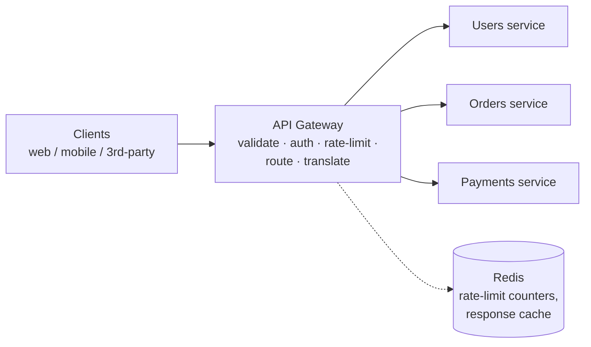
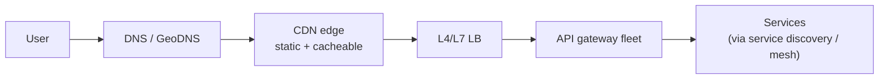

# Deep Dive 09 — API Gateway

> **Source:** [Hello Interview — API Gateway Deep Dive](https://www.hellointerview.com/learn/system-design/deep-dives/api-gateway) (written guide; no dedicated video).
> **Prerequisites:** [05 — Load Balancing](../Core%20Course/05-load-balancing.md) · [10 — Microservices](../Core%20Course/10-microservices.md). Pairs with [13 — Security](../Core%20Course/13-security.md) (authn/z), [11 — Reliability](../Core%20Course/11-reliability.md) (rate limiting, circuit breakers), [DD-01 — Redis](01-redis.md#54-rate-limiter), and [18d — Infra Primitives](../Core%20Course/18d-design-infra-primitives.md) (where *designing* a gateway is the whole problem).

## What you'll master

The API gateway is the **lowest-depth box on your whiteboard** — and that's the skill. Hello Interview's own guidance is blunt: *"I'll add an API gateway to handle routing and middleware"* is the correct amount of detail, and candidates lose minutes touring middleware instead of designing the system. What you actually need is held in reserve: a crisp answer for **"what does it do?"**, a clean **gateway vs load balancer vs reverse proxy** distinction, and — for the rare interview where the gateway *is* the problem ([18d](../Core%20Course/18d-design-infra-primitives.md)) — the real internals.

By the end of this note you will be able to:

- Introduce the gateway in **one sentence** and move on — the altitude discipline itself.
- Walk the **request lifecycle** (validate → middleware → route → translate → transform → cache) when probed.
- Separate **gateway / load balancer / reverse proxy** roles without hand-waving — the #1 probe.
- Say where the **stateful middleware state lives** (rate-limit counters, sessions) — the trap inside "gateways are stateless."
- Place it correctly in the **edge stack** (DNS → CDN → LB → gateway → services) and know when *not* to add one.

---

## Table of Contents

0. [In the Room — Staff-Level Delivery](#in-the-room--staff-level-delivery)
1. [What It Is — One Sentence, One Diagram](#1-what-it-is--one-sentence-one-diagram)
2. [The Request Lifecycle](#2-the-request-lifecycle)
3. [Gateway vs Load Balancer vs Reverse Proxy](#3-gateway-vs-load-balancer-vs-reverse-proxy)
4. [The Middleware Menu — and Where Its State Lives](#4-the-middleware-menu--and-where-its-state-lives)
5. [Scaling & the Edge Stack](#5-scaling--the-edge-stack)
6. [The Landscape](#6-the-landscape)
7. [When NOT to Add One](#7-when-not-to-add-one)
8. [Interview Cheat-Sheet](#interview-cheat-sheet)

---

## In the Room — Staff-Level Delivery

### Decisions to make decisively

| Decision | Default position (say this) | One-line justification | Revisit trigger |
|----------|------------------------------|------------------------|-----------------|
| **Whether to draw it** | **Yes for microservices; no for a monolith** | One entry point for routing + cross-cutting concerns; a monolith behind an LB needs neither | Client-facing API over many services appears → draw it |
| **Depth to volunteer** | **One sentence** — "gateway handles routing, auth, rate limiting" — then move | The gateway is never the crux; minutes spent here are minutes not spent on the actual design | The interviewer probes, or the problem *is* the gateway |
| **Auth placement** | **Authenticate at the gateway; authorize in services** | Token validation is generic (verify JWT, reject early); *permissions* are domain logic that belongs with the domain | Zero-trust/service-mesh requirement → mTLS between services too ([10](../Core%20Course/10-microservices.md)) |
| **Rate limiting** | **At the gateway, counters in Redis** | Enforce before work is done; shared counters because the gateway fleet is many nodes | Per-service budgets → additional limits at service level |
| **Build vs buy** | **Buy/adopt: managed (AWS APIGW) or Kong/Envoy-based** | Undifferentiated heavy lifting; you customize with plugins/config, not code | Extreme edge logic or cost at massive scale → custom Envoy build-out |
| **Protocol translation** | **External REST/HTTP ↔ internal gRPC at the gateway** | Clients get web-friendly JSON; services get typed, efficient RPC | Internal REST everywhere → skip translation, say you're keeping it simple |

### Altitude — name-and-move-on vs deep-dive

**Name and move on (this whole topic, by default):**
- *"Clients hit an API gateway — single entry point, handles routing, authn, rate limiting, TLS termination — then requests fan to services."* That sentence is the complete expected treatment in 90% of designs. Saying more unprompted reads as padding.

**Deep-dive — only when probed or when it's the problem:**
- **Gateway vs LB distinction** (§3) — the most common probe, and a filter for people who draw boxes they can't explain.
- **Where middleware state lives** (§4) — "stateless gateway" meets rate-limit counters; the answer is Redis, and it connects to [DD-01 §5.4](01-redis.md#54-rate-limiter).
- **Designing a gateway itself** ([18d](../Core%20Course/18d-design-infra-primitives.md)) — routing table, plugin chain, config-push, hot reload.

### Experience hooks

- *"Our gateway does exactly three jobs — route, verify the JWT, enforce per-tenant rate limits from Redis — and we've fought to keep it that thin. Every time business logic creeps into gateway plugins, debugging spans two systems and deploys couple."*
- *"The distinction that pays rent: our LB spreads identical traffic across replicas; our gateway sends different paths to different services. When someone says 'the load balancer routes /payments' I know we're about to have a vocabulary problem."*
- *"We cache token-validation results with a 60-second TTL at the gateway — auth-service load dropped 90%, and the revocation blast radius is one minute, which security signed off on. That trade was a meeting, and it should be."*

---

## 1. What It Is — One Sentence, One Diagram

**The sentence:** *"A single entry point that routes client requests to the right backend service and applies the cross-cutting middleware — auth, rate limiting, TLS, logging — so every service doesn't reimplement it."*

It exists because microservices moved the composition problem to the client — dozens of services, each with its own address, auth, and quirks. The gateway restores one facade ([10 — Microservices](../Core%20Course/10-microservices.md)); clients stay ignorant of internal topology.

---

## 2. The Request Lifecycle

The probe-ready walkthrough — six stages, one breath each:

1. **Validate** — URL shape, required headers, payload schema; reject garbage before it costs anything.
2. **Middleware** — authenticate (verify JWT/API key), rate-limit, IP filters, CORS, decompress; the cheap-rejection layer.
3. **Route** — match path/method/headers against the **routing table** (`/orders/* → orders-service`); this table *is* the gateway's core data structure, pushed via config ([37 — Feature Flags](../Core%20Course/37-design-feature-flags.md)-style config-push, not redeploys).
4. **Translate** — external HTTP/JSON ↔ internal gRPC where used.
5. **Transform** — shape the backend response for the client (strip internal fields, version mapping).
6. **Cache** — non-user-specific responses by TTL or event invalidation ([03 — Caching](../Core%20Course/03-caching.md) rules apply unchanged).

Everything here is **per-request, latency-critical, and fail-fast** — which is why gateway work must stay small: single-digit ms of added latency is the budget.

---

## 3. Gateway vs Load Balancer vs Reverse Proxy

The #1 probe. The clean separation:

| | **Reverse proxy** | **Load balancer** | **API gateway** |
|---|-------------------|-------------------|------------------|
| Question it answers | "Who fronts the servers?" | "**Which copy** gets this request?" | "**Which service** gets this request, and is it allowed?" |
| Operates on | Connections/requests generically | Identical replicas of one thing | *Different* routes → *different* services |
| Knows about | Almost nothing | Health + load of instances | Routes, auth, limits, API shape (L7 semantics) |
| Examples | nginx | ALB/NLB, HAProxy ([05](../Core%20Course/05-load-balancing.md)) | Kong, AWS APIGW, Envoy-based |

The honest footnote that earns credit: **in practice they nest and blur** — a gateway *is* a specialized reverse proxy, usually sits *behind* an LB (that spreads traffic across gateway replicas), and calls services *through* more LBs. nginx/Envoy can play all three roles with different configs. Precision about the *role*, not the binary, is the Staff answer.

---

## 4. The Middleware Menu — and Where Its State Lives

The menu (name, don't tour): TLS termination · authentication · **rate limiting** · request logging/metrics · CORS · compression · IP allow/deny · timeouts & retries · response caching · circuit breaking ([11 — Reliability](../Core%20Course/11-reliability.md)).

The trap inside "gateways are stateless": several of those need **shared state across the gateway fleet** —

- **Rate-limit counters** → [Redis, atomic INCR/Lua](01-redis.md#54-rate-limiter) — *not* per-node in-memory counters, or your effective limit is `limit × N nodes` and burst-shaped by the LB.
- **Response cache** → Redis/CDN tier, same invalidation discipline as [03 — Caching](../Core%20Course/03-caching.md).
- **Auth** → keep it stateless-verifiable (JWT signatures) so no lookup is needed; cache introspection results with a short TTL when you must call an auth service — and state the revocation-latency trade aloud.

The design smell to name: **business logic in the gateway.** Orchestration, domain decisions, and data munging belong in services (or a BFF — a per-client-type mini-gateway, worth one sentence if the interviewer asks about mobile vs web APIs). The gateway stays thin or it becomes the new monolith — with root access to everything.

---

## 5. Scaling & the Edge Stack

- Gateways scale **horizontally behind a load balancer** — the request-path work is stateless once counters/caches live in Redis (§4).
- Global: **regional gateway fleets + GeoDNS/anycast** so users hit a nearby edge ([25 — Internet](../Core%20Course/25-internet-networking.md)); the full stack, in order:

- Capacity is rarely the crux — a tuned proxy node handles **tens of thousands of RPS**; the gateway's risks are **blast radius** (it's in front of *everything* — a bad config push is a total outage: canary configs, [33 — Deployment](../Core%20Course/33-design-deployment-system.md)) and **added latency** (keep the middleware chain lean).

---

## 6. The Landscape

| | Pick when | Note |
|---|-----------|------|
| **AWS API Gateway / Azure APIM / GCP Endpoints** | Cloud-native, managed, pay-per-request | Pairs with Lambda; per-request cost at high volume is real |
| **Kong** (nginx-based) | Self-hosted, rich plugin ecosystem | The common OSS default |
| **Envoy** (+ Ambassador/Emissary, Gloo) | Modern L7 everything; same proxy as service meshes | One data plane from edge to mesh ([10](../Core%20Course/10-microservices.md)) |
| **nginx / HAProxy hand-rolled** | Simple needs, existing expertise | You'll grow the middleware yourself |

In the room: *"a managed gateway or Kong — this isn't where I'd spend innovation budget."* One sentence, done.

---

## 7. When NOT to Add One

1. **Monolith** — an LB in front of replicas is the whole story; a gateway is a box with no job.
2. **Internal service-to-service traffic** — that's service discovery / mesh territory, not the client-facing gateway.
3. **As the orchestrator** — if the gateway is composing multi-service workflows, that's an application (BFF or aggregation service) wearing a gateway costume.
4. **Latency-critical hops where its middleware adds nothing** — every box on the hot path must pay rent.

---

## Interview Cheat-Sheet

**One-liner (and usually the whole answer):** *"Clients hit an API gateway — single entry point: routing, authn, rate limiting, TLS — then requests fan out to services."*

**Lifecycle (when probed):** validate → middleware (auth, limits) → route via routing table → translate (REST↔gRPC) → transform → cache.

**The distinction (recite):** reverse proxy fronts servers · LB picks *which copy* · gateway picks *which service* and whether you're allowed — and in practice they nest (LB → gateway fleet → LBs → services).

**The four probes and your answers:**

| Probe | Answer |
|-------|--------|
| "Gateway vs load balancer?" | LB = identical replicas of one thing; gateway = different routes to different services + cross-cutting middleware; gateway fleet itself sits behind an LB |
| "Isn't it a single point of failure?" | Horizontally scaled, stateless request path; the real SPOF is config — canary every routing-table push |
| "How does rate limiting work across N gateway nodes?" | Shared counters in Redis (atomic INCR/sliding window) — per-node counters multiply your limit by N |
| "Where does auth happen?" | Verify identity at the gateway (JWT signature, cheap reject); authorize in the service that owns the domain |

**Say-verbatim lines:**
- *"The gateway stays thin — route, verify, limit. The moment it orchestrates, it's a monolith with root access."*
- *"One sentence of gateway is the right amount — the design crux is elsewhere, and I'd rather spend our minutes there."*
