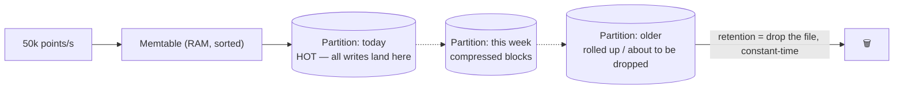

# Deep Dive 10 — Time Series Databases

> **Source:** [Hello Interview — Time Series Databases Deep Dive](https://www.hellointerview.com/learn/system-design/deep-dives/time-series-databases) (written guide).
> **Prerequisites:** [DD-04 — Cassandra §3](04-cassandra.md#3-the-write-path--why-writes-fly-lsm) (LSM — TSDBs reuse it) · [06 — Databases](../Core%20Course/06-databases.md). Pairs with [12 — Observability](../Core%20Course/12-observability.md) (the home use case), [39 — IoT Ingestion](../Core%20Course/39-design-iot-ingestion.md), [34 — Real-Time Analytics](../Core%20Course/34-design-realtime-analytics.md), and [DD-03 — PostgreSQL](03-postgresql.md) (Timescale = the "stay in Postgres" option).

## What you'll master

TSDBs are the cleanest case study in a deep principle: **make strong assumptions about your data, and you can beat a general-purpose database by 10–100× — violate them, and you're worse off.** Metrics arrive append-only, time-ordered, at regular intervals, with near-identical neighboring values and low-cardinality dimensions. Every TSDB trick — LSM writes, delta-of-delta timestamps, XOR floats, partition-drop retention, downsampling — is just one of those assumptions cashed in. And the famous failure mode (**cardinality explosion**) is what happens when one assumption breaks.

By the end of this note you will be able to:

- Characterize the **workload** (append-heavy, recent-hot, regular, similar-neighbors) and quote why Postgres bloats on it (16 bytes of information stored as 50–100).
- Walk the **storage engine**: LSM (again), time partitions, block metadata, bloom filters — and what each buys.
- Explain **Gorilla-style compression** in interview depth: delta-of-delta ≈ 1 bit/timestamp, XOR floats ≈ 1.37 bytes/value.
- Design the **retention ladder** (raw → rollups) and volunteer it the moment someone says "10-second samples for a year."
- Model **tags vs fields** correctly and name the **cardinality problem** before the interviewer does.
- Choose between **Prometheus / InfluxDB / TimescaleDB / ClickHouse** — and default to *not* adding a TSDB at all.

---

## Table of Contents

0. [In the Room — Staff-Level Delivery](#in-the-room--staff-level-delivery)
1. [The Workload — Six Assumptions to Cash In](#1-the-workload--six-assumptions-to-cash-in)
2. [Why Postgres Bloats on It](#2-why-postgres-bloats-on-it)
3. [The Storage Engine — LSM, Partitions, Blocks](#3-the-storage-engine--lsm-partitions-blocks)
4. [Compression — Where the 10–100× Comes From](#4-compression--where-the-10100-comes-from)
5. [The Retention Ladder — Downsampling & Rollups](#5-the-retention-ladder--downsampling--rollups)
6. [Data Model & the Cardinality Problem](#6-data-model--the-cardinality-problem)
7. [Query Execution](#7-query-execution)
8. [The Landscape](#8-the-landscape)
9. [When NOT to Use a TSDB](#9-when-not-to-use-a-tsdb)
10. [Interview Cheat-Sheet](#interview-cheat-sheet)

---

## In the Room — Staff-Level Delivery

### Decisions to make decisively

| Decision | Default position (say this) | One-line justification | Revisit trigger |
|----------|------------------------------|------------------------|-----------------|
| **Whether to add a TSDB** | **Not yet — stretch Postgres/Timescale first** | Specialized stores are earned by a measured bottleneck, not by the word "metrics" ([the DD-03 rule](03-postgresql.md#6-the-scaling-ladder), again) | Sustained 10k+ points/s, or storage/retention math stops closing |
| **Which one** | **Prometheus for infra monitoring · TimescaleDB when it must live in Postgres · ClickHouse when it's really analytics** | Match the tool to the query pattern, not the buzzword | Product-embedded metrics at huge scale → InfluxDB/ClickHouse conversation |
| **Retention** | **Volunteer the ladder**: raw for days, 1-min for weeks, 1-h for a year | Nobody looks at 10-second granularity from last March; storage drops ~two orders | Compliance/forensics needs raw history → cold object storage, not the TSDB |
| **Tags vs fields** | **Tags = low-cardinality dimensions you filter by; anything user-shaped is a field (or doesn't belong)** | Tags build the in-memory series index; high-cardinality tags detonate it | Genuinely need per-user series → that's an analytics/OLAP problem now |
| **Deletes** | **Never row-delete; drop time partitions** | Retention as an `O(1)` file unlink vs a tombstone bill ([the Cassandra lesson](04-cassandra.md#7-anti-patterns--the-cluster-melters), solved structurally) | — |

### Altitude — name-and-move-on vs deep-dive

**Name and move on (one sentence each):**
- LSM mechanics — you've covered it in [DD-04](04-cassandra.md#3-the-write-path--why-writes-fly-lsm); here it's "same engine, one sentence, move."
- Bloom filters — third appearance ([Cassandra reads](04-cassandra.md#4-the-read-path--what-reads-pay), [big-data structures](00-INDEX.md)); "skip SSTables that definitely lack the series."
- Vendor feature lists — nobody cares which InfluxDB version renamed what.

**Deep-dive — spend your minutes here:**
- **The assumption→optimization chain** (§1, §4) — being able to *derive* the compression tricks from the workload is the whole flex.
- **The retention ladder** (§5) — the proactive move that wins observability/IoT designs.
- **Cardinality** (§6) — the failure mode; naming it unprompted is the competence signal.

### Experience hooks

- *"Our metrics pipeline stores ~30 bytes of truth per point; the naive Postgres schema we started with spent ~80. The fix wasn't a faster database — it was admitting metrics aren't rows."*
- *"Someone once added a `request_id` tag to a counter 'for debugging' — series count went from 50k to 50M and the TSDB's memory index ate the box. Cardinality review is now part of adding any metric."* ([12 — Observability](../Core%20Course/12-observability.md) tells the same war story.)
- *"Our retention ladder is a product decision written down: raw for 3 days, minute-rollups for 30, hourly for 400. When someone asks for 10-second data from last quarter, the answer is 'we decided not to pay for that' — and that's the right answer."*

---

## 1. The Workload — Six Assumptions to Cash In

The motivating shape (100k servers × dozens of metrics = **50k+ points/second, forever**):

1. **Append-only** — you never update yesterday's CPU reading.
2. **Time-ordered arrival** — high locality; "now" is always the hot write region.
3. **Recent-hot reads** — dashboards want the last hour, rarely last year.
4. **Regular timestamps** — samples every 10 s ⇒ deltas are constant.
5. **Similar neighbors** — CPU goes 45.2 → 45.3, not 45.2 → 97.6.
6. **Low-cardinality dimensions** — hundreds of hosts/regions/services, not millions of users.

> **Staff-level insight:** this list *is* the deep dive. Every optimization in §3–5 is one assumption converted into performance, and §6's disaster is assumption #6 violated. Present it that way — "TSDBs are what you get when you're allowed to assume X, Y, Z" — and you're teaching the interviewer, which is the strongest position in the room.

---

## 2. Why Postgres Bloats on It

Four concrete failures of update-in-place row storage at this workload:

- **Random-I/O write path**: B-tree pages scattered on disk vs an append log — sequential I/O sustains **100k+ writes/s**; random tops out orders of magnitude lower.
- **Storage bloat**: a point's information content is **16 bytes** (timestamp + float); a naive `(timestamp, host, metric, value)` row with indexes lands at **50–100 bytes** — 3–6× before you've stored a week.
- **Index write-amplification**: every tag you want to filter by is another B-tree updated per insert — and it still doesn't survive cardinality growth.
- **Retention pain**: `DELETE WHERE time < X` is a massive, vacuum-generating scan ([MVCC garbage](03-postgresql.md#1-the-mental-model--heap--mvcc--wal)); TSDBs instead **drop a partition file**.

Honest counterweight to also say: **TimescaleDB fixes most of this inside Postgres** (hypertables = automatic time partitioning + columnar compression) — which is why "stay in Postgres" remains the opening move.

---

## 3. The Storage Engine — LSM, Partitions, Blocks

The write path is [Cassandra's LSM](04-cassandra.md#3-the-write-path--why-writes-fly-lsm) — memtable → immutable SSTables → compaction — one sentence, done. What TSDBs add on top:

- **Time partitioning**: data files are windows (day/week). Writes always hit "now" (locality), range queries prune to relevant partitions instantly, and **retention = unlink old partitions** — no deletes, no tombstones.
- **Block metadata**: each block stores min/max of time and value — query wants `value > 90%`? Blocks maxing at 60% are skipped without a read.
- **Bloom filters** per SSTable (~10 bits/key, ~1% false positives): "definitely-not-here" answers skip disk entirely.
- Series data is stored **columnar and per-series co-located**, so reading one host's CPU for 6 hours is one contiguous scan, not a row-soup filter.

---

## 4. Compression — Where the 10–100× Comes From

The crown jewels (from Facebook's **Gorilla** paper — name it):

| Technique | Idea | Result |
|-----------|------|--------|
| **Delta encoding** | Store differences, not values: `[45.2, +0.1, −0.2, +0.3]` + varint | Small deltas fit in 1–2 bytes instead of 8 |
| **Delta-of-delta (timestamps)** | Samples every 10 s ⇒ delta constant ⇒ delta-of-delta ≈ all zeros | **~1 bit per timestamp** on regular data |
| **XOR float compression** | Neighboring floats share leading/trailing bits; XOR exposes near-zero patterns | **~1.37 bytes per value** vs 8 raw |

Stack them: a 16-byte point stores in ~2 bytes — and *that* is the honest answer to "how do you store 50k points/second for a year." Each trick is an assumption cashed in: regularity → delta-of-delta; similar-neighbors → XOR. Irregular, jumpy data compresses far worse — say that too.

---

## 5. The Retention Ladder — Downsampling & Rollups

The proactive move for any "store metrics for a year" requirement — volunteer it:

| Age | Resolution | What's stored |
|-----|-----------|----------------|
| 24 h | 10 s raw | Full fidelity for incident debugging |
| 7 d | 1-min rollups | avg/min/max/sum/count per window |
| 30 d | 5-min rollups | Same aggregates |
| 1 yr | 1-h rollups | Trends, capacity planning |

- Rollups store **min/max/sum/count** (not just avg — you can't recompute a max from averages; this detail lands).
- The example math: 10 s → 1 h resolution = **~288× less data** for old ranges, and historical dashboard queries get proportionally faster.
- Phrase it as a product negotiation: *"we probably need fine resolution for a week, then 5-minute averages — does that work for the debugging story?"* — requirement-shaping, not just storage engineering ([30 — Capacity](../Core%20Course/30-capacity-estimation.md) math backs it).

---

## 6. Data Model & the Cardinality Problem

The model (InfluxDB line-protocol flavor): `cpu_usage,host=server-1,region=us-west value=45.2 <ts>`

- **Measurement** (`cpu_usage`) ≈ table · **tags** (`host`, `region`) = *indexed* dimensions · **fields** (`value`) = the unindexed data · timestamp.
- **A series = one unique tag combination.** The TSDB keeps an in-memory inverted index of all series — that's what makes `region=us-west AND env=prod` instant.

**The detonation:** cardinality = product of tag values. 1,000 hosts × 50 metrics = 50k series — fine. Add `user_id` (10M values) as a tag → **potentially billions of series** → the series index outgrows RAM, query planning crawls, ingestion chokes. The system is now *worse* than the general-purpose DB you left.

Rules to recite: **tags are for dimensions you filter/group by and can enumerate** (hosts, regions, status codes); **anything user-shaped or unbounded is a field — or belongs in an [OLAP store](../Core%20Course/34-design-realtime-analytics.md), not a TSDB.**

---

## 7. Query Execution

`avg(cpu) WHERE region=us-west AND env=prod, last 6 h, per 5 min` — the four-step walk:

1. **Partition pruning** — only partitions overlapping the 6-hour window.
2. **Tag-index lookup** — intersect posting lists (`region=us-west` ∩ `env=prod`) → the matching series ([DD-06's inverted index](06-elasticsearch.md#2-the-two-index-structures--mappings), same trick).
3. **Block lookup + skip** — bloom filters and min/max metadata drop irrelevant blocks unread.
4. **Streaming aggregation** — decompress and fold per 5-min bucket without materializing raw points.

The one-liner: *"prune time, prune series, prune blocks, then stream — the query never touches data it doesn't need, because the layout was designed around this exact query shape."*

---

## 8. The Landscape

| | Pick when | Note |
|---|-----------|------|
| **Prometheus** | Infra/K8s monitoring | Pull-based scraper + TSDB + PromQL; the observability default ([12](../Core%20Course/12-observability.md)); pairs with Thanos/Mimir for long-term/global. **VictoriaMetrics** is the common drop-in alt (Prometheus-compatible, better cardinality tolerance + compression) — name it |
| **TimescaleDB** | Metrics must live next to relational data, SQL required | Postgres extension: hypertables, compression, `continuous aggregates` = rollups — the "stay in Postgres" answer |
| **InfluxDB** | Product-embedded time series, IoT | Purpose-built. **Currency: InfluxDB 3 (IOx) is a rewrite** — Apache Arrow + Parquet on object storage + SQL (`FlightSQL`), *not* the old in-memory tag-index engine; the tags/fields model of §6 describes 1.x/2.x, and v3 changes the cardinality economics materially. Say which generation you mean |
| **ClickHouse** | It's really **analytics over events**, huge scale, high(er) cardinality tolerated | Columnar OLAP that eats time series as a special case ([34](../Core%20Course/34-design-realtime-analytics.md)) |

Decision script: **monitoring → Prometheus (or VictoriaMetrics) · in-Postgres → Timescale · IoT/product metrics → InfluxDB · analytics wearing a time-series costume → ClickHouse.**

---

## 9. When NOT to Use a TSDB

1. **High-cardinality dimensions** are inherent to the queries (per-user anything) → OLAP/columnar, not a TSDB.
2. **Point lookups and joins** — "get event X and join to accounts" is database work; TSDBs have no business doing it.
3. **Modest scale** — thousands of points/minute lives happily in Postgres/Timescale; the specialized store is ops surface without payoff.
4. **Years of raw fine-grained history** — that's an archive problem: rollups in the TSDB, raw in object storage (Parquet on S3) if compliance demands it.
5. **Irregular, spiky, schema-less events** — the compression assumptions don't hold; that's a log/analytics pipeline ([16](../Core%20Course/16-data-processing.md)).

---

## Interview Cheat-Sheet

**One-liner:** *"A TSDB is a set of assumptions cashed in: append-only + time-ordered → LSM and time partitions; regular intervals → delta-of-delta timestamps (~1 bit); similar neighbors → XOR floats (~1.4 bytes); recent-hot → downsampling ladders; low-cardinality tags → an in-memory series index. Break the last assumption and the whole thing detonates."*

**Numbers:** 16-byte point → 50–100 bytes naive vs **~2 bytes compressed** (Gorilla) · delta-of-delta ≈ **1 bit/timestamp** · XOR ≈ **1.37 B/value** · rollups: 10 s → 1 h = **~288×** less · TSDB threshold ≈ **10k+ points/s sustained** · bloom ≈ 10 bits/key, 1% FP.

**The reflexes (recite):** retention = drop partitions, never DELETE · rollups store min/max/sum/count · tags = enumerable dimensions, user-shaped things are fields · volunteer the retention ladder when anyone says "for a year."

**The four probes and your answers:**

| Probe | Answer |
|-------|--------|
| "Store 10 s samples for a year?" | Retention ladder: raw for days, minute-rollups for weeks, hourly for the year — ~two orders less storage; negotiate the fidelity as a requirement |
| "Why not just Postgres?" | Random-I/O writes, 3–6× storage bloat, DELETE-based retention — though Timescale closes most of the gap and is my first move |
| "What breaks a TSDB?" | Cardinality: series = tag-combination count; one user-id tag turns 50k series into billions and the in-memory index dies |
| "How is it so compressed?" | Gorilla: delta-of-delta on regular timestamps ≈ 1 bit; XOR on similar floats ≈ 1.4 bytes — assumptions about the data doing the work |

**Say-verbatim lines:**
- *"Strong assumptions, massive wins — violated assumptions, worse than Postgres."*
- *"Retention is a file unlink, not a query."*
- *"Cardinality review before any new tag — a metric is cheap, a dimension is not."*
