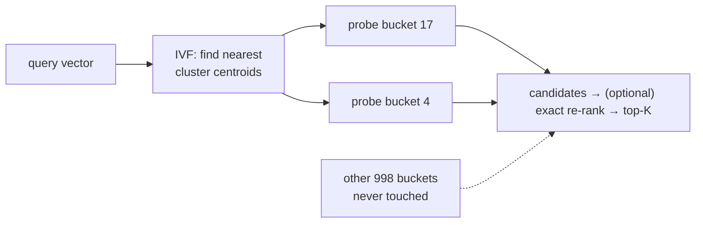
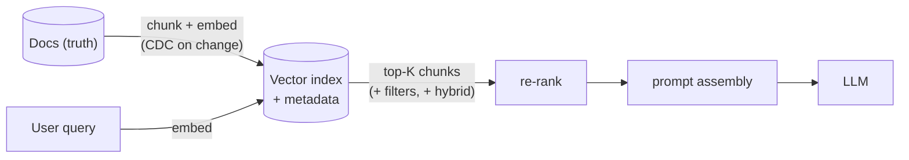

# Deep Dive 11 — Vector Databases

> **Source:** [Hello Interview — Vector Databases Deep Dive](https://www.hellointerview.com/learn/system-design/deep-dives/vector-databases) (written guide; premium) + standard ANN-search internals.
> **Prerequisites:** [17 — AI Systems](../Core%20Course/17-ai-systems.md) (RAG, embeddings in context) · [06 — Databases](../Core%20Course/06-databases.md). Pairs with [DD-06 — Elasticsearch](06-elasticsearch.md) (hybrid search, and the same "projection, not truth" role) and [DD-03 — PostgreSQL](03-postgresql.md) (pgvector = the stay-in-Postgres move, again).

## What you'll master

Vector search shows up the moment a design says **"similar," "semantic," "recommend," or "RAG"** — and Hello Interview's own guidance is that most interviews need *placement* knowledge, not index internals. So the skill split is: deploy it correctly in one sentence (embed → index → approximate nearest-neighbor search), hold **HNSW vs IVF vs quantization** in reserve for the probe, and know the two traps that actually bite in production — **filtered search** and **embedding freshness**.

By the end of this note you will be able to:

- Explain **embeddings + similarity-as-geometry** in two sentences, with dimensions and metrics right (128–3072 dims; cosine/dot/L2).
- Show **why exact kNN dies** with real numbers (10M × 1536-dim floats ≈ 61 GB scanned per query) and what "approximate" buys and costs (**recall**, the tunable dial).
- Sketch the three **ANN index families** — HNSW (graph), IVF (clusters), PQ (compression) — one mechanism sentence each.
- Handle the **filtered-search trap** (pre- vs post-filtering) and **hybrid search** (BM25 + vectors, RRF).
- Place the store correctly: **pgvector-first**, purpose-built at scale — and treat it as a rebuildable projection, like [ES](06-elasticsearch.md#7-keeping-es-in-sync--the-cdc-pipeline).

---

## Table of Contents

0. [In the Room — Staff-Level Delivery](#in-the-room--staff-level-delivery)
1. [The Mental Model — Similarity Is Geometry](#1-the-mental-model--similarity-is-geometry)
2. [Why Exact kNN Dies — and What "Approximate" Means](#2-why-exact-knn-dies--and-what-approximate-means)
3. [The ANN Index Families](#3-the-ann-index-families)
4. [The Two Production Traps — Filtering & Freshness](#4-the-two-production-traps--filtering--freshness)
5. [Hybrid Search](#5-hybrid-search)
6. [The RAG Pipeline Placement](#6-the-rag-pipeline-placement)
7. [The Landscape](#7-the-landscape)
8. [When NOT to Use a Vector DB](#8-when-not-to-use-a-vector-db)
9. [Interview Cheat-Sheet](#interview-cheat-sheet)

---

## In the Room — Staff-Level Delivery

### Decisions to make decisively

| Decision | Default position (say this) | One-line justification | Revisit trigger |
|----------|------------------------------|------------------------|-----------------|
| **Which store** | **pgvector in the existing Postgres** | One less system; HNSW inside Postgres handles millions of vectors fine — [the DD-03 rule](03-postgresql.md#6-the-scaling-ladder) yet again | ~50M+ vectors, high QPS, or heavy filtered search → purpose-built (Qdrant/Pinecone/Milvus) |
| **Index** | **HNSW** | Best recall/latency for most workloads; the industry default | RAM cost bites at huge scale → IVF-PQ tiering |
| **Metric** | **Cosine (or dot on normalized vectors)** | What text-embedding models are trained for; say "match the metric to the model card" | — |
| **Exact vs approximate** | **ANN with recall ~0.95+, measured** | Brute force is O(N·d) per query; recall is a dial you tune against a ground-truth sample, not a leap of faith | Small corpus (<~100k) → exact scan is fine, skip the index |
| **Filters + vectors** | **Pre-filter/filter-aware search when filters are selective** | Post-filtering top-K can return near-zero results after the WHERE clause | Loose filters → post-filter with over-fetch (K×10) is fine |
| **Role in architecture** | **Rebuildable projection** — source docs + model version are the truth; re-embed to rebuild | Same contract as [the ES rule](06-elasticsearch.md#9-when-not-to-use-elasticsearch): if you can't rebuild it, you built it wrong | — |

### Altitude — name-and-move-on vs deep-dive

**Name and move on (one sentence each):**
- What an embedding is — two sentences max (§1); lecturing on ML here reads as filler.
- LSH/Annoy — name as "older ANN families," done.
- Vendor comparisons — one line; nobody's testing your Pinecone pricing knowledge.

**Deep-dive — spend your minutes here:**
- **Recall as the explicit trade** (§2) — "approximate" without a recall number is hand-waving; with one, it's engineering.
- **The filtered-search trap** (§4) — the practitioner's tell; most candidates have never hit it.
- **Freshness/re-embedding** (§4) — the ops question hiding in every RAG design.

### Experience hooks

- *"We started semantic search on pgvector inside the DB we already ran — 3M vectors, HNSW, p99 under 40 ms. The purpose-built store conversation starts if we 10× and filtered search gets heavy, and not before."*
- *"Our worst vector bug wasn't the index — it was upgrading the embedding model and forgetting that old and new vectors don't live in the same space. Now the model version is part of the index name, and an upgrade is a full re-embed + alias flip, exactly like an ES reindex."*
- *"Post-filtering burned us: top-50 similar docs, then `WHERE tenant_id = X` — three results survived. We moved tenant into the index's filter-aware search and recall came back."*

---

## 1. The Mental Model — Similarity Is Geometry

- An **embedding** is an array of floats (typically **128–1536 dims**; OpenAI's large model 3072) produced by a model such that **semantically similar things land close together** in the space. Text, images, users, products — anything can be embedded.
- **Similarity = distance**: **cosine** (angle; the text default), **dot product** (cosine on normalized vectors, cheaper), **Euclidean/L2**. Rule: *use the metric the embedding model was trained with.*
- The query, always the same shape: **k-nearest-neighbors** — embed the query, find the K closest stored vectors, return their payloads.

The one-liner: *"a vector DB is a store whose only interesting query is 'K nearest points to this one' — everything about it is making that query fast at scale."*

---

## 2. Why Exact kNN Dies — and What "Approximate" Means

Brute force = compare the query against **every** vector: O(N·d) per query.

- The BOTEC to say aloud: **10M docs × 1536 dims × 4 bytes ≈ 61 GB** — scanned *per query*. Even at memory bandwidth that's hundreds of ms and zero concurrency headroom. At 100M+ it's simply over.
- **ANN (approximate nearest neighbor)** indexes trade a sliver of correctness for orders of magnitude: they return the true neighbors with probability **recall** (e.g. 0.95 = 95% of the true top-K found), at **single-digit-ms** latencies.
- The Staff framing: **recall is a measured, tunable dial** (index parameters like HNSW's `efSearch`), evaluated against a brute-forced ground-truth sample — *"I'd tune to recall ≥0.95 at p99 <50 ms and monitor it"* turns "approximately correct" from a shrug into an SLO.

---

## 3. The ANN Index Families

One mechanism sentence each — this is the reserve depth for the "how does it actually work?" probe:

| Family | Mechanism | Trade |
|--------|-----------|-------|
| **HNSW** (graph) | Multi-layer proximity graph — top layers sparse for coarse navigation, bottom dense; search greedily descends toward the query (skip-list intuition, in vector space) | **The default**: best recall/latency; costs RAM (graph + vectors in memory); inserts are fine, deletes are awkward |
| **IVF** (clusters) | K-means the corpus into buckets; search probes only the few closest buckets (`nprobe`) | Much smaller memory/build cost; recall depends on probing enough buckets; needs (re)training as data drifts |
| **PQ** (compression) | Chop each vector into sub-vectors, replace each with a codebook id — 1536 floats → ~dozens of bytes | 10–50× memory reduction with recall loss; usually **IVF-PQ** together for huge corpora; often + a re-rank on exact vectors |

(LSH and Annoy exist as older families — name them only if asked for the taxonomy.)

---

## 4. The Two Production Traps — Filtering & Freshness

**Trap 1 — filtered vector search.** "Similar docs *where tenant_id = X and status = published*":

- **Post-filter**: ANN top-K first, then apply the WHERE — with selective filters, most of your K dies and you return 2 results with great scores. Mitigation: over-fetch (K×10) — wasteful, still fails on very selective filters.
- **Pre-filter / filter-aware**: restrict the search to qualifying vectors — exact for small filtered sets, or engine-native filtered HNSW (Qdrant/pgvector iterative scans do this). This capability difference *is* the real differentiator between vector stores — name it as your selection criterion.

**Trap 2 — embedding freshness.** Two clocks:
- **Content changes** → re-embed the changed docs; pipeline is [the CDC pattern](06-elasticsearch.md#7-keeping-es-in-sync--the-cdc-pipeline) with an embedding step in the transform.
- **Model changes** → *all* vectors are stale at once — old and new embeddings **don't share a space**; never mix them. Version the index by model, re-embed everything, flip an alias ([the migration reflex](../Core%20Course/32-migrations.md)).

---

## 5. Hybrid Search

Semantic search misses exact tokens (SKUs, names, error codes); keyword search misses paraphrases. Production search is usually **both**:

- Run **BM25** ([DD-06 §4](06-elasticsearch.md#4-the-query-path--scatter-gather--scoring)) and **vector kNN** in parallel, merge with **RRF (reciprocal rank fusion)** — rank-based, no score-calibration headaches — or a weighted blend, often + a **re-ranker** model on the top ~100.
- This is why **Elasticsearch/OpenSearch added kNN**: one engine, one sync pipeline, hybrid built in — a strong consolidation argument when you already run ES.

---

## 6. The RAG Pipeline Placement

Where the vector DB sits in the design interviewers actually ask about ([17 — AI Systems](../Core%20Course/17-ai-systems.md) owns the full picture):

The two vector-relevant callouts in a RAG design: **chunking strategy feeds retrieval quality** (name it, don't tour it), and **the index is a projection** — docs + model version are the truth; the index rebuilds from them.

---

## 7. The Landscape

| | Pick when | Note |
|---|-----------|------|
| **pgvector** | Default: existing Postgres, ≤ tens of millions of vectors | HNSW + filtered (iterative) search; transactional with your data |
| **Elasticsearch / OpenSearch kNN** | You already run it; hybrid search is the requirement | One sync pipeline for keyword + vector |
| **Qdrant / Weaviate / Milvus** | Purpose-built OSS: heavy filtered search, 100M+ vectors, high QPS | Filtered-HNSW quality is the differentiator |
| **Pinecone / Turbopuffer** | Managed, zero-ops, serverless pricing | The DynamoDB-style trade: ops for $ and lock-in |
| **FAISS** | A *library*, not a DB — batch/offline ANN, research, custom infra | You own persistence, filtering, and serving around it |

Escalation script: **pgvector → (already-on-ES? add kNN) → purpose-built when scale/filtering demand it → FAISS only when you're building the platform yourself.**

---

## 8. When NOT to Use a Vector DB

1. **The similarity is expressible as structure** — tags, categories, joins: relational queries beat embeddings for filterable facts; embeddings are for *unstructured* similarity.
2. **Tiny corpus** — under ~100k vectors, exact scan (even in NumPy or SQL) is milliseconds; an ANN index is ceremony.
3. **As the system of record** — payloads live with the truth; the vector index is rebuildable ([the ES rule](06-elasticsearch.md#9-when-not-to-use-elasticsearch), verbatim).
4. **Recommendation systems that are really collaborative filtering at scale** — embeddings may be the representation, but the serving system is its own design ([18c](../Core%20Course/18c-design-marketplace-money.md)); don't wave "vector DB" at it.
5. **When keyword search satisfies the requirement** — "search by title" doesn't need 1536 dimensions; check before adding a model dependency to the write path.

---

## Interview Cheat-Sheet

**One-liner:** *"Embed content into vectors where similarity is distance, index them for approximate k-nearest-neighbor (HNSW by default), and treat the whole thing as a rebuildable projection — recall is a measured dial, filters need filter-aware search, and a model upgrade means a full re-embed."*

**Numbers:** dims 128–1536 (up to 3072) · 10M × 1536 × 4 B ≈ **61 GB** brute-forced per query — why ANN exists · target **recall ≥0.95** at single-digit–double-digit ms · PQ: 10–50× memory reduction · exact scan fine under ~100k vectors.

**Index families (recite):** HNSW = layered proximity graph, greedy descent — default, RAM-hungry · IVF = k-means buckets, probe a few · PQ = codebook compression, pair with IVF at huge scale, re-rank exact.

**The four probes and your answers:**

| Probe | Answer |
|-------|--------|
| "How does it scale past brute force?" | ANN index (HNSW/IVF); state the recall SLO and how you'd measure it against ground truth |
| "Similar items *for this tenant only*?" | Filter-aware/pre-filtered search — post-filtering top-K collapses under selective filters; over-fetch is the weak patch |
| "Docs change / model upgrades?" | CDC re-embeds changed docs; model change = new versioned index, full re-embed, alias flip — spaces don't mix |
| "Vector DB or Elasticsearch?" | Need hybrid + already run ES → ES kNN; heavy filtered vector workloads at scale → purpose-built; default → pgvector |

**Say-verbatim lines:**
- *"Recall is a dial with an SLO, not a caveat."*
- *"Old and new embeddings don't share a space — a model upgrade is a reindex, not a rolling update."*
- *"The vector index is a projection; the docs and the model version are the truth."*
