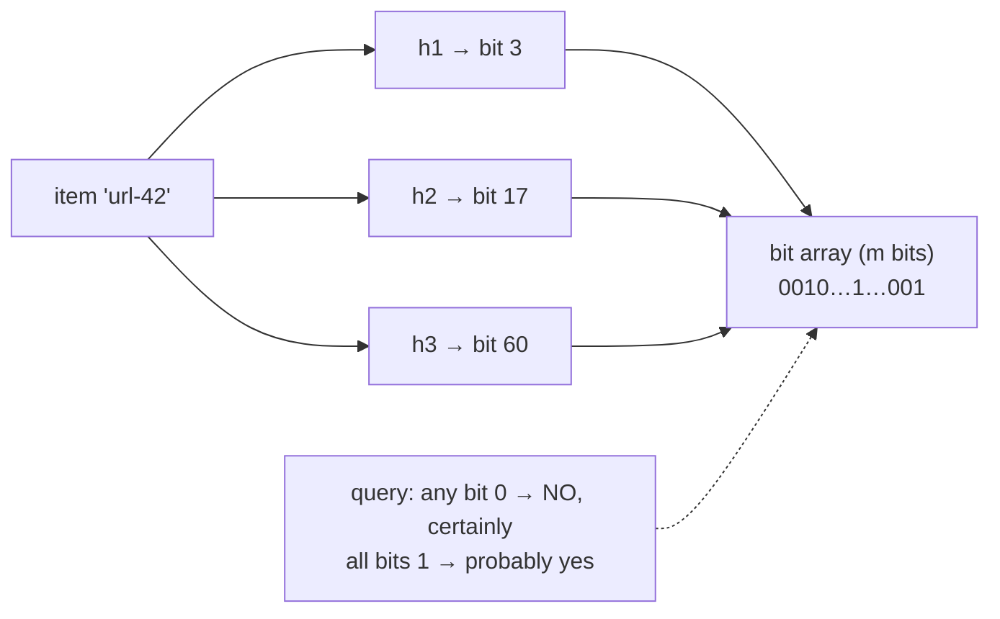
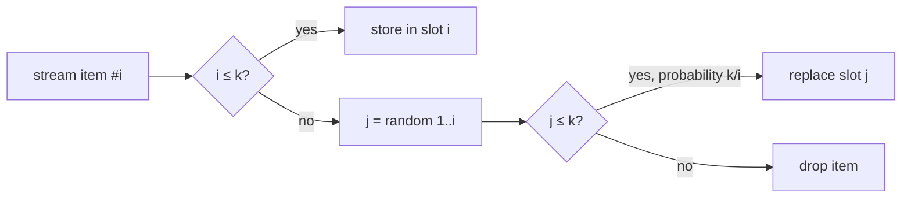

# Deep Dive 12 — Data Structures for Big Data

> **Source:** [Hello Interview — Data Structures for Big Data](https://www.hellointerview.com/learn/system-design/deep-dives/data-structures-for-big-data) (written guide; premium) + standard references (Bloom '70, Flajolet HLL, Cormode–Muthukrishnan CMS).
> **Prerequisites:** [34 — Real-Time Analytics](../Core%20Course/34-design-realtime-analytics.md) (where these earn their keep). Pairs with [DD-01 — Redis](01-redis.md) (ships HLL natively), [DD-04](04-cassandra.md#4-the-read-path--what-reads-pay)/[DD-06](06-elasticsearch.md#3-the-write-path--refresh-translog-merge)/[DD-10](10-time-series-databases.md#3-the-storage-engine--lsm-partitions-blocks) (Bloom filters in the wild), [12 — Observability](../Core%20Course/12-observability.md) (quantiles), [18d — Top-K](../Core%20Course/18d-design-infra-primitives.md).

## What you'll master

Four structures that trade **exactness for orders-of-magnitude less memory** — the difference between "count distinct users across a billion events" being a 16 GB hash set or a **12 KB sketch**. They appear at the *end* of designs, when the honest answer to "how do you count/dedupe/rank at this volume?" is "approximately, in constant memory, with a stated error." The guide's own warning is the frame: **used where they reshape the architecture, they're a superpower; sprinkled where a hash map would do, they're overengineering with extra steps.**

By the end of this note you will be able to:

- Deploy each of the four by name with its **guarantee, error, and memory** in one breath: **Bloom filter** (membership), **HyperLogLog** (distinct count), **Count-Min Sketch** (frequency), **approximate quantiles / t-digest** (percentiles).
- Recognize the **trigger phrases**: "have we seen this before?" → Bloom · "how many unique?" → HLL · "how often / top-K?" → CMS + heap · "p99 latency?" → t-digest.
- Quote the **numbers**: ~10 bits/element @1% FP (Bloom) · 12 KB for billions @ ~0.81% error (HLL) · KB-scale grids (CMS).
- State each structure's **one-sided error** correctly — which direction it can be wrong, and why that's the design lever.
- Know what **ships in Redis** (`PFADD/PFCOUNT`, RedisBloom) so the answer is a command, not a build.
- Reach for **reservoir sampling** when the ask is *examples*, not a measure: a uniform k-of-n sample in one pass, made mergeable with bottom-k keys.

---

## Table of Contents

0. [In the Room — Staff-Level Delivery](#in-the-room--staff-level-delivery)
1. [The Common Idea — Hashing + Bounded Error](#1-the-common-idea--hashing--bounded-error)
2. [Bloom Filter — "Definitely Not, or Probably Yes"](#2-bloom-filter--definitely-not-or-probably-yes)
3. [HyperLogLog — Counting Distinct in 12 KB](#3-hyperloglog--counting-distinct-in-12-kb)
4. [Count-Min Sketch — Frequencies & Top-K](#4-count-min-sketch--frequencies--top-k)
5. [Approximate Quantiles — p99 Without the Log](#5-approximate-quantiles--p99-without-the-log)
6. [Reservoir Sampling — A Fair Sample of an Unbounded Stream](#6-reservoir-sampling--a-fair-sample-of-an-unbounded-stream)
7. [Where They Slot Into Designs](#7-where-they-slot-into-designs)
8. [When NOT to Reach for Them](#8-when-not-to-reach-for-them)
9. [Interview Cheat-Sheet](#interview-cheat-sheet)

---

## In the Room — Staff-Level Delivery

### Decisions to make decisively

| Decision | Default position (say this) | One-line justification | Revisit trigger |
|----------|------------------------------|------------------------|-----------------|
| **Exact or approximate** | **Exact until the memory math breaks** — do the BOTEC aloud | A hash set of 100M 64-bit IDs is ~1.6 GB — often *fine*; sketches are earned by scale, not fashion | Billions of items, per-key×per-window multiplicity, or per-node memory budgets |
| **Unique counts** | **HLL — and in Redis it's `PFADD`/`PFCOUNT`, done** | 12 KB per counter, ~0.81% error, **mergeable across shards** | Exact-required (billing!) → real dedupe (DB constraint / [Bloom-fronted](02-kafka.md#8-delivery-guarantees) store) |
| **Membership at scale** | **Bloom filter in front of the expensive check** | "Definitely not" answers skip the disk/network hop; false positives just pay the check anyway | Need deletes → counting Bloom/cuckoo filter, or rethink |
| **Top-K / heavy hitters** | **CMS + a small heap of the current top-K** | CMS answers "how often?", the heap remembers *who*; KBs total | Exact ranks needed → [stream job](07-flink.md) with keyed state |
| **Percentiles** | **t-digest / DDSketch per window, merged centrally** | Raw latency logs don't scale and **you can't average p99s** — digests merge correctly | — (averaging percentiles stays wrong forever) |
| **Error disclosure** | **Always state the error and its direction** | "~1% overcount possible, never undercount" is engineering; "roughly" is hand-waving | — |

### Altitude — name-and-move-on vs deep-dive

**Name and move on (one sentence each):**
- The math derivations — quote the numbers, skip the proofs; nobody wants the harmonic mean of registers derived live.
- Cuckoo filters, counting Blooms, exotic sketches — "variants exist for deletes," move.
- Where Bloom filters live inside databases — you've already met them three times ([Cassandra](04-cassandra.md#4-the-read-path--what-reads-pay), [ES/Lucene](06-elasticsearch.md), [TSDBs](10-time-series-databases.md#3-the-storage-engine--lsm-partitions-blocks)); one callback sentence.

**Deep-dive — spend your minutes here:**
- **The one-sided-error reasoning** (§2) — placing a Bloom filter so false positives are *safe by construction* is the actual skill.
- **Mergeability** (§3, §5) — the under-appreciated property that makes sketches work in *distributed* systems: per-shard sketches union into a global answer.
- **The Top-K assembly** (§4) — CMS+heap is a standard [interview problem's](../Core%20Course/18d-design-infra-primitives.md) core.

### Experience hooks

- *"Our unread-analytics dashboard counts daily uniques with Redis HLL — one `PFADD` per event, 12 KB per counter, and `PFMERGE` gives us weekly rollups for free. The exact version we replaced was a 40 GB Redis set nobody could afford to keep."*
- *"We Bloom-front our 'has this URL been crawled?' check — 10 bits per URL means a billion URLs fit in ~1.2 GB of RAM, and a false positive just means we skip a URL we'd have skipped anyway. The error direction was the design."*
- *"An SRE once averaged five nodes' p99s into a 'global p99' on a dashboard — we now ship t-digests from every node and merge them, because percentiles don't average and that graph had been lying for a year."*

---

## 1. The Common Idea — Hashing + Bounded Error

All four share one move: **hash the input into a small, fixed-size summary; accept a known, tunable error in exchange for constant memory and `O(1)` updates.** Three properties make them system-design material rather than trivia:

1. **Fixed memory, unbounded input** — the sketch never grows; the stream can.
2. **Known error direction** — each structure is wrong in only *one* way (Bloom never false-negatives; CMS never undercounts). Architecture exploits the direction.
3. **Mergeability** — two sketches OR/add/union into one. Per-shard → global with no coordination; this is why they thrive in [distributed aggregation](../Core%20Course/34-design-realtime-analytics.md).

---

## 2. Bloom Filter — "Definitely Not, or Probably Yes"

**Mechanism (one breath):** a bit array + k hash functions; *add* sets k bits, *query* checks them — any zero ⇒ **definitely not present**; all ones ⇒ **probably present** (others may have set those bits).

- **Numbers:** ~**10 bits/element for ~1% false positives** (9.6 theoretical); k ≈ 7 hashes. A billion items ≈ **1.2 GB** vs ~16+ GB for a hash set of hashes.
- **No deletes** (bits are shared) — counting/cuckoo variants exist; usually you rebuild periodically instead.
- **The design skill — place it so false positives are harmless:** crawler dedupe (FP = skip one URL) · [cache-penetration guard](../Core%20Course/03-caching.md#54-cache-penetration) (FP = one wasted DB read) · LSM read-skipping (FP = one extra SSTable probe — [Cassandra's exact usage](04-cassandra.md#4-the-read-path--what-reads-pay)) · "username taken?" fast path. In every case the filter *removes* work on the common path and the rare mistake just pays the original cost.

> **Staff-level insight:** the sentence that shows mastery: *"I put the Bloom filter where a false positive degrades to the un-optimized path — so the error budget costs latency, never correctness."*

---

## 3. HyperLogLog — Counting Distinct in 12 KB

**Mechanism (one breath):** hash each item; the number of leading zeros in the hash is evidence of scale ("seeing a hash with 20 leading zeros suggests ~2²⁰ distinct items"); keep the max per bucket across 2¹⁴ buckets and combine (harmonic mean) to estimate cardinality.

- **Numbers:** standard config = 2¹⁴ registers = **12 KB**, error ≈ **0.81%**, essentially regardless of whether you count millions or billions. (Exact set for 1B user-ids: tens of GB.)
- **Mergeable**: union = per-register max ⇒ per-shard/per-day HLLs roll up to global/monthly *exactly as easily* — the killer feature for [distributed analytics](../Core%20Course/34-design-realtime-analytics.md).
- **It ships in Redis** ([DD-01](01-redis.md)): `PFADD page:home user123` · `PFCOUNT page:home` · `PFMERGE week day1..day7`. In an interview, "Redis HLL, 12 KB per counter, ±1%" is a complete answer to "unique visitors per page per day at scale."
- Not for: exact counts (billing, entitlements) or *membership* ("was user X here?" — HLL can't answer *who*, only *how many*).

---

## 4. Count-Min Sketch — Frequencies & Top-K

**Mechanism (one breath):** a d×w grid of counters with d hash functions; *add* increments one counter per row; *query* takes the **min** across rows — collisions only ever inflate, so the min is the least-damaged estimate.

- **Error shape: never undercounts, may overcount** by εN with probability 1−δ; memory O(w×d) counters — typically **KBs** for stream-scale workloads (w = ⌈e/ε⌉, d = ⌈ln 1/δ⌉).
- **Top-K / heavy hitters assembly** (the [interview classic](../Core%20Course/18d-design-infra-primitives.md)): stream item → CMS `add` → query its estimate → maintain a small **min-heap of the K largest**. CMS answers "how often," the heap remembers "who" — constant memory for both, and the overcount direction means you might *include* a borderline item, never miss a true heavy hitter's magnitude.
- Uses: trending hashtags, hot-key detection (the [hot-partition](02-kafka.md#10-hot-partitions) detector itself!), rate-limit prefiltering, popularity-biased caching.

---

## 5. Approximate Quantiles — p99 Without the Log

The problem: percentiles need the *distribution*, and storing every latency sample at 100k RPS is its own big-data problem. Averaging per-node p99s is **wrong** (percentiles don't compose by averaging).

**Mechanism (one breath):** digest structures — **t-digest**, **DDSketch**, GK — keep a compressed shape of the distribution (centroids dense near the tails), sized in **KBs**, with ~1%-relative error exactly where you care (the tail).

- **Mergeable** — per-node digests per window combine into the true global p99: the correct architecture for [metrics pipelines](../Core%20Course/12-observability.md) (and what Prometheus histograms / DDSketch-based vendors do underneath).
- Uses: SLO dashboards, A/B latency comparisons, autoscaling signals, load-balancer health.
- The interview line: *"each node ships a t-digest per 10 s window; the aggregator merges digests — merged p99 is correct, averaged p99s are fiction."*

---

## 6. Reservoir Sampling — A Fair Sample of an Unbounded Stream

The companion to the four sketches. Sketches summarize a *measure*. Reservoir sampling keeps **actual items**, a uniformly random **k of them**, from a stream whose length you don't know, in one pass and O(k) memory. It's the answer when the requirement is "show me *examples*", which the sketches can't do (§8, point 3).

**Mechanism (one breath, Algorithm R):** keep the first k items; for the i-th item (i > k), draw `j = random(1..i)`; if `j ≤ k`, overwrite slot j. Every item seen ends up in the reservoir with probability exactly **k/n**, whatever n turns out to be.

- **Why it's fair (one line):** item i enters with probability k/i, and each later item m evicts it with probability (k/m)·(1/k) = 1/m, so it survives to the end with k/i · Π(m−1)/m = **k/n**.
- **Fast variant (Algorithm L):** instead of one random draw per item, jump ahead by a geometrically distributed **skip count**. That's O(k·log(n/k)) random draws in total, which matters at millions of events/sec.
- **Weighted (A-Res, Efraimidis–Spirakis):** give each item the key `u^(1/w)` (u uniform in (0,1), w its weight) and keep the **k largest keys** in a min-heap. Use it to sample proportionally to revenue, latency or bytes.
- **Distributed: bottom-k makes it mergeable.** Tag each item with a random key `u` and keep the **k smallest keys** per shard. Merging is "take the k smallest across shards", which gives a uniform sample of the *union* with no coordination, the same superpower as HLL (§3). Naively concatenating per-shard reservoirs is **biased** when shards saw different volumes. That's the trap to name.
- **Stratify to keep the rare stuff:** one reservoir per `(endpoint, status_code)` bucket, so 0.01% error requests still get k examples instead of being drowned by the 99.99% successes. This is the cheap cousin of tail-based trace sampling ([12 — Observability](../Core%20Course/12-observability.md)).
- **Error shape:** the *selection* is exactly unbiased; estimates computed *from* the sample carry ordinary sampling error, **≈ ±1/√k** relative for proportions. k = 1,000 gives about ±3%.

| Fixed-rate sampling ("keep 1%") | Reservoir sampling ("keep 1,000") |
|---|---|
| Output size grows with traffic, so a 10× spike means 10× sample storage | Output size is **fixed**; the rate adapts automatically |
| Trivial to reason about rates (×100 to estimate totals) | Need n (a counter) alongside to scale estimates back up |
| Good for steady-state metrics | Good for **bounded debug/example sets**, judged-relevance pools, per-window samples |

Uses: "keep 1,000 representative requests per endpoint per minute" for debugging, sampled request logs under a fixed storage budget, an unbiased query sample for human relevance judging ([07 — Search](../Core%20Course/07-search.md#26-metrics--precisionrecall-ndcg-map-mrr)), downsampling training data, and a fixed-size random sample for an A/B audit.

> **Staff-level insight:** the sentence that shows mastery: *"I want examples, not a count, so it's a reservoir: fixed k per window, stratified by endpoint and status so errors aren't drowned out, and bottom-k keys so per-host reservoirs merge into a fair global sample. Concatenating them would over-represent the quiet hosts."* That covers memory, fairness *and* the distributed trap in one sentence.

---

## 7. Where They Slot Into Designs

The trigger-phrase map — hear the phrase, name the structure, quote its cost:

| You hear | Reach for | The complete sentence |
|----------|-----------|----------------------|
| "Have we already seen/crawled/cached this?" | **Bloom** | "Bloom filter in front of the store — 10 bits/item @1% FP, false positive just pays the normal lookup" |
| "How many *unique* users/IPs/queries?" | **HLL** | "Redis HLL — 12 KB per counter, ±0.8%, PFMERGE for rollups" |
| "Top-K / trending / heavy hitters" | **CMS + heap** | "Count-Min for frequencies (never undercounts), min-heap for the current K, constant memory" |
| "p95/p99, SLOs, latency distribution" | **t-digest** | "Per-node digests, merged centrally — percentiles merge, they don't average" |
| "Keep a representative sample / show me examples" | **Reservoir** | "Reservoir of k per window, stratified by endpoint+status, bottom-k keys so shards merge fairly" |

And the callback that ties the track together: these aren't exotic — **you've been using them all along**: Bloom filters gate reads in [Cassandra](04-cassandra.md#4-the-read-path--what-reads-pay), [Lucene/ES](06-elasticsearch.md), and [TSDBs](10-time-series-databases.md#3-the-storage-engine--lsm-partitions-blocks); HLL ships in [Redis](01-redis.md); [ad-click aggregation](../Core%20Course/34-design-realtime-analytics.md) is HLL+CMS wearing a product requirement.

---

## 8. When NOT to Reach for Them

1. **The exact version fits.** 10M IDs in a set is ~160 MB — a non-problem. Sketches at that scale are résumé-driven design; do the memory BOTEC first and say it.
2. **Correctness is the product.** Billing, entitlements, financial dedupe, idempotency — "±1%" is not a number you say near money ([exact-once machinery](05-dynamodb.md#4-consistency-conditional-writes--transactions) instead).
3. **You need the members, not the measure.** HLL can't list who; Bloom can't enumerate; CMS can't say which keys exist. If the query is "show me them," you need real storage.
4. **Deletes/decay are core** — most sketches don't subtract; windowing (sketch-per-interval, drop old ones — [the TSDB move](10-time-series-databases.md#3-the-storage-engine--lsm-partitions-blocks)) is the workaround, and if that's contorted, rethink.
5. **Before the fundamentals.** The guide's own warning: these impress only *after* caching/partitioning/load-balancing are nailed — a sketch bolted onto a broken design signals overengineering, not depth.

---

## Interview Cheat-Sheet

**One-liner:** *"Four hash-based summaries that trade exactness for constant memory with one-sided, tunable error — Bloom for membership (definitely-not/probably-yes), HLL for distinct counts (12 KB, ±0.8%, mergeable), Count-Min for frequencies (never undercounts) + heap for top-K, t-digest for percentiles (merge, never average)."*

**Numbers:** Bloom ~**10 bits/elem @ 1% FP** (1B items ≈ 1.2 GB) · HLL **12 KB, ~0.81% error**, any cardinality · CMS **KBs**, overcount ≤ εN · digests **KBs/node/window** · reservoir **O(k) items**, each kept with prob **k/n**, estimates ±~1/√k.

**Error directions (recite):** Bloom: no false negatives · HLL: small symmetric % · CMS: never under, may over · t-digest: relative error, accurate at tails · reservoir: selection exactly unbiased, estimates carry sampling error.

**Reservoir (Algorithm R):** keep first k; item i replaces slot `random(1..i)` if ≤ k → each item kept with prob k/n. Weighted = keep top-k of `u^(1/w)`; distributed = **bottom-k random keys** (concatenating per-shard reservoirs is biased).

**The four probes and your answers:**

| Probe | Answer |
|-------|--------|
| "1% wrong is acceptable?!" | The error is one-sided and placed where it degrades to the slow path or a ±1% dashboard — never correctness or money |
| "Unique visitors, 1B events/day?" | HLL per page per day (12 KB each), PFMERGE for rollups; exact set would be tens of GB per counter |
| "Global p99 across 200 nodes?" | Merge t-digests — averaging per-node p99s is statistically meaningless |
| "Why not just count exactly?" | BOTEC first: if exact fits in memory, count exactly — sketches are earned by scale, and I'll say when that line is crossed |
| "Keep sample logs within a fixed budget?" | Reservoir per (endpoint, status) per window: fixed size under any spike, rare errors guaranteed examples, bottom-k so per-host samples merge fairly |

**Say-verbatim lines:**
- *"Place the Bloom filter where a false positive costs latency, never correctness."*
- *"Sketches merge — that's the real superpower: per-shard summaries union into the global truth with no coordination."*
- *"Percentiles merge; they don't average."*
