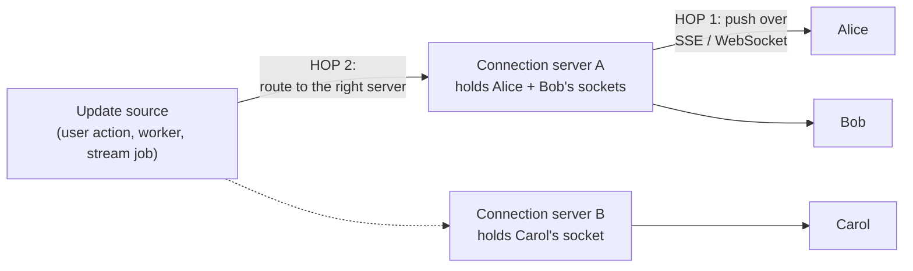

# Deep Dive 13 — Realtime Updates

> **Source:** [Hello Interview — Real-time Updates Deep Dive](https://www.hellointerview.com/learn/system-design/deep-dives/realtime-updates) (written guide; no dedicated video).
> **Prerequisites:** [09 — Real-Time Systems](../Core%20Course/09-realtime-systems.md) (this is its decision-layer companion) · [25 — Internet & Networking](../Core%20Course/25-internet-networking.md). Pairs with [DD-01 — Redis §5.7](01-redis.md#57-pubsub) (the hop-2 workhorse), [DD-02 — Kafka](02-kafka.md), [18a — Chat](../Core%20Course/18a-design-chat-social.md), [36 — Live Streaming](../Core%20Course/36-design-live-streaming.md), [38 — Whiteboard](../Core%20Course/38-design-collaborative-whiteboard.md).

## What you'll master

"The feed updates live," "viewers see comments instantly," "the driver's location moves on the map" — every one of those sentences hides the same design: **a protocol choice on hop 1 (server → client) and a routing choice on hop 2 (source → the right server)**. Candidates blur into "I'll use WebSockets" reflexively; a Staff candidate picks the *cheapest protocol that satisfies the requirement*, then spends the real minutes on the part interviewers actually probe — **fan-out, reconnection, missed messages, and what a deploy does to a million open connections**.

By the end of this note you will be able to:

- Frame every realtime feature as **two hops** and design each independently.
- Recite the **protocol menu** — polling, long-polling, SSE, WebSocket, WebRTC — with the one-line decision rule for each.
- Design the **connection layer**: stateful servers behind L4 LBs, heartbeats, exponential-backoff-with-jitter reconnects, graceful drains.
- Solve **hop 2** three ways — pull, **Redis pub/sub** (default), consistent-hash routing — and handle the whale-room problem.
- Make the reliability contract explicit: **realtime is the hint, the database is the truth** — reconnect-and-catch-up, offline → push.
- Know when the honest answer is **"just poll every 30 seconds."**

---

## Table of Contents

0. [In the Room — Staff-Level Delivery](#in-the-room--staff-level-delivery)
1. [The Mental Model — Two Hops](#1-the-mental-model--two-hops)
2. [Hop 1 — the Protocol Menu](#2-hop-1--the-protocol-menu)
3. [The Connection Layer at Scale](#3-the-connection-layer-at-scale)
4. [Hop 2 — Getting Updates to the Right Server](#4-hop-2--getting-updates-to-the-right-server)
5. [Reliability — Missed Messages, Offline, Ordering](#5-reliability--missed-messages-offline-ordering)
6. [When Plain Polling Wins](#6-when-plain-polling-wins)
7. [Interview Cheat-Sheet](#interview-cheat-sheet)

---

## In the Room — Staff-Level Delivery

### Decisions to make decisively

| Decision | Default position (say this) | One-line justification | Revisit trigger |
|----------|------------------------------|------------------------|-----------------|
| **Protocol** | **SSE for one-way, WebSocket only when the client streams back** | SSE is plain HTTP — proxies, load balancers, and reconnection (`Last-Event-ID`) come free; WebSockets buy bidirectionality at infra cost | Client sends continuous input (typing, cursors, game moves) → WebSocket; client→server is occasional → SSE + normal POSTs |
| **Hop 2** | **Redis pub/sub, channel per user/room** | Connection servers subscribe for their connected users; publishers stay ignorant of topology; [at-most-once is fine because it's a hint](01-redis.md#57-pubsub) | Delivery guarantees needed on the wire → Kafka/Streams behind it; huge scale → sharded pub/sub |
| **Load balancer** | **L4 for WebSockets; SSE rides normal HTTP LBs** | Persistent TCP wants connection affinity, not per-request routing | — |
| **Reliability contract** | **DB is the truth, the socket is a hint** — reconnect = catch-up query since last-seen cursor | Any pushed-only message will eventually be lost; catch-up turns "missed" into "late" | — (this one doesn't move) |
| **Offline users** | **Persist to inbox + push notification (APNS/FCM)** | The connection layer only serves the online; offline is a storage + push problem ([09](../Core%20Course/09-realtime-systems.md)) | — |
| **Whether realtime at all** | **Poll every 30–60 s unless the product visibly needs seconds** | Persistent connections are a permanently-on ops tax; polling is boring and bulletproof | Sub-5 s freshness visible to users → upgrade the hop-1 protocol |

### Altitude — name-and-move-on vs deep-dive

**Name and move on (one sentence each):**
- How WebSocket upgrade handshakes work — "HTTP Upgrade → persistent TCP," done.
- WebRTC internals (STUN/TURN/SDP) — name it as the P2P option for [calls/streaming](../Core%20Course/36-design-live-streaming.md) and move; it's its own module.
- Long-polling mechanics — one sentence as the compatibility fallback.

**Deep-dive — spend your minutes here:**
- **Hop 2 fan-out** (§4) — "how does server B know user X is on server A?" is *the* probe; pub/sub vs registry is the answer.
- **Reconnect + catch-up** (§5) — the difference between a demo and a product.
- **Whale rooms / celebrity fan-out** (§4) — a million viewers on one stream is the scaling probe.

### Experience hooks

- *"Running a chat platform taught us the contract: the socket is a latency optimization, the message table is the product. Every client reconnect runs 'give me everything in this conversation since cursor X' — so a dropped connection costs milliseconds of lag, never data."*
- *"Our worst incident was a reconnect storm: a connection-server deploy dropped 400k clients that all retried at t+1s exactly. Exponential backoff with jitter and connection draining on deploys — those two words, jitter and drain, were bought with a postmortem."*
- *"We run SSE for one-way feeds and WebSockets only where the client talks back — and even our SSE has consumed absurd debugging time on proxy buffering and idle timeouts. The lesson: every persistent connection is an ops liability; hold as few as the product needs."*

---

## 1. The Mental Model — Two Hops

Every realtime feature decomposes into two independent problems:

- **Hop 1 (server → client):** which protocol keeps the pipe open — §2.
- **Hop 2 (source → server):** the sender doesn't know which of your N connection servers holds the recipient's socket — §4.

Naming the two hops up front structures the whole conversation — interviewers reward the decomposition itself, because most candidates conflate the hops into a "WebSockets" hand-wave and then can't answer the fan-out probe.

---

## 2. Hop 1 — the Protocol Menu

| Protocol | Mechanism (one breath) | Pick when | The catch |
|----------|------------------------|-----------|-----------|
| **Simple polling** | `GET /updates` every N seconds | Freshness ≥ ~30 s; the boring default | Latency = interval; wasted requests |
| **Long polling** | Server holds the request until data or timeout, client immediately re-requests | Near-realtime through hostile proxies/legacy infra | A reconnect per message; thundering re-requests |
| **SSE** | One HTTP response that never ends; server streams `data:` events; auto-reconnect + **`Last-Event-ID`** built in | **One-way default**: feeds, notifications, dashboards, progress, LLM tokens | One-directional; proxy buffering/idle-timeout edge cases (real, per the source guide) |
| **WebSocket** | HTTP Upgrade → full-duplex persistent TCP | **Client streams back**: chat typing, cursors, games, collab editing | Stateful infra: L4 LBs, heartbeats, drains — the whole §3 tax |
| **WebRTC** | P2P (with STUN/TURN for NAT) | Voice/video, sub-100 ms peer paths ([36](../Core%20Course/36-design-live-streaming.md)) | Complexity; signaling server anyway; firewall pain |

**The decision rule to say verbatim:** *"Does the client need to push a continuous stream back? No → SSE (it's just HTTP; the infrastructure already works). Yes → WebSocket, and I accept the stateful-connection tax. Neither, and 30-second freshness is fine → poll and keep the system boring."*

---

## 3. The Connection Layer at Scale

The moment hop 1 is persistent, you own a **stateful fleet** — the design consequences:

- **Load balancing:** WebSockets ride **L4** (TCP pass-through — the LB never parses frames); SSE works on L7 with response buffering disabled. Session affinity matters at *connect* time only — after that the TCP connection *is* the affinity.
- **Capacity:** a tuned server holds **hundreds of thousands to ~1M idle connections** (memory ~tens of KB each; [C10M territory — 24](../Core%20Course/24-os-concurrency.md)); the real limits are fan-out CPU and bandwidth during bursts, not socket count. BOTEC: 10M concurrent users ÷ ~500k/server ≈ **20 connection servers** + headroom.
- **Liveness:** **heartbeats** (ping/pong every ~30 s) detect half-dead connections that TCP won't report; server reaps on missed pongs, client treats a missed pong as "reconnect now."
- **Reconnect discipline:** **exponential backoff + jitter** — 400k clients retrying at the same second is a self-inflicted DDoS ([28 — retry storms](../Core%20Course/28-designing-for-failure.md)).
- **Deploys:** you can't just restart — **drain**: stop accepting, tell clients to reconnect (they'll land on new instances), then die. Rolling drains turn "deploy = mass disconnect" into background noise.

---

## 4. Hop 2 — Getting Updates to the Right Server

The probe: *user X's message must reach user Y — Y's socket lives on one of 20 servers. How does the message find it?*

| Approach | Mechanism | Trade |
|----------|-----------|-------|
| **Pull** | Connection servers poll the DB/queue for their users' updates | Simple; latency = poll interval; scales badly — skip past small scale |
| **Pub/sub (default)** | Each connection server **subscribes** to channels for its connected users/rooms ([Redis](01-redis.md#57-pubsub)); publishers `PUBLISH user:123` and stay topology-blind | Loose coupling, ms latency; at-most-once (fine — it's a hint, §5); Redis fan-out shardable (`SPUBLISH`) |
| **Consistent-hash routing** | A registry (or hash ring) maps user → server; senders route directly | No broker hop; but now you own membership, rebalancing, and failure re-mapping — [DD-08 territory](08-zookeeper.md) |

**Default script:** *Redis pub/sub, one channel per user (or per room); connection servers subscribe/unsubscribe as clients attach/detach. [Channels are cheap](01-redis.md#57-pubsub) — millions of them cost per-node connections, not per-channel ones.*

**The whale room** (a million viewers on one live stream — the [hot-key disease's](02-kafka.md#10-hot-partitions) sixth appearance): per-user channels die at broadcast scale. Flip to **one channel per room**, every connection server subscribes once, and each server fans out locally to its own sockets — the broker carries *one* message per event, not a million. For truly huge broadcasts, batch/coalesce (comments sampled per 100 ms) — nobody reads 10k comments/s anyway ([36](../Core%20Course/36-design-live-streaming.md)).

---

## 5. Reliability — Missed Messages, Offline, Ordering

The section that separates products from demos — state the contract:

> **The socket is a hint; the database is the truth.**

- **Every update is persisted first** (messages table, notifications inbox — via the normal write path, possibly [Kafka](02-kafka.md) in between), *then* published for realtime delivery. Pub/sub losing a message costs latency, not data.
- **Reconnect = catch-up**: client tracks a cursor (last message id / event id); on reconnect it asks "everything since X" — SSE's `Last-Event-ID` does this natively; WebSocket designs implement the same manually. The gap between disconnect and reconnect is *covered by the store, not the wire*.
- **Offline = storage + push**: no socket → write to the inbox and trigger **APNS/FCM** push ([09](../Core%20Course/09-realtime-systems.md)); delivery resumes from the cursor at next connect.
- **Ordering**: per-conversation sequence numbers (or [Kafka partition ordering](02-kafka.md#3-partitioning--keys--the-one-decision-that-matters) upstream) — clients render by sequence, not arrival; duplicates from catch-up-plus-push dedupe by id. Same at-least-once + idempotency instincts as everywhere else in this track.

---

## 6. When Plain Polling Wins

The YAGNI section — offering it is a seniority tell:

1. **Freshness budget ≥ ~30 s** — dashboards, order status, badge counts: poll. Nobody perceives the difference; your infra stays stateless.
2. **Low concurrency** — hundreds of users polling is *nothing*; a persistent-connection layer for that is résumé-driven.
3. **Battery/network-hostile clients** — mobile OSes punish held connections; system push (FCM) + poll-on-open is the platform-native answer.
4. **You already need push notifications anyway** — if FCM/APNS wakes the app, in-app polling on foreground may cover the rest.

Say it as: *"I'd start with polling at 30 s; the moment the product demands visible-in-seconds, I upgrade hop 1 to SSE — the two-hop architecture doesn't change, only the last leg does."* That sentence shows the design is protocol-independent — the actual insight of this whole topic.

---

## Interview Cheat-Sheet

**One-liner:** *"Two hops: source-to-server routing (Redis pub/sub by default) and server-to-client protocol (SSE unless the client streams back, then WebSocket). The socket is a hint, the database is the truth — reconnect is a catch-up query from a cursor, offline is inbox + push."*

**Numbers:** heartbeat ~30 s ping/pong · reconnect = exponential backoff **+ jitter** · a tuned server holds **~100k–1M** idle connections (fan-out CPU/bandwidth is the real limit) · polling is honest at ≥30 s freshness · whale rooms: 1 channel/room, servers fan out locally.

**Protocol rule (recite):** client streams back? → WebSocket · one-way pushes? → SSE (free reconnect + `Last-Event-ID`) · 30 s freshness ok? → poll · voice/video/P2P? → WebRTC.

**The four probes and your answers:**

| Probe | Answer |
|-------|--------|
| "How does server B know user X is on server A?" | It doesn't need to — pub/sub: A subscribed to `user:X` when the socket attached; publishers publish and stay topology-blind |
| "Connection drops — messages lost?" | No: persisted before published; reconnect sends "since cursor X" — the wire is a hint, the store is the truth |
| "A million viewers on one stream?" | Channel-per-room, each server subscribes once and fans out locally; coalesce/batch events — the broker carries one copy |
| "Deploy restarts the connection fleet?" | Drain: stop accepting, signal reconnect, roll gradually — plus client backoff-with-jitter so the herd doesn't stampede the LB |

**Say-verbatim lines:**
- *"SSE unless the client talks back — it's just HTTP, and boring infrastructure is a feature."*
- *"The socket is a latency optimization; the message table is the product."*
- *"Jitter and drain — the two words that prevent reconnect storms."*
