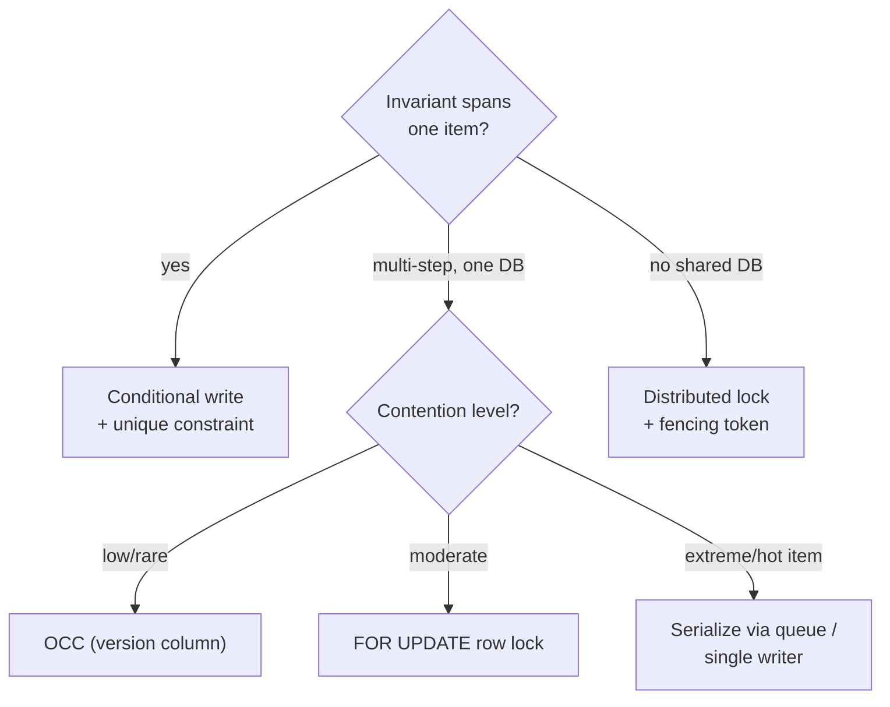

# Pattern 14 — Dealing with Contention

> **Source:** [Hello Interview — Dealing with Contention](https://www.hellointerview.com/learn/system-design/patterns/dealing-with-contention) (patterns series).
> **The pattern in one line:** *when N actors race for one resource, pick the cheapest mechanism that makes the invariant hold — and know the ladder cold.*
> Pairs with: [DD-03 §4](03-postgresql.md#4-transactions-isolation--locks) (the toolbox lives here) · [DD-05 §4](05-dynamodb.md#4-consistency-conditional-writes--transactions) · [DD-08 §6](08-zookeeper.md#6-fencing-tokens--the-lock-story-done-right) · [31 — Matching Engine](../Core%20Course/31-design-matching-engine.md) · [18c — Ticketmaster-style problems](../Core%20Course/18c-design-marketplace-money.md).

## The problem — read-then-write is a race

The canonical failure (Ticketmaster's last seat): Alice reads "1 available," Bob reads "1 available" a millisecond later, both validate in application code, both charge cards, both write — availability hits −1, two people own one seat. **Any check done in application memory is fiction by the time the write lands.** Contention problems are exactly the ones where "it worked in testing" and "it corrupted data on launch day" are the same design.

Trigger phrases: last ticket · inventory decrement · auction bid · wallet debit · username claim · "prevent double-X."

---

## The ladder — cheapest mechanism that holds the invariant

Work top-down; stop at the first rung that satisfies the requirement:

| # | Mechanism | One-breath how | Reach for it when | The catch |
|---|-----------|----------------|--------------------|-----------|
| 1 | **Atomic / conditional write** | Push the check *into* the write: `UPDATE seats SET held=true WHERE id=? AND held=false` (rows-affected tells you who won) · [DynamoDB `ConditionExpression`](05-dynamodb.md#4-consistency-conditional-writes--transactions) · [Redis single-threaded INCR/Lua](01-redis.md#54-rate-limiter) | **Default.** Single-item invariants — most contention is this | Only guards one item; multi-row invariants need more |
| 2 | **Constraints as backstop** | `UNIQUE(event, seat)` — the DB rejects the second booking no matter what code path raced | **Always present** alongside whatever else you pick | Reactive (error to handle), not a flow-control tool |
| 3 | **Pessimistic lock** | [`SELECT … FOR UPDATE`](03-postgresql.md#4-transactions-isolation--locks): contenders queue on the row | Multi-step check-then-act inside one DB; moderate contention | Held locks + slow txns = queues and **deadlocks** (see below) |
| 4 | **Optimistic concurrency (OCC)** | Read version → write `WHERE version = :read`; retry on miss | Contention is *rare* but must be correct — collaborative edits, profile updates | Retry loops melt under *high* contention; **ABA** if you compare values not versions |
| 5 | **Serializable isolation** | The DB detects conflicting interleavings and aborts one (retry on 40001) | Cross-row invariants no single lock covers | Latency + retry tax everywhere it's on |
| 6 | **Distributed lock** | [ZooKeeper/etcd lease + **fencing token**](08-zookeeper.md#6-fencing-tokens--the-lock-story-done-right); [Redis `SET NX`](01-redis.md#52-distributed-lock) for efficiency-only | Contenders *don't share a database* | A whole coordination system; Redis version is efficiency, not correctness |
| 7 | **Serialize: single writer / queue** | Remove the race: all ops for one resource flow through one ordered consumer ([Kafka key-partition](02-kafka.md#3-partitioning--keys--the-one-decision-that-matters), or one thread — the [matching engine](../Core%20Course/31-design-matching-engine.md) design) | Extreme contention on few resources (auctions, order books) where locks would thrash | Latency through the queue; the writer is a throughput ceiling per key |



---

## The two probe-traps

- **Deadlock** (pessimistic): txn 1 locks A→B, txn 2 locks B→A. Answers: **lock in a global order** (sort ids before locking), keep transactions short, lock timeouts + retry. Saying "consistent lock ordering" is usually the full credit.
- **ABA** (optimistic): value changed 1→0→1 between your read and write — value-compare says "unchanged," history says otherwise. Answer: compare **monotonic versions**, never values.

And the escalation probe — *"now it's a Taylor Swift on-sale, 100k people for 500 seats"*: locks thrash at that ratio; the staff answer is **shrink the contention window** (hold seats via atomic conditional write with TTL, confirm payment async — [Ticketmaster's shape](../Core%20Course/18c-design-marketplace-money.md)) or **serialize per resource** (rung 7), plus a **virtual waiting room** to shape arrival rate ([02-kafka §6](02-kafka.md#6-queue-vs-stream--the-two-deployments)).

---

## Isolation levels — which anomalies each one buys off

Rung 5 in one table. The probe is never "name the levels"; it's "which bug does this level still allow?":

| Level | Prevents | Still allows | The fix if you stay at this level |
|-------|----------|--------------|-----------------------------------|
| **Read Committed** (Postgres/Oracle default) | Dirty reads | **Lost update** (two txns read 10, both write 10−1 = 9), non-repeatable reads | Atomic write (`SET qty = qty - 1`), `FOR UPDATE`, or a version check |
| **Repeatable Read / Snapshot** (MySQL InnoDB default; Postgres RR = snapshot isolation) | Non-repeatable reads; Postgres RR also *aborts* a concurrent update to the same row (retry on 40001) | **Write skew**: two txns read the same *set*, each writes a *different* row, and the invariant across rows breaks | Materialize the conflict: lock a parent row (`SELECT … FROM shifts WHERE day=? FOR UPDATE`), or a constraint |
| **Serializable** (Postgres SSI) | Everything above, including write skew | Nothing anomalous; aborts conflicting txns instead | **Retry loop on 40001** in every caller; keep txns short |

**Write skew, the example to use:** the on-call rule "at least one doctor on call". Alice and Bob each check that "2 are on call" and each takes themselves off; both commit, and now zero are on call. No row was written twice, so row locks and snapshot isolation don't see it. Serializable catches it, and so does locking the shift row both of them read. Also note that **MySQL's Repeatable Read does not detect lost updates** on a plain read-then-write the way Postgres RR does, so "we're on Repeatable Read" is not an answer there.

---

## How pessimistic locking fails in production

`FOR UPDATE` is correct; these are the ways it hurts:

- **Lock held across a network call.** `BEGIN; SELECT … FOR UPDATE; call payment API (2 s); COMMIT;` means every other buyer of that row waits 2 s. Rule: **no remote calls inside a lock**. Take the hold (rung 1 or a reservation, below), commit, call out, then confirm in a second short transaction.
- **The per-row throughput ceiling.** One hot row serializes on its lock, so max throughput ≈ **1 / lock-hold time**: 1 ms → ~1,000 txns/s, 10 ms → ~100/s. Do this arithmetic out loud; it's how you justify rung 7.
- **Convoys and pool exhaustion.** Waiters each hold a DB connection while they wait, so a hot row can exhaust the connection pool and take down unrelated endpoints. Set `lock_timeout` (fail fast, e.g. 1–2 s) and `statement_timeout`, and return "try again" rather than queueing forever.
- **Deadlocks are detected, not prevented.** Postgres checks after `deadlock_timeout` (default 1 s) and aborts one transaction, so callers **must retry**. Global lock ordering (sort IDs before locking) prevents them in the first place.
- **Long transactions block maintenance.** An open transaction holds back vacuum (Postgres) or the purge of undo (MySQL), so table bloat and slower reads follow.

---

## Reservations — shrink the contention window

The pattern behind Ticketmaster seat holds and Shopify's inventory reservations: don't hold a lock while the user types a card number; hold a **row state with an expiry**.

```sql
-- claim: one conditional write; expired holds are reclaimable in the same statement
UPDATE seats
   SET status = 'held', held_by = :user, hold_expires_at = now() + interval '10 minutes'
 WHERE id = :seat
   AND (status = 'available' OR (status = 'held' AND hold_expires_at < now()));
-- rows affected = 1 → you hold it. Confirm after payment:
UPDATE seats SET status = 'sold' WHERE id = :seat AND held_by = :user AND hold_expires_at > now();
```

- No lock is held while the user pays, and contention is a single conditional write per claim.
- **Expiry is lazy**: no sweeper is needed for correctness, because the claim itself treats an expired hold as free. A background job only tidies up for display.
- **Payment arriving after expiry** must fail the confirm (the `hold_expires_at > now()` guard) and refund, which is the compensation from [Pattern 15](15-pattern-multi-step-processes.md).

> **Staff-level insight:** *"The contention window is the lock-hold time, so I make it a single statement. Holds are a state with a TTL that the next claim can reclaim, not a lock held across a payment call. That turns a 2-second lock into a 1-millisecond write, which is a 2,000× higher ceiling on the hot row."*

---

## Interview cheat-sheet

**Reflex (recite):** *conditional write + unique constraint backstop; escalate to row lock for multi-step, OCC when conflicts are rare, queue-serialization when one item is molten; distributed lock only when there's no shared DB — and then with fencing.*

| Probe | Answer |
|-------|--------|
| "Two users, last seat?" | `UPDATE … WHERE held=false` — the write is the check; unique constraint as backstop |
| "Deadlocks?" | Global lock ordering + short transactions + timeout-retry |
| "Optimistic under load?" | Retry storms — OCC is for rare conflicts; hot items go to locks or a serialized writer |
| "Across services, no shared DB?" | Consensus lock with fencing token — or better, restructure so one service owns the invariant |
| "Two doctors both go off call?" | Write skew: snapshot isolation misses it. Serializable (retry 40001), or lock the shared parent row both txns read |
| "Lock while the user pays?" | Never hold a lock across a remote call: reservation row with `hold_expires_at`, reclaimed lazily by the next conditional claim; confirm in a second short txn |
| "How fast can one hot row go?" | ~1 / lock-hold time: 1 ms → ~1k txns/s. Beyond that, shrink the hold or serialize through a single writer |

**Say-verbatim:** *"Never read-then-decide in app memory — the write itself must carry the condition."* · *"The app check is UX; the constraint is correctness."* ([DD-03](03-postgresql.md#4-transactions-isolation--locks))
