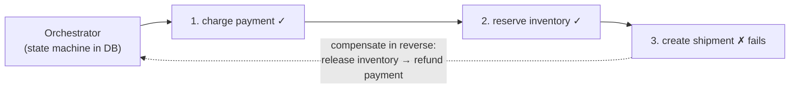

# Pattern 15 — Multi-step Processes

> **Source:** [Hello Interview — Multi-step Processes](https://www.hellointerview.com/learn/system-design/patterns/multi-step-processes) (patterns series).
> **The pattern in one line:** *a workflow spanning services will crash mid-flight — design where the state lives, how steps retry, and how completed steps get undone.*
> Pairs with: [04 — Messaging](../Core%20Course/04-messaging-event-driven.md) (sagas live there) · [DD-02 §8–9](02-kafka.md#8-delivery-guarantees) · [35 — Scheduler](../Core%20Course/35-design-scheduler.md) (Temporal/DAGs) · [02 — Distributed Systems](../Core%20Course/02-distributed-systems.md) (2PC and why not).

## The problem — the crash in the middle

Order fulfillment: charge payment → reserve inventory → create shipment → notify. Each step is a different service; each can fail, time out, or return *unknown*. The naive version interleaves business logic with retry/crash handling until neither is legible — and the deadly question is always the same: **the process died after step 2 — who knows, and what happens now?** "Startlingly hard" is the guide's phrase, and it's earned.

Trigger phrases: checkout/order flow · payment authorization · onboarding/KYC · provisioning · AI-agent pipelines ("long chains of flaky operations").

---

## The decision — where does workflow state live?

| Approach | State lives in… | One-breath how | Reach for it when | The catch |
|----------|-----------------|----------------|--------------------|-----------|
| **Choreography** (events) | Nowhere central — implicit in event flow | Each service reacts to the previous service's event ([Kafka topics](02-kafka.md)); order-placed → payment-charged → inventory-reserved… | Few steps, loose coupling desired, steps genuinely independent | Nobody can answer "where is order 123?" — state is smeared across topics; changing the flow = changing N services |
| **Orchestration** (saga) | An orchestrator's DB row / state machine | One coordinator calls each step, records progress, runs **compensations** on failure | The default for business-critical flows — auditable, debuggable, one place to look | The orchestrator is a service you own: its crashes, its retries |
| **Durable execution** (Temporal et al.) | The engine's event history | Write the workflow as ordinary code; the engine **persists every step's result and replays** after a crash so execution resumes exactly where it died | Long-lived, many-step, human-in-the-loop or timer-heavy flows | A serious infrastructure dependency; determinism rules for workflow code |

The honest ordering to say: **choreography for two or three fire-and-forget steps; an orchestrator saga once compensation or visibility matters; a durable-execution engine when workflows are long-lived and numerous enough to earn the platform.**

---

## The saga — compensation, not rollback

Distributed steps can't share a transaction (2PC blocks and doesn't survive coordinator death — [module 02](../Core%20Course/02-distributed-systems.md)); the saga replaces *rollback* with **compensating actions**:

The rules that earn credit:

- **Every step is idempotent** — retries are certain (timeouts return *unknown*, and unknown must be retried); each step carries an **idempotency key** so re-execution is a no-op ([DD-02's honesty](02-kafka.md#8-delivery-guarantees), applied per-step).
- **Compensations are business actions, not undo**: you don't un-charge a card, you *refund* it — and the customer may see both. Design the flow so compensations are acceptable product events.
- **Semantic ordering**: put hard-to-compensate steps *last* (send-the-email after charge-the-card, never before).
- **The outbox pattern** for the state-change+event atomicity gap: write the state transition and the outgoing event in one DB transaction; a relay publishes from the outbox table — otherwise "DB committed but event never sent" strands the workflow.

---

## Durable execution — what Temporal actually does

The idea worth two sentences in any interview: the engine **journals every step result**; on crash, it re-runs the workflow function from the top, but completed steps return their **recorded** results instead of re-executing — so code resumes mid-function as if nothing happened. This is [Flink's checkpoint insight](07-flink.md#4-state--checkpoints--how-nothing-is-lost) applied to business workflows: *bind "where am I" and "what happened" into one durable record, and recovery becomes replay.*

What it buys: retries/timers/heartbeats as library calls, workflows that sleep for 30 days, full history for debugging. What it costs: an engine to operate, and workflow code constrained to determinism.

---

## Start smaller — single-server primitives first

Before sagas or Temporal, check whether the workflow even needs them:

| Situation | Primitive | Why it's enough |
|-----------|-----------|-----------------|
| Every step writes to **one database** | **One transaction** | Atomic by construction; no compensation needed |
| Local writes + **one** external side effect (email, webhook) | **Transaction + outbox / job row** ([DD-03 §7.1](03-postgresql.md#71-the-skip-locked-work-queue--the-mechanics)) | The job commits with the state; a worker performs the side effect at-least-once with an idempotency key |
| A few steps, one service, minutes long | **State-machine row + job queue** (`status` column, each transition a conditional write) | Visible, queryable, recoverable, with no new infrastructure |
| Many services, compensations, long waits (days), timers, human steps | **Orchestrator saga or durable execution** | Now the platform earns its cost |

Say which row you're on before drawing an orchestrator. Proposing Temporal for a two-step flow inside one database is the YAGNI tell.

---

## Common deep dives — the probes, answered

### "The process running your saga crashes partway through"

- **DB-backed orchestrator:** the workflow row records `current_step`, `status`, `attempt` and a `heartbeat_at`. Each step's side effect uses an **idempotency key derived from `(workflow_id, step_name)`**, not from the attempt, so a re-run after a crash dedupes at the provider. A **recovery sweeper** picks up rows in non-terminal states whose heartbeat is stale and resumes them from `current_step`. Since every step is idempotent, "resume" and "retry" are the same operation.
- **Durable execution:** nothing to write. The engine replays the event history on another worker; completed steps return their recorded results and execution continues from the first unrecorded step.
- **The gap to name:** a step that *did* its side effect but crashed before recording it. That's exactly why the key has to be stable across attempts.

### "How can we ensure step X runs exactly once?"

Over a network you can't guarantee it, and saying so is the credit. What you build is **effectively-once = at-least-once execution + an idempotent effect**:
1. **Idempotent by design:** the provider accepts an idempotency key (Stripe's `Idempotency-Key` header), or the write is an upsert/conditional write keyed by the step.
2. **Not idempotent upstream** (a legacy API with no key): record **intent** before the call (`step=charge, ref=wf-123-charge, status=started`), and on retry **query the provider by your reference** before calling again ("did a charge with ref X happen?"). Only call if it didn't.
3. **Timeout ≠ failure:** an unknown outcome is always resolved by retry-with-the-same-key or by a reconciliation query, never by assuming it failed.

### "How will you handle updates to the workflow?" — versioning & migrations

Workflows outlive deploys: an order waiting 30 days for a return will meet several new code versions.
- **Durable execution's special problem:** replay requires the code to make the **same decisions** it made originally, so a changed branch breaks replay of in-flight histories (a non-determinism error). Fixes:
  - **Version markers / patching** (`workflow.GetVersion` in Go, `patched()` in Python/TS): the workflow records which code path it took, so old executions keep the old branch and new ones take the new branch. Remove the old branch once no old executions remain.
  - **Worker versioning** (pinning executions to a build): old executions keep running on old workers until they drain, and new executions start on the new build.
- **DB-backed state machines:** store `definition_version` on each instance; keep handlers for old versions until those instances finish. Add steps only in backward-compatible ways (new optional step, never renumbering existing ones).
- **Migrations (moving in-flight instances to new logic):** only at safe points. Wait until the instance reaches a stable state, then restart it on the new version carrying its state forward (Temporal: `continue-as-new` into the new version). Never mass-edit running workflow state in place.

### "How do we keep the workflow state size in check?"

- **Pass pointers, not payloads:** a 20 MB document goes to S3; the workflow carries the key. Large inputs in step results bloat every replay.
- **Bounded histories:** Temporal caps a single execution's history (about **51,200 events or 50 MB**, warning well before). Long-lived or looping workflows (a subscription that renews monthly, an entity workflow per user) call **continue-as-new** periodically: finish this execution and start a fresh one with the current state as input.
- **Fan-out via child workflows:** processing 100k items means 100k child workflows (or batches), each with its own history, not 100k steps in one parent.
- DB orchestrators have the same issue as unbounded step-log tables: partition them by time and archive completed workflows.

### "How do we deal with external events?" — waiting on humans and webhooks

- **Correlation:** every outside party gets a reference that maps to the workflow (`approval_token → workflow_id`, `stripe_payment_intent → order workflow`), stored in a lookup table or embedded in the callback URL.
- **Durable execution:** the webhook handler sends a **signal** to the workflow by ID; the workflow is blocked on `await signal("approved")` *with a durable timer* ("wait up to 7 days, then escalate or cancel"). The waiting costs nothing; no thread or process is held.
- **DB-backed:** `status = WAITING_FOR_APPROVAL, wait_deadline = …`; the webhook handler performs a **conditional transition** (`WHERE status = 'WAITING_FOR_APPROVAL'`) so duplicate or late callbacks are no-ops; a [scheduler](../Core%20Course/35-design-scheduler.md) fires the deadline transition.
- **Webhooks arrive twice, out of order, or after the timeout.** Make every transition a guarded state change, and decide explicitly what a late approval does (usually: ignore it and notify).

---

## Interview cheat-sheet

**Reflex (recite):** *name where state lives → orchestrated saga by default → every step idempotent with a key → compensations as real business actions, hard-to-undo steps last → outbox for the write+publish gap → Temporal when flows are long-lived and plentiful.*

| Probe | Answer |
|-------|--------|
| "Crashes after charging but before reserving?" | Orchestrator's state row says step 1 done; on recovery it retries step 2 (idempotent) — or compensates with a refund |
| "Payment call times out — did it happen?" | Unknown ⇒ retry with the same idempotency key; the provider dedupes — never treat timeout as failure |
| "Why not a distributed transaction?" | 2PC blocks on coordinator failure and locks across services; sagas trade atomicity for availability + explicit compensation |
| "Choreography or orchestration?" | Orchestration once anyone needs to ask "where is order 123?" — visibility and compensation want one owner |
| "Do we need Temporal?" | Only past one DB: single txn → txn + outbox/job row → state-machine row → saga/durable execution, in that order |
| "Step X exactly once?" | Impossible over a network; effectively-once = at-least-once + idempotency key from (workflow_id, step); if the provider has no keys, record intent and query before retrying |
| "Deploy a change with 10k workflows in flight?" | Version markers/patching (old runs keep old branch) or pin runs to worker builds until drained; migrate only at safe points via continue-as-new |
| "Wait 7 days for a human approval?" | Correlation id → signal the workflow; durable timer for the deadline; guarded transitions so duplicate/late webhooks are no-ops |

**Say-verbatim:** *"Every arrow in this diagram will eventually fail after doing its work — idempotency keys make the retry safe, and the outbox makes state-change and event atomic."*
