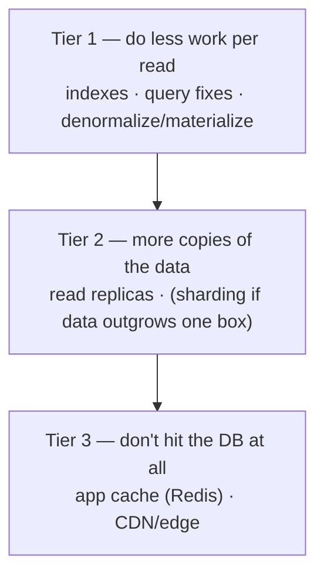

# Pattern 16 — Scaling Reads

> **Source:** [Hello Interview — Scaling Reads](https://www.hellointerview.com/learn/system-design/patterns/scaling-reads) (patterns series).
> **The pattern in one line:** *reads outnumber writes 10–100×, so scale the read path in tiers — do less work, then copy the data, then don't hit the database at all.*
> Pairs with: [03 — Caching](../Core%20Course/03-caching.md) (the deep end of tier 3) · [DD-03 §2, §6](03-postgresql.md#2-read-performance--indexes) · [DD-01](01-redis.md#51-cache) · [05 — Load Balancing](../Core%20Course/05-load-balancing.md) (CDN/edge).

## The problem — the 100:1 ratio meets physical limits

One Instagram session = dozens of photos × multiple queries each = 100+ reads; the same user posts once a day. Read:write ratios of **10:1 to 100:1+** are the norm, and a single database has hard physical ceilings (CPU instructions, RAM, disk I/O). The pattern is the *ordered escalation* for the read side — same philosophy as [DD-03's scaling ladder](03-postgresql.md#6-the-scaling-ladder), zoomed into reads.

Trigger phrases: feeds · product pages · search results · "millions of users viewing" · any read-mostly product.

---

## The three tiers — in order, stopping early

### Tier 1 — make each read cheap
- **Indexes + query optimization** first — a missing index is a 1000× fix that costs nothing ([the index menu](03-postgresql.md#2-read-performance--indexes)). `EXPLAIN ANALYZE` before architecture.
- **Denormalize / materialized views**: precompute the expensive join/aggregate at write time (a `feed_items` table, a follower-count column). Trades write complexity + storage for read speed — the [one-query-per-page rule](04-cassandra.md#2-the-data-model--query-first-partition-key-first) applied to relational land.
- Hardware (more RAM = bigger buffer pool) buys time, not a solution — say it as a stopgap.

### Tier 2 — more copies
- **Read replicas**: the workhorse — reads fan across N replicas, writes stay on the primary. The trade you must volunteer: **replication lag** → route read-your-own-writes to the primary ([DD-03 §5](03-postgresql.md#5-replication--high-availability)).
- Replicas multiply *read* capacity only; if the dataset itself has outgrown one machine, that's sharding — a different problem ([Pattern 17](17-pattern-scaling-writes.md)).

### Tier 3 — don't ask the database
- **Application cache** ([Redis, cache-aside + TTL](01-redis.md#51-cache)): the hot working set answers in sub-ms; the DB sees only misses. All of [module 03's hard parts](../Core%20Course/03-caching.md#5-cache-challenges--the-interview-meat) — invalidation, **stampede** (single-flight, jittered TTLs), hot keys — arrive with it; name them proactively.
- **CDN/edge** for anything shared and cacheable (images, public pages, API responses with coarse TTLs) — the read never enters your infrastructure at all.

The funnel framing that lands: **CDN absorbs the shared head → Redis absorbs the per-user hot set → replicas absorb the misses → the primary sees ~1% of raw read traffic.** Do the BOTEC at each stage ([30](../Core%20Course/30-capacity-estimation.md)) and show the requirement dying before it reaches the DB.

---

## The trades to state unprompted

Every tier weakens freshness — say the contract out loud:

| Tier | Staleness introduced | The line to say |
|------|----------------------|------------------|
| Materialized views | Until next refresh/write-through | "Precomputed at write time — counts may trail by seconds" |
| Replicas | Replication lag (ms–s) | "Read-your-writes goes to the primary; everything else tolerates lag" |
| Cache | Up to TTL + invalidation races | "Bounded staleness: TTL T with delete-on-write" ([03 §5.6](../Core%20Course/03-caching.md)) |
| CDN | Up to edge TTL | "Public, shared, coarse — versioned URLs for instant busts" |

---

## Common deep dives — the probes, answered

### "Your queries get slower as the dataset grows"

The symptom is usually that the **index working set no longer fits in RAM**, or that a query was never index-shaped and is now scanning a much bigger table. In order:
1. **`EXPLAIN ANALYZE` the slow queries.** Look for sequential scans, sorts on disk, and row estimates that are off by orders of magnitude (stale statistics → `ANALYZE`).
2. **Make the index match the query:** composite index in `WHERE` equality columns → range column → `ORDER BY` order; **covering indexes** (`INCLUDE`) so the read never touches the heap.
3. **Replace `OFFSET` pagination with keyset pagination** (`WHERE (created_at, id) < (:last_ts, :last_id) ORDER BY … LIMIT 50`). `OFFSET 100000` reads and discards 100k rows; keyset is constant cost at any depth.
4. **Partition by time** so queries over "the last 30 days" prune to a few partitions, and old data is dropped by detaching a partition instead of a giant `DELETE`.
5. **Archive the cold tail** to cheaper storage (object store + an OLAP engine) and keep the OLTP table to the hot working set.
6. **Precompute** what's still expensive: summary tables or materialized views refreshed on write or on a schedule.

### "Millions of concurrent reads for the same cached item" — the hot key

One key lives on one cache shard, and a single Redis node tops out around 100k–200k simple ops/s, so a viral item can saturate one shard while the rest of the cluster idles.
- **In-process L1 cache:** each app server keeps the hot item in local memory with a **short TTL (1–5 s)**. Redis then sees roughly `N_servers / TTL` reads per second for that key instead of millions. This is the biggest lever.
- **Request coalescing (single-flight)** per process: 1,000 concurrent misses for one key become 1 fetch, and the other 999 wait for its result.
- **Replicate the key:** write it as `item:42#0..k`; readers pick a random suffix, so load spreads across k shards; writers update all k (or invalidate all k).
- **Push public content to the CDN** so the read never reaches your servers at all.
- **Detect it:** sample key frequencies (Count-Min Sketch, [DD-12](12-big-data-structures.md); `redis-cli --hotkeys`) and promote hot keys to L1/replication automatically.

### "Multiple requests try to rebuild an expired entry at once" — the stampede

The cheat-sheet answer is single-flight + stale-while-revalidate + TTL jitter. The mechanics behind each:
- **Lease / lock on miss:** the first miss takes a short-lived lock (`SET rebuild:key NX PX 5000`, or Memcached-style leases); others either wait briefly and re-read, or are served stale.
- **Stale-while-revalidate:** store the value with a soft expiry earlier than the hard one; after the soft expiry, one request refreshes in the background while everyone else keeps getting the slightly stale value.
- **Probabilistic early expiration (XFetch):** each reader refreshes early with a probability that rises as expiry approaches, so the rebuild happens before the cliff without coordination.
- **Jitter TTLs** (±10–20%) so keys written together don't expire together. **Warm the cache** before a launch or after a cache restart rather than letting cold traffic hit the DB.

### "Updates must be immediately visible" — invalidation without lies

Be precise about *to whom*. Usually the requirement is **the writer sees their own write immediately; everyone else within seconds.**
- **Read-your-writes for the writer:** after a write, route that user's reads to the primary for a few seconds, or carry a **version/LSN token** in the session (the replica serves the read only if it has replayed past that LSN; otherwise the primary does).
- **Delete-on-write, after commit:** invalidate the cache key *after* the transaction commits. Driving it from **CDC** guarantees ordering with the commit and survives app crashes.
- **The classic race:** a reader misses, reads the old row from a lagging replica, and repopulates the cache *after* your delete, so stale data sticks until TTL. Fixes: leases (a populate is rejected if an invalidation happened since the miss), a delayed second delete, or **versioned keys**.
- **Versioned keys:** the key includes the entity's version (`product:42:v17`), and the write bumps the version pointer. Old entries are never read again, so there's nothing to invalidate. It costs one extra lookup for the version pointer (which can itself be cached short).
- **When "everyone, immediately" really is the requirement** (prices during checkout, permissions), read that field from the primary and keep it out of the cache. Don't contort the cache into strong consistency.

---

## Interview cheat-sheet

**Reflex (recite):** *index → denormalize → replicas (name the lag) → Redis cache (name stampede + invalidation) → CDN — BOTEC at each tier, stop when the requirement fits.*

| Probe | Answer |
|-------|--------|
| "10M users open the app at 9am?" | Funnel: CDN for media, Redis for feed pages (pre-materialized), replicas behind misses — primary never sees the spike |
| "User posts, doesn't see own post?" | Replica lag — pin read-your-writes to primary or session-stick briefly |
| "Cache key expires under load?" | Stampede: single-flight lock + stale-while-revalidate + TTL jitter |
| "Why not shard instead?" | Sharding solves data-size/write-throughput; reads at 100:1 are cheaper solved with copies and caches — shard last |
| "Queries slower as data grows?" | EXPLAIN → composite/covering index matching WHERE+ORDER BY → keyset not OFFSET → time partitions → archive the cold tail |
| "One item gets millions of reads/s?" | In-process L1 cache with 1–5 s TTL (Redis sees N_servers/TTL) + single-flight + replicate the key across k shards; CDN if public |
| "Writer must see their update instantly?" | Read-your-writes via primary pinning or an LSN token; delete-after-commit via CDC; versioned keys to dodge the repopulate race |

**Say-verbatim:** *"Each tier trades freshness for throughput — I'll state the staleness contract at every layer rather than pretend it's zero."*
