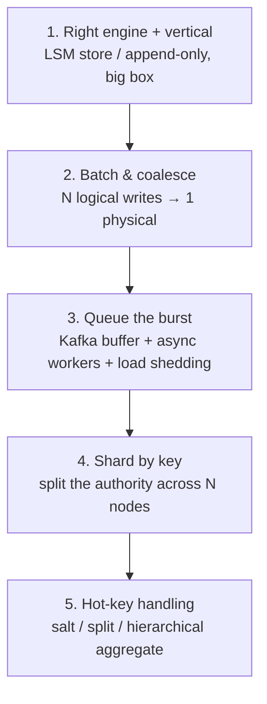
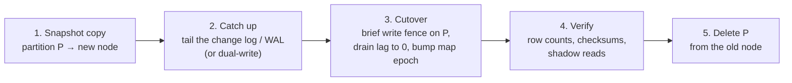

# Pattern 17 — Scaling Writes

> **Source:** [Hello Interview — Scaling Writes](https://www.hellointerview.com/learn/system-design/patterns/scaling-writes) (patterns series).
> **The pattern in one line:** *when writes outgrow one node: choose the right engine, batch, buffer bursts with a queue, then shard by a key — and have the hot-key answer ready.*
> Pairs with: [DD-02](02-kafka.md) (the buffer) · [DD-04](04-cassandra.md) (the write-optimized engine) · [Pattern 16](16-pattern-scaling-reads.md) (its twin) · [30 — Capacity](../Core%20Course/30-capacity-estimation.md) · [39 — IoT](../Core%20Course/39-design-iot-ingestion.md) / [34 — Analytics](../Core%20Course/34-design-realtime-analytics.md) (the classic write-heavy problems).

## The problem — the write side has no cheap copies

Reads scale with replicas and caches because copies are cheap. **Writes must all land somewhere authoritative** — every mitigation is either *doing less work per write*, *deferring the work*, or *splitting the authority*. Single-node ceilings to anchor on: [Postgres ~5–20k TPS](03-postgresql.md#3-write-performance), [Cassandra ~10k+/node](04-cassandra.md#3-the-write-path--why-writes-fly-lsm), [Kafka ~1M msg/s/broker](02-kafka.md#5-performance-numbers--why-its-fast) — the pattern is choosing which combination absorbs your number.

Trigger phrases: clickstream/telemetry ingestion · IoT firehose · like/view counters · order spikes ("flash sale") · "millions of writes per second."

---

## The ladder — in order

**1. Right engine before more engines.** Update-in-place B-trees pay random I/O per write; [LSM engines](04-cassandra.md#3-the-write-path--why-writes-fly-lsm) pay one sequential append. If the workload is append-heavy (events, logs, metrics), the *engine choice alone* is 10×. Vertical scaling buys headroom while the requirement is still one node's worth — say it and move.

**2. Batch and coalesce.** Amortize per-write overhead: multi-row inserts / [`COPY`](03-postgresql.md#3-write-performance), [producer batching + compression](02-kafka.md#2-life-of-a-message), and **coalescing** — 1,000 increments to the same counter become one `+1000` ([Redis](01-redis.md) or in-process buffer, flushed per second). Trade: bounded loss window on crash — name it and price it.

**3. Queue the burst, shed the excess.** The flash-sale insight: **provision for sustained rate, buffer the peak** — [Kafka](02-kafka.md#6-queue-vs-stream--the-two-deployments) absorbs the 10× spike, workers drain at capacity, consumer lag is the health metric. The write becomes async: client gets 202 + an id, not a synchronous commit — state that contract change explicitly. Beyond the buffer: **load shedding** — reject low-value writes first (sampled telemetry before orders), with backpressure to clients ([11 — Reliability](../Core%20Course/11-reliability.md), [28 — metastable failure](../Core%20Course/28-designing-for-failure.md)).

**4. Shard by key.** Split the authority: partition by tenant/user/entity across N nodes — [Kafka partitions](02-kafka.md#3-partitioning--keys--the-one-decision-that-matters), [Cassandra's ring](04-cassandra.md#1-the-mental-model--a-masterless-ring), or app-level DB sharding. The key decision *is* the design (ordering, locality, resharding pain — the track's most repeated lesson). Also in the kit: **vertical partitioning** — split hot columns/tables from cold so the write-hot path carries less.

**5. Hot keys — the seventh appearance.** Uniform hashing assumes uniform access; a viral entity breaks it. The menu (same medicine everywhere: [Redis](01-redis.md#6-the-hot-key-problem) · [Kafka](02-kafka.md#10-hot-partitions) · [DynamoDB](05-dynamodb.md#6-hot-partitions--write-sharding)): **split/salt the hot key** (`key_0..9`, merge on read) — statically for known whales, dynamically off runtime metrics for surprises — and **hierarchical aggregation**: pre-sum at the edge (per app node, per shard) so the root sees partial aggregates, not raw events ([Flink two-stage](07-flink.md#2-the-mental-model--a-distributed-dataflow)).

---

## The contract changes to volunteer

Each rung changes what the client is promised — the Staff move is saying so:

- **Batching/coalescing** → a crash loses the unflushed window ("up to 1 s of likes" — price it against the product).
- **Queueing** → durability moves to the queue; *acceptance* ≠ *processed*; readers may not see the write for seconds ([DD-02 §8](02-kafka.md#8-delivery-guarantees) honesty applies).
- **Sharding** → cross-key transactions and global ordering are gone; per-key ordering survives if the key design is right.
- **Shedding** → some writes are deliberately dropped; which class, and who decided, must be written down.

---

## The rungs, one level deeper

**Engine choice, concretely.** Write-optimized means LSM engines (Cassandra/ScyllaDB, RocksDB-based stores, DynamoDB's internals), append-only logs (Kafka), and time-series databases ([DD-10](10-time-series-databases.md)). Two levers inside *any* engine: **every secondary index is an extra write** (drop the ones the write-hot table doesn't need), and **synchronous replication multiplies commit latency** (decide which tables need it).

**Vertical partitioning, concretely.** A `users` row with profile fields plus `last_seen_at` and `login_count` means every heartbeat rewrites the whole row (a new tuple version in Postgres, a full-row WAL record) and contends with profile edits. Move the write-hot columns to a narrow `user_activity` table, or out of the database entirely into Redis with a periodic flush. Write amplification falls by the ratio of row widths.

**Load shedding, concretely.** Classify writes by value (orders > user posts > likes > analytics events) and shed **at admission** (the gateway or the API, before work is done) using a signal you already have: queue lag, p99 latency, or a CPU threshold. Shed the lowest class first, return `429`/`503` with `Retry-After`, and let clients back off with jitter ([28 — metastable failures](../Core%20Course/28-designing-for-failure.md)). Shedding after the work is half done is the metastable trap.

---

## Common deep dives — the probes, answered

### "How do you reshard when you need more shards?"

**Make it a non-event from day one with logical shards.** Hash keys into a fixed, large number of **logical partitions** (e.g. 1,024 or 4,096) and map logical partitions → physical nodes in a versioned **partition map** (stored in ZooKeeper/etcd, [DD-08](08-zookeeper.md)). Adding capacity then means *moving whole logical partitions*, not rehashing keys. `hash % N` over physical nodes is the mistake that forces moving most of the data.

**Moving one partition live:**

- **Routing safety:** clients and routers cache the map with its **epoch**; a node rejects writes for a partition it no longer owns (wrong epoch), and the client refreshes the map and retries. This is how a stale router can't write to the old home.
- **Throttle the copy** so the source node doesn't fall over while serving live traffic.
- **Off-the-shelf:** Vitess, Citus and CockroachDB do this for you; DynamoDB and Bigtable split partitions automatically. Name one, then show you know what it's doing.
- **Expand–migrate–contract** for any schema change that rides along ([32 — Migrations](../Core%20Course/32-migrations.md)).

### "A key is too hot for even a single shard"

Two strategies; pick by whether you know the whales in advance:

| | **Split all keys** (static) | **Split hot keys dynamically** |
|---|---|---|
| How | Every counter is always `k` sub-keys (`post:123#0..k-1`); writes go to a random sub-key; reads sum all `k` | Keys start whole; a detector (Count-Min Sketch or per-key rate metrics) flags a hot key and writes `split(post:123, k=16)` to a routing table; writers then spread across `k` |
| Read cost | Always `k` reads per key (cache the sum) | `k` reads only for split keys |
| Complexity | Trivial, stateless | A routing table every reader and writer consults; splits and merges must be safe |
| Use when | The workload is *mostly* hot (like counters on a celebrity platform) | Hotness is rare and unpredictable (a post going viral) |

The dynamic version's subtle rule: **readers must read every suffix that was ever written** until a merge has folded them back, so a split only ever grows until an explicit merge job runs. Pair either strategy with **coalescing at the app tier** (buffer +1s in memory, flush `+N` per second) and **hierarchical aggregation** (per-node partial sums → per-shard → root), so the hot key sees one write per flush per node, not one per event.

---

## Interview cheat-sheet

**Reflex (recite):** *right engine → batch/coalesce → Kafka buffer + shed → shard by the entity key → salt the whales + aggregate hierarchically — BOTEC the requirement against node ceilings at each rung.*

| Probe | Answer |
|-------|--------|
| "Traffic 10×es for one hour?" | Buffer, don't provision: Kafka absorbs, workers drain, lag is the dashboard; shed the lowest-value class if lag breaches SLO |
| "One post gets 1M likes/min?" | Sharded counters (`post:123:{0..9}`) + periodic aggregate — never one row taking 16k writes/s |
| "How do you reshard live?" | Consistent hashing to bound movement + [expand-migrate-contract with dual-writes](../Core%20Course/32-migrations.md) — never `hash % N` |
| "Won't async lose writes?" | Ack after the queue's replicated commit (`acks=all`) — durability transfers to the log, workers are at-least-once + idempotent |
| "Add shards without downtime?" | Logical partitions (e.g. 4,096) mapped by a versioned partition map; move whole partitions: copy → tail log → fence + epoch bump → verify → delete |
| "Hot key beyond one shard?" | Split all keys (k sub-keys, sum on read) if hotness is common; split dynamically via a routing table if rare — readers read every suffix until merged |

**Say-verbatim:** *"Reads scale with copies; writes scale by splitting authority — and every split is a key-design decision I make once, early, out loud."*
