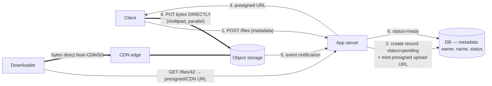

# Pattern 18 — Handling Large Blobs

> **Source:** [Hello Interview — Handling Large Blobs](https://www.hellointerview.com/learn/system-design/patterns/large-blobs) (patterns series).
> **The pattern in one line:** *big files never flow through your servers — metadata in the DB, bytes in object storage, and presigned URLs connect clients directly to both directions.*
> Pairs with: [08 — Storage](../Core%20Course/08-storage.md) (S3 internals) · [18b — Dropbox/YouTube](../Core%20Course/18b-design-media-productivity.md) · [36 — Live Streaming](../Core%20Course/36-design-live-streaming.md) · [DD-19 — Long-Running Tasks](19-pattern-long-running-tasks.md) (what happens after upload).

## The problem — your API server as a 4 GB proxy

A client uploads a video through `POST /upload` → the app server holds the connection, buffers gigabytes, burns bandwidth and memory, hits LB timeouts — and does it all again on download. Meanwhile blobs stuffed into the database bloat storage, slow replication, and wreck backups. Two wrong defaults, one pattern to fix both.

Trigger phrases: video/photo upload · file sync (Dropbox) · attachments · exports/reports · "users upload…" anything.

The rule of thumb to quote: **files > ~10 MB that don't need SQL queries belong in object storage** — S3-class stores give effectively unlimited capacity and **11 nines of durability** at per-object pricing.

---

## The pattern — presigned URLs, both directions

- **Upload:** the server's only jobs are *authorize, record, mint*. A **presigned URL** is a time-limited, scope-limited capability ("PUT this one key for 15 minutes") — the client pushes bytes straight to storage; your fleet never touches them.
- **Download:** same trick in reverse — presigned GET, or better, **CDN in front of the bucket** for anything hot/public; private content uses signed CDN URLs. Your servers hand out *pointers*, never bytes.
- **Metadata/bytes split:** the DB row (owner, filename, size, permissions, `status`) is the source of truth for *existence and access*; the bucket holds only bytes keyed by an opaque id.

---

## Big files — multipart, resumable, parallel

For GB-scale transfers, single PUTs fail at the worst moment:

- **Multipart upload**: split into parts (S3: 5 MB–5 GB per part, up to 10,000 parts, 5 TB object cap); parts upload **in parallel** (bandwidth×N) and each part retries **independently** — a dropped connection costs one part, not the file. Finish with a *complete* call that stitches the parts.
- **Resumability**: the upload id + list-parts tells the client what survived a crash — resume from part 47, not byte zero. (Dropbox-style clients also **chunk content-addressably** — hash each block, upload only blocks the server lacks — which buys dedupe and delta-sync; mention for file-sync problems, [18b](../Core%20Course/18b-design-media-productivity.md).)
- **Progress** falls out of parts-completed — surfaced over [SSE/polling](13-realtime-updates.md#2-hop-1--the-protocol-menu).

---

## The consistency gap — pending vs ready

The subtle probe: the DB says a file exists the moment the record is created, but bytes land later (or never). Handle it explicitly:

1. Record starts **`status=pending`** — invisible to readers.
2. Storage **event notification** (S3 → Lambda/queue) — not client say-so — flips it to `ready`, after optional validation/virus-scan/transcode ([DD-19](19-pattern-long-running-tasks.md) picks up here).
3. A **reaper** deletes stale pending records + orphaned parts (TTL) — the crash-between-steps cleanup.

This is the [outbox instinct](15-pattern-multi-step-processes.md#the-saga--compensation-not-rollback) applied to files: two systems, one logical fact, reconciled by events + a sweeper, not by hope.

---

## When NOT

- **Small files** (< ~1 MB, e.g. avatars): a DB bytea/blob or inline base64 is *fine* — the pattern's ceremony isn't earned.
- **Data needing queries/transactions** — if you filter by its contents in SQL, it's data, not a blob.
- **Strict-governance payloads** where policy mandates the database's audit/encryption story.

---

## Common deep dives — the probes, answered

### "What if the upload fails at 99%?"

Multipart already makes the retry unit a part. The details that make it work in practice:
- **The client persists** `upload_id` and the list of completed parts (part number + ETag) locally, so a browser refresh or app restart resumes instead of restarting. Otherwise it can call `ListParts` to recover.
- **Checksums per part and per object** (`Content-MD5` / `x-amz-checksum-*`), so a corrupted part is rejected at upload, not discovered at download.
- **Abandoned uploads cost money:** uploaded parts are billed until completed or aborted. Add a bucket **lifecycle rule to abort incomplete multipart uploads after N days**, and the TTL reaper for `pending` rows.
- **Browsers and mobile:** use a resumable protocol: S3 multipart, GCS resumable upload sessions (a session URI valid for about a week), or **tus** (an open resumable-upload protocol), rather than inventing one.

### "How do you prevent abuse?"

The presigned URL is a capability, so constrain it at minting time and verify after upload:
- **Constrain the URL:** presigned **POST policies** can enforce `content-length-range` (max size), the `Content-Type`, and an exact key. The **server chooses the key** (an opaque UUID, never the client's filename). Keep expiry short (minutes).
- **Quotas:** check the user's quota when minting, and reconcile with the **actual** size from the storage event (clients can lie about the size they declared).
- **Rate-limit URL minting** per user/IP ([DD-22](22-rate-limiting.md)), since every URL is a write capability.
- **Validate before `ready`:** check magic bytes against the claimed type, virus-scan, and for user-generated content run hash-matching against known-bad content and moderation, all in the pending → ready step.
- **Serve user uploads from a separate domain** (e.g. `usercontent.example.com`) with `Content-Disposition: attachment` for unknown types, so an uploaded HTML or SVG file can't run script on your main origin. Keep buckets private by default and block public ACLs.

### "How do you handle metadata?"

- **The database is the index; the bucket is not.** Listing a user's files, searching by name, permissions and sharing all come from the metadata table. Never call `ListObjects` on a request path.
- **Key design:** opaque, high-entropy keys (`{uuid}` or `{hash-prefix}/{uuid}`). S3 scales per prefix (about **3,500 writes and 5,500 reads per second per prefix**) and now partitions automatically, so random prefixes help a sudden spike while it adapts.
- **Content hash** (SHA-256) in the metadata enables deduplication (store once, reference many times) and integrity checks.
- **Versioning and deletes:** soft-delete in metadata first (instant, reversible), delete bytes asynchronously; with bucket versioning on, a lifecycle rule expires old versions.

### "How do you make downloads fast?"

- **CDN in front of the bucket** for anything read more than once; **signed CDN URLs, or signed cookies** when one page needs many private files (CloudFront signed cookies avoid signing each URL).
- **HTTP Range requests:** resume interrupted downloads, let video players seek without downloading the whole file, and fetch big files with **parallel ranged GETs**.
- **Serve the right size:** pre-generate image variants (thumbnails, WebP/AVIF) and video renditions ([36](../Core%20Course/36-design-live-streaming.md)). The fastest byte is the one you don't send.
- **Distance:** cross-region replication or multi-region buckets for globally read data; upload acceleration (edge-terminated uploads) for users far from the bucket's region.

---

## Cloud provider terminology

Interviewers use their own cloud's names; map them in one breath:

| Concept | AWS | GCP | Azure |
|---------|-----|-----|-------|
| Object store | S3 | Cloud Storage (GCS) | Blob Storage |
| Time-limited access URL | Presigned URL | Signed URL | SAS token |
| Large-file upload | Multipart upload | Resumable upload (or XML multipart / compose) | Block blob: Put Block + Put Block List |
| Upload-complete event | S3 Event Notifications → SQS/Lambda/EventBridge | Pub/Sub notifications / Eventarc | Event Grid |
| CDN | CloudFront | Cloud CDN / Media CDN | Azure Front Door / Azure CDN |
| Lifecycle / tiering | Lifecycle rules, S3 Glacier tiers | Object Lifecycle Management, Nearline/Coldline/Archive | Lifecycle management, Cool/Cold/Archive tiers |

---

## Interview cheat-sheet

**Reflex (recite):** *metadata row (`pending`) → presigned URL → client uploads direct (multipart, parallel, resumable) → storage event flips `ready` → downloads via CDN/signed URLs — servers move pointers, never bytes.*

**Numbers:** object storage ≈ **11 nines durability** · blob threshold ≈ **10 MB** · S3: **5 GB** single-PUT max, parts 5 MB–5 GB, **10k parts**, **5 TB** object cap · presigned URLs = minutes-scale expiry.

| Probe | Answer |
|-------|--------|
| "Why not upload through your API?" | Server becomes a bandwidth proxy: memory, timeouts, fleet-size scaling with bytes — presigned URLs delete the middleman |
| "Upload dies at 90%?" | Multipart: completed parts persist; client lists parts and resumes — retry unit is a part, not the file |
| "DB says exists, S3 has nothing?" | `pending` → `ready` via storage event, plus a TTL reaper for orphans — the client is never the source of truth |
| "Millions download the same video?" | CDN in front of the bucket (signed URLs if private) — origin sees cache misses only ([36](../Core%20Course/36-design-live-streaming.md) for the streaming variant) |
| "Stop people uploading 50 GB of junk?" | Presigned POST policy (content-length-range, type, server-chosen key, short expiry) + quota reconciled from the storage event + scan before `ready` |
| "Uploaded HTML runs script?" | Serve user content from a separate domain with `Content-Disposition: attachment`; private buckets, public ACLs blocked |
| "Fast downloads for big files?" | CDN + signed cookies, HTTP Range for resume/seek/parallel fetch, pre-sized variants, cross-region replicas |

**Say-verbatim:** *"My API hands out capabilities, not bytes."* · *"The database owns that the file exists; the bucket just holds its body."*
