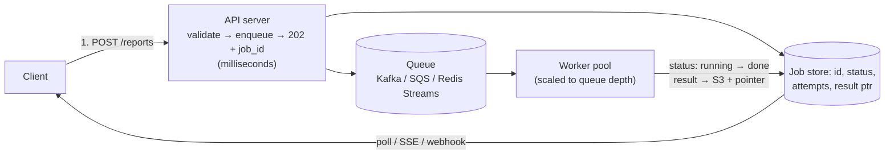

# Pattern 19 — Managing Long-Running Tasks

> **Source:** [Hello Interview — Managing Long Running Tasks](https://www.hellointerview.com/learn/system-design/patterns/long-running-tasks) (patterns series).
> **The pattern in one line:** *anything slower than a request gets split in two — accept-and-enqueue now, execute in workers later, deliver the result out-of-band.*
> Pairs with: [DD-02 §6, §9](02-kafka.md#6-queue-vs-stream--the-two-deployments) (the queue + DLQ machinery) · [DD-01 §5.6](01-redis.md#56-streams--queues--event-sourcing) · [DD-13](13-realtime-updates.md) (result delivery) · [DD-15](15-pattern-multi-step-processes.md) (when tasks become workflows) · [35 — Scheduler](../Core%20Course/35-design-scheduler.md).

## The problem — work that outlives the request

PDF generation takes 45 seconds; LBs and web servers time out at **30–60 s**; the user's browser hangs and the request may never complete. Same story for transcoding (minutes), bulk imports, newsletter sends, thumbnail pipelines. Synchronous execution couples *request volume* to *processing capacity* — one traffic spike and everything is slow.

Trigger phrases: transcode · generate/export · bulk/batch · "send to all users" · anything measured in seconds-to-minutes.

---

## The two-phase model

- **Phase 1 — accept:** validate, persist a job row (`queued`), enqueue, return **202 + job id** in milliseconds. The API's contract changes from "done" to "accepted" — say that explicitly.
- **Phase 2 — execute:** workers consume, flip status (`running` → `done`/`failed`), write results (big outputs → [S3 + pointer](18-pattern-large-blobs.md), never the queue).
- **Result delivery**, in escalating niceness: **polling** `GET /jobs/:id` (fine default) → **[SSE/WebSocket push](13-realtime-updates.md#2-hop-1--the-protocol-menu)** for in-app progress → **webhooks** for server-to-server (with retries + signatures).
- Queue choice is [DD-02 §11's script](02-kafka.md#11-kafka-vs-the-alternatives): SQS for built-in retry/DLQ ergonomics, Kafka for throughput/replay, [Redis Streams](01-redis.md#56-streams--queues--event-sourcing) when Redis is already there and volume is modest. And the zero-infrastructure option: a **Postgres `SKIP LOCKED` job table** ([DD-03 §7.1](03-postgresql.md#71-the-skip-locked-work-queue--the-mechanics)) when the job must enqueue *atomically with* the business write and volume is below a few thousand jobs/s.

**Why it wins:** timeouts vanish · workers scale on **queue depth** (the autoscaling signal), independent of API fleet · bursts become backlog instead of outage ([Pattern 17 rung 3](17-pattern-scaling-writes.md#the-ladder--in-order), same move).

---

## The production concerns (where the probes live)

- **Retries + idempotency** — workers die mid-job, redelivery is certain ([at-least-once, always](02-kafka.md#8-delivery-guarantees)): jobs carry an idempotency key; side effects check-or-skip. *"Charge the card"* as a job is where this stops being theoretical.
- **Poison jobs → DLQ** — N failures moves the job to a [dead-letter queue with an owner and an alert](02-kafka.md#9-retries-errors--dead-letter-queues); never let one bad job block the lane.
- **Stuck jobs** — worker took the job and died silently: visibility timeouts (SQS), [pending-entry claims (`XCLAIM`)](01-redis.md#56-streams--queues--event-sourcing), or heartbeat + reaper on the job row. "Running for 2 hours" needs a machine answer, not a human one.
- **Backpressure** — arrival > drain: autoscale workers on depth; beyond that, [shed or defer low-priority work](17-pattern-scaling-writes.md#the-ladder--in-order) and surface queue-time SLOs.
- **Mixed workloads** — separate queues per priority/duration class (the 10-ms thumbnails must not sit behind 10-minute transcodes); dedicated worker pools per lane.
- **Dependencies** — "resize after upload after scan" is no longer a task, it's a **workflow** → graduate to [Pattern 15](15-pattern-multi-step-processes.md) (orchestrator/Temporal) rather than chaining queues by hand.

---

## When NOT

- **Sub-second work** — just do it in the request; a queue adds latency, infrastructure, and eventual-semantics for nothing.
- **The client genuinely needs the answer synchronously** (pricing check, validation) — make *the work* faster; async doesn't help a blocking need.
- **One cron-shaped nightly batch** — a scheduler ([35](../Core%20Course/35-design-scheduler.md)), not a job platform.

---

## Interview cheat-sheet

**Reflex (recite):** *202 + job id → queue → idempotent workers scaled on depth → status via poll/SSE/webhook → DLQ with an alert → separate lanes per priority → it's a workflow? Pattern 15.*

**Numbers:** request timeouts **30–60 s** = the line between sync and async · enqueue+ack in **milliseconds** · autoscale signal = **queue depth / oldest-message age**.

| Probe | Answer |
|-------|--------|
| "Worker crashes mid-job?" | Redelivery via visibility-timeout/claim → idempotency key makes the retry safe; job row heartbeat catches silent deaths |
| "Job fails every time?" | Bounded retries with backoff → DLQ with alerting and an owner — poison must not block the lane |
| "How does the user find out?" | Poll by default; SSE for live progress; webhook for machines — and the result body lives in S3, not the queue |
| "Queue keeps growing?" | Autoscale on depth; then priority-shed; queue-time is an SLO with a dashboard, not a surprise |

**Say-verbatim:** *"The API promises acceptance, not completion — everything after the 202 is the workers' contract."* · *"Queue depth is my autoscaling signal and my health metric."*
