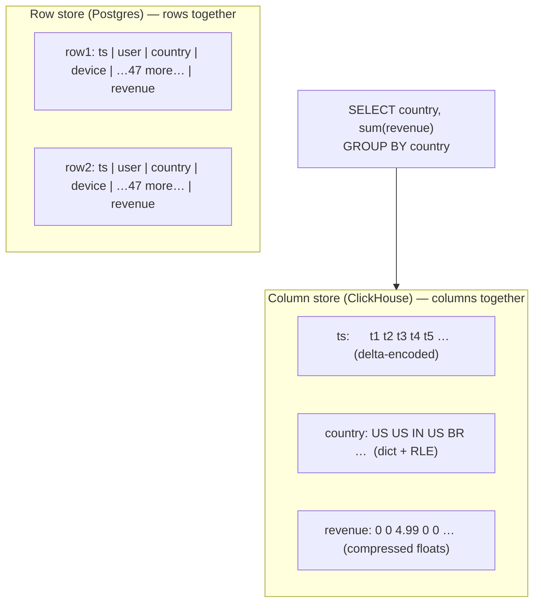
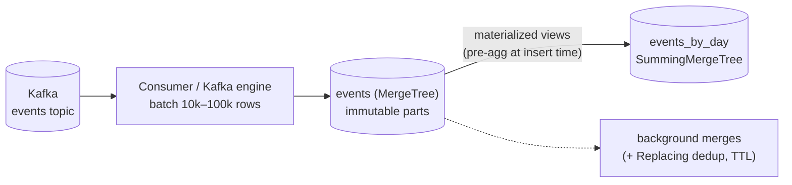

# Deep Dive 20 — ClickHouse (& Columnar OLAP)

> **Source:** beyond the Hello Interview catalog — built from ClickHouse architecture docs + standard OLAP internals. Covers the columnar family (ClickHouse/Druid/Pinot) with ClickHouse as the concrete system.
> **Prerequisites:** [DD-10 — TSDBs](10-time-series-databases.md) (shares half its tricks) · [16 — Data Processing](../Core%20Course/16-data-processing.md). Pairs with [34 — Real-Time Analytics](../Core%20Course/34-design-realtime-analytics.md) (the home problem), [DD-02 — Kafka](02-kafka.md) (the feed), [DD-12](12-big-data-structures.md) (the approximate functions inside).

## What you'll master

ClickHouse enters when the requirement is **aggregations over billions of events with seconds-fresh data and sub-second queries** — ad analytics, product events, observability backends. The probe behind it: *"why is this 100× faster than Postgres for the same query?"* — and the answer is derivable, not memorized: **columnar layout + compression + vectorized scans**, paid for by giving up cheap point-updates and transactional semantics. It's the last store in the track's taxonomy: OLTP row stores ([DD-03](03-postgresql.md)) · KV/wide-column ([DD-04](04-cassandra.md)/[05](05-dynamodb.md)) · search ([DD-06](06-elasticsearch.md)) · time-series ([DD-10](10-time-series-databases.md)) · **columnar OLAP — this one**.

By the end of this note you will be able to:

- Derive the **100×** from first principles (read 2 of 50 columns × 10–30× compression × vectorized execution).
- Explain **MergeTree** — parts, ORDER BY keys, sparse indexes, background merges — and spot the LSM family resemblance instantly.
- Design the **ingestion path** (Kafka → batched inserts → materialized views) with the honest dedup story.
- Know what it's **bad at** — point updates, high-QPS lookups, joins — and the workarounds (denormalize, dictionaries, `ReplacingMergeTree`).
- Place it in the **landscape**: vs Druid/Pinot, vs Snowflake/BigQuery, vs Postgres, vs a TSDB.

---

## Table of Contents

0. [In the Room — Staff-Level Delivery](#in-the-room--staff-level-delivery)
1. [The Mental Model — Columns Change Everything](#1-the-mental-model--columns-change-everything)
2. [MergeTree — the Storage Engine](#2-mergetree--the-storage-engine)
3. [Ingestion — Batches, Kafka, and the Dedup Story](#3-ingestion--batches-kafka-and-the-dedup-story)
4. [Querying — Aggregations, Materialized Views, Approximation](#4-querying--aggregations-materialized-views-approximation)
5. [What It's Bad At — and the Workarounds](#5-what-its-bad-at--and-the-workarounds)
6. [The Landscape](#6-the-landscape)
7. [When NOT to Use ClickHouse](#7-when-not-to-use-clickhouse)
8. [Interview Cheat-Sheet](#interview-cheat-sheet)

---

## In the Room — Staff-Level Delivery

### Decisions to make decisively

| Decision | Default position (say this) | One-line justification | Revisit trigger |
|----------|------------------------------|------------------------|-----------------|
| **When OLAP enters** | **When aggregation queries over large event volumes become a product surface** (dashboards, analytics APIs) | Row stores scan rows; analytics reads 2 columns of billions — wrong shape, no index fixes it | Ad-hoc internal analytics only → warehouse (Snowflake/BigQuery); counts on hot paths → pre-aggregate in [Flink](07-flink.md)+[Redis](01-redis.md) first |
| **Schema** | **One wide denormalized events table; `ORDER BY (tenant, toDate(ts), …)`** | Joins are the weak spot; the ORDER BY key is the index — lead with what every query filters by | Slowly-changing lookups → dictionaries, not joins |
| **Ingestion** | **Kafka → batched inserts (10k+ rows) → materialized views for rollups** | Small inserts create part-explosion; batches are the engine's native food | Sub-second freshness demands → async inserts / Kafka table engine |
| **Dedup / exactly-once** | **At-least-once + `ReplacingMergeTree` on an event-id (or idempotent insert blocks)** | [The track's delivery honesty](02-kafka.md#8-delivery-guarantees), OLAP edition — dedup is eventual, queries use `FINAL`/`GROUP BY` discipline | True dedup-at-read requirements → aggregate around it (uniqExact on event-id) |
| **Updates/deletes** | **Design them out** — immutable events, TTL for retention, versioned rows for corrections | Heavy `ALTER … DELETE` mutations rewrite whole parts (anti-pattern as a workflow); **lightweight deletes (`DELETE FROM`, 23.x+)** mark rows deleted cheaply and reclaim on the next merge — the modern GDPR-erasure answer | GDPR/erasure → lightweight `DELETE FROM` (or batched mutation as a scheduled job), not a per-request code path |
| **Which OLAP** | **ClickHouse default; Druid/Pinot when streaming-native ops fit better; warehouse for BI** | ClickHouse: best raw scan speed + SQL. **Self-host one binary, or ClickHouse Cloud with SharedMergeTree** (storage/compute separated on object storage — replicas share one copy of data, no per-replica disk) | Serverless/elastic BI over engineering-owned serving → BigQuery/Snowflake |

### Altitude — name-and-move-on vs deep-dive

**Name and move on (one sentence each):**
- Vectorized/SIMD execution — "processes columns in CPU-cache-sized batches" — one breath.
- Replication/sharding — "ReplicatedMergeTree via a Raft-style keeper, Distributed tables for fan-out" — the [same quorum ideas](08-zookeeper.md) you've already covered. *2026 note:* ClickHouse Cloud's **SharedMergeTree** replaces per-replica local copies with a single copy on object storage, so replicas coordinate only metadata via Keeper — the storage/compute-separation move the whole OLAP market made; name it if asked "self-host vs Cloud."
- Druid vs Pinot feature nuances — "streaming-native cousins, same design conversation."

**Deep-dive — spend your minutes here:**
- **The 100× derivation** (§1) — being able to build the number from column-pruning × compression is the whole credibility of the choice.
- **ORDER BY key design** (§2) — the partition-key decision's *eighth* appearance; same reflexes, new costume.
- **The dedup story** (§3) — "Kafka is at-least-once; what does your dashboard double-count?" is the sharpest probe here.

### Experience hooks

- *"Our message-analytics dashboard was killing the OLTP replica — one `GROUP BY day, tenant` over 2B rows. Moving events to ClickHouse turned a 4-minute query into 300 ms, and the derivation is boring: it reads 3 columns instead of 40, compressed 15×."*
- *"We learned the insert discipline the hard way: a service inserting single rows created tens of thousands of parts and merges fell behind. Now everything funnels through a buffer that flushes 50k-row batches — ClickHouse eats batches, chokes on crumbs."*
- *"Our dedup contract is written on the dashboard: 'counts may include <0.1% replay duplicates until merges settle.' For the money numbers we count `uniqExact(event_id)` instead — exactness where it's paid for, approximation where it isn't."*

---

## 1. The Mental Model — Columns Change Everything

One table, two layouts:

The 100×, derived in one breath for the room: *"the query touches 2 of 50 columns → 25× less data read; similar values stored adjacently compress 10–30× (dictionary, run-length, delta — [Gorilla's cousins](10-time-series-databases.md#4-compression--where-the-10100-comes-from)); and execution is vectorized — whole column blocks per CPU operation instead of row-at-a-time. Multiply, and a 4-minute Postgres scan is a sub-second ClickHouse query."*

The price, stated in the same breath: rows are now scattered across column files — **reading or updating one row means touching every column**. Columnar is a bet that you aggregate millions and rarely fetch one.

---

## 2. MergeTree — the Storage Engine

The default engine family; the mechanics rhyme with everything you've already learned:

- **Inserts create immutable sorted "parts"** (a directory of column files, sorted by the `ORDER BY` key); **background merges** combine parts — the [LSM idea](04-cassandra.md#3-the-write-path--why-writes-fly-lsm) at coarse granularity, fourth appearance in the track.
- **The `ORDER BY` key is the index and the layout.** ClickHouse keeps a **sparse primary index** — one entry per *granule* (**8,192 rows**), tiny enough for RAM — and range-scans the granules that match. Lead the key with what every query filters on (`(tenant_id, toDate(ts))`); it's the [partition-key decision](02-kafka.md#3-partitioning--keys--the-one-decision-that-matters) yet again.
- **Partitions** (typically by month/day) prune whole directories and make **retention = `DROP PARTITION`** — the [TSDB unlink trick](10-time-series-databases.md#3-the-storage-engine--lsm-partitions-blocks), verbatim.
- Per-column **compression codecs** (LZ4/ZSTD + delta/double-delta/dictionary) and per-part min/max **skip indexes** — block-level pruning, same as everywhere.
- Scale-out: **ReplicatedMergeTree** (replicas coordinated via ClickHouse Keeper — a built-in [Raft quorum](08-zookeeper.md#7-the-modern-landscape--etcd-kraft-and-who-still-uses-zk); the internalize-your-consensus lesson again) + **Distributed tables** that scatter-gather across shards.

> **Staff-level insight:** the track's punchline lands here: *ClickHouse ≈ Cassandra's LSM + the TSDB's partitions and compression + Elasticsearch's scatter-gather — recombined for the aggregation query shape.* Saying "there are no new ideas in this box, only a new mix" is both true and the strongest possible signal that you understand all four systems.

---

## 3. Ingestion — Batches, Kafka, and the Dedup Story

- **Batch or die:** every insert creates a part; thousands of single-row inserts = part explosion = merge collapse. Feed it **10k+ row batches** (buffer in the consumer, or use async inserts). This is [Pattern 17's batching rung](17-pattern-scaling-writes.md#the-ladder--in-order) as a hard requirement, not an optimization.
- **From Kafka:** consumer-with-batching (most control) or the built-in Kafka table engine + materialized view. Either way delivery is **at-least-once** — so the dedup story must be explicit:
  - **Insert idempotency**: retried *identical* insert blocks are dropped automatically (block hashing) — handles producer retries.
  - **`ReplacingMergeTree(version)` keyed by event-id**: duplicates collapse *eventually, at merge time* — queries before the merge see them, so either tolerate (~0.1% on dashboards), query with `FINAL` (costly), or count `uniqExact(event_id)` where exactness is paid for.
- **Freshness:** seconds from event to queryable is normal — say the number and pair it with [the same contract-stating discipline](06-elasticsearch.md#7-keeping-es-in-sync--the-cdc-pipeline) as every projection in this track.

---

## 4. Querying — Aggregations, Materialized Views, Approximation

- **It's SQL** — full `GROUP BY`/window-function support at billions-of-rows scans (**~GB/s–billions of rows/s per node**). The mental shift: you stop *avoiding* scans and start designing them — pruning (partitions, ORDER BY prefix, skip indexes) decides cost, not row count.
- **Materialized views** = insert-time rollups: raw events flow in, `SummingMergeTree`/`AggregatingMergeTree` targets keep per-day/per-tenant aggregates hot. This is [the retention-ladder/rollup instinct](10-time-series-databases.md#5-the-retention-ladder--downsampling--rollups) generalized — dashboards read the rollup, drill-downs hit raw.
- **Approximate functions built in**: `uniq` (HLL), `quantile` (t-digest-style), `topK` — [DD-12's sketches](12-big-data-structures.md) as SQL functions. Say "uniques via HLL at 12 KB a counter, exact `uniqExact` where money depends on it" and you've tied two notes together.
- **Joins**: supported but the weak spot at scale — **denormalize into the wide event row at ingest**, and use **dictionaries** (in-RAM lookup tables refreshed periodically) for the country-code/plan-name class of enrichment.

---

## 5. What It's Bad At — and the Workarounds

| Weakness | Why (from the model) | Workaround |
|----------|----------------------|------------|
| **Point updates/deletes** | Rows smeared across immutable column files; mutations rewrite parts | Immutable events + versioned correction rows; `ALTER DELETE` as batch compliance jobs only |
| **High-QPS point lookups** | Sparse index finds granules, not rows — every lookup decompresses blocks | Serve entities from [Postgres](03-postgresql.md)/[Redis](01-redis.md); ClickHouse answers aggregates |
| **Transactions / read-your-writes** | No OLTP semantics; parts appear atomically but that's it | It's a projection at the end of the pipeline, never the system of record |
| **Many concurrent small queries** | Built for few heavy scans, not thousands of tiny ones | Cache dashboard results ([Redis](01-redis.md#51-cache)); pre-aggregate via MVs |
| **Joins between big tables** | Hash-join memory + shuffle cost | Denormalize at ingest; dictionaries for lookups |

---

## 6. The Landscape

| | Pick when | One-line against |
|---|-----------|-------------------|
| **ClickHouse** | Engineering-owned analytics serving: fastest scans, full SQL, one binary, cheap at scale | You operate it; merges/parts discipline is real |
| **Druid / Pinot** | Streaming-native realtime OLAP (Kafka-first ingestion, per-segment TTLs), high-concurrency dashboards | More moving parts (multiple node roles); weaker ad-hoc SQL |
| **BigQuery / Snowflake** | BI/warehouse: elastic, serverless, zero ops, SQL for analysts | Latency + cost per query make it a poor *product* backend |
| **TSDB** ([DD-10](10-time-series-databases.md)) | Low-cardinality machine metrics | Detonates on high-cardinality dimensions — which is exactly where ClickHouse shines |
| **Elasticsearch aggs** ([DD-06](06-elasticsearch.md)) | Aggregations *on search results* you already index | An analytics engine it is not — cost and accuracy fall off at OLAP scale |

Decision script: **product analytics/observability backend → ClickHouse · Kafka-first realtime dashboards at high query concurrency → Druid/Pinot · analyst BI → warehouse · machine metrics → TSDB.**

---

## 7. When NOT to Use ClickHouse

1. **As the operational database** — no transactions, no cheap updates, no point-read SLOs. It's the *last* box in the pipeline, fed by CDC/Kafka.
2. **Before pre-aggregation would do** — if the product needs five counters, [Flink + Redis](07-flink.md) or a [rollup table](10-time-series-databases.md#5-the-retention-ladder--downsampling--rollups) is less system; OLAP is earned by *flexible* slicing over big volumes.
3. **Small data** — under ~100M rows, Postgres with good indexes (or even a read replica dedicated to analytics) is fine; do the BOTEC aloud.
4. **Analyst-driven BI with unpredictable elasticity** — that's the warehouse's home game.

---

## Interview Cheat-Sheet

**One-liner:** *"Columnar MergeTree store: reads only the queried columns, compresses 10–30×, scans vectorized — that's the 100× on aggregations. Immutable sorted parts with background merges (LSM again), partitions for pruning and drop-retention, sparse index on the ORDER BY key. It's the analytics projection at the end of the Kafka pipeline — never the system of record."*

**Numbers:** granule **8,192 rows** (sparse index) · compression **10–30×** · scans **~GB/s–billions rows/s/node** · insert batches **10k+ rows** (part explosion otherwise) · freshness **seconds** from Kafka · dedup settles **at merge time**.

**The design reflex (recite):** wide denormalized event table → `ORDER BY` leads with every query's filter → partition by time (drop = retention) → Kafka in batches → materialized-view rollups → dictionaries not joins → approximate functions unless money.

**The four probes and your answers:**

| Probe | Answer |
|-------|--------|
| "Why 100× over Postgres?" | 2 of 50 columns read × 10–30× compression × vectorized scans — derive it, don't assert it |
| "Update a user's row?" | You don't — immutable events + versioned corrections; mutations are batch compliance jobs, and entities live in the OLTP store |
| "Kafka replays — double counts?" | At-least-once owned explicitly: idempotent insert blocks + ReplacingMergeTree on event-id (eventual), `uniqExact` where it must be exact |
| "Why not BigQuery / a TSDB / ES?" | Warehouse = BI not product serving; TSDB dies on cardinality; ES aggs aren't an OLAP engine — ClickHouse is the product-analytics serving tier |

**Say-verbatim lines:**
- *"Columnar is a bet: aggregate millions, rarely fetch one."*
- *"ClickHouse eats batches and chokes on crumbs."*
- *"No new ideas in this box — LSM parts, time partitions, sketches, scatter-gather — just recombined for the aggregation shape."*
