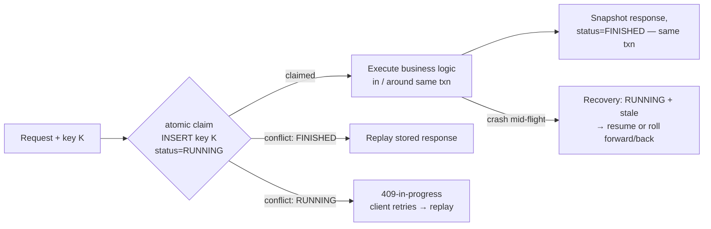

# Case Study 23 — Exactly-Once Purchase: Backend Idempotency

> **Source:** Stripe's idempotency engineering posts (the canonical public design) + standard distributed-systems practice.
> **The problem in one line:** *the same "place order" request will arrive more than once — retries, refreshes, replays, second devices — and must produce exactly one order and one charge.*
> Pairs with: [P-14 — Contention](14-pattern-contention.md) (the *other* money race) · [P-15 — Multi-step Processes](15-pattern-multi-step-processes.md) (what happens after dedup) · [DD-03 — PostgreSQL](03-postgresql.md) (unique constraints do the work) · [DD-09 — API Gateway](09-api-gateway.md) (where dedup does *not* belong) · client half: [Mobile 29](../Mobile%20System%20Design/29-ecommerce-checkout.md).

## The problem — at-least-once is a law, exactly-once is a design

Every layer of the stack retries: the user (double-tap, refresh, "try again"), the HTTP client, proxies and gateways, your own service mesh, and any queue in the path ([DD-02 §8](02-kafka.md#8-delivery-guarantees): delivery is at-least-once or at-most-once — pick one, and for money you pick at-least-once). So duplicate *delivery* of the purchase request is guaranteed by construction. The design question is making duplicate *execution* impossible: **at-least-once delivery + idempotent processing = effectively-exactly-once** — the only honest meaning of "exactly-once" across a network.

Trigger phrases: checkout/payments · "user clicked twice" · webhook handlers · "the retry charged them again" · any POST that creates something money-shaped.

---

## The contract — what the client and server agree on

The client mints an **idempotency key** per purchase *intent* (UUID, persisted client-side before the first send — the [Mobile 29](../Mobile%20System%20Design/29-ecommerce-checkout.md) half) and sends it as a header. The server promises four things:

| Promise | Meaning | Mechanism |
|---|---|---|
| **First wins** | First request with key K executes; every later K does not | Atomic claim on K (unique constraint) |
| **Replay the receipt** | Later Ks get the *stored response* of the first — status code, body, order ID | Response snapshot saved with the key |
| **Concurrent-safe** | Two Ks in flight at once → one executes, one waits or gets 409-in-progress | The claim row is also the lock |
| **Loud on misuse** | Same K, *different* payload → 422, never silent execution | Request hash stored with the key |

> **Staff-level insight:** the subtle promise is the third. Most homegrown implementations check-then-insert ("SELECT key; if absent, process; INSERT") — a textbook TOCTOU race where two concurrent duplicates both pass the check. The claim must be a single atomic write *before* processing starts.

---

## The engine — claim, execute, snapshot

- **The claim is a unique-constraint insert** — `INSERT INTO idempotency_keys (key, user_id, request_hash, status) VALUES (…)` ([DD-03](03-postgresql.md): the database's uniqueness machinery is the one component already solving distributed races; don't rebuild it in application code). Redis `SET NX` ([DD-01](01-redis.md)) works as a fast path, but then the key store is a *second* system that can disagree with your DB — default to the same database that owns orders, so **claim + order + snapshot commit atomically in one transaction**.
- **One transaction kills three failure modes.** Claim, order insert, and response snapshot in a single commit means: crash before commit → no key claimed, retry is clean; crash after → key FINISHED with receipt, retry replays. The unrepresentable state is "order exists but key doesn't" — which is exactly the state that produces double charges.
- **The RUNNING state needs an owner.** Crash *between* claim and finish leaves K stuck RUNNING. Options, in order: lease/timestamp on the claim → a sweeper inspects stale RUNNING keys and resolves them (did the order commit? roll forward the snapshot : release the key); or run the whole step inside one DB transaction so RUNNING can't survive a crash at all (claim row rolls back with it). Never let stale RUNNING mean "blocked forever" *or* "assume failed."

- **Disambiguate the two shapes — they are not the same design, and conflating them is the classic Stripe-interviewer trap:**
  - **Internal-only side effect** (the effect is a DB write you own — creating the order row): claim + order + snapshot commit **atomically in one transaction**. RUNNING is *never externally visible* — the row commits straight to FINISHED — so a concurrent duplicate **blocks on the claim row's lock**, then reads the committed receipt and replays it. There is no separate "409-in-progress" state here; the lock *is* the serialization.
  - **External side effect in the step** (you must call a PSP / send an email mid-transaction): you **cannot** hold a DB transaction + row lock open across a multi-second external network call, so you are **forced two-phase** — commit the claim as **RUNNING (now visible)** → make the external call with a *derived* idempotency key → commit **FINISHED** with the snapshot. Only in this shape does a concurrent duplicate observe RUNNING and get **409-in-progress**, and only here do you need the sweeper + recovery points (on restart: query the PSP by the derived key to learn whether the charge happened, then roll forward or release). Say which shape you're in before you draw the state machine.
- **External side effects get their own key**: pass a *derived* idempotency key to the PSP (Stripe accepts one per charge) so your internal retries can't double-charge either. Two dedup layers: yours stops duplicate orders; the PSP's stops duplicate charges ([P-15](15-pattern-multi-step-processes.md)'s per-step keys — this is that rule at the edges).

---

## Scope, storage, and lifetime — the decisions interviewers probe

- **Scope the key to `(user, endpoint)`**, not globally — key collisions across users must be impossible, and the same key on a different endpoint is a bug to surface, not honor.
- **TTL ≥ the longest client retry horizon** (24–72 h typical). Below the TTL, dedup is guaranteed; past it, the *resolution* path (query order by key/intent) must still answer — expiry bounds double-execution protection, not truth. Partition or TTL-index the key table; it's append-heavy and prune-friendly ([P-17](17-pattern-scaling-writes.md) hygiene).
- **Where it lives:** in the service that owns the resource — **not** the [API gateway](09-api-gateway.md). Gateway-level dedup can't be atomic with the order write (the whole point), can't replay bodies faithfully across deploys, and turns the gateway stateful. The gateway's legitimate role is passing the header through untouched.
- **Reads don't need keys** — GETs are naturally idempotent; so are true upserts (`PUT /settings`). The key machinery is for non-idempotent creators: `POST /orders`, `POST /payments`, webhook side effects.
- **Webhooks are the same problem inbound**: providers deliver at-least-once; your handler dedups on *their* event ID with the same claim-execute-snapshot engine. Symmetry worth saying out loud.

---

## What idempotency does *not* solve

- **Two different intents racing for the last unit** — that's [P-14 — Contention](14-pattern-contention.md): conditional write / lock / OCC on inventory decides; one buyer gets an honest "sold out." *Duplication is one intent twice; contention is two intents, one item.* Different keys, different machinery — interviewers love blurring them; don't let them.
- **The multi-step aftermath** — charge landed, order write failed: that's [P-15](15-pattern-multi-step-processes.md)'s saga/outbox territory. Idempotency makes each step safely retryable; the saga decides *which* steps run and what compensates.
- **Detection as the backstop:** a reconciliation job (same-user/same-amount/same-window charges without matching dedup hits) plus a paged metric at count = 1. The backstop exists to prove the invariant holds, not to quietly mop up — every firing is a sev on the prevention layer.

---

## Interview cheat-sheet

**Reflex (recite):** *at-least-once delivery is a law → client-minted key per intent → atomic claim via unique constraint, same txn as the order → snapshot and replay the receipt → 409 on concurrent, 422 on payload mismatch → derived key to the PSP → TTL ≥ retry horizon, resolution outlives it → contention and sagas are different problems.*

| Probe | Answer |
|-------|--------|
| "Two duplicates arrive concurrently?" | The claim is one atomic insert — check-then-insert is the classic TOCTOU bug; loser waits or gets 409 and ends up replaying the winner's receipt |
| "Crash after charging, before responding?" | Claim + order + snapshot share a transaction, so the key is FINISHED with the receipt; the retry replays it — the user sees a hiccup, not a second charge |
| "Why not dedup at the gateway?" | Dedup must commit atomically with the order write; a gateway can't join that transaction — it stays stateless and forwards the header |
| "Key expired, user retries a week later?" | Dedup TTL bounds double-execution protection, not truth: resolution queries the order by intent; only a confirmed-absent order justifies re-execution — as a *new*, explicit intent |

**Say-verbatim:** *"Exactly-once across a network is a myth at the transport layer and a design at the application layer: at-least-once delivery plus idempotent processing. The key is claimed atomically in the same transaction that creates the order — after that, duplicates don't fail, they replay the receipt."*
