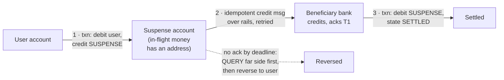

# Case Study 24 — Banking Ledger & Money Transfer

> **Source:** double-entry ledger practice (DDIA ch. 7/9 territory) + published payment-infrastructure designs (Stripe, Square, modern ledger services).
> **The problem in one line:** *debit account A and credit account B so that money is never created, destroyed, or double-moved — even across shards, services, and other banks.*
> Pairs with: [P-14 — Contention](14-pattern-contention.md) (hot-account serialization) · [P-15 — Multi-step Processes](15-pattern-multi-step-processes.md) (the cross-boundary saga) · [P-17 — Scaling Writes](17-pattern-scaling-writes.md) (the ledger is a write-scaling problem) · [DD-03 — PostgreSQL](03-postgresql.md) (locks, constraints, serializable) · [DD-02 — Kafka](02-kafka.md) (partition-per-account single-writer) · client half: [Mobile 30](../Mobile%20System%20Design/30-banking-money-transfer.md).

## The problem — one invariant, and the boundary question

The invariant: **the sum of all ledger entries is zero — per currency** — every movement is a debit and a credit that must move together. State the qualifier out loud: the zero-sum holds *within a single currency*; a cross-currency transfer is **two balanced sub-transactions plus an FX bridge**, not one balanced entry (see the multi-currency note below). The first design question is not "SQL or NoSQL"; it's **"can one database see both accounts?"** That boundary decides everything:

| | One trust boundary | Across boundaries |
|---|---|---|
| Example | Both accounts in one DB/shard | Cross-shard, cross-service, cross-bank |
| Atomicity | **Free** — one ACID transaction | **Manufactured** — saga + suspense + reconciliation |
| 2PC's role | Inside the DB's own machinery, invisible | Rejected: the far side won't hold your locks ([P-15](15-pattern-multi-step-processes.md)) |
| User-visible states | None — all-or-nothing | PENDING is real; sweepers finish the job |

Trigger phrases: money transfer · wallet/payments platform · "design Venmo/UPI" · points/credits systems (same physics, softer pager).

---

## The data model — the ledger *is* the invariant

- **Append-only double-entry journal:** `entry(txn_id, account_id, amount, direction, created_at)` written in legs that sum to zero per transaction. **Balances are derived** — a cached aggregate, rebuildable by replay. `UPDATE accounts SET balance = balance - 500` as the primary record destroys history, loses updates under concurrency, and makes "is the system correct right now?" unanswerable.
- **Corrections are reversing entries**, never UPDATE/DELETE. The journal's immutability is the audit artifact regulators certify — tamper-evidence (hash-chaining if pushed) turns a schema choice into a compliance answer.
- **The asymmetry that unlocks scale:** debits need a serialized funds check (two concurrent ₹800 debits on ₹1,000 must not both pass); **credits are commutative** and can append concurrently in any order. Serialize debits per account; let credits flow. This one sentence solves the hot-merchant-account probe before it's asked.
- **Money representation — say this before you're asked, it's table stakes at a payments company:** store amounts as **integer minor units** (paise, cents) or an exact `DECIMAL`, **never a float** (`0.1 + 0.2 ≠ 0.3` is a solvency bug). Every entry carries an explicit **currency code**; you never sum across currencies. Define the **rounding policy** once (banker's/half-even is common) and ledger the residual — rounding must land in a real account, not vanish.
- **Multi-currency & FX:** a EUR→INR transfer is a debit-EUR + credit-EUR into an FX/nostro account, then a debit-INR + credit-INR out of it, joined by a **rate captured and pinned at authorization** (rates move; you lock the quote and ledger the FX spread as its own entry). Each currency's sub-book balances to zero independently; the FX account is where the two books meet. Reconciliation runs **per currency**. If asked "where does the rate come from and when is it locked?", the answer is *at quote time, stored on the transaction, with an expiry* — never re-fetched at capture.

---

## Regime A — one boundary: a single transaction, done properly

```sql
BEGIN;
  SELECT balance FROM accounts WHERE id IN (:low, :high) FOR UPDATE;  -- global lock order!
  -- funds check · INSERT transfer (UNIQUE transfer_id → dedup, DD-23's claim)
  -- append debit + credit entries · update both cached balances
COMMIT;
```

- **Lock in account-ID order, not transfer order** — A→B racing B→A each locking "their" debit account first is the classic deadlock; a global order makes it impossible ([DD-03](03-postgresql.md)).
- **The [DD-23](23-exactly-once-purchase.md) claim rides inside:** unique constraint on the client-minted transfer ID means duplicate delivery collapses in the *same commit* that moves the money — idempotency and atomicity land together.
- **Hot accounts, escalation ladder** ([P-14](14-pattern-contention.md) applied): row lock is fine to ~hundreds of debits/sec per account → then a **single-writer queue per account** (partition by account ID on [Kafka](02-kafka.md); one consumer owns each account's debit ordering — contention becomes throughput) → for extreme fan-in (the exchange's settlement account), sub-accounts that net periodically ([P-17](17-pattern-scaling-writes.md)'s salt-the-whales, with money).

## Regime B — across boundaries: saga + suspense account



- **Debit-first is a law, not a preference.** Fail-after-debit = money *held* in suspense — an internal reversal fixes it. Fail-after-credit = money *created* — clawback from someone else's account is a legal process with a failure mode of losing. **Fail toward holding money, never toward minting it** — the saga's semantic-ordering rule ([P-15](15-pattern-multi-step-processes.md): hard-to-compensate steps last) with money's specific gravity.
- **The suspense account keeps the invariant continuously true**: without it, "debited but not credited" is money that exists nowhere and the books don't balance mid-flight. With it, in-flight money is a queryable row whose **age** is the single best alarm — "suspense entries older than SLA" mechanically catches every stuck transfer.
- **Compensation starts with a query, never a guess.** Lost ack ≠ failed credit. The sweeper asks the far side "did T1 land?" (their [DD-23](23-exactly-once-purchase.md) record answers) and only a confirmed-absent credit is safe to reverse — blind timeout-compensation manufactures double-credits, the evil twin of the double-charge.
- **Real rails look exactly like this**: UPI, SWIFT, card networks are asynchronous messages + idempotent application + suspense accounting + **netting** (gross messages all day, one net settlement between institutions) + reconciliation files. What survives from 2PC is only its recovery discipline: in doubt, ask.

---

## Reconciliation — the subsystem that proves correctness

Three loops, continuously: **internal invariant checks** (journal sums to zero; cached balances match replayed aggregates), **suspense aging** (the stuck-transfer pager), and **external matching** (your ledger vs the rails' settlement files, daily). Design rule: *every* failure mode must be reconciliation-visible — a bug you detect and repair by end-of-day is an incident; one you can't detect is a solvency question. The sev taxonomy follows: unbalanced ledger = sev-0 stop-the-line; aged suspense = page; reversal-rate drift = dashboard. Note what's absent: latency — for money, **slow-and-exactly-once beats instant-and-ambiguous**, and you say that priority order in the room.

---

## Interview cheat-sheet

**Reflex (recite):** *append-only double-entry, balances derived, corrections reverse → same boundary: one ACID txn, ordered locks, dedup-in-commit → cross-boundary: saga, debit-first into suspense, idempotent credit, query-then-reverse → serialize debits only, credits commute → netting between institutions → reconciliation proves it; suspense age is the alarm.*

| Probe | Answer |
|-------|--------|
| "Atomic debit+credit across two banks?" | You don't get atomicity — you manufacture it: saga + suspense + idempotent steps + reconciliation; 2PC dies at the trust boundary because the far side won't hold your locks |
| "Two ₹800 debits race a ₹1,000 balance?" | All debits for an account pass one serialization point — row lock, or single-writer partition at scale; the second sees ₹200 and fails honestly. Credits never queue behind this |
| "Crash between debit and credit?" | The money is in suspense, not gone: sweeper queries the far side, completes or reverses; the suspense-age alarm found it before any human did |
| "Merchant account with 10k credits/sec?" | Credits are commutative — append freely, aggregate lazily; only debits serialize. If even that's hot: sub-accounts netted periodically |

**Say-verbatim:** *"Atomicity is free inside one trust boundary and manufactured across two — so my first question is where the boundary is. Debit-first, into a suspense account, so in-flight money always has an address; and the compensation path starts with a query, because reversing a credit that actually landed is how you create money's evil twin."*
