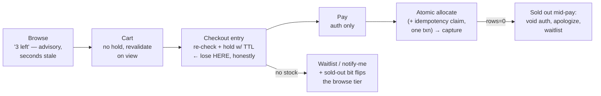

# Case Study 25 — Limited Stock: Inventory Contention & Flash Sales

> **Source:** [P-14 — Contention](14-pattern-contention.md) applied end-to-end + published flash-sale architectures (Alibaba 11.11, ticketing systems, sneaker drops).
> **The problem in one line:** *N buyers race for S units — sell exactly S: never oversell (an order without stock), never undersell (stock stranded in abandoned carts), and tell the other N−S buyers the truth fast.*
> Pairs with: [P-14 — Contention](14-pattern-contention.md) (the mechanism ladder) · [CS-23 — Exactly-Once Purchase](23-exactly-once-purchase.md) (the *other* purchase bug — compose both) · [P-15 — Multi-step](15-pattern-multi-step-processes.md) (charge/allocate ordering) · [DD-22 — Rate Limiting](22-rate-limiting.md) (the front door) · client-side holds: [Mobile 24](../Mobile%20System%20Design/24-hotel-reservation.md).

## The problem — and what it is *not*

Two different bugs hide inside "user bought twice / two users bought the last one," and interviewers deliberately blur them:

- **Duplication** — *one* intent delivered twice (retry, double-tap) → [CS-23](23-exactly-once-purchase.md)'s idempotency key. Dedup it.
- **Contention** — *many* intents, few items → this note. **Must not be deduped** — serialize the allocation instead.

A real checkout needs both, composed: the idempotency claim and the stock decrement land in the same transaction — a retry must neither double-decrement nor consume a second unit.

Trigger phrases: flash sale · limited drop · "only 3 left" · ticket on-sale · "1000 users, 5 items, same second."

---

## Variation 1 — exactly S orders for S units

### The invariant is one atomic conditional write

```sql
UPDATE inventory SET stock = stock - :qty
WHERE item_id = :id AND stock >= :qty;   -- rows_affected = 0 → honest "sold out"
```

This is [P-14](14-pattern-contention.md)'s cheapest rung and it is *sufficient at most scales*: the database serializes the row; there is no check-then-act gap to race through. Say explicitly: *"I will not SELECT the stock and then decrement it — reading first is the TOCTOU bug; the condition lives inside the write."* Oversell is now structurally impossible.

### Never *undersell* — the half candidates forget

Exactness cuts both ways. Stock leaks strand units and undersell the drop:

- **Abandoned checkouts:** if stock is reserved before payment, every reservation carries a **TTL** and an expiry sweeper returns units to the pool ([Mobile 24](../Mobile%20System%20Design/24-hotel-reservation.md)'s holds, server side). No TTL → carts full of dead holds "sell out" a drop that shipped 60% of stock.
- **Failed payments / cancellations:** the compensation path increments stock back — the reservation row makes this idempotent (release the *reservation*, not "+1 blindly," or a retried release double-credits stock).
- **The accounting identity** a reconciliation job continuously checks: `initial_stock = confirmed_orders + live_reservations + available` — any drift is a leak or a phantom, found mechanically.

### When the row itself melts — the flash-sale escalation ladder

A conditional write on one row serializes on that row's lock: fine at 1k/sec, a meltdown at 500k/sec on drop morning. Escalate deliberately ([P-14](14-pattern-contention.md) + [P-17](17-pattern-scaling-writes.md)):

| Rung | Mechanism | How exactness holds | Cost |
|---|---|---|---|
| 1 | **Conditional write in the DB** | The row lock serializes; condition in the write | Melts on a truly hot row |
| 2 | **Atomic counter in Redis** as the gate (Lua: `if stock > 0 then DECR`), DB as truth behind it | Counter admits at most S winners; losers bounce in µs without touching the DB; winners proceed to the durable txn | Two systems → reconcile counter vs DB; Redis loss → rebuild counter from DB |
| 3 | **Single-writer queue**: all requests for item X into one [Kafka](02-kafka.md) partition; one consumer allocates in arrival order | Serialization by ownership, not locks — contention becomes throughput + a *fair* FIFO | Async UX (202 + "you're in line"), the consumer is a component you operate |
| 4 | **Pre-minted tokens**: S purchase tokens issued (lottery or queue position); checkout requires a token | Allocation decided *before* the stampede hits checkout — the sale becomes S calm purchases | A whole admission subsystem (and the standard answer for sneaker drops/ticketing) |

> **Staff-level insight:** rungs 2–4 all implement the same idea — **move the decision earlier and off the hot row**. The DB row stops being where the race resolves and becomes where the result is durably recorded. Naming that inversion is the senior move.

---

## Variation 2 — the other N−S buyers (cart semantics & the losers' experience)

### The cart is not a reservation

The core policy decision, and the default is firm: **adding to cart holds nothing** (Amazon's model). A cart-add is free; letting it reserve stock hands bots and idle browsers a zero-cost inventory lock — one script "carts" the entire drop and nobody can buy. The spectrum, by intent shown:

| Point of hold | Who uses it | Why |
|---|---|---|
| **No hold — check at payment** | Default retail | Free option = abuse surface; contention is rare enough to resolve at the end |
| **Hold at checkout entry, TTL minutes** | Flash sales, ticketing, hotels | Entering checkout shows real intent; TTL bounds the damage; countdown renders from server expiry |
| **Hold at cart-add** | Almost never | Only defensible with strict per-user limits + short TTL + an admission gate in front |

### The stock number on a product page is advisory — the sold-out bit is not

- **"Only 3 left" is a cached, eventually-consistent hint** — a display tier that may lie by seconds ([staleness is a budget](../Mobile%20System%20Design/24-hotel-reservation.md): spend it freely on browse, zero at allocation). Don't burn engineering on making it exact; burn it on the transition:
- **Sold-out is the cheapest bit in the system — propagate it aggressively.** The instant stock hits zero, flip a flag that pushes to CDN/edge caches and the browse tier: millions of buyers stop hammering checkout because the *button disabled itself*. The crowd is turned away at the cheapest layer, not the most expensive one.

### The funnel of honest disappointments



- **Fail early, message plainly.** The right place to lose is checkout entry — before card entry, before hope: *"this sold out while it was in your cart"* with a one-tap waitlist. Cart contents revalidate against current stock whenever the cart is viewed, so the bad news arrives at the earliest reliable moment.
- **Order of money operations** ([P-15](15-pattern-multi-step-processes.md) semantic ordering): **authorize → allocate → capture**. Authorization is reversible (void); capture is a real charge. Allocation failing after auth → void, apologize, waitlist. Never capture before stock is yours — "charged then cancelled" is the experience that makes the news. This is [CS-24](24-banking-ledger.md)'s debit-first law wearing retail clothes: fail toward *holding* (an auth you can void), never toward *owing* (a captured charge without goods).
- **The front door for the stampede:** rate limiting ([DD-22](22-rate-limiting.md)) + a waiting room issuing queue positions (fairness you can *show*: "you're #4,812") + per-user purchase limits enforced at allocation (`AND buyer hasn't exceeded limit` — inside the atomic write, or bots make limits decorative). For pure drops, a lottery beats a queue: fairer than rewarding the fastest botnet.
- **Losers become demand data:** waitlist + notify-me converts the N−S into the restock's first customers and tells purchasing exactly how much demand was unmet — the failure path has product value; say so.

---

## Interview cheat-sheet

**Reflex (recite):** *contention ≠ duplication — serialize one, dedup the other, compose both in one txn → conditional decrement is the invariant (no read-then-write) → TTL holds + release-by-reservation so you never undersell either → hot row: Redis gate → single-writer queue → pre-minted tokens (move the decision off the row) → cart holds nothing; hold at checkout entry with TTL → authorize-allocate-capture in that order → sold-out bit to the edge; losers get truth early + a waitlist.*

| Probe | Answer |
|-------|--------|
| "1,000 buyers, 5 units, same second?" | One atomic conditional decrement — 5 succeed, 995 get `rows_affected = 0` and an honest sold-out in one round trip; at flash-sale scale the same decision moves to a Redis gate or a single-writer queue |
| "Why not reserve at add-to-cart?" | A free hold is a bot's favorite API — one script carts the whole drop. Holds start where intent is proven (checkout entry) and carry a TTL so abandonment can't strand stock |
| "User pays and *then* there's no stock?" | Ordering makes it rare (allocate before capture) and survivable (void the auth, never the capture); if allocation uses holds, payment happens *inside* a held reservation and the race resolved at hold time |
| "Exactly sold out — how do you *know*?" | The identity `initial = confirmed + live holds + available`, checked continuously; every hold release is idempotent by reservation ID so compensation can't double-credit stock |

**Say-verbatim:** *"The cart is a wish, the hold is a promise with a TTL, and the conditional decrement is the contract. I serialize the decrement, not the users — and the moment stock hits zero, sold-out becomes the cheapest bit in the system: I push it to the edge so a million people stop asking an expensive question."*
