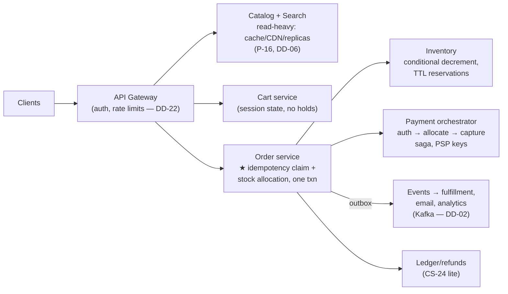

# Case Study 26 — "Design an E-commerce Platform," Answered at Staff/EM

> **Source:** [Senior System Design Mock: Design an E-commerce Platform](https://www.youtube.com/watch?v=RuGY_1pap74) — this note takes the same question **one level up**: what changes between the Senior answer in the video and the Staff/EM answer that gets the offer.
> **This is the capstone of the money-path series:** [CS-23 — Exactly-Once Purchase](23-exactly-once-purchase.md) · [CS-25 — Inventory Contention](25-flash-sale-inventory.md) · [CS-24 — Ledger & Money](24-banking-ledger.md) — those notes are the ammunition; this note is how you fire it in 45 minutes.

## What "one level up" actually means for this question

The Senior candidate designs a *working system*: services, databases, a queue, caching. Competent, complete, forgettable. The altitude moves that change the grade:

1. **Scope to the crux, out loud.** E-commerce = catalog + search + cart + checkout + orders + payments + inventory + fulfillment + notifications. You cannot do nine subsystems in 45 minutes and shouldn't try. The Staff move: *"the interesting physics live in the money path — checkout, inventory, payment. Catalog and search are read-scaling problems with known shapes ([P-16](16-pattern-scaling-reads.md)); I'll sketch them and spend my depth where correctness is unforgiving."* Naming what you're *not* doing, and why, is itself the signal.
2. **Name the three distinct hard problems** — most candidates blur them into "handle payments carefully": **duplication** (one intent twice → idempotency, [CS-23](23-exactly-once-purchase.md)), **contention** (many intents, few items → serialized allocation, [CS-25](25-flash-sale-inventory.md)), **multi-step money** (charge + order + stock must converge → saga/outbox, [P-15](15-pattern-multi-step-processes.md)). Announcing this taxonomy in minute 10 reframes the whole interview around *your* map.
3. **Design the contracts, not just the boxes.** Staff differentiator: the idempotency-key contract with clients, the reservation-TTL contract with inventory, the auth/capture contract with the PSP, the event contract (outbox) with fulfillment — each is a *cross-team agreement you'd write down*, and you say so.
4. **Carry the EM layer alongside** — rollout risk, buy-vs-build, reconciliation as an org practice, and the sev taxonomy. EM answers price things: a duplicate charge costs a refund + a support ticket + trust; that price justifies the engineering.

## The 45-minute shape

| Minutes | Do | Say-verbatim anchor |
|---|---|---|
| 0–5 | Requirements + **scope cut** to the money path; name scale (peak = sale day, 100× baseline) | "Depth on checkout; sketches elsewhere — correctness is the product here" |
| 5–15 | High-level: the service map below; identify where each hard problem lives | "Three different hard problems hide in 'buy': duplication, contention, money movement" |
| 15–35 | Deep dives: order placement (idempotency + allocation in one txn) → payment orchestration (auth-allocate-capture saga + outbox) → flash-sale escalation | the reflexes from CS-23/25/24 |
| 35–45 | Failure drills + reconciliation + EM layer (rollout, buy-vs-build, pager) | "Every failure mode must be reconciliation-visible" |

## The high-level map (draw this, then point at the crux)



- **Catalog/search:** heavy read-side machinery ([P-16](16-pattern-scaling-reads.md): cache → CDN → replicas; [DD-06](06-elasticsearch.md) for search) — eventually consistent *on purpose*: a slightly stale product page is free; say "staleness is a budget I spend on browse and refuse at checkout" ([Mobile 24](../Mobile%20System%20Design/24-hotel-reservation.md)'s tiering).
- **Cart:** deliberately boring — a keyed document per user, **no stock holds** ([CS-25](25-flash-sale-inventory.md): a free hold is a bot's API). Its one interesting behavior: revalidate against stock/price on view, so bad news arrives early.
- **Order service is the crux star:** placement is *one transaction* containing the idempotency claim ([CS-23](23-exactly-once-purchase.md)'s unique-constraint insert + response snapshot) and the conditional stock allocation ([CS-25](25-flash-sale-inventory.md)) — a retry can neither double-charge nor grab a second unit, by construction.
- **Payment orchestration is a saga** ([P-15](15-pattern-multi-step-processes.md)): **authorize → allocate → capture**, compensations = void/release; derived idempotency key per PSP call; outbox row in the order transaction so "order placed" events can't be lost or phantom. Refunds/settlement get a small double-entry ledger ([CS-24](24-banking-ledger.md)) — even shops need books that balance.
- **Downstream (fulfillment, email) hangs off events** — at-least-once consumers, idempotent by order ID ([DD-02 §8](02-kafka.md#8-delivery-guarantees)).

## The altitude table — same probe, three answers

The interviewer asks the same questions at every level; the *answer shape* is what's graded:

| Probe | Senior (the video's altitude) | Staff adds | EM adds |
|---|---|---|---|
| "User clicks buy twice" | "Idempotency key, dedup on the server" | The *mechanics that make it true*: atomic claim + order + snapshot in one txn (TOCTOU called out), 409-in-progress, replay-the-receipt, PSP-layer key — and it's a written client contract, versioned and tested | Duplicate-charge count pages at 1; the backstop auto-refund detector exists but every firing is a sev on prevention — "a backstop that quietly mops up teaches the system to leak" |
| "Flash sale: 100k buyers, 500 units" | "Lock the row / decrement atomically" | The escalation ladder with numbers: conditional write → Redis gate → single-writer partition → pre-minted tokens; *and* the undersell half — TTL holds, idempotent release, the accounting identity | Fairness and abuse are product decisions: queue-with-visible-position vs lottery, per-user limits inside the atomic write; sold-out bit pushed to CDN is a cost decision (protects the fleet) |
| "Payment succeeded but order failed" | "Use a saga / compensate" | Ordering as law: authorize-allocate-**capture** so the bad path voids an auth, never claws back a capture; outbox closes the write-vs-publish gap; sweeper resolves stuck states by *querying* before compensating | "Charged-then-cancelled makes the news" — the sev taxonomy, and reconciliation (orders vs PSP settlement file, daily) as a staffed practice, not a script |
| "How do you scale it?" | Shard/replicate/cache each service | Scale is *asymmetric by design*: browse scales with copies (cheap, eventual), the money path scales by moving decisions off hot rows (serialization, not replication) — two different physics, named | Capacity is planned around sale events (100× peak), load-tested with the *failure drills* rehearsed; the checkout carries a kill switch — fail closed with honesty |
| "Payments: build or integrate?" | (rarely asked at Senior) | Integration architecture: PSP behind an internal interface, idempotency keys passed down, webhook dedup inbound — swap-able by design | **Buy.** Card handling is PCI scope + certification + liability for zero differentiation; own the order state machine, rent the card vault. Same call for search (Elastic/Algolia) vs the differentiating checkout |

## The video's side quest, closed: price-drop notifications

The mock spends a third of its time on "notify subscribers when a price changes." It's a *composition* question — every part exists in this repo ([DD-13](13-realtime-updates.md), [18d's notification system](../Core%20Course/18d-design-infra-primitives.md), [DD-02](02-kafka.md)) — but in the room you must assemble it in one pass:

```
price write (any admin service) ──► CDC on items table ──► CHANGE FILTER ──► Q1: (item, old→new price)
                                                             │ threshold: drop ≥ X% ­— no event for a 2-cent wiggle
                                                             │ dedup: coalesce N changes/min to latest (volatile items)
Q1 ──► fan-out workers: item → subscriber list (paginated reads — a "whale" item has 1M subscribers)
    ──► Q2: (user, item, new price) — per-USER queue, the unit delivery cares about
Q2 ──► delivery service ──► online now?  SSE push over the existing connection (channel = user)
                        ──► offline?     push/email via the notification service
                        ──► subscribed to 200 volatile items? DIGEST: batch per user per window
```

The six decisions that make it a Staff answer rather than a box chain:

1. **BOTEC first, out loud** (the video's own numbers): 10M products × 1/1000 changing daily ≈ 10K items, ~30K events/day ≈ **one event/second** — the *base* rate is trivial; the entire design difficulty is the **skew** (one Nike drop = 1M subscriber deliveries in a burst). Say that sentence and the interviewer knows you can size.
2. **Two queues, two units:** Q1's unit is the *item*, Q2's unit is the *(user, delivery)*. The fan-out worker between them is where 1 event becomes 1M — paginate the subscriber read, and the whale item parallelizes across workers by subscriber-page, not by item ([P-17](17-pattern-scaling-writes.md): salt the whale).
3. **Filter before fan-out, always:** thresholds and coalescing run on Q1 where cardinality is 1× — running them post-fan-out multiplies the work you were trying to avoid by a million.
4. **Delivery transport is [DD-13](13-realtime-updates.md)'s ladder verbatim:** polling burns 10M users asking about prices that didn't change; WebSocket is a stateful fleet you don't need (no client→server stream); **SSE wins** — server-push over a held connection, channel keyed by user, notification service as fallback for offline. This exact trade-off (WS vs polling vs SSE) is the pattern the interviewer said to "please master."
5. **Digest is a product contract, not an afterthought:** per-user rate cap + windowed batching turns "200 pings from a volatile watchlist" into one summary — decided *with* product, enforced in the delivery service (the [Mobile 22](../Mobile%20System%20Design/22-push-notification-system.md) grouping discipline, server-side).
6. **Latency is observable per leg** (the video's closing probe): stamp the event at CDC-emit, Q1-enqueue, fan-out, Q2-enqueue, delivery; the SLI is *price-changed → user-notified* p99, decomposable by leg; queue depth alerts lead the latency alert ([12 — Observability](../Core%20Course/12-observability.md)). "I can tell you which leg ate the budget" is the sentence.

**EM overlay:** the notification is a *promise* — "subscribe and we'll tell you" — so the SLO is a product commitment; the whale-drop burst is a capacity event you calendar (same muscle as sale day); and the CDC dependency means the items table's schema is now a cross-team contract with the notification org — version it like one.

## Failure drills to volunteer (don't wait to be asked)

Running two of these unprompted in the last ten minutes is the strongest Staff signal available:

- **Order-service crash between claim and commit:** nothing leaked — claim, allocation, and snapshot share the transaction; the retry finds either nothing (clean re-run) or a FINISHED receipt (replay). The unrepresentable state was the point.
- **PSP times out on capture:** unknown ≠ failed — re-poll with the same key; the PSP dedupes. Meanwhile the order sits in a visible CAPTURING state with an SLA and a sweeper; the user sees "confirming," never a guess.
- **Redis gate says sold out, DB says 3 left:** the gate is a fast-path *filter*, the DB is truth — reconciliation heals the counter from the DB; worst case a few buyers were turned away early (safe direction). The reverse divergence is impossible because the DB's conditional write is still the contract.
- **Sale-day retro metric:** oversells (must be 0), undersell % (stranded holds), duplicate charges (0, paged), p99 order placement, and *reconciliation deltas* — the numbers an EM reads Monday morning.

---

## Interview cheat-sheet

**Reflex (recite):** *scope to the money path, sketch the rest → name the three hard problems (duplication / contention / money movement) as different problems → order placement = idempotency claim + conditional allocation, one transaction → payment = auth-allocate-capture saga + outbox + PSP keys → flash sale = move the decision off the hot row (gate → single writer → tokens) → cart holds nothing; staleness spent on browse, refused at checkout → reconciliation proves it; duplicate charges page at one → buy the PSP and the search engine, own the checkout.*

| Probe | One-breath answer |
|-------|-------------------|
| "Where do you start?" | "Where correctness is unforgiving: the money path. Catalog and search are known read-scaling shapes — I'll spend depth where retries have a price" |
| "What's genuinely hard here?" | "Three separate things people blur: the same buy arriving twice, many buys racing few units, and charge+order+stock needing to converge — dedup the first, serialize the second, saga the third" |
| "Sale day is 100× traffic" | "Browse scales with copies; checkout scales by moving the allocation decision off the hot row — two different physics, and I capacity-plan and load-test the second against the drill list" |
| "What do you build vs buy?" | "Rent the undifferentiated liability — PSP, search engine. Own the order state machine and the allocation path: that's where the product wins or loses" |

**Say-verbatim:**
- *"Depth on checkout, sketches elsewhere — in e-commerce, correctness is the product."*
- *"Price alerts: the base rate is one event a second — the whole problem is the whale item. Filter before fan-out, two queues with two units, SSE for delivery, digest as the product contract."*
- *"Duplication, contention, and money movement are three different problems — dedup, serialize, saga."*
- *"Browse scales with copies; money scales by serialization — I refuse to scale the money path with optimism."*
- *"The failure drill is the design review: crash between claim and commit, timeout on capture, gate-vs-truth divergence — each has a rehearsed answer."*
