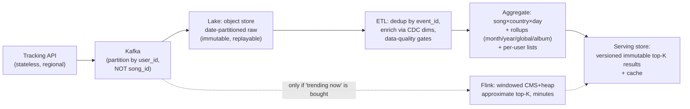

# CS-27 — "Top-K Most-Listened Songs," at Staff/EM

> **Source:** [Google India engineers in a Mock System Design Interview](https://www.youtube.com/watch?v=S1DvEdR0iUo) (Life at Google) — a Staff SWE candidate + EM interviewer walk the problem at a strong Senior altitude. This note is the level up: what the same 45 minutes sounds like when *you* are interviewing at Staff/EM.
> **The prompt:** *given an API that tracks when a user listens to a song in an album, report the top most-listened songs and albums — by user, by country, by day/month/year.*
> **The crux in one line:** *this is a **counting cube + a ranking** — precompute both at exactly the freshness the product paid for, keep the pipeline honest under at-least-once delivery, and treat per-user listening history as sensitive data wearing an analytics costume.*
> Companions: [12 — Big-Data Structures](12-big-data-structures.md) · [20 — ClickHouse](20-clickhouse.md) · [07 — Flink](07-flink.md) · [02 — Kafka](02-kafka.md) · the YouTube view-count package (the same counting problem with one hot counter instead of a cube) · client half: [Mobile 26 — Spotify](../Mobile%20System%20Design/26-spotify-music.md).

## What you'll master

- Naming the **problem class** in the first two minutes: top-K heavy hitters over a dimensional cube — and why that naming drives every later choice.
- **The cube discipline**: which rollups to materialize, which to derive, and why per-user top-K is a different animal than per-country top-K.
- **Batch-exact + stream-approximate** as a priced menu (count-min sketch + heap when the product asks for "trending now").
- The pipeline's **correctness spine**: dedup under at-least-once, late events, replayable backfill — the part the mock waved at.
- The **Staff/EM layer the mock never touched**: privacy of listening data, chart-manipulation integrity, build-vs-buy TCO, and freshness as a product knob with a price tag.

## The mock, summarized fairly (and its altitude)

The candidate ran a clean, methodical loop: clarified scope (API only, no personalization), assumed 400M users / 40% DAU / ~600M listen-events/day / 70M-song catalog, then built: tracking API → **Kafka** → streaming copy to **HDFS** (date partitions — she caught the small-files trap) → **ETL enrichment** joining song/album/user metadata replicated from OLTP via CDC → **batch aggregation** (BigQuery or Presto) → **precomputed results pushed to an RDBMS** for serving at 200→1000 QPS → two-region reliability (dual ingest, active/standby batch, dual serving DBs) → closed with monitoring, data-quality checks, and backfill as "what I'd do with more time."

The interviewer's debrief is a free rubric: methodical structure, back-of-envelope comfort, thinking aloud, receptive to nudges, **don't expand scope the interviewer didn't ask for**, do trade-off analysis proactively, and cover the non-functional space. All correct — and all *process*. What separates Staff/EM is **content altitude**: naming the problem class, pricing freshness, and raising privacy/integrity before being asked. That's this note.

## In the Room

| Decision | Default position | Justification |
|---|---|---|
| Problem naming | **"Top-K heavy hitters over a (dimension × window) cube — a counting problem plus a ranking problem"** | Names the design space in one sentence; every later box is an implementation detail of it |
| Freshness | **Batch-exact at 1 h (the ask); streaming-approximate only if the product buys "trending now"** | Freshness is a product knob with an architecture price — 1 h = batch, minutes = Flink + sketches, seconds = push back |
| Aggregation | **Materialize the queried rollups; derive coarser windows by summing finer ones** | Months are sums of days — rollup, never recount; kills the cube explosion |
| Per-user top-K | **Separate path: shard by user, store in KV — not in the country/global cube** | 200M tiny per-user problems ≠ one giant problem; the cube treatment would be storage suicide |
| Ingestion truth | **At-least-once + event-ID dedup + event-time watermarks** | Duplicates and late mobile replays are the *normal case*; counts that ignore them are inflated fiction |
| Serving | **Precompute → immutable versioned results in a serving store + cache; reads never compute** | The mock's RDBMS call, formalized: 1000 QPS of lookups is trivial *because* the query ran once per hour, not once per request |
| Privacy | **Aggregates are public; the event stream is sensitive personal data — minimize, threshold, retain-with-limits** | Listening history + age/gender/location enrichment is a profile; Staff raises it unprompted |

## 1. Name the problem class, then let it drive

Two sub-problems hide in the prompt, and they scale differently:

1. **Counting:** `count(listens)` grouped by `(entity, slice, window)` where entity ∈ {song, album}, slice ∈ {global, country, user}, window ∈ {day, month, year}. This is the YouTube view-count problem *generalized from one hot counter to a cube* — same at-least-once ingestion, same dedup obligations, but the hot-key pressure is spread across a keyspace instead of concentrated on one row.
2. **Ranking:** top-N over each counted slice. Exact ranking needs the full count table for the slice; approximate ranking can ride sketches (§3).

Say the cube's size out loud before drawing boxes: 70M songs × ~200 countries × 365 days is *not* a table you materialize blindly — but you don't need to. **Materialize only the finest grain you query (song × country × day), derive everything coarser by rollup** — month = Σ days, year = Σ months, global = Σ countries, album = Σ its songs (or count album-grain directly if track-to-album mapping churns). Sparse reality saves you: most (song, country, day) cells are zero, and columnar storage ([20 — ClickHouse](20-clickhouse.md)) compresses the rest. The rollup rule is the single most important sentence in the aggregation design: **recounting coarse windows from raw events is O(events); rolling up from finer aggregates is O(cells) — and it makes backfills composable** (§4).

**Per-user top-K is a different animal, and saying so is a Staff tell.** A user's own top songs touch only that user's ~1K events/month — 200M *tiny* problems, embarrassingly parallel, shard by `user_id`, compute in the same batch pass, store as a per-user list in a KV store (this is personalization-adjacent storage, not an analytics cube). Putting `user` in the same dimensional cube as `country` is the classic mistake — the cardinalities differ by six orders of magnitude and the access pattern (one user reads their own row) is point-lookup, not slice-scan.

## 2. The pipeline, kept — and hardened

The mock's skeleton is right; keep it and harden the joints:

- **Partition Kafka by `user_id` (or random), never by `song_id`.** A celebrity drop makes one song the write hot key; partitioning by song recreates the hot-video problem for no benefit — counting doesn't need per-song ordering. Skew then reappears at the *reduce* stage (one reducer owns the hit song's cells) — pre-aggregate per partition (combiner), salt the whale keys if a single reducer still saturates ([17 — Scaling Writes](17-pattern-scaling-writes.md)).
- **The lake is immutable and replayable** — that's what makes her "backfill" closing remark real: every ETL stage is deterministic and writes partition-atomically, so *rerun = overwrite partition*, and any downstream bug is fixed by replaying partitions, not by apologizing. Retention on raw: 30–90 days hot, then archive/expire (privacy wants this too — §5).
- **Data-quality gates between stages, with SLOs:** row counts vs Kafka offset deltas (loss), dedup ratio (health of clients), null-rate on joined dims (CDC lag), freshness lag per slice. "The chart is stale" pages the pipeline on-call; "the chart is *wrong*" is a sev — different alerts, different runbooks.

## 3. Freshness is a priced menu (own the batch choice, then show the next rung)

The candidate chose batch because the interviewer said 1 h. Staff states the *menu* and its prices:

| Product ask | Architecture | Cost & correctness |
|---|---|---|
| Hourly/daily charts (the ask) | **Batch exact** on the lake | cheapest; exact; freshness = schedule + pipeline lag |
| "Trending in the last 15 min" | **Flink** ([07](07-flink.md)) windowed **count-min sketch + min-heap** per partition, merged ([12 — Big-Data Structures](12-big-data-structures.md)) | approximate (CMS overestimates; bounded ε) — fine for trending, *not* for royalty reports; state, checkpoints, on-call |
| Both | **Lambda, owned honestly:** stream serves the fresh window, nightly batch is truth and corrects drift | two codepaths — pay it only if the product actually bought both |
| "Real-time exact global chart" | — | push back: exact + instant + global picks two. Say the price; let product choose |

The killer sentence: **exactness and freshness are both features with price tags, and different consumers of the same counts need different bundles** — the trending widget tolerates ε; the artist-payout report tolerates hours but not estimation error. One event stream, two aggregation contracts. (The same split the view-count package makes between displayed counts and billing — 17 — View Integrity.)

## 4. The correctness spine the mock waved at

- **At-least-once is a law** ([CS-23](23-exactly-once-purchase.md)'s law, analytics edition): client retries, Kafka redelivery, ETL reruns — duplicates are the normal case. Every listen event carries a client-minted `event_id`; dedup in ETL within a bounded window (and idempotent partition overwrites make *pipeline-level* replays safe by construction). Without this, every chart is inflated by your own infrastructure's weather.
- **Late events are the mobile default, not an edge case:** offline listeners ([Mobile 20 — Analytics SDK](../Mobile%20System%20Design/20-analytics-sdk.md) is literally the other end of this pipe) sync hours or days late. Allocate by **event time**, not arrival time; keep recent day-partitions *open for restatement* (e.g., D−3…D re-aggregate on each run); publish charts as "as of" snapshots. A chart that never restates is either ignoring late data or lying about finality — pick your policy and document it.
- **What counts as a listen** is a spec negotiation, same as "what counts as a view" (Uber 01 §6): 5 seconds? 30 seconds (the industry norm — it's the royalty threshold)? completion? Skips? The counting unit determines the money downstream — get it in writing before designing.

## 5. The Staff/EM Layer (what the mock never touched)

- **Privacy is the elephant.** The candidate enriched events with gender, age group, and location without pausing — at Google that design review doesn't end well. The Staff/EM version: the **event stream is sensitive personal data** (listening history is protected in multiple jurisdictions and embarrassing in all of them). Concretely: (1) public aggregates carry **k-anonymity thresholds** — "top songs among 25–34 women in a small country" with 12 listeners is a deanonymization, suppress slices below k; (2) **GDPR deletion** in an append-only lake = per-user tombstones + re-aggregation of affected partitions, or crypto-shredding of per-user keys — design it in, retrofits are miserable; (3) raw retention is a *liability clock*, not a free archive — expire it; (4) per-user top-K lists live behind the user's own auth, in a different privacy class than the global chart.
- **Integrity: charts move money, so charts get gamed.** Stream farms and bot playlists are an industry (chart manipulation = payola 2.0; labels' payouts ride these numbers). Raw vs **validated** counts, fraud scoring offline on the replayable log, charts computed from validated only — the view-integrity design transplants wholesale. EM framing: the chart's *credibility* is the product; one "botted #1" scandal costs more than the fraud pipeline.
- **Build-vs-buy (the EM's actual decision):** BigQuery vs self-run HDFS+Presto/Spark isn't a technology preference — it's TCO + on-call + hiring. Managed OLAP until the bill or data-residency forces otherwise; the EM asks "who carries the pager for the Hadoop cluster, and what else could that team ship?" The candidate name-dropped both; the level-up is *arguing the decision*, not listing options.
- **Cost shape:** 600M events/day × ~200 B ≈ 120 GB/day raw — storage is pocket change; **compute is the bill**, and precompute converts per-query cost into per-hour cost (the whole economic argument for the serving-store design, one sentence). The per-region freshness config from the mock (1 h hot regions, daily elsewhere) is a *cost* knob as much as a UX one — say both halves.
- **Org reality:** this system sits between client instrumentation (mobile team), the lake (data platform), and chart consumers (product, payouts, legal). The Staff artifact is the **event schema + counting-unit contract** — versioned, with owners; the EM artifact is the SLO sheet (freshness, loss, restatement policy) that product signed.

## The altitude table (same probes, three levels)

| Probe | Senior answer | Staff answer | EM overlay |
|---|---|---|---|
| "Design it" | The mock: API → Kafka → lake → ETL → batch agg → serving DB | Same skeleton + names the class (top-K over a cube), rollup discipline, per-user split, dedup/late-event spine | Freshness & exactness as priced product knobs; schema contract owns the org seam |
| "Make it fresher" | Smaller batch windows | Streaming CMS+heap for trending, batch stays truth; ε stated | Only if product buys it — two codepaths is a staffing cost, not a checkbox |
| "Celebrity release day" | "Kafka scales" | Partition by user not song; combiner pre-aggregation; salt whale keys at reduce | Capacity game-day before the drop; the marketing calendar is an ops input |
| "Counts look wrong" | Check the pipeline | Dedup ratio, CDC lag, restatement window — data-quality SLOs point at the stage | "Wrong" vs "stale" are different pages; publish the restatement policy |
| "Delete my data" | *(not covered)* | Tombstones + partition re-agg or crypto-shred; raw retention clock | Deletion SLA is a legal commitment; audit evidence, not best effort |
| "Is #1 real?" | *(not covered)* | Raw vs validated counts; offline fraud on the replayable log | Chart credibility is the product; fraud pipeline is brand insurance |

## Follow-Ups — the Interviewer Escalates

- **"One song is 8% of all events today."** — Ingestion doesn't care (partitioned by user); the reduce cell for that song is one hot key — combiners collapse it per-partition before the shuffle; if a single reducer still saturates, salt the key into k sub-cells and sum ([17 — Scaling Writes](17-pattern-scaling-writes.md)). The *read* side spikes too: that chart page is one cached, versioned result — the CDN eats it.
- **"Product wants the chart to update every minute."** — Menu answer (§3): streaming CMS+heap for the trending surface with stated error bounds; batch remains the system of record and corrects the stream nightly; and the question back — *which consumer needs it?* Trending yes, payouts never.
- **"A phone syncs three days of offline listens."** — Event-time allocation; D−3 partitions still open for restatement; charts are "as of" snapshots and the policy is published. Never allocate to arrival day — that invents a fake spike today and a hole on the real day.
- **"Prove yesterday's #1 wasn't bots."** — Validated-count pipeline: fraud scoring runs offline on the immutable log (replayable = re-adjudicable), charts read validated counts, and the raw-vs-validated delta is itself a monitored signal. Same three-layer shape as view integrity.
- **"Legal: a user invokes GDPR erasure."** — Tombstone their user_id, re-aggregate affected partitions on schedule (aggregates without user dims usually survive as-is — deletion mainly bites raw + per-user lists), crypto-shred the per-user KV row, and the deletion job emits audit evidence. The design decision that made this tractable was made in §2: partition-atomic, re-runnable ETL.
- **"Your BigQuery bill doubled."** — The EM probe. Answer with the cost shape: per-query aggregation crept back in somewhere (a dashboard hitting raw?) — precompute exists to make queries cheap; audit query patterns, move hot ad-hoc slices into materialized rollups, and re-check the per-region freshness config — daily-refresh regions at hourly cadence is pure burn.

---

## Interview Cheat-Sheet

**30-second architecture:** tracking API → Kafka (partition by user) → immutable date-partitioned lake → dedup-and-enrich ETL (event-time, CDC dims, quality gates) → aggregate song×country×day + rollups (month/year/global/album = sums, never recounts) + per-user lists in KV → versioned immutable top-K results in a serving store + cache; reads never compute · trending (if bought): Flink CMS+heap, batch stays truth · privacy: k-anonymity thresholds, deletion-by-design, raw retention clock · integrity: validated counts feed the chart.

| Probe | Answer |
|---|---|
| "Why batch?" | The product bought 1 h freshness; batch is exact and cheapest. Fresher is a menu with prices, not a redesign |
| "Cube too big?" | Materialize the finest queried grain; everything coarser is a rollup — months are sums of days |
| "Per-user top-K?" | Different animal: 200M tiny problems, shard by user, KV storage, point lookups — not cube rows |
| "Duplicates/late data?" | event_id dedup + event-time allocation + open restatement window; at-least-once is the law |
| "What the mock missed?" | Privacy (k-anonymity, deletion), integrity (validated counts), and pricing freshness — the Staff/EM layer |

**Say-verbatim:**
- *"This is a counting cube plus a ranking — and top-K is cheap once the counting is right."*
- *"Months are sums of days: roll up, never recount — it's also what makes backfill composable."*
- *"Exact and fresh are both features with price tags; trending buys approximate, payouts buy exact-but-slow."*
- *"A per-user listening history is sensitive data wearing an analytics costume — minimize, threshold, and design deletion in."*
