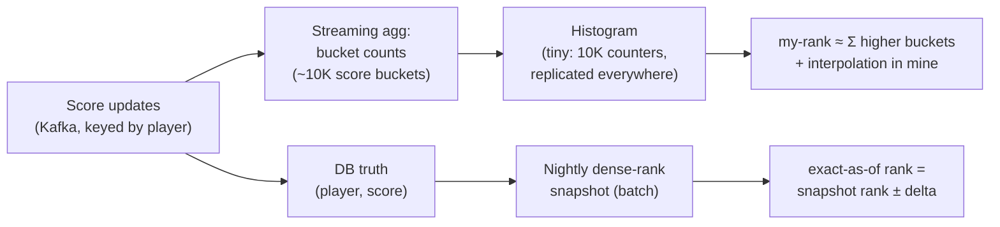

# CS-28 — Distributed Leaderboard & Ranking ("What's *my* rank?")

> **Sources:** Redis sorted-set architectures (the reference implementation) · Hello Interview's leaderboard question family · standard game-backend practice.
> **The prompt (canonical form):** *50M players earn scores continuously; show the top-100, each player's own rank, and a friends leaderboard; reset weekly.*
> **The crux in one line:** *top-N, my-rank, and my-neighbors are **three different queries with three different costs** — my-rank is a global prefix-sum that changes on every write, and the design is choosing its contract: exact-small (one sorted set), approximate-huge (bucket histogram), or exact-but-stale (snapshot + delta).*
> Companions: [CS-27](27-topk-music-analytics.md) (top-N for everyone; this note is rank-for-me) · [DD-01 Redis](01-redis.md) (sorted-set internals) · [DD-12](12-big-data-structures.md) (t-digest for percentiles) · [17 — Scaling Writes](17-pattern-scaling-writes.md) · the view-count package (monotonic-reads UX, transplanted here).

## What you'll master

- Splitting the prompt into its **three queries** and refusing to serve them from one structure.
- The **memory math that kills premature distribution**: 50M players is *one* sorted set — and saying so is the Staff move.
- The **scaling ladder** past one node: read-split → bucket-histogram approximate rank → dense-rank snapshot + live delta.
- **Rank semantics** people get wrong: ties, dense vs competition ranking, score-encoding tricks, monotonic UX.
- The **Staff/EM layer**: leaderboard integrity (cheating is the product risk), projection-not-truth ops posture, and reset mechanics.

## In the Room

| Decision | Default position | Justification |
|---|---|---|
| First move | **Name the three queries: top-N (cheap, cacheable), my-rank (global aggregate), neighbors/friends (K point reads)** | Treating my-rank like top-N is the trap the question is built around |
| Core structure | **One Redis sorted set per (board, period) + DB as truth** | 50M entries ≈ 6–8 GB, `ZRANK`/`ZADD` are `O(log N)` — a single node with replicas carries this; distribute only on evidence |
| Truth vs projection | **DB rows are truth; the ZSET is a rebuildable projection** | Losing Redis becomes a latency incident, not data loss — changes the whole ops posture |
| Score semantics | **Decide max-wins vs additive *first*** — high-score games upsert `max(old,new)`, points games increment | The two need different idempotency stories; conflating them corrupts scores under retries |
| Ties | **Composite score: `score` in high bits, `(MAX_TS − first_achieved_ts)` in low bits** | Earlier achiever ranks higher, deterministically — no "why am I below them with the same score" tickets |
| At huge scale | **Bucket histogram for approximate my-rank + periodic exact snapshot; never shard the ZSET by score range** | Prefix sums over ~10K buckets are cheap and bounded-error; score-range shards need constant rebalancing as the distribution shifts |
| Resets | **Key-per-period (`board:weekly:2026-W30`), pre-created, old keys TTL'd** | Reset = pointer swap, not a mutation storm; history stays queryable until TTL |

## 1. Three queries, three cost profiles (say this first)

| Query | Shape | Cost | Serving |
|---|---|---|---|
| Top-100 | same answer for everyone | one `ZREVRANGE`, cache it | edge/CDN-cacheable for seconds — it's [CS-27](27-topk-music-analytics.md)'s output with K=100 |
| **My rank** | different answer per player, changes on *every* write globally | `ZREVRANK` (high-score-first) = `O(log N)` on one node; a **prefix sum** anywhere else | the actual design problem — the rest of this note |
| Friends (K≈200) | K point lookups of friends' scores, sort in hand | `ZMSCORE` + client-side sort | never a server-side global structure; the social graph provides the K |

The interview's fork: candidates who reach for "shard it like any big system" have not noticed that **rank is a global aggregate** — player #4,231,882's rank depends on every other player's score. Sharding the sorted set by player-id makes top-N a scatter-gather and my-rank impossible; sharding by score range makes rank a two-shard sum but turns every score change into a potential cross-shard move and every distribution shift into a rebalance. The right first answer is refusing to distribute at all.

## 2. The ladder (climb on evidence, like [CS-25](25-flash-sale-inventory.md)'s hot row)

**Rung 1 — one sorted set (the honest default).** Memory: 50M × (~16 B member + 8 B score + ~100 B skiplist/dict overhead) ≈ **6–8 GB** — one Redis node. Throughput: `ZADD`+`ZRANK` at `O(log 50M)` ≈ 26 levels — a node does ~100K ops/s; 50M players averaging one update/minute ≈ 800K/min ≈ 13K/s. **Fits with headroom.** Read replicas serve my-rank and neighbors; top-100 is cached in front. State plainly: *"this carries us past 100M players; I'll design the next rung but not build it."*

**Rung 2 — split the reads.** Top-N from a 5-second cache (nobody can tell). My-rank from replicas (replication lag ≪ anyone's sense of rank). Writes stay on the primary. This rung is free and buys ~5× read scale.

**Rung 3 — billions of entries or multi-region: approximate + snapshot.**

- **Bucket histogram:** fix ~10K score buckets; my-rank ≈ (sum of counts in higher buckets) + interpolated position within my bucket. The histogram is a few KB — replicate it anywhere, update it from the stream, answer in `O(buckets)` with error bounded by bucket width. This is [DD-12](12-big-data-structures.md)'s philosophy (small sketch, bounded error) applied to ranking; product renders "~#4.2M" or "top 8%", which is all anyone reads at that depth anyway.
- **Snapshot + delta for exactness:** nightly batch computes dense rank for everyone (one sort — [Core 23](../Core%20Course/23-distributed-computation.md)'s bread and butter); intraday, serve `snapshot_rank` adjusted by the histogram's delta since snapshot. Exact-as-of-midnight beats approximate-now for anything money-adjacent (tournament payouts read the *snapshot*, never the live board — finality needs a timestamp).
- **Percentiles** ("top 3% this week") ride a [t-digest](12-big-data-structures.md) over the same stream.

The composed answer: **live-approximate for the UI, periodic-exact for anything that pays out** — the same exact-vs-fresh split as [CS-27 §3](27-topk-music-analytics.md), third appearance in your prep, worth saying so.

## 3. Writes, idempotency & the projection discipline

- **The DB row is truth** (`player_id, board, period, score, achieved_at`, updated transactionally with whatever gameplay event produced it); the ZSET/histogram are **projections** fed from the same event stream — rebuildable by replay, which turns "Redis died" into a runbook (`re-materialize from DB scan, ~minutes`) instead of an apology.
- **Max-wins boards:** update is `ZADD GT` (only-if-greater) — naturally idempotent, retries free. **Additive boards:** increments are *not* idempotent ⇒ event-id dedup before the projection, same at-least-once law as every counting system ([CS-23](23-exactly-once-purchase.md)'s law, third domain).
- **Hot player** (streamer updating 100×/s): coalesce in the stream (keep max / sum per key per second) before the projection — [17 — Scaling Writes](17-pattern-scaling-writes.md)' batching rung; the leaderboard needs their *current* standing, not their event history.
- **Monotonic UX:** ranks legitimately fall when others score — but never show a *stale* fall (replica flap making rank oscillate ±3 per refresh). Session high-water-mark on the client, exactly the view-count monotonic-reads trick: within a session, display rank moves smoothly toward server truth, never jitters.

## 4. Semantics people get wrong (cheap points in the room)

- **Tie-breaking is a spec decision:** composite-encode `score << 22 | (MAX_TS − achieved_at_minutes)` into the ZSET score so equal scores rank by who got there first — deterministic, no application-side second sort. Say the float caveat precisely: Redis scores are IEEE-754 doubles with a **53-bit mantissa**, so shifting the score left by 22 bits leaves only 31 bits for the score itself — a hard ceiling of **~2.1 billion (2³¹)**, above which the low bits (your timestamp *and* eventually the score) silently lose precision and ranking corrupts. Budget the split to your real max score, or drop the packing and use member-lexicographic tiebreak instead.
- **Dense vs competition ranking:** three players at score 100 — are they all #1 with the next at #2 (dense) or at #4 (competition/"1224")? Product decision, and **`ZREVRANK` gives neither directly**: it returns a player's **0-based index position** in the set, which for tied players is an *arbitrary* position within the tie group, not a shared rank. True **competition rank** = `ZCOUNT` of strictly-higher scores + 1 (all ties share the low number); **dense rank** needs distinct-score counting (e.g. a second ZSET of unique scores). Use `ZREVRANK` only when "my exact ordinal slot" is acceptable and ties needn't share a number. Ask, don't assume.
- **Resets are key swaps:** pre-create next period's key, flip a pointer at the boundary, TTL the old key after the "last week's results" window. Never `ZREMRANGE`-in-place at midnight — that's a self-inflicted thundering herd on your hottest structure, and it destroys the payout audit trail.

## 5. The Staff/EM Layer

- **Integrity is the product** (CS-27's chart-credibility point, sharpened — here players *actively attack*): scores are **server-authoritative** — computed from validated gameplay events, never accepted as client-reported numbers ("the APK is public," as the [Mobile track](../Mobile%20System%20Design/06-security-privacy.md) says). Impossible-score rules (rate-of-gain bounds, physics limits), shadow-review queue for the top of the board before payouts, and a replayable event log so #1 can be *proven* legitimate (Uber 17 — view integrity's three layers transplanted). One botted #1 with a cash prize is a support fire, a refund wave, and a community-trust incident.
- **Ops posture from the projection discipline:** the pager story for "Redis down" is *degraded latency + rebuild runbook*, not data loss; the alert that matters is **projection lag** (event stream → board), because a leaderboard 10 minutes behind *during a tournament final* is a product outage with all systems green.
- **Build-vs-buy (EM):** managed Redis (Memorystore/ElastiCache) until the histogram rung; the histogram+snapshot tier is plain stream-processing you already run ([DD-07](07-flink.md)). The thing you *never* build: a custom distributed sorted set — that's a database engine wearing a game feature's clothes.
- **Product policy is architecture here:** reset cadence (daily/weekly/seasonal) drives both engagement *and* key lifecycle; regional vs global boards decide whether you ever face the multi-region rank problem (partition by region like flash-sale stock — split it, don't replicate it); and "show exact rank" vs "show percentile band" is the difference between rung 3 and rung 1. The EM who gets product to accept "top 8%" below rank 10K has deleted a distributed system.

## The altitude table

| Probe | Senior answer | Staff answer | EM overlay |
|---|---|---|---|
| "Design it" | Redis sorted set + DB | Three-queries split; ZSET as rebuildable projection; memory math proving one node suffices | Managed Redis; the runbook and projection-lag SLO are deliverables |
| "500M players / global" | Shard Redis | Bucket histogram + snapshot-plus-delta; never score-range shards; exact only where money reads | Push product to percentile bands below the top — deletes the hard problem |
| "Same score, who's higher?" | "Timestamp?" | Composite-encoded tiebreak, double-precision caveat, dense-vs-competition named as spec | Publish the rule — tie disputes are support load |
| "Player claims rank dropped wrongly" | Check the data | Session high-water monotonic display + replica-flap explanation + restatement policy | "Rank fell" tickets are a UX metric; smooth display is cheaper than support |
| "Is #1 cheating?" | Anti-cheat team's problem | Server-authoritative scores, impossible-score rules, replayable log ⇒ provable | Payout gate = shadow review; credibility is the feature |
| "Weekly reset" | Cron that clears | Key-per-period, pre-create, pointer flip, TTL history | Reset cadence is an engagement lever owned with product, not an infra chore |

## Follow-Ups — the Interviewer Escalates

- **"Friends leaderboard for a user with 5,000 friends."** — Still point reads: `ZMSCORE` the 5K ids (pipelined, ~ms), sort in hand; cache per-user for a minute. The social graph is the index; no global structure needed. If "friends-of-friends" appears, *that's* a graph problem — renegotiate scope.
- **"Show rank on every game screen — reads 100× writes."** — Rank changes only when scores near yours change: cache own-rank with short TTL + invalidate-on-own-write; below the top ~10K render percentile bands from the histogram — nobody refreshes #4.2M expecting precision.
- **"Two updates for one player race."** — Max-wins: `ZADD GT` makes order irrelevant. Additive: dedup by event-id upstream, and the DB transition is the arbiter — same conditional-write discipline as the [flash-sale claim](25-flash-sale-inventory.md), fourth appearance.
- **"Tournament pays the top 100 cash."** — Payouts read the **frozen end-of-period snapshot** (exact, audited, from DB truth), never the live projection; freeze → shadow-review window → publish → pay. Finality needs a timestamp; live boards don't have one.
- **"Multi-region with data residency."** — Regional boards natively (partition, don't replicate — rank doesn't multi-master); the "global" board is a merge of regional *snapshots* on a schedule, labeled as such. A real-time exact global rank across regions is the push-back answer: name the cost, offer global-approximate via merged histograms.
- **"Rebuild takes 40 minutes; tournament final is now."** — Serve from the snapshot + delta path while the ZSET re-materializes (the rung-3 machinery doubles as rung-1's disaster fallback — say this when you draw it); degrade my-rank to histogram-approximate; top-100 comes from DB truth directly (one indexed query). Nothing about the incident touches truth.

---

## Interview Cheat-Sheet

**30-second architecture:** three queries split — top-N (cached `ZREVRANGE`), my-rank (`ZREVRANK` on one sorted set, replicas; competition-rank for ties = `ZCOUNT` higher + 1), friends (`ZMSCORE` point reads + local sort) · DB is truth, ZSET is a rebuildable projection fed by the event stream (dedup for additive, `ZADD GT` for max-wins) · ties via composite score encoding · resets = key-per-period pointer flip · past ~100M: bucket-histogram approximate rank + nightly dense-rank snapshot, exact only where money reads · anti-cheat: server-authoritative scores, replayable log, frozen audited snapshots for payouts.

| Probe | Answer |
|---|---|
| "Why not shard it?" | 50M entries is 6–8 GB and 13K ops/s — one node with replicas; the memory math *is* the answer |
| "A billion players?" | Histogram prefix-sum for approximate, snapshot+delta for exact-as-of; score-range sharding rejected (rebalance churn) |
| "Exact rank for everyone always?" | Costed menu: `O(log N)` on one box, else approximate-live + exact-periodic; product picks per surface |
| "Redis dies?" | Latency incident, not data loss — projection rebuilds from DB; meanwhile snapshot+delta serves |
| "Cheaters?" | Server-authoritative scores + impossible-score rules + replayable log; payouts read frozen reviewed snapshots |

**Say-verbatim:**
- *"Top-N, my-rank, and my-neighbors are three different queries with three different costs — I won't serve them from one structure."*
- *"Fifty million players is one sorted set — the Staff move here is knowing when* not *to distribute."*
- *"Rank is a prefix sum: buckets make it cheap and approximate, snapshots make it exact and stale — the product picks per surface."*
- *"The leaderboard is a projection; the database is truth — losing Redis is a latency incident, not data loss."*
