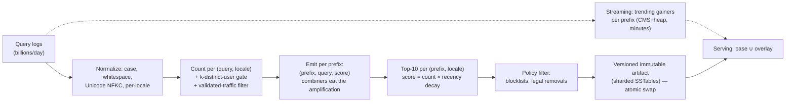

# CS-29 — Typeahead / Search Autocomplete

> **Sources:** the classic "design Google search suggest" question family · expands the 472-word sketch in [Core 07 §4.2](../Core%20Course/07-search.md) into the full worked problem.
> **The prompt (canonical form):** *as the user types, return the top-10 query completions per keystroke, p99 < 100 ms end-to-end, billions of queries/day of log volume, trending topics appear within minutes.*
> **The crux in one line:** *typeahead is **top-K per prefix, fully precomputed** — every keystroke is a point lookup against a built artifact; the design lives in the build pipeline (a [CS-27](27-topk-music-analytics.md) cube keyed by prefix), the freshness overlay, and the fact that a suggestion corpus is a **publishing surface** with policy obligations.*
> Companions: [CS-27](27-topk-music-analytics.md) (the counting machinery this reuses) · [DD-12](12-big-data-structures.md) (CMS+heap for trending) · [16 — Scaling Reads](16-pattern-scaling-reads.md) · [Core 23](../Core%20Course/23-distributed-computation.md) (the build job is MapReduce) · client half: debounce/cancel discipline from [Mobile 03](../Mobile%20System%20Design/03-networking-realtime.md).

## What you'll master

- The **inversion that defines the problem**: all computation at build time, zero at query time — and the economics that force it.
- The **prefix cube**: emit-per-prefix write amplification, top-K lists as the stored unit, storage math that stays boring.
- **Two-tier freshness**: daily exact base + streaming trending overlay — the third appearance of exact-vs-fresh in your prep, priced per tier.
- **The client as tier zero**: debounce, cancel, and per-prefix caching decide the QPS before any server exists.
- The **Staff/EM layer nobody rehearses**: corpus entry thresholds (privacy *and* anti-gaming with one mechanism), policy filtering, and the expedited-takedown path.

## In the Room

| Decision | Default position | Justification |
|---|---|---|
| Query path | **Point lookup: `prefix → precomputed top-10 list`; no computation, no fanout, ever** | A keystroke has a ~20 ms server budget; anything that "searches" at query time has already lost |
| Data structure | **The trie is a build-time concept; serving stores flattened prefix keys → top-K lists** | Sharded KV of small immutable lists beats a giant in-memory trie for ops, replication, and versioned swaps |
| Build | **Daily/weekly batch over query logs (normalize → count → per-prefix top-K → versioned artifact, atomic swap)** | Exact, replayable, and cheap — the corpus barely moves day to day |
| Freshness | **Streaming trending overlay (per-prefix top gainers, minutes) merged over the base at read** | Breaking news can't wait for the nightly build; the overlay is small and disposable |
| Client | **Debounce (~150 ms), cancel in-flight on next keystroke, cache per-prefix results for the session** | The keystroke is the QPS multiplier; tier zero of the architecture is in the app |
| Corpus entry | **A query enters the corpus only with ≥ k distinct users over a window** | One threshold buys privacy (no personal queries surface) *and* anti-gaming (one bot ≠ one voice) |
| Policy | **Blocklist/legal filtering at build time + an expedited takedown path that bypasses the build** | Suggestions are speech you publish; "next build fixes it" is not an answer legal accepts |

## 1. The economics that define the shape

Do the two multiplications out loud — they *are* the design:

- **Read side:** every search is ~15–25 keystrokes, each a potential request ⇒ suggest traffic is **~10–20× search QPS**. At that volume, per-request work must be ~zero: one point lookup of a ~1 KB immutable list, cache-friendly at every layer (server memory for the hot head, CDN for popular prefixes, client for the session).
- **Write side:** the corpus changes slowly (the top-10 for "how to " is stable for months). Recomputing *anything* per request to serve answers that change daily is burning compute at 10× search QPS to produce a constant. **Precompute converts per-keystroke cost into per-day cost** — the same economic argument as [CS-27](27-topk-music-analytics.md)'s serving store and [CS-28](28-distributed-leaderboard.md)'s snapshots, and the sentence worth saying in the room.

The head is *brutally* hot: single-character prefixes serve a huge share of first keystrokes — which is why the hot head lives pinned in serving memory and edge caches, and why the client caching matters: a user who types "we", deletes, retypes "we" should never hit the network twice ([16 — Scaling Reads](16-pattern-scaling-reads.md): the best read is the one that doesn't happen).

## 2. The build pipeline (a CS-27 cube keyed by prefix)

- **The emit step is the write amplification:** each distinct query fans out to one record per prefix (cap prefixes at ~20 chars). It's a textbook MapReduce with combiners ([Core 23](../Core%20Course/23-distributed-computation.md)); the reduce per prefix keeps a 10-element heap — nothing here is clever, which is the point.
- **Storage math (say it, it kills the fear):** ~5B distinct corpus-worthy queries × ~15 prefixes × ~30 B ≈ 2–3 TB of prefix records, collapsing to top-10 lists ≈ **hundreds of GB per locale artifact** — sharded KV territory, not exotic.
- **Scoring is counts × decay**, not raw counts — an evergreen query and last week's meme shouldn't tie. Decay constants per surface (news-ier surfaces decay faster); exactness doesn't matter here (it's a ranking signal, not a payout — contrast [CS-27 §3](27-topk-music-analytics.md)).
- **Artifacts are versioned and swapped atomically** — same discipline as every projection in your prep: a bad build rolls back by pointer flip; serving never sees a half-written corpus.

## 3. Freshness: two tiers, priced separately

- **Base:** the nightly build — exact-ish, policy-filtered, audited. A day stale and nobody notices, because the head of the distribution is static.
- **Trending overlay:** streaming job ([DD-07](07-flink.md)) tracks *gainers* — queries whose short-window rate is anomalous vs their base rate — per prefix, via CMS + heap ([DD-12](12-big-data-structures.md)); publishes a tiny overlay map (`prefix → few candidates`) every minute or two. Serving merges: overlay candidates injected into the base list with a boost, capped (never let trending displace the whole list — hijack resistance and UX stability).
- The overlay is **disposable by design**: it expires in minutes, carries lighter policy vetting (velocity + blocklist, no full audit), and its blast radius is capped by the injection limit. That asymmetry — heavyweight slow tier, lightweight fast tier with a bounded slot — is the reusable trick, and it's the third appearance of exact-vs-fresh in your prep ([CS-27](27-topk-music-analytics.md) charts, [CS-28](28-distributed-leaderboard.md) payouts). Name the pattern.

## 4. Serving & the latency budget (make the budget a table)

| Leg | Budget |
|---|---|
| Client debounce | 100–150 ms (deliberate — collapses keystroke bursts) |
| Network RTT | 20–50 ms (edge PoPs do the heavy lifting) |
| Server: lookup + merge overlay + personalize-rerank | **< 20 ms p99** |
| Render | one frame |

- Shard the artifact by prefix hash; each shard memory-maps its SSTables; hot head pinned in RAM. Replicas scale reads linearly because everything is immutable — no invalidation problem exists ([16 — Scaling Reads](16-pattern-scaling-reads.md)' dream case).
- **Failure posture: fail-empty, fast.** No suggestions is a mild UX moment; a 900 ms spinner on every keystroke is a broken product. Timeout at the client ~200 ms and render nothing — the search box still works. (Fail-open reads, the browse side of 11-consistency's posture table.)
- **Personalization is a rerank, not a corpus:** the user's own recent/frequent queries rerank (or prepend to) the *same* candidate list at the edge or on-device. Never fork the corpus per user — that's a cache-key explosion and a privacy cliff in one move. Personal history stays user-scoped ([Mobile 06](../Mobile%20System%20Design/06-security-privacy.md)'s data-class discipline).

## 5. The Staff/EM Layer

- **A suggestion corpus is a publishing surface.** Search results *find* content; suggestions *say things* next to your brand, unprompted. That's why the pipeline has: build-time blocklists (slurs, categories per market law), **legal/RTBF removals** as a maintained filter list applied every build *and* an **expedited takedown path** that patches the live artifact + overlay within minutes (a "suggest scandal" — an offensive completion next to a person's name — is a same-day press cycle, and "the nightly build will fix it" is a failed answer). Removals are audited: who, why, when, per market.
- **The k-distinct-users gate is the elegant control** — one threshold, three wins: privacy (nobody's personal query string ever surfaces), anti-gaming (a bot farm must fake k *distinct plausible users*, not k requests — raise their cost like 13-fairness), and noise floor (typos don't pollute). Validated-traffic filtering upstream (Uber 17) backs it.
- **Locale is an org decision, not a parameter:** per-locale corpora (normalization, scripts, IME romanization for CJK, market law) mean per-locale quality ownership — the EM question is who owns Hindi suggest quality, and the honest answer shapes the team, not the schema.
- **Metrics that matter:** suggestion CTR and keystrokes-saved (the product's reason to exist), coverage (% keystrokes with ≥1 suggestion), p99 per leg of the budget table, corpus age, takedown SLA. Experimentation rides the flag platform ([Core 37](../Core%20Course/37-design-feature-flags.md)) — ranking changes ship as experiments, never as builds.
- **Build-vs-buy (EM):** managed search products (Algolia/ES suggesters — [DD-06](06-elasticsearch.md)) win for product catalogs of 10⁶ items; the build case is web-scale query-log volume, trending, and policy obligations. State the crossover instead of defaulting to build.

## The altitude table

| Probe | Senior answer | Staff answer | EM overlay |
|---|---|---|---|
| "Design it" | Trie + top-K per node | Build/serve inversion: batch prefix cube → immutable sharded lists → point lookup; trie named as build-time concept only | Precompute economics (10–20× search QPS); corpus is a publishing surface with policy machinery |
| "Trending in minutes" | Smaller batches | Gainer detection overlay, bounded injection slots, disposable tier | Light-vetting risk explicitly accepted + capped; takedown SLA covers the tail |
| "p99 spikes" | Add cache | Budget table per leg; immutability makes replicas free; fail-empty at 200 ms | Latency SLO owned per leg by different teams — the budget table *is* the org contract |
| "Offensive suggestion" | Blocklist | Build-time filters + expedited live patch + audit trail; overlay vetting asymmetry | Same-day press risk; takedown SLA is a legal commitment with an on-call |
| "Personalize it" | Store user history server-side | Rerank-not-corpus; on-device/edge rerank of shared candidates | Privacy class separation; personalization never touches the shared artifact |
| "Someone games it" | Rate limit | k-distinct-users gate + validated traffic + velocity anomalies on the overlay | Gaming the box is brand damage; the gate prices the attack |

## Follow-Ups — the Interviewer Escalates

- **"User types 5 characters in 400 ms — 5 requests?"** — No: debounce collapses the burst, in-flight requests are cancelled on the next keystroke ([Mobile 03](../Mobile%20System%20Design/03-networking-realtime.md)'s discipline), and the session cache serves backspace-retype for free. The server sees ~1–2 requests for that burst; tier zero did its job.
- **"Prefix `a` — how does one key serve it?"** — It's ~1 KB, immutable for a day, identical for everyone in a locale: pinned in every replica's RAM and cached at the edge with a short TTL. The hottest key in the system is also the cheapest — because nothing is computed.
- **"CJK / Hindi input?"** — Per-locale corpora; normalize + support IME romanization (pinyin prefixes matching Chinese queries); scripts change the *build's* normalize step and the *client's* composition events, not the architecture. The real cost is per-locale quality ownership — say the org sentence.
- **"A celebrity dies; 30 seconds later?"** — Trending overlay catches the gainer within its window (minutes, not seconds — state the honest bound); if product demands seconds, that's a push-based hot-topic injection with human/automated vetting — name the price (a curated fast lane, i.e., an editorial system, not a bigger Flink job).
- **"Legal orders a removal in one hour."** — Expedited path: append to the live filter list, patch serving artifacts in place (filter-at-read for the interim), overlay purge, audit record; next build bakes it in. The design point: takedown latency is decoupled from build latency *by construction*.
- **"Why not compute top-K at query time from the search index?"** — The economics: 10–20× search QPS × a ranking computation vs a point lookup; and the corpus barely changes intraday. Query-time computation buys freshness nobody measures at a cost everybody pays. (If the interviewer pushes: that *is* the design for tiny corpora — concede the crossover, cite the buy option.)

---

## Interview Cheat-Sheet

**30-second architecture:** client tier zero (debounce ~150 ms, cancel, session cache) → edge/CDN for hot prefixes → sharded serving of **immutable versioned prefix→top-10 artifacts** (point lookup + bounded trending-overlay merge + rerank-only personalization, < 20 ms) → built daily by batch (normalize → k-distinct-gated counts × recency decay → per-prefix top-K via MapReduce+combiners → policy filter → atomic swap) → streaming gainer overlay (minutes, disposable, capped injection) → expedited takedown path bypassing the build · fail-empty fast, never spin.

| Probe | Answer |
|---|---|
| "Why precompute?" | Suggest QPS is 10–20× search QPS and the answers change daily — per-keystroke computation is burning money to produce a constant |
| "Trie or table?" | Trie is the build-time concept; serving is flattened prefix keys → small immutable lists — shardable, replicable, swappable |
| "Fresh how?" | Two tiers: daily exact base + minutes-fresh gainer overlay with capped slots — priced separately, vetted asymmetrically |
| "Privacy?" | k-distinct-users gate: personal queries never enter the corpus; personalization is a rerank on-device, never a forked corpus |
| "Bad suggestion live now?" | Expedited filter patch + audit, decoupled from the build — takedown SLA is part of the design |

**Say-verbatim:**
- *"Typeahead is top-K per prefix with all the computation at build time — the read path is a point lookup."*
- *"The keystroke is the QPS multiplier, so the client is tier zero: debounce, cancel, cache."*
- *"Base daily, trending in minutes, takedowns in an hour — three freshness lanes, three price points, one bounded merge."*
- *"A suggestion corpus is a publishing surface — the k-distinct gate, policy filters, and an expedited takedown path are the design, not PR's problem."*
