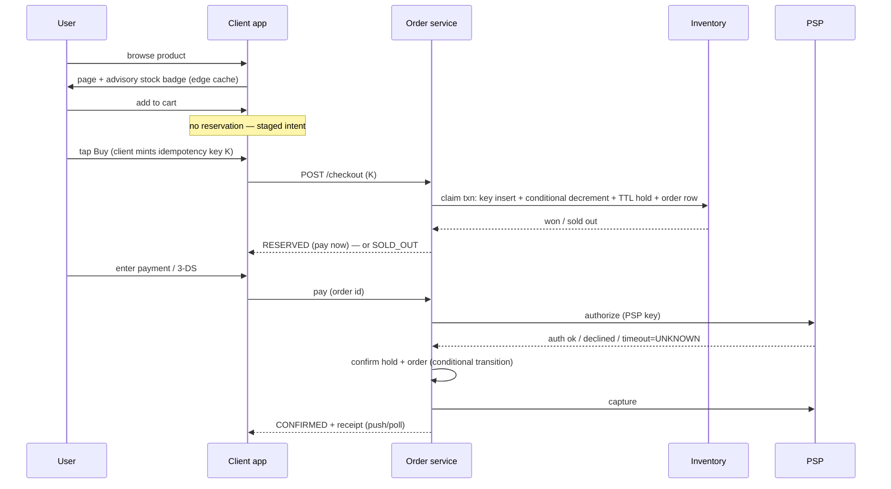
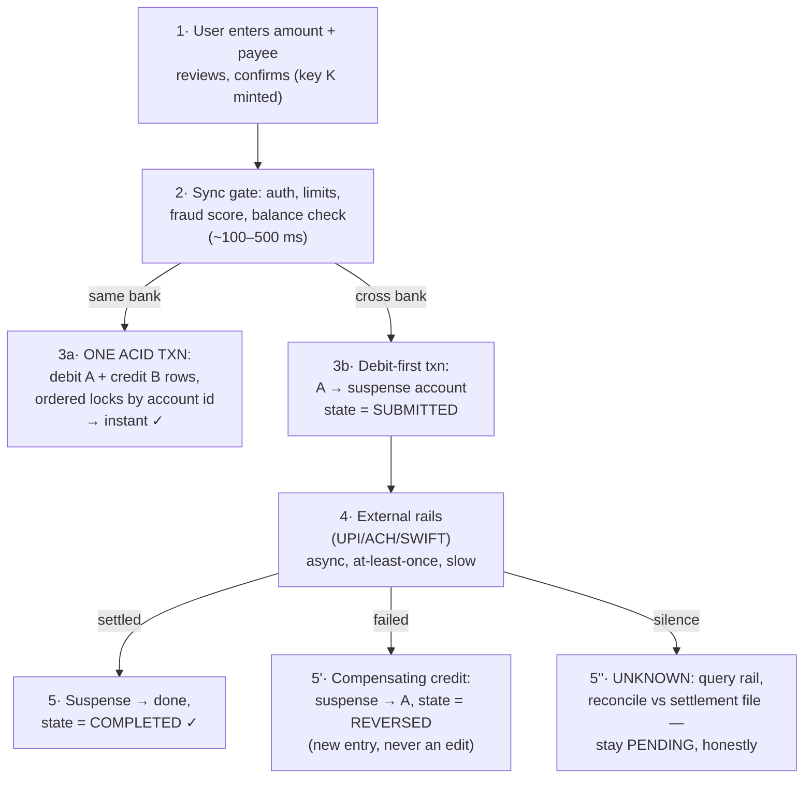

# CS-30 — The Money Path, End to End: User Journey ↔ Engineering Workflow

> **The companion walkthrough to** [CS-23 — Exactly-Once Purchase](23-exactly-once-purchase.md) · [CS-25 — Flash-Sale Inventory](25-flash-sale-inventory.md) · [CS-24 — Banking Ledger](24-banking-ledger.md). Those notes are organized by *mechanism* (idempotency, contention, ledger). This one is organized by **time**: what the user experiences at each moment, what the system does underneath it, what can go wrong right there, and which trade-off was taken. Use it to *narrate* a design — interviewers grade the story where every screen the user sees is a state the backend can prove.
> **The one-line frame:** *the UI is a projection of a state machine; every stage below is one transition, and the challenges live at the transitions, not in the boxes.*

## Journey A — Buying a product (e-commerce checkout)

### Stage 1 — Browsing: "is it in stock? what does it cost?"

| | |
|---|---|
| **User experiences** | Product page, price, an availability badge — instantly, even on sale day |
| **Technically** | Fully cached read path: CDN/edge page, stock signal as a pushed *advisory* bit/band, ≤ 2 s stale. Zero reads touch the inventory row ([CS-25 §read-shell](25-flash-sale-inventory.md)) |
| **Challenges** | 1000:1 read:write ratio; a linearizable stock count for browsers is a self-inflicted outage; a *stale AVAILABLE* creates doomed checkouts |
| **Trade-off taken** | **Fail-open, approximate reads.** Browse lies slightly and cheaply; the gate corrects it authoritatively at claim time. The one freshness worth paying for: the sold-out flip, pushed to the edge in < 1 s, because it redirects the whole crowd |

### Stage 2 — Add to cart: "I want this"

| | |
|---|---|
| **User experiences** | Item sits in the cart; UI says (honestly) "not reserved until checkout" |
| **Technically** | Cheap keyed write; **no stock hold** — the cart's real job is staging payment method/address so the buy tap is *one* request |
| **Challenges** | Users *feel* carting = claiming; if carts reserved, browsers and bots would strand the whole inventory (denial-of-inventory) |
| **Trade-off taken** | **Cart ≠ reservation** — sell-through over comfort, with honest UI. Alternative (TTL cart-holds) rejected: churns stock through non-buyers ([CS-25](25-flash-sale-inventory.md); the mock video's design, corrected) |

### Stage 3 — Tapping Buy: the request that must not double

| | |
|---|---|
| **User experiences** | One tap. Maybe a nervous second tap. Maybe the app retries on flaky Wi-Fi. They expect: one order |
| **Technically** | Client mints an **idempotency key per intent** (not per attempt) when the pay button arms; every retry carries the same key ([CS-23 §2](23-exactly-once-purchase.md)) |
| **Challenges** | The six duplicate sources (double-tap, client retry, network switch, gateway replay, refresh, outbox replay); the killer: *a retry can be repeating a success*, indistinguishably |
| **Trade-off taken** | **Identity over inference.** Dedup by key, not by heuristics like (user, item, minute). Key TTL ≥ 48 h retry horizon — a correctness parameter, not a cache knob |

### Stage 4 — The claim: win or lose in one transaction

| | |
|---|---|
| **User experiences** | < 500 ms verdict: "Reserved — complete payment in 10:00" or a definitive "Sold out" (+ waitlist offer). No spinner theater |
| **Technically** | **One ACID transaction**: idempotency-key insert (unique constraint = arbiter) + conditional decrement `WHERE stock >= qty` + TTL hold + order row + response snapshot. Rowcount 0 anywhere ⇒ rollback ⇒ clean verdict ([CS-23 §3](23-exactly-once-purchase.md) ∘ [CS-25 §2](25-flash-sale-inventory.md)) |
| **Challenges** | TOCTOU (check-then-act across statements); hot-row contention when thousands race one SKU; crash mid-claim |
| **Trade-off taken** | **Conditional write over locks/OCC** (µs critical section; no convoy, no retry-storm). Contention beyond one row's capacity → climb the ladder (Redis gate → single-writer → tokens), never shard the counter first. The atomicity choice buys: crash leaves all-or-nothing — no zombie claims. **Hold TTL = 10 min**: shorter pressures 3-DS users; longer strands stock — sized from payment p99, not vibes |

### Stage 5 — Paying: money crosses the trust boundary

| | |
|---|---|
| **User experiences** | Payment form (pre-staged from cart), maybe a 3-DS bank challenge (30–90 s), then "Processing…" — the order page owns the wait |
| **Technically** | Saga with a durable program counter in the order row: **authorize → confirm hold/order → capture**, each step a conditional state transition, each PSP call carrying *our* idempotency key ([CS-24's boundary rule](24-banking-ledger.md): inside = ACID, across = saga) |
| **Challenges** | PSP timeout = **UNKNOWN** (money may have moved); webhooks arrive late/duplicated/reordered; capture racing hold expiry; user closes the app mid-payment |
| **Trade-off taken** | **Async verdict + auth/capture split.** Sync end-to-end checkout dies under 3-DS; instead: in-band allocation verdict, async payment with pending states. Auth-then-capture makes the common failures reversible-for-free (void auth) instead of refund-shaped. UNKNOWN resolves by *query* (ours to PSP; client's to `GET /orders?key=`) — never blind resend |

### Stage 6 — The branches: decline, timeout, abandonment

| Branch | User sees | System does | Trade-off |
|---|---|---|---|
| Card declined | "Payment failed — try another card (9:12 left)" | Order → PAYMENT_FAILED, **hold still valid**; retry pays the *same* order — no re-allocation | Buyer keeps their win through a fixable failure; costs stranded-hold time |
| Client timeout | Brief "checking…" then truth | Client queries by key: found ⇒ render that state; absent ⇒ safe re-POST same key | Query-then-act is the only move safe in all three worlds (never-arrived / lost / won) |
| Walks away | Nothing — later, "your reservation expired" | TTL sweeper: conditional hold transition → stock += 1, order EXPIRED; release idempotent (sweeper vs late-cancel race safe) | Recycle loop is where the last ~20% of sell-through comes from; auth (if any) voided — money never outlives the goods claim |
| Capture races expiry | Rare "we couldn't complete — refunded" apology | Hold's conditional transition is the arbiter; loser compensates (late confirm ⇒ void/refund; fixed toward buyer-safe) | Never confirm an expired hold — that's how recycled units oversell |

### Stage 7 — After: the promise keeps itself

| | |
|---|---|
| **User experiences** | Confirmation, email, shipping updates; a refund that "just works" if support intervenes |
| **Technically** | Order CONFIRMED + outbox event in the same txn → Kafka → fulfillment/email (at-least-once + dedup). Refunds = compensating entries, never row edits. **Reconciliation** (orders × PSP statement × events) auto-heals mismatches < 1 h |
| **Challenges** | Publish-vs-commit gap (solved by outbox); silent drift between our books and the PSP's |
| **Trade-off taken** | Reconciliation is a *staffed backstop*, not the mechanism: prevention by construction, detection by three-way match — "a backstop that quietly mops up teaches the system to leak," so every auto-fix is also a paged defect |

**Flash-sale overlay (when N ≫ S):** insert a stage between 2 and 3 — the **waiting room** (signed queue token, random draw over an arrival window, paced admission ~20K/s). The user sees an honest queue position; the engineering effect is that stages 4–5 never see the raw spike, which is what lets every rung below stay simple ([CS-25 §ladder](25-flash-sale-inventory.md), full package in Supplementary).

---

## Journey B — Sending money (bank transfer)

### Stage 1 — Intent: "send ₹10,000 to Priya"

| | |
|---|---|
| **User experiences** | Enter amount + payee → review screen → confirm (biometric). Two-phase *UI* on purpose — no accidental sends |
| **Technically** | Client mints the idempotency key at *confirm*; the review screen shows exactly what the server will execute (amount, payee, fees) — the request is a signed statement of intent |
| **Challenges** | Fat-fingered duplicates ("did it go through?" → tap again); stale payee data |
| **Trade-off taken** | Same identity-over-inference call as retail ([CS-23](23-exactly-once-purchase.md)) — but here a duplicate isn't a support ticket, it's a regulatory incident, so the key is non-negotiable at *any* scale |

### Stage 2 — The synchronous gate: can this transfer exist?

| | |
|---|---|
| **User experiences** | ~Half a second of "verifying," or an immediate, specific no ("exceeds daily limit") |
| **Technically** | Auth, per-account/day limits, sanctions screening, fraud score, and an *advisory* balance check — all read-only, all before any money state changes |
| **Challenges** | Fraud models want time and features; users want instant; the balance check here is advisory (the authoritative check is the debit's conditional write — same TOCTOU discipline as stock) |
| **Trade-off taken** | **Cheap checks sync, expensive checks tiered**: low-risk transfers pass on the fast path; high-score ones step up (OTP, delay, review queue). Latency is spent on risk only where risk lives — a fraud model on every ₹50 UPI ping is how you lose the product |

### Stage 3 — The money moves (or starts to): one boundary vs two

| | |
|---|---|
| **User experiences** | Same-bank: **instant** ✓ — balances update before the success animation ends. Cross-bank: "Submitted — usually takes minutes/hours" with a live status |
| **Technically** | **Same bank = one trust boundary = one ACID transaction**: append debit + credit entries (double-entry: they *are* one atom), locks taken in **sorted account-id order** (deadlock-free), balance = derived. **Cross-bank = two boundaries = saga**: debit A → **suspense account** first, *then* submit to the rail. The suspense account makes "money in flight" a first-class ledger location — every rupee has an address at every instant ([CS-24](24-banking-ledger.md)) |
| **Challenges** | Concurrent debits racing the balance (serialize debits — conditional `WHERE balance >= amt`; credits commute, no lock needed); the rail is slow, at-least-once, and occasionally silent |
| **Trade-off taken** | **Debit-first, always**: fail toward *holding* the user's money (refundable, visible) and never toward minting it (credit-first + failed debit = money from nothing). The user-experience cost — "why is it deducted but not delivered?" — is answered with *honest states*, not by reordering the ledger |

### Stage 4 — In flight: the rail has it

| | |
|---|---|
| **User experiences** | "Processing" with a truthful ETA; balance already reflects the debit (correct — and communicated as "in transit") |
| **Technically** | Transfer row is the saga's program counter (SUBMITTED → rail-acked → SETTLED); the rail call carries our reference id (their dedup); status webhooks/files are idempotent, state-machine-gated |
| **Challenges** | Rails answer in minutes-to-days (ACH/SWIFT) or seconds (UPI/IMPS); silence ≠ failure; duplicate submissions at the rail are *our* double-spend |
| **Trade-off taken** | **Pending is a product surface, not an embarrassment.** The alternative — optimistic "Done!" before settlement — manufactures reversals, the most expensive UX in banking. Show state truthfully; notify on transitions |

### Stage 5 — Resolution: settled, failed, or silent

| Branch | User sees | System does | Trade-off |
|---|---|---|---|
| Settled | ✓ + notification | Suspense → cleared, COMPLETED entry; books balance by construction | — |
| Rail rejects (bad account, closed) | "Returned — money back in your account" | **Compensating credit** suspense → A, state REVERSED — a *new* entry; history immutable | Corrections as reversing entries, never edits — the audit trail *is* the product ([CS-24](24-banking-ledger.md)) |
| Silence past SLA | Still "processing," now with support visibility | Query the rail by our reference; **reconcile against the daily settlement file**; suspense account's non-zero aging balance is itself the alarm | Stay honestly PENDING rather than guess — with money, an UNKNOWN closed optimistically is a lie with interest |
| User demands "cancel" | Cancel if pre-submission; else "will return if it fails" | Pre-rail: compensate now. Post-rail: you can't unsend — only await outcome or issue a recall request | The honest no beats the comforting maybe |

### Stage 6 — Living with the record

| | |
|---|---|
| **User experiences** | Balance and statement that always agree, everywhere, forever (support sees the same numbers) |
| **Technically** | Balances derived from the append-only ledger (cached materializations, rebuildable); statements read replicas with read-your-writes for the actor; every entry traceable to a transfer id; **continuous + end-of-day reconciliation** (internal ledger × rail statements) with suspense-aging dashboards |
| **Challenges** | Materialized balance drift vs ledger truth; replica lag showing a user their own transfer "missing" |
| **Trade-off taken** | **Append-only + derived** over update-in-place: costlier reads (mitigated by snapshots), but corrections, audits, and disputes become *queries over history* instead of forensics. Read-your-writes scoped to the actor — the same session-pinning trick as everywhere else |

---

## The one table to remember (both journeys compressed)

| Stage kind | User-facing rule | Engineering rule | The recurring trade-off |
|---|---|---|---|
| Browse/compose | Instant, slightly stale, honest labels | Fail-open reads, pushed invalidation | Freshness bought only where it changes behavior |
| Commit point | One fast, definitive verdict | **One atomic claim** (key + conditional write + state row) | Serialize the invariant, keep everything else off the hot path |
| Money movement | Truthful pending states | Saga with durable program counter; debit/auth first; idempotent external calls | Reversible steps before irreversible; UNKNOWN → query, never guess |
| Failure branches | Specific, actionable messages; never a silent maybe | Conditional transitions arbitrate races; compensations pre-written | Fail toward holding money visibly, never toward minting/losing it |
| Aftermath | It just stays correct | Outbox events, append-only history, staffed reconciliation | Prevention by construction; detection as backstop; every auto-fix pages |

**Say-verbatim:**
- *"Every screen the user sees is a state the backend can prove — the UI is a projection of the order/transfer state machine, and the challenges all live at the transitions."*
- *"The commit point is one atomic claim; before it everything is cheap and stale, after it everything is idempotent and asynchronous."*
- *"Cross the trust boundary and the transaction becomes a saga: debit first, suspense as the address of in-flight money, compensations pre-written."*
- *"Pending is a product surface — with money, the honest 'processing' beats the optimistic 'done' every single time."*
