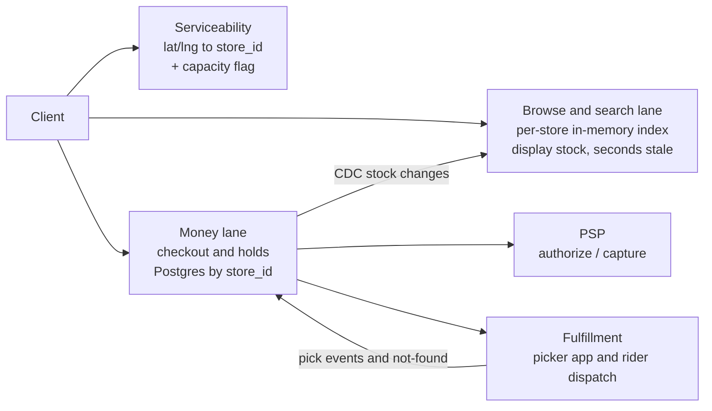
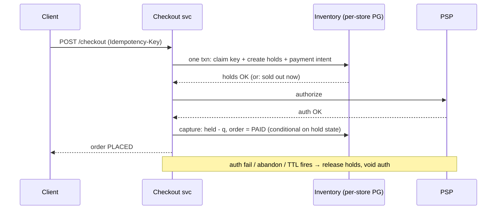

# CS-31 — Quick Commerce: The Dark-Store Backend

> **Sources:** composed from [CS-25 — Flash-Sale Inventory](25-flash-sale-inventory.md), [CS-23 — Exactly-Once Purchase](23-exactly-once-purchase.md), [Core 29 — Geospatial](../Core%20Course/29-geospatial-systems.md), [18c — Marketplace & Money](../Core%20Course/18c-design-marketplace-money.md). Prompt shape: "Design Blinkit / Zepto / Instamart — search nearby dark stores, cart, pay, delivery in 10–15 minutes, never oversell."
> **Pairs with:** [CS-30 — Money-Path Journeys](30-money-path-journeys.md) (the checkout timeline), [DD-16 — Scaling Reads](16-pattern-scaling-reads.md).

A very likely prompt in India-based loops: local color (dark stores, 10-minute delivery) over standard machinery. The whole game is recognizing which parts are standard, which numbers are small, and which two traps are planted.

---

## What you'll master

- The **decisive framing**: the dark store is the natural shard — resolve *user → store* once, and 500 stores turn every hard problem into 500 small independent ones.
- The **BOTEC inversion**: 20K RPS is browse; orders are <1/sec/store; a whole store's catalog is ~20 MB. Know when **not** to distribute.
- **Serviceability as admission control** — geofence (point-in-polygon, *not* proximity) plus capacity-aware eligibility: the 10-minute SLA is defended at the front door.
- The **cart trap**: hold at *proceed-to-checkout* with a TTL — never at add-to-cart, never nothing. Cart ≠ reservation.
- The **checkout saga** with idempotency keys and the payment-after-expiry policy fork.
- The quick-commerce twist no other note has: **the shelf is the truth** — the picker is a second writer, and "never oversell" against a physical shelf is a buffer plus a compensation path, not a WHERE clause.

## In the Room

**Recognize the prompt:** "nearby stores" + "under N ms search" + "simultaneous purchase" + "minutes between cart and payment" = geospatial scoping + read scaling + inventory contention + hold lifetime. Four solved problems wearing one costume.

**The decisive move (say it in the first two minutes):** *"The dark store is the natural shard. Every query — search, availability, inventory, ordering — is scoped to exactly one of 500 stores. If I resolve user → store once per session, the system decomposes into 500 small, independent problems. Let me size how small."*

| Decision | Choice | One-line why |
|---|---|---|
| User → store resolution | Geofence polygon + capacity flag, once per session, re-checked at checkout | Serviceability is admission control for the SLA, not a nearest-neighbor query |
| Search | Per-store in-memory index (~20 MB/store), display stock via CDC, seconds stale | Fail-open browse; 100 ms is easy when the corpus is 10K SKUs |
| Inventory truth | Postgres row per (store, SKU); conditional `UPDATE … WHERE available >= q` | <1 order/sec/store — a WHERE clause, not a pipeline |
| Reservation point | TTL hold (~5 min) created at *proceed-to-checkout* | Cart is a wishlist; holds at add-to-cart starve real buyers |
| Payment | Saga: claim + intent (one txn, idempotency key) → authorize → capture+commit | At-least-once callbacks are a law; replay the receipt |
| Shelf vs DB drift | Safety buffer on display + picker-driven decrement + substitution branch | The DB is a projection of a shelf; price the tail, don't deny it |

**Experience hook (real-time chat platform):** same shape as region-scoped chat traffic — once a tenant is pinned to a region, everything downstream is small and local; the hard part was always the *pinning decision and its re-check*, not the scoped work.

---

## 1. Requirements and the two planted traps

**Functional:** see only products in your nearest *eligible* dark store; search < 100 ms; concurrent purchases of the same SKU; once payment succeeds, quantity never exceeds available inventory; minutes may pass between cart and payment.

**Non-functional split that drives the architecture:**

- **Browse is fail-open.** Display stock a few seconds stale is fine; a browse outage must never take checkout down with it.
- **Money is fail-closed.** The conditional decrement is the truth; no cache sits on the write path.
- Search p99 < 100 ms; propagation of a sold-out signal to browse in seconds; availability of browse > availability of checkout (degrade in that order).

**Trap 1 — "several minutes between cart and payment":** the interviewer is asking *when do you reserve stock?* (§4).
**Trap 2 — "20,000 requests per second":** the interviewer is checking whether you notice it's almost all reads (§2).

> **Staff-level insight:** the requirement says "never oversell" as if it were one invariant. It's two: never oversell *the database* (achievable — atomic conditional write) and never oversell *the shelf* (not fully achievable — physical drift exists; you buffer and compensate). Naming that split early is the strongest single signal in this prompt.

## 2. BOTEC — the numbers invert the problem

| Quantity | Estimate | So what |
|---|---|---|
| Peak traffic | 20K RPS | ~99% browse/search (commerce read:write ≈ 100:1) → cache problem |
| Orders | 5M DAU × ~20% conversion ≈ 1M/day ≈ 12/sec avg, ~60–100/sec peak | Across 500 stores → **<1 order every few seconds per store** |
| Contention unit | one (store, SKU) row | At that write rate: plain conditional write, no ladder needed |
| Store catalog | ~10K SKUs × ~2 KB ≈ **20 MB** | Entire store fits in one cache node's memory; all 500 ≈ 10 GB |
| Inventory table | 500 × 10K = 5M rows | One Postgres could hold everything; shard for isolation, not throughput |

**Say verbatim:** *"This is a read-scaling problem wearing an inventory-contention costume — and the contention is tiny because the store is the shard. I know when not to distribute: I will not build a Kafka-fed single-writer inventory pipeline for one order per store per few seconds. The flash-sale ladder ([CS-25](25-flash-sale-inventory.md)) stays in the toolbox for a festival promo SKU; the default is a WHERE clause."*

## 3. High-level architecture — three lanes



- **Serviceability service** — 500 geofence polygons in memory everywhere; returns `store_id` or "not serviceable"; result pinned to the session and re-checked at checkout.
- **Browse/search lane** — the 20K RPS. Per-store index in Redis/in-process, sharded by `store_id`; display stock is a CDC-fed projection of the inventory table. Fail-open.
- **Money lane** — the ~100 writes/sec. Postgres sharded by `store_id` (≈10 physical nodes; sharding buys blast-radius isolation). All stock movements are conditional writes. Fail-closed.
- **Fulfillment boundary** — orders feed the picker queue; pick events flow *back* as a second writer (§6).

**APIs (the contract that matters):**

```
GET  /serviceability?lat,lng            → store_id | not_serviceable  (once/session)
GET  /stores/{id}/search?q=milk         → SKUs + display stock        (<100 ms)
POST /carts/{id}/items                  → no inventory effect
POST /checkout  {cart, Idempotency-Key} → holds + intent (one txn)
POST /payments/confirm                  → capture → order PLACED
```

## 4. Deep dive A — serviceability is admission control

Two things distinguish this from the [Core 29](../Core%20Course/29-geospatial-systems.md) proximity toolkit:

**1. The query shape is point-in-polygon, not nearest-neighbor.** "Which store's delivery zone contains this point?" — 500 hand-drawn polygons (drawn around rider travel time, rivers, highways — not radii). At 500 polygons, brute-force point-in-polygon over all of them is microseconds; an R-tree or S2 cover is an optimization you *name*, not build. Nearest-store-by-distance is wrong: the nearest store across a river may be 25 minutes away.

**2. Eligible = in-zone AND has capacity.** A store drowning in orders (picker backlog, no riders) flips itself `eligible=false`; users get the next covering store or "unavailable."

> **Staff-level insight:** the 10–15 minute promise is defended *at the front door, by admission control* — not in the delivery leg by heroic routing. Same shape as [DD-22 — Rate Limiting](22-rate-limiting.md): protect the SLA by refusing work you can't do in time, and degrade honestly ("back at 7 pm") rather than silently breaking the promise. Load-shedding by shrinking the serviceable map is a *product* decision made by an *engineering* signal — flag it as a cross-team contract.

Pin the resolved `store_id` to the session (prices, stock, cart all scoped to it). Re-check at checkout — the user may have moved, the store may have flipped ineligible. A store change invalidates the cart's store-scoped lines; surface it, don't silently re-price.

## 5. Deep dive B — search under 100 ms (and why it's the easy part)

Per-store corpus is 10K–30K SKUs — this is *not* web search:

- **Index:** per-store inverted index + prefix table for typeahead, in memory on search nodes, sharded by `store_id`. 20 MB × replicas is nothing. Rebuild from catalog on deploy; typo tolerance via a small Elasticsearch cluster if product insists — even then each query hits one tiny store-scoped shard.
- **Availability filtering:** search returns SKUs + **display stock** from the CDC-fed projection — seconds stale, deliberately. Never join search against the inventory primary; browse must not touch the money lane.
- **Budget:** gateway 5 ms + search node 10–20 ms (in-memory) + stock overlay 1 ms (same node) — p99 well under 100 ms. The tail risk is cold cache after deploy → warm indexes before taking traffic.

Staleness is self-correcting: a user who taps a just-sold-out item hits the conditional claim at checkout and gets an honest "sold out" — the display lied for seconds, the money path never lies. ([DD-16](16-pattern-scaling-reads.md): cache is a projection, truth lives at the write path.)

## 6. Deep dive C — the cart trap: when do you reserve?

*"Customers may spend several minutes between adding items and completing payment."* The fork, made explicit:

| Option | What happens | Verdict |
|---|---|---|
| Hold at add-to-cart | ~80% of carts never convert; their holds starve real buyers. Dark stores carry 5–20 units/SKU — hostage-taking is fatal at this stock depth | ❌ |
| No hold; check only at payment | Users pay for vanished items → refund storms, worst possible UX | ❌ |
| **Hold at proceed-to-checkout, TTL ≈ 5 min** | Cart stays a wishlist; the hold spans exactly the payment window | ✅ |

The hold is the [CS-25](25-flash-sale-inventory.md) primitive, store-scoped:

```sql
UPDATE store_inventory
SET    available = available - :q, held = held + :q
WHERE  store_id = :s AND sku = :k AND available >= :q;
-- 0 rows updated = sold out: tell the user NOW, at checkout — not after payment
```

**Never undersell either:** expiry must return units exactly once. Sweeper + `expires_at` on the hold row; release is itself conditional (`WHERE state = 'HELD'`) so a race between sweeper, user cancel, and capture settles by state machine, not by luck. Never trust the client to release.

> **Staff-level insight:** the TTL length is not an engineering constant — it's stock liquidity traded against conversion, and it's *A/B-testable*. Saying "5 minutes, and I'd hand that dial to product with an experiment" turns a magic number into a managed decision. (EM framing: the dial has an owner.)

## 7. Deep dive D — checkout saga: pay without overselling



- **Idempotency is a law** ([CS-23](23-exactly-once-purchase.md)): key claimed in the same transaction as the holds and intent; every retry — client, gateway, PSP callback — replays the stored receipt, never re-executes. PSP webhooks are at-least-once; dedup by `payment_intent_id`.
- **Order state machine** (`PLACED → PICKING → PACKED → DISPATCHED → DELIVERED`, plus `SUBSTITUTED / REFUNDED` branches) is the shared contract with fulfillment — transitions are conditional writes, same primitive again.

**The edge to volunteer before they ask — payment succeeds after the hold expired** (slow 3-DS redirect, PSP retry an hour later):

1. Prevent: extend the hold when the PSP redirect starts.
2. Absorb: at capture, attempt a *fresh* conditional claim — if stock exists, commit anyway.
3. Compensate: if not, **auto-refund + apology credit**. An invariant violation becomes a costed policy with an owner.

This is the [CS-30](30-money-path-journeys.md) Journey-A aftermath stage in miniature: the system never promises what it can't check; it prices the tail.

## 8. Deep dive E — the shelf is the truth (the quick-commerce twist)

Everything above treats the database as ground truth. In a dark store it's a **projection of a physical shelf**: shrinkage, misplaced items, a picker grabbing the last yogurt the DB counts as 2.

- **The picker app is a second writer.** Pick events decrement committed stock; **"item not found at picking"** triggers the substitution/refund branch of the order saga — a compensation path that *must exist* because no WHERE clause sees the shelf.
- **Safety buffer:** display `available - k` for fast movers (k ≈ 1–2), so DB-vs-shelf drift eats the buffer, not the promise. Buffer size is again a priced dial: withheld sellable units vs not-found incidents.
- **Reconciliation:** nightly cycle counts (and on every not-found event) snap the projection back to the shelf — the [CS-24](24-banking-ledger.md) reconciliation instinct applied to atoms instead of money.

> **Staff-level insight:** "never oversell" against the database is a conditional write; against the shelf it's `buffer + compensation path + reconciliation loop`. Engineering doesn't chase zero — it measures **not-found rate** as a cost line and tunes the buffer. Candidates who claim the WHERE clause alone solves quick-commerce inventory have never met a shelf.

## 9. Failure drills — volunteer two

| Failure | Blast radius | Behavior |
|---|---|---|
| Search cache / Redis down | Browse degrades | Fall back to DB reads with tight timeouts; worst case browse is down, **checkout still works** — money lane has no cache dependency |
| One store's PG shard down | 1/500 of business | Store flips unserviceable; users rerouted or told honestly. This is what sharding bought: isolation, not throughput |
| Store overloaded (pickers/riders) | That store | Serviceability flips `eligible=false` — admission control defends the SLA (§4) |
| PSP slow/down | Checkout | Holds keep ticking; TTL bounds the damage; queue-and-retry authorize within the hold window; degrade to COD if product allows |
| CDC lag (stale display stock) | Cosmetic | Conditional claim catches it at checkout; alert on lag > tens of seconds |
| Hold sweeper dies | Phantom "sold out" | Stock trapped in `held` — alert on held-age p99; sweeper is idempotent so restart is safe |

**Fail-open browse, fail-closed money — and neither lane can take the other down.**

## 10. The Staff & EM layer

- **Teams cut on the architecture's seams:** catalog/search (fail-open culture, latency SLOs) · inventory+checkout (fail-closed culture, correctness SLOs, PSP on-call) · fulfillment/serviceability (the physical-world boundary). The order state machine and the idempotency contract are *published interfaces* between them — versioned, not renegotiated per incident.
- **Manage by cost lines, not absolutes:** oversell/not-found rate × (refund + goodwill credit) traded against buffer size; hold TTL traded against conversion; serviceable-map shrinkage traded against demand. Each dial has an owner and an experiment.
- **The SLO split is organizational**: browse teams page on latency, money teams page on correctness (a failed conditional write is *working as intended*; a double-charge is a sev-1). Putting both cultures in one team produces the wrong instincts in both directions.

## Altitude table — same probe, three answers

| Probe | Senior | Staff | EM |
|---|---|---|---|
| "Prevent overselling?" | Row lock / conditional decrement | Conditional write + TTL hold at checkout + the DB-vs-shelf split, buffer + compensation | Oversell rate as a cost line with an owner and a dashboard |
| "Search in 100 ms?" | Cache + Elasticsearch | Store-scoped 20 MB in-memory index; display stock as CDC projection; fail-open | Latency SLO owned by browse team; cold-cache deploy runbook |
| "20K RPS?" | Horizontal scaling, LB | It's 99% reads; writes are <1/sec/store — know when not to distribute | Capacity model per store; festival surge = pre-scale browse only |
| "Cart for minutes?" | Reserve with timeout | Hold at proceed-to-checkout, not add-to-cart; TTL as an A/B-able dial | Conversion-vs-liquidity experiment; product owns the dial |
| "10-min delivery?" | Fast rider assignment | Admission control at serviceability; capacity-aware eligibility | Promise-keeping metric; map-shrinkage as a cross-team contract |

## Follow-ups — the interviewer escalates

1. **"A festival flash SKU — 50K people want one phone at one store."** Now the CS-25 ladder earns its keep: Redis atomic gate in front of that row → pre-minted tokens for the extreme case. The default path stays a WHERE clause; the ladder is per-SKU opt-in.
2. **"Item in cart is available at store A but user walks into store B's zone."** Re-run serviceability at checkout; cart lines are store-scoped — re-validate, surface diffs (price/stock), never silently swap. Multi-store split of one order: refuse (two riders, broken SLA) unless product explicitly buys it.
3. **"Two units left, three concurrent checkouts?"** Three conditional claims serialize on the row; third gets 0-rows-updated → honest sold-out at checkout, before money moves. Latency of serialization at <1/sec/store: irrelevant.
4. **"PSP callback arrives twice / after refund?"** Idempotency by `payment_intent_id`; state machine rejects illegal transitions; reconciliation job (CS-24 instinct) diffs PSP ledger vs orders nightly.
5. **"How do substitutions work?"** Picker flags not-found → user gets substitute-or-refund choice with a short reply window → default policy per category (substitute staples, refund electronics) → compensation entries, never mutation of the paid amount ([CS-24](24-banking-ledger.md) append-only instinct).
6. **"Why not one national inventory service?"** Because store-scoping *is* the design: a national service reintroduces the coordination the shard structure eliminated. Cross-store visibility is an analytics/rebalancing concern — batch, offline, not on the order path.

## Interview Cheat-Sheet

**One-liners**

- "The dark store is the natural shard — resolve user → store once, and 500 stores make every hard problem small."
- "This is a read-scaling problem wearing an inventory-contention costume."
- "Cart ≠ reservation: hold at proceed-to-checkout with a TTL, never at add-to-cart, never nothing."
- "Serviceability is admission control — the 10-minute promise is defended at the front door."
- "Never oversell the DB: a WHERE clause. Never oversell the shelf: a buffer plus a compensation path."
- "Fail-open browse, fail-closed money — and neither lane can take the other down."

**Numbers:** 20K RPS ≈ 99% reads · 1M orders/day ≈ 100/sec peak ≈ <1/sec/store · 20 MB per store catalog, 10 GB all-in · 5M inventory rows total · hold TTL ≈ 5 min (A/B the dial) · safety buffer k ≈ 1–2 on fast movers.

**The four probes, pre-answered:** overselling → §6/§7 conditional claim + saga; slow cart → §6 hold-at-checkout; 100 ms search → §5 store-scoped memory index; shelf drift → §8 buffer + substitution + reconciliation.

**Say verbatim (close):** *"Resolve user → store once and everything downstream is small: search is a 20 MB index, contention is one conditional write per store per second, overselling is a WHERE clause plus a TTL hold at checkout. The irreducible bits are the payment-after-expiry edge and the fact that the shelf, not the database, is the truth — both handled with priced compensation paths, each with an owner."*
