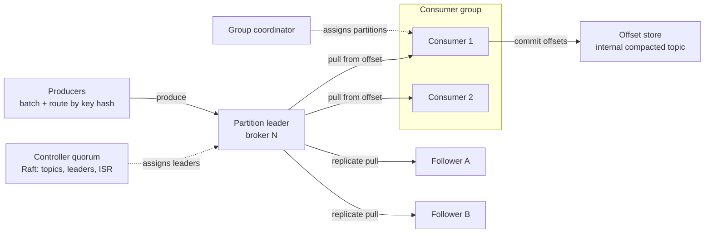
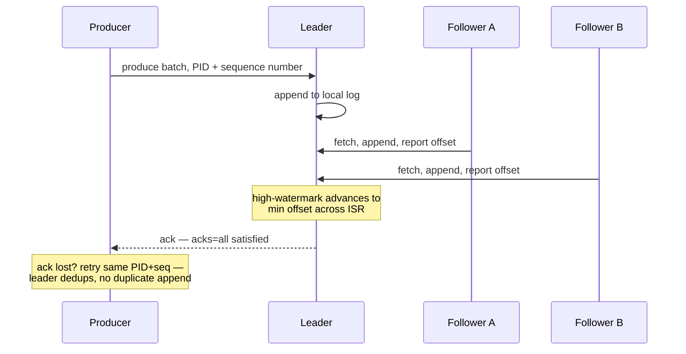

# 32 — Design a Distributed Message Queue (Build It, Don't Name It)

> **Sources:** Composed on [Core 04 — Messaging](../Core%20Course/04-messaging-event-driven.md), [Core 21 §3–4 — Build From Scratch](../Core%20Course/21-build-from-scratch.md), and [DD-02 — Kafka](02-kafka.md); the guided Senior-level walkthrough is Grokking *Modern System Design* ch. 17 (sibling folder) — this note is the Staff/EM elevation of it. Hands-on twin: `Supplementary/Kafka/` lab stages 1–4.
>
> **The prompt:** *"Design a distributed message queue — producers publish, consumers subscribe, messages survive failures. Don't say Kafka. Build it."* A Google infra-round classic: they name the primitive, you derive the internals.

## What you'll master

- The **crux decision** the whole design hangs on: per-message state (a mailbox) vs an **append-only log** (a cursor) — and why at scale you build the log.
- Why a log-based broker is fast: **sequential IO + page cache + zero-copy**, and why durability comes from **replication, not fsync**.
- The replication contract: leader/followers, **ISR, high-watermark, acks**, and the one dial that trades availability for durability.
- Consumer groups as **cursors**: pull vs push, rebalancing, commit timing — and how at-least-once falls out of the design rather than being a feature.
- The Staff & EM layer: SLOs for a queue platform, the retention cost line, multi-tenancy quotas, and who owns what.

## In the Room — the decisive move

Say this in the first five minutes, before any boxes:

> *"The fork in this design is where per-message state lives. A mailbox-style broker — SQS, RabbitMQ — tracks status per message: visible, in-flight, acked. Rich semantics, but at a million messages a second that state is the bottleneck. A log-style broker stores an immutable ordered log and reduces every consumer to one integer — an offset. Replay is free, fan-out is free, and the disk only ever does sequential writes. I'm building the log; queue semantics become a view the consumer layer provides."*

### Decisions to make decisively

| Decision | Choice | Because |
|---|---|---|
| Storage model | Append-only partitioned log | Per-message state collapses to one cursor per group; sequential IO; replay and fan-out are free |
| Delivery floor | At-least-once, idempotent consumers | Exactly-once delivery is impossible; process-then-commit is the correct default |
| Durability | Replication factor 3, `acks=all`, high-watermark | Survives broker loss without fsync-per-message; durability from copies, not disks |
| Consumption | Pull, not push | Backpressure becomes observable lag instead of overwhelmed consumers |
| Ordering | Per-partition only, key-routed | Global order caps throughput at one partition; per-entity order is the real requirement |
| Metadata | Small Raft quorum (controller) | Leader assignment and membership need consensus; data path does not |

**Experience hook.** *"Our chat pipeline is exactly this shape — every conversation is a keyed stream, per-room ordering matters, cross-room ordering doesn't. I've lived what happens when a poison event blocks a partition of rooms: skip-to-DLT with an alarm isn't hygiene, it's availability."*

---

## 1. Requirements — scope it like Staff

**Functional.**
- `publish(topic, key, message)` — durable once acknowledged.
- Subscribe with **consumer groups**: within a group, partitions are divided (competing consumers); separate groups each get the full stream (fan-out).
- Explicit commit/ack; **replay** from a chosen offset; retention of 7 days.

**Non-functional.**
- Scale target: **1M messages/sec peak**, ~1 KB average, ~10K topics, average fan-out 3 groups.
- **No acknowledged message is ever lost** (survive loss of any single broker; state the RF trade-off).
- Publish p99 **< 20 ms**; end-to-end delivery typically < 200 ms (lag, not latency, is the consumer-side metric).
- Ordering **per key**, not global.

**Declared non-goals (say them out loud):** transactions/exactly-once processing, delayed/scheduled delivery, priority queues, geo-replication — each is a follow-up, and naming them as cuts is the scoping signal.

> **Staff-level insight:** The requirements trap is the word "queue." Ask immediately: *do consumers compete or does every subscriber need every message, and does anyone need replay?* If the answer includes replay or multi-subscriber, a mailbox model is already dead — the requirement chose the log for you. Surface that causality; don't just pick an architecture.

## 2. Back-of-envelope — let the numbers pick the bottleneck

| Quantity | Math | Result |
|---|---|---|
| Ingest | 1M msg/s × 1 KB | **1 GB/s** in |
| Replicated write volume | × RF 3 | 3 GB/s to disks |
| Egress | × 3 consumer groups | 3 GB/s out (mostly page-cache reads) |
| Stored, 7 days | 1 GB/s × 604800 s × RF 3 | **~1.8 PB** |
| Per-broker ceiling | 10 Gbps NIC ≈ 1.25 GB/s; sequential disk ~200–500 MB/s | **network-bound before disk-bound** |
| Fleet | ingest+replication+egress ÷ per-broker budget | **~50–100 brokers** |
| Partitions (hot topic) | keep ≤ ~50 MB/s per partition | dozens per big topic; over-provision ~2× for ordering stability |

Two conclusions to speak: the system is **network-bound, not disk-bound** — sequential logs make disks nearly free; and **retention is the dominant cost line** — 7 days ≈ 1.8 PB, so retention days and RF are business decisions, not defaults.

## 3. High-level design

- **Topic = N partitions; partition = a replicated append-only log.** Publishing appends to the partition chosen by `hash(key) % N` — the key is the ordering contract.
- **Brokers** own partitions as leader or follower. All produce/consume traffic goes to leaders; followers replicate by pulling, like ordinary consumers.
- **Controller** — a small Raft quorum — owns metadata only: topic configs, leader assignment, ISR membership, broker liveness. Consensus on the metadata path, never on the data path: that's why the data plane scales linearly.
- **Consumers pull.** A group coordinator assigns each partition to exactly one consumer in the group; each group's progress is one committed offset per partition, stored in an internal topic.

## 4. Deep dive A — the partition on disk (why it's fast)

A partition is a directory of **segment files** (~1 GB each) plus a sparse index mapping offset → byte position. Writes only ever append to the active segment; reads at an offset are a binary search in the index then a sequential scan.

- **Sequential IO**: appends and mostly-tail reads mean even spinning disks deliver hundreds of MB/s; SSDs make it irrelevant.
- **Page cache, not process cache**: the broker writes to the OS page cache and lets the kernel flush. Tail consumers are served from RAM without the JVM/heap ever copying the data.
- **Zero-copy**: `sendfile` moves bytes page-cache → NIC without entering user space. This is why one broker can serve GB/s of fan-out.
- **No fsync per message.** Flushing every message would destroy throughput. Instead, durability comes from the message existing on **multiple machines** (§5) before it's acknowledged. Say the line: *"durability from replication, not from fsync."*
- Retention = deleting whole aged segments — `O(1)` file unlink, no per-message deletes. Compare a mailbox broker, which must randomly delete individual acked messages: that's the state explosion you avoided.

> **Staff-level insight:** This section is the "why is it fast" probe, and the answer is one sentence: *"the design never asks the disk or the kernel to do anything random — appends, sequential reads, whole-segment deletes, zero-copy sends."* Everything else is arithmetic.

## 5. Deep dive B — replication: ISR, high-watermark, acks

Per partition: one **leader**, RF−1 **followers**. The leader tracks the **ISR** — the set of replicas fully caught up. The **high-watermark** is the highest offset present on every ISR member; consumers may only read up to it, so a reader can never see a message that a failover could lose.

The dials, and what they trade:

| Setting | Meaning | Trade |
|---|---|---|
| `acks=0 / 1 / all` | ack after: nothing / leader append / full ISR | latency vs durability; `all` is the only "no acked loss" setting |
| `min.insync.replicas=2` | refuse writes if ISR shrinks below 2 | prefer **unavailable over unsafe** for the money path |
| Unclean leader election | let a lagging replica become leader | availability at the price of acked-data loss — off by default, decide per topic |
| Idempotent producer | broker dedups on producer-id + sequence | closes the retry-duplicate window at the broker hop |

**Failure walk (rehearse this):** leader dies → controller elects a new leader **from the ISR** → producers/consumers re-route via metadata refresh → messages above the old high-watermark on the dead leader were never readable, so no consumer ever saw data that's now gone. A **zombie leader** (network-partitioned, still thinks it leads) is fenced by **leader epoch** — stale-epoch writes are rejected.

> **Staff-level insight:** The interviewer's real question is "what does your ack *mean*?" The Staff answer: *"`acks=all` + min-ISR 2 means an ack certifies the message is on at least two machines; a slow replica drops out of ISR so it can't block progress; if ISR falls below the minimum I choose to go unavailable rather than lie about durability."* That's CAP applied to one partition, decided, with the dial named.

## 6. Deep dive C — consumers: cursors, rebalancing, and the semantics floor

- **Pull, not push.** Consumers fetch at their own pace with long-poll for latency. Backpressure needs no protocol — it *is* the growing gap between log end and committed offset. **Lag is the health metric**, and it's observable by anyone, not just the consumer.
- **Commit timing decides your guarantee.** Process-then-commit → at-least-once (the default; crash after processing, before commit → redelivery). Commit-then-process → at-most-once. Say it as a law: *at-least-once is the floor, so every consumer is idempotent* — dedup on a stable key, atomic with the side effect ([CS-23](23-exactly-once-purchase.md)).
- **Rebalancing.** The group coordinator detects membership change (join, crash, session timeout) and reassigns partitions. Naive rebalance is stop-the-world; incremental/cooperative assignment moves only the partitions that must move. The EM-visible symptom of getting this wrong: every deploy of a 200-instance consumer fleet causes minutes of paused consumption.
- **Poison messages.** Offsets are a high-water mark over an *ordered* partition, so one unprocessable record head-of-line blocks everything behind it. The answer is never "retry forever": classify terminal vs retryable, produce terminal failures to a **dead-letter topic**, commit past them, and alarm on DLT depth. Tiered retry topics (5s / 1m / 30m) handle the retryable class without blocking the partition.
- **Queue-style semantics as a layer.** If a tenant needs per-message ack, delays, or individual redelivery — mailbox semantics — build it *above* the log (retry topics + DLT + a small in-flight tracker), or point them at a mailbox product. Pulsar's design is the interesting middle: storage in BookKeeper, per-subscription ack state in the broker — name it as the contrast if probed.

## 7. Failure drills — volunteer these

| Failure | Blast radius | Design answer |
|---|---|---|
| Broker dies | Its leader partitions pause seconds | Controller elects new leaders from ISR; clients refresh metadata; no acked loss (`acks=all`) |
| Controller node dies | Metadata ops pause, data path unaffected | Raft elects a new controller; leaders keep serving |
| Slow follower | ISR shrinks | Progress continues; below min-ISR → partition goes read-only — chosen unavailability |
| Producer retry after lost ack | Duplicate append risk | Idempotent producer: PID + sequence dedup at the leader |
| Poison record | Head-of-line blocks one partition | Terminal → DLT + commit past + alarm; retryable → tiered retry topics |
| Consumer fleet deploy | Rebalance storm | Cooperative incremental rebalancing; static membership for stateful consumers |
| Disk fills | Broker degrades | Retention enforcement + per-tenant quotas; alert on time-to-full, not percent-full |
| Hot partition | One key dwarfs its partition | Fix the key (composite/bucketed) — adding partitions remaps `hash % N` and breaks per-key history |

## 8. The Staff & EM layer

**SLOs — publish and consume are different products.**
- Produce path: availability of the ack, publish p99 latency. This is the SLO your *producers* feel.
- Consume path: **end-to-end lag** per group. Owned jointly: platform owns the broker's contribution, the consuming team owns their drain rate. Splitting this ownership line explicitly is the EM move — otherwise every lag incident is a blame negotiation.
- Durability: stated as a policy ("no acked loss up to one broker + one disk failure"), verified by chaos drills, not claimed from configs.

**Cost lines with owners.** Retention days × ingest × RF is the bill — at our numbers, ~1.8 PB live. Levers, each a business decision: retention per topic (7 days → 1 is an 85% cut), RF per tier (money topics 3, telemetry 2), compression (often 4–5×), tiered storage (age segments to object storage; cheap replay, slower). An EM prices these per-tenant and makes topics *cost-visible* — showback turns "keep everything forever" into a deliberate purchase.

**Multi-tenancy.** Quotas on produce/fetch byte-rate per client; without them one runaway producer is a platform-wide incident. Schema registry with compatibility rules — a topic is an **API between teams**: producers own schema evolution, consumers own their lag, platform owns the fleet and the client libraries. DLT triage belongs to the *consuming* team, with a paging alarm, or dead letters rot silently.

### Altitude — the same probes at three levels

| Probe | Senior says | Staff says | EM adds |
|---|---|---|---|
| "How do you not lose data?" | Replication, acks | `acks=all` + min-ISR + high-watermark + fencing; unavailable-over-unsafe, per topic | Durability policy verified by chaos drills; RF as a cost tier |
| "Consumer is slow" | Add consumers | Lag as the signal; ceiling = downstream store; partitions cap parallelism | Lag SLO ownership split producer/consumer/platform |
| "One bad message" | Retry, DLQ | Head-of-line on ordered offsets; terminal vs retryable; DLT + commit past | DLT triage owned by consuming team, alarmed |
| "Why is it fast?" | It batches | Sequential IO, page cache, zero-copy, no per-message fsync | Throughput per broker → fleet cost per tenant |
| "Scale it 10×" | More brokers | Network-bound math; partition headroom; hot-key strategy | Quotas, capacity review, cost showback |

## 9. Follow-ups they'll actually ask

1. **"Add exactly-once."** Scope it: atomic consume-transform-produce inside the system = transactions over offsets+outputs; the instant an external DB/API appears, it's back to at-least-once + idempotency at the sink.
2. **"Add delayed messages."** Timing wheel or per-delay-tier topics; a log can't skip — never "scan and filter."
3. **"Add priority."** Separate topics per priority class + weighted consumption; a log has no queue-jumping.
4. **"Geo-replication."** Async mirroring per topic; offsets don't transfer — consumers need checkpoint translation. Active-active needs per-key home regions ([Core 02b](../Core%20Course/02b-multi-region-resilience.md)).
5. **"Why not just Redis Streams / a DB table?"** Volume and retention math from §2 — a DB-as-queue dies on delete churn and polling; fine below ~1K msg/s, and say so ("know when NOT to build this").

## Interview Cheat-Sheet

**One-liners.**
- "Build the log, not the mailbox — every consumer is one integer."
- "Durability from replication, not fsync; the ack means it's on two machines."
- "Consumers may read only to the high-watermark — no one ever sees data a failover could lose."
- "Pull turns backpressure into observable lag."
- "At-least-once is the floor; idempotent consumers are the law."
- "The partition key is the ordering contract — and repartitioning breaks it, so over-provision."

**Numbers.** 1M msg/s ≈ 1 GB/s ingest; RF 3 + 3 groups → network-bound at ~10 Gbps/broker → 50–100 brokers; 7-day retention ≈ 1.8 PB (the cost line); ≤ 50 MB/s per partition.

**The close.** *"The design is three separations: data from metadata — consensus only on the control plane; storage from consumption — the log is truth, consumers are cursors; and delivery from processing — the broker promises at-least-once, idempotent consumers promise effective-once. Everything else — speed, replay, fan-out, backpressure — falls out of choosing the log."*
