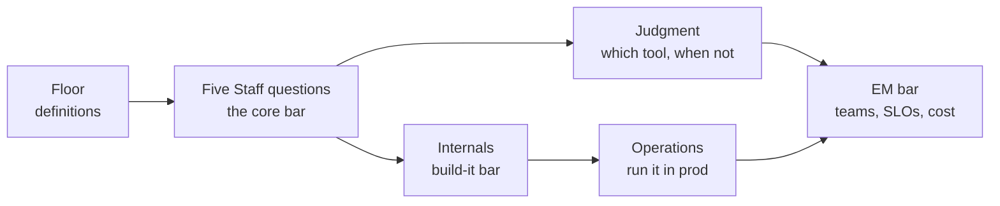

# 33 — Messaging Queues: The Mastery Bar

> **What this is:** the self-test. Not notes — a checklist of every question you should answer *well* to honestly say "I know messaging queues and distributed messaging queues." Each row gives the probe and **the bar**: what a strong answer must contain. If your answer misses the bar, the study map at the bottom says exactly where to go.
>

## How to score yourself

For every question, grade honestly:

- **Cold** — you can answer out loud, unprompted, with the trade-off named. *This is the only passing grade.*
- **Prompted** — you recognize the answer when you see it. That's reading familiarity, not interview readiness — redo the source with the question in hand.
- **Blank** — go to the study map row.

Answer *out loud*. The gap between "I know this" and "I can say this in 30 seconds" is precisely what mocks expose.

## Level 0 — the floor (Senior baseline)

If any of these takes thought, return to Core 04 pass one before anything else.

| Question | The bar — your answer contains |
|---|---|
| Queue vs pub/sub? | Exactly-one consumer (work distribution) vs every subscriber (broadcast); Kafka unifies via consumer groups |
| Why async at all? | Temporal decoupling + load-leveling — **and the price**: eventual consistency + mandatory idempotency, said unprompted |
| What's a DLQ? | Route-aside after N failures + **an alarm on depth** + a redrive story; a DLQ nobody drains is a data-loss delay line |
| Visibility timeout? | Receive hides, only ack deletes, crash → reappears; set 2–3× p99 processing time, heartbeat-extend long jobs |
| Backoff done right? | Exponential **with full jitter**, hard max attempts, and the taxonomy: retryable vs terminal — never retry a 400 |

## The five Staff questions — the core bar

### 1. Delivery semantics

| Probe | The bar |
|---|---|
| "I need exactly-once." | *"Exactly-once delivery is impossible — Two Generals. I build effective-once: at-least-once + idempotency key, dedup write atomic with the side effect. Kafka EOS is real but only inside Kafka — an external DB or API drops you back to at-least-once at that sink."* |
| "Producer publish timed out — now what?" | Two truths possible (broker has it / doesn't); the producer **must retry** → duplicates are structural → idempotent producer (PID+seq) closes the broker hop, consumer idempotency closes the rest |
| "Where exactly does the duplicate come from?" | You can draw both crash windows: ack-lost-after-append (producer side) and crash-after-process-before-commit (consumer side) |

### 2. Ordering

| Probe | The bar |
|---|---|
| "Messages must be in order." | Push back: *global or per-entity?* Global = one partition = throughput ceiling, almost never the requirement |
| "Pick the partition key." | Smallest entity whose events must stay ordered, high-cardinality (userId, orderId, conversationId) — and the celebrity-key mitigation (composite key / accepted hotspot) |
| "We doubled partitions and things broke." | `hash(key) % N` remapped — per-key order broke mid-stream; partition count is effectively immutable for ordering, over-provision up front |

### 3. Lag & backpressure

| Probe | The bar |
|---|---|
| "How do you know the system is healthy?" | **Consumer lag**, not producer success — producers can be green while data ages; lag is the backpressure signal in a pull system |
| "Lag doubling hourly — walk me through it." | Diagnose: consumer throughput (deploy? poison loop? downstream slow?) → partition ceiling (consumers > partitions idle) → **the true constraint is usually the stateful store** |
| "So autoscale consumers?" | Yes, on lag, **with a hard ceiling** — scaling past the downstream DB just relocates the bottleneck onto something that falls over worse |

### 4. Durability

| Probe | The bar |
|---|---|
| "What does your ack mean?" | `acks=all` + min-ISR: the message is on ≥2 machines; durability from **replication, not fsync** |
| "Broker dies mid-stream." | New leader from ISR; consumers only ever read to the **high-watermark**, so nothing visible is ever lost; zombie leaders fenced by epoch |
| "ISR shrinks below minimum." | Partition refuses writes — **unavailable over unsafe**, chosen per topic class (money vs telemetry) |

### 5. Poison messages

| Probe | The bar |
|---|---|
| "One message keeps failing." | Terminal vs retryable first; terminal → DLQ/DLT immediately, retryable → tiered retry topics |
| "Same question, but Kafka." | The difference stated: SQS retries messages **independently**; Kafka offsets are a high-water mark over an ordered partition → **head-of-line blocking** → produce to DLT, commit past, alarm on DLT depth |

## The internals bar (build-it rounds)

| Probe | The bar |
|---|---|
| "Design the broker's storage." | The crux fork: per-message state (mailbox) vs append-only log (cursor); at scale the log wins — replay free, fan-out free, one integer per group |
| "Why is a log broker fast?" | Nothing random, ever: sequential appends, page cache, zero-copy `sendfile`, whole-segment deletes, no per-message fsync |
| "Consumer group mechanics?" | Coordinator assigns partitions 1:1 within a group; commit timing decides at-least/at-most-once; rebalance = the disruption — cooperative/incremental vs stop-the-world |
| "Push or pull, and why?" | Pull: backpressure needs no protocol, batching is natural, slow consumers hurt only themselves — the cost is long-poll for latency |
| "Where's consensus?" | Metadata only (controller Raft: leaders, ISR, configs) — never on the data path; that separation is why the data plane scales linearly |
| "Capacity math." | 1M msg/s × 1 KB = 1 GB/s; ×RF, ×fan-out → **network-bound before disk-bound**; retention × ingest × RF = the PB-scale cost line |

## The judgment bar (which tool, and when not)

| Probe | The bar |
|---|---|
| "Queue, stream, or RPC?" | Need the response now / read-your-write → stay synchronous; task distribution + per-message semantics → queue; replay + fan-out + ordering → log/stream |
| "SQS vs Kafka vs RabbitMQ vs Pulsar?" | SQS: zero-ops mailbox, per-message semantics, no replay. RabbitMQ: routing richness, low latency, modest scale. Kafka: throughput + replay + ecosystem; you own head-of-line and rebalances. Pulsar: log storage (BookKeeper) + broker-side ack state — the middle ground |
| "When is a queue the wrong answer?" | Sub-ms request/response; strict read-your-write; tiny volume (a DB table + poller below ~1K msg/s is honest); workflow orchestration (that's a workflow engine, queues are its transport) |
| "Event sourcing / CQRS — always?" | No — name them as *available* patterns with real costs (schema evolution, rebuild time); using the log as system-of-record is a commitment, not a default |

## The operations bar

| Probe | The bar |
|---|---|
| "Top three dashboards?" | Per-group lag (+ its derivative), under-replicated partitions / ISR shrink events, DLT depth. Honorable mention: disk time-to-full |
| "Hot partition in prod — find and fix." | Find: per-partition byte-rate skew; fix: the **key**, not the count — bucketed composite key, or accept and isolate the whale |
| "A consumer deploy causes a 4-minute stall every release." | Rebalance storm — cooperative incremental assignment, static membership, session timeouts tuned |
| "The outbox relay died Friday night." | At-least-once relay means catch-up + duplicate burst Monday — consumers were idempotent, so it's a lag event, not a correctness event. If that sentence isn't true, that's the finding |

## The EM bar

| Probe | The bar |
|---|---|
| "Two teams share a topic. What's the contract?" | The topic **is** an API: producer owns schema + compatibility rules (registry-enforced), consumer owns lag + DLT triage, platform owns fleet + client libs. Every messaging incident review starts by finding which of the three ownerships was ambiguous |
| "What SLOs would you set?" | Produce path: ack availability + publish p99. Consume path: e2e lag per group — **jointly owned**, split stated. Durability: a policy verified by chaos drills, not a config claim |
| "The Kafka bill doubled." | Levers with owners: retention days per topic, RF per tier, compression, tiered storage — plus **showback**, because unpriced retention defaults to "forever" |
| "One team's producer took down the platform." | Quotas (produce/fetch byte-rate) are day-one multi-tenancy, not hardening; capacity review for new high-volume topics |

## The final gate — ten questions, cold, out loud

Pass = fluent Staff-bar answers to all ten, ~30–60 seconds each. This is the "I know messaging queues" certificate.

1. Producer timeout: what are the two possible truths, and what closes each duplicate window?
2. Why does visibility timeout make exactly-once impossible — and what do you build instead?
3. Poison message in SQS vs Kafka — why are they different problems, and the fix for each?
4. Chat app, 10M users, per-conversation ordering: key choice, and what breaks if partitions double?
5. Order row + `OrderPlaced` event: walk the dual-write crash window → outbox → CDC → why consumers must *still* dedup.
6. Lag doubling hourly: your diagnostic sequence, and when adding consumers is the wrong move.
7. "What does your ack mean?" — acks, ISR, min-ISR, high-watermark, and the unavailable-over-unsafe call.
8. Build-it: mailbox vs log — the fork, and three things the log gives you for free.
9. Why is the log broker fast? (The four "nothing random" mechanisms.)
10. Two teams, one topic, recurring incidents: the ownership contract you'd institute as EM.

## Study map — where to fix a miss

| Missed area | Go to |
|---|---|
| Floor definitions, retries, DLQ, visibility | Core 04 §§1–5 |
| Delivery semantics, effective-once | Core 04 §14, §17 · [CS-23](23-exactly-once-purchase.md) |
| Ordering & partition keys | Core 04 §15 · DD-02 §3 |
| Dual-write / outbox / CDC | Core 04 §16 |
| Backpressure & lag | Core 04 §18 · DD-02 §7 |
| Internals & build-it | [CS-32](32-design-message-queue.md) · Core 21 §3–4 · DD-02 |
| Judgment / platform picker | Core 04 §13, §20 · DD-02 §11–12 |
| EM contracts, SLOs, cost | CS-32 §8 · [Core 19b](../Core%20Course/19b-engineering-operations-economics.md) |

**The honest definition of "knowing it":** you can *derive* the system (CS-32), *operate* it (lab), *choose* it or refuse it (judgment bar), and *organize* it (EM bar) — and you can do all four out loud.
