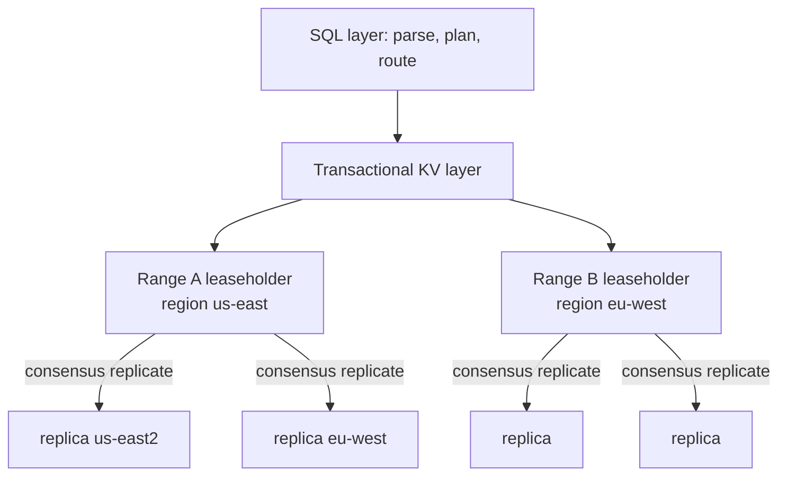
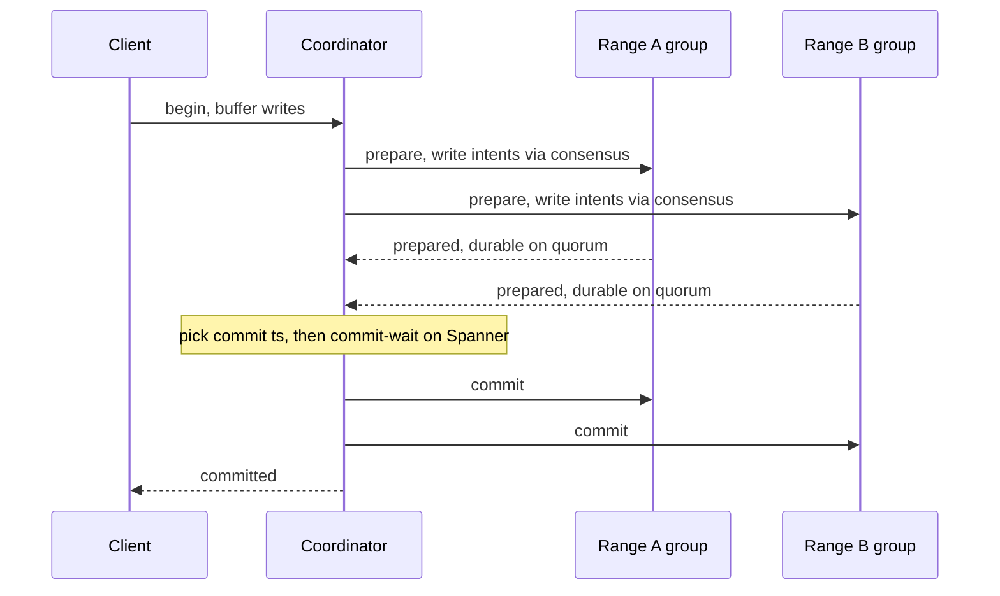

# 34 — NewSQL / Distributed SQL (Spanner, CockroachDB)

> **Sources:** Google's *Spanner* (OSDI 2012) + *Spanner: Becoming a SQL System* (SIGMOD 2017); CockroachDB architecture docs; composed on [Core 02 — Distributed Systems](../Core%20Course/02-distributed-systems.md) (consensus, clocks, 2PC), [Core 06 — Databases](../Core%20Course/06-databases.md) (sharding, replication), [Core 22 — Google Papers](../Core%20Course/22-google-papers.md#spanner). Beyond the Hello Interview catalog — this is the deep dive [DD-03 Postgres §8](03-postgresql.md) and [DD-21 Pattern Selection](21-pattern-selection.md) both punt to when a design needs multi-region strong-consistency writes.
>
> **Why it exists as its own note:** the moment a design says "global, strongly consistent, and horizontally write-scalable," you're out of Postgres/Cassandra territory and an interviewer expects you to name *how* — TrueTime vs bounded-clock-skew, consensus-per-shard, and the latency you pay for it. This is a top Google/Coinbase/Stripe probe and the repo had no home for it.

## What you'll master

- The one-line reason NewSQL exists: **ACID + SQL + horizontal scale + strong consistency, all four at once** — the combination a single Postgres, a sharded Postgres (Vitess), and Cassandra each give up one of.
- **How Spanner makes it work:** data split into ranges, each range a **Paxos group**, cross-range transactions via **2PC-over-Paxos**, and **TrueTime** buying *external consistency* — plus the exact cost (commit-wait).
- **How CockroachDB makes it work without atomic clocks:** Raft-per-range, HLC + a **bounded max clock offset**, and **uncertainty-interval read restarts** instead of commit-wait.
- The latency you pay and how to claw it back: **leaseholder/range locality, follower reads, bounded staleness**.
- **When NOT to reach for it** — the "you're paying a global coordination tax for a single-region workload" trap.

## In the Room — the decisive framing

Say this when a prompt turns global-and-transactional (multi-region bank, global inventory, a ledger that must be correct across continents):

> *"A single Postgres gives me ACID but one write region and a vertical ceiling. Sharded Postgres (Vitess) scales writes but I lose cross-shard transactions. Cassandra scales globally but it's AP — no serializable cross-key transactions. NewSQL — Spanner, CockroachDB — is the system that refuses to give any of those up: it shards data into ranges, replicates each range by consensus, and runs distributed transactions across them with serializable isolation. The price is written on the tin: every write pays a consensus round-trip, and cross-region writes pay cross-region RTT. So I reach for it only when I genuinely need strong consistency at global scale, and I design for locality so most transactions stay in one region."*

### Decisions to make decisively

| Decision | Choice | Because |
|---|---|---|
| Do I even need NewSQL? | Only if strong consistency **and** horizontal write-scale **and** multi-region | If you can fit one Postgres primary, do that — don't pay the coordination tax |
| Clock strategy | Spanner: TrueTime (GPS+atomic). CockroachDB: HLC + max-offset | Determines whether you pay *commit-wait* (Spanner) or *read-restarts* (CRDB) |
| Isolation | Serializable by default (both) | The whole point; if you wanted weaker, a cheaper store would do |
| Locality | Pin range leaseholders to the region that writes them | Consensus RTT is the bill; keep the quorum local |
| Stale-OK reads | Follower reads / bounded staleness | Reads that tolerate seconds of lag skip the leaseholder entirely |

**Experience hook.** *"On chat infra the equivalent tension is region-pinning: a conversation's writes should commit in one region and only replicate outward. NewSQL formalizes that — the leaseholder is the 'home region' and cross-region writes are the expensive exception you design against, not the default."*

---

## 1. The problem — why "just shard Postgres" isn't enough

Four properties, and every pre-NewSQL system drops one:

| System | ACID | SQL | Horizontal write scale | Strong consistency multi-region |
|---|---|---|---|---|
| Single Postgres/MySQL | ✅ | ✅ | ❌ (one primary) | ❌ (one write region) |
| Sharded via Vitess | ✅ *within a shard* | ✅ | ✅ | ❌ (**no cross-shard ACID** by default) |
| Aurora | ✅ | ✅ | ❌ (**single writer**, shared storage) | ❌ (one write region; replicas only) |
| Cassandra / DynamoDB | ❌ (per-key only) | ❌ | ✅ | ❌ (AP; LWW conflicts) |
| **Spanner / CockroachDB** | ✅ | ✅ | ✅ | ✅ |

The key correction to a common misconception: **Aurora is not NewSQL.** Aurora scales *storage* and *reads* brilliantly (log-is-the-database, 6-way replicated storage) but still has **one writer** — it does not horizontally scale writes or give you multi-region active-active. Naming that distinction unprompted is a strong signal.

NewSQL's bet: take the relational model and ACID, and make the *transaction manager itself* distributed — shard the data, replicate each shard by consensus (not async), and run a real distributed-transaction protocol across shards. The hard part isn't storage; it's **transactions that stay serializable across shards and regions**.

## 2. Architecture — ranges, consensus groups, leaseholders

Both systems share the same skeleton (names differ):

- **Data is split into ranges** (Spanner: *splits*/tablets; CockroachDB: *ranges* ~512 MB). Ranges split and merge automatically as data grows or heats up.
- **Each range is its own consensus group** — Spanner uses **Paxos**, CockroachDB uses **Raft** — replicated (typically ×3 or ×5) across failure domains. This is the crucial difference from Cassandra: replication is **synchronous via consensus**, so a committed write is on a majority and survives minority loss with *no* data loss and *no* LWW conflict.
- **One replica per range is the leaseholder** (CRDB) / Paxos leader (Spanner) — it serves reads and sequences writes. Writes need a **consensus quorum**; that quorum RTT *is* your write latency, and if the replicas span regions, it's cross-region RTT.
- **The SQL layer is stateless and separate** — any node parses SQL, plans, and routes KV operations to the right leaseholders. Scale SQL and storage independently.

> **Staff-level insight:** the single most important design lever is **where the leaseholders live**. A transaction that touches ranges whose leaseholders are all in one region commits at intra-region latency; one that spans regions pays cross-region consensus. So schema and placement design *is* latency design — pin a tenant's / user's / conversation's ranges to their home region and cross-region transactions become the rare, expensive exception you explicitly budget for.

## 3. The heart of it — distributed transactions

A transaction that touches multiple ranges is a **2PC where each participant is itself a consensus group** — "2PC over Paxos/Raft." This is what makes it correct *and* what makes it expensive.

- **Write intents (CockroachDB) / locks:** during prepare, each participant writes a provisional value ("intent") pointing at the transaction record, replicated by consensus. A concurrent reader that hits an intent either waits or helps resolve it. On commit, intents flip to real values; on abort, they're discarded. This is **Percolator-inspired** — the transaction record is the single source of truth for the whole transaction's fate.
- **The coordinator** is not a special node — it's one of the participating range leaders (CRDB uses the txn's first range). No separate 2PC coordinator to be a SPOF, because the coordinator's state is itself consensus-replicated.
- **Serializable by default.** Both default to serializable isolation (Spanner: external consistency = strict serializability; CockroachDB: serializable, and *not* the weaker snapshot isolation Postgres defaults to). This is the entire value proposition — you don't get write-skew ([Core 02 §1.2](../Core%20Course/02-distributed-systems.md)) that snapshot isolation allows.

## 4. Deep dive — TrueTime and why commit-wait exists (Spanner)

The subtle problem: with data and clocks spread across the planet, how do you assign transaction timestamps so that **if T1 commits before T2 begins in real (wall-clock) time, T1's timestamp is strictly smaller than T2's**? That property is **external consistency** (a.k.a. strict serializability) — the strongest guarantee, and it's what lets a client in Tokyo read a value a client in New York just wrote, correctly, without coordination.

Ordinary clocks can't do it — they're skewed by unknown amounts. Spanner's answer is **TrueTime**: GPS receivers + atomic clocks in every datacenter expose time not as a number but as an **interval** `[earliest, latest]` with a *bounded* uncertainty **ε** (historically ~1–7 ms; smaller now). `TT.now()` guarantees the true time lies in that interval.

Two rules give external consistency:
1. **Assign the commit timestamp** `s = TT.now().latest` (the latest possible "now").
2. **Commit-wait:** before releasing the commit (making it visible), **wait until `TT.after(s)` is true** — i.e. wait out the uncertainty so that `s` is now *definitely in the past* everywhere. This wait is ~**2ε**.

Why it works: by waiting out ε, Spanner guarantees no other transaction can later pick a timestamp ≤ `s` and appear to have happened "before" — the timestamps respect real-time order. The **cost is latency**: every read-write transaction pays ~2ε of commit-wait on top of the consensus RTT. **Shrinking ε is a direct latency win**, which is why Google invests in the clock hardware.

> **Staff-level insight:** the say-verbatim is *"Spanner buys external consistency by making time an interval and waiting out its uncertainty — commit-wait ≈ 2ε on every write. TrueTime doesn't remove clock skew; it bounds it and pays for the bound in latency. That's the whole trick, and it's why 'just use Spanner' has a real per-write cost, not a free one."*

## 5. Deep dive — CockroachDB without atomic clocks

CockroachDB can't assume GPS/atomic clocks (it runs on commodity cloud VMs), so it makes a different trade:

- **Hybrid Logical Clocks (HLC)** timestamp every event ([Core 02 §7](../Core%20Course/02-distributed-systems.md)) — physical time + a logical counter, so causality is preserved and timestamps stay near wall-clock.
- **A configured maximum clock offset** (`--max-offset`, default 500 ms, often tuned to ~250 ms with good NTP). This is a *safety assumption*: **if a node ever detects its clock has drifted beyond max-offset from its peers, it crashes itself** rather than risk violating consistency. Say this — it's the load-bearing safety mechanism.
- **Uncertainty-interval read restarts instead of commit-wait.** When a read at timestamp `t` encounters a value written in the window `(t, t + max_offset]`, CRDB *can't tell* whether that write really happened before or after the read in real time — it's within the uncertainty window. So it does a **read refresh / uncertainty restart**: bump the read timestamp above the observed write and retry. This pushes the cost onto *reads that hit recent writes* rather than a fixed commit-wait on every write.

**The trade in one line:** Spanner pays a fixed **commit-wait on writes** (needs tight clocks to keep it small); CockroachDB pays **occasional read restarts** under contention (needs bounded clock skew to stay safe). Same problem — bounding the effect of clock uncertainty on serializability — two different bills.

## 6. Clawing back latency — locality and follower reads

Strong consistency at global scale is expensive by construction; the entire operational game is keeping transactions *local*:

- **Leaseholder / leader locality.** Pin the leaseholder of a range to the region that writes it most (CRDB: table/row-level "regional by row"; Spanner: placement configs / leader region). A write then needs only an *intra-region* quorum. Design the schema so a transaction's ranges share a home region.
- **Follower reads / bounded staleness.** A read that tolerates being slightly stale can be served by *any nearby replica* at a timestamp below the **closed timestamp** (the point up to which the range is guaranteed immutable) — no leaseholder round-trip, no cross-region hop. This is how you get fast local reads in a globally-consistent DB: exact reads pay consensus, stale-OK reads go local. Spanner's equivalent is bounded-staleness / stale reads.
- **Read-only transactions** in Spanner take a timestamp and read a consistent snapshot *without locks or 2PC* — lock-free, and can run at follower replicas.

> **Staff-level insight:** the mature answer to "isn't Spanner slow?" is *"strongly-consistent cross-region writes are slow by physics — so I make them rare. Leaseholders live in the home region so most writes are local; reads that can tolerate seconds of staleness use follower reads and never touch the leader. I pay the global-consensus cost only on the transactions that genuinely need global correctness."*

## 7. The landscape — pick and defend

| System | Consensus | Clock model | Wire/dialect | Note |
|---|---|---|---|---|
| **Spanner** | Paxos per split | **TrueTime** (GPS+atomic) | GoogleSQL + PostgreSQL | GCP-managed; external consistency; the reference design |
| **CockroachDB** | Raft per range | HLC + max-offset | PostgreSQL | Self-host or Cloud; serializable; "regional by row" for locality |
| **YugabyteDB** | Raft per tablet | HLC + max-offset | PostgreSQL (reuses PG upper half) | DocDB storage; strong Postgres feature compat |
| **TiDB** | Raft (per Region) | TSO (a central timestamp oracle, PD) | MySQL | HTAP: TiKV (row) + TiFlash (column); note the **centralized TSO** vs decentralized clocks |
| **Vitess** | (MySQL replication) | — | MySQL | **Sharded MySQL, not NewSQL** — no cross-shard ACID by default; YouTube/Slack scale-out |
| **Aurora / Aurora DSQL** | — / (newer) | — | PostgreSQL/MySQL | Classic Aurora = single-writer, *not* NewSQL. **Aurora DSQL** (2024, active-active multi-region, optimistic concurrency) is AWS's genuine entrant — name it as the current AWS answer |

Decision heuristic (decide, don't list): **Spanner** if you're on GCP and want it fully managed with the tightest consistency; **CockroachDB** if you want Postgres-compatible distributed SQL you can self-host or run multi-cloud; **TiDB** if you need HTAP (transactional + analytical) in one system; **Aurora DSQL** as the AWS-native multi-region option; **Vitess** if you already run MySQL and only need shard-scale, *not* cross-shard transactions.

## 8. When NOT to use NewSQL (know when not to distribute)

This is where you earn the level — reaching for Spanner reflexively is over-engineering:

1. **It fits one Postgres.** If a single primary (+ read replicas) handles your write volume and you're single-region, **use it** — NewSQL adds latency, cost, and operational complexity to buy scale/consistency you don't need. "Shard last" ([Core 06](../Core%20Course/06-databases.md)) applies here doubly.
2. **Ultra-low-latency single-row writes.** Every write pays a consensus round-trip. If you need sub-millisecond single-key writes and don't need cross-key transactions, a leaderless/quorum KV (DynamoDB, Cassandra) or Redis is faster.
3. **High cross-shard contention.** Serializable isolation means contended transactions *retry* (SSI restarts / uncertainty restarts). A workload where thousands of transactions fight over the same rows will thrash — you'd redesign for less contention (escrow, sharded counters, [DD-14 contention ladder](14-pattern-contention.md)) before or instead of adopting NewSQL.
4. **Analytics / OLAP.** NewSQL is OLTP; scan-and-aggregate belongs in [ClickHouse (DD-20)](20-clickhouse.md) / a warehouse. (TiDB's TiFlash is the hedge, but a dedicated OLAP store still wins on heavy analytics.)

## Interview Cheat-Sheet

**One-liner:** *"Distributed SQL = ACID + SQL + horizontal scale + strong consistency, by sharding data into ranges, replicating each range by consensus, and running 2PC-over-consensus for cross-range transactions. The cost is a consensus round-trip per write; the art is keeping transactions region-local."*

**The mechanisms, one line each:**
- Ranges → each a Paxos (Spanner) / Raft (CockroachDB) group → synchronous, no-loss, no-conflict replication.
- Cross-range txn = **2PC where every participant is a consensus group**; write intents + a transaction record (Percolator-style).
- **Spanner:** TrueTime `[earliest,latest]` with uncertainty ε → **commit-wait ≈ 2ε** buys external consistency.
- **CockroachDB:** HLC + **max clock offset** (self-crash if exceeded) → **uncertainty read-restarts** instead of commit-wait.
- Latency claw-back: **leaseholder locality** + **follower reads / bounded staleness**.

**Say-verbatim:** *"TrueTime doesn't eliminate clock skew — it bounds it and pays for the bound with commit-wait. CockroachDB refuses the clock hardware and pays with read restarts instead. Either way, strong consistency across regions costs a round-trip you can't wish away — so I design for locality and only pay it where correctness demands it."*

**The close:** *"NewSQL is the right answer exactly when you need serializable transactions at global scale and can't fit one primary — a global ledger, multi-region inventory, a payments core. It is the wrong answer when a single Postgres fits, when you need sub-ms single-key writes, or when the workload is analytics. 'Global and strongly consistent' has a physics tax; NewSQL makes it payable, not free."*
