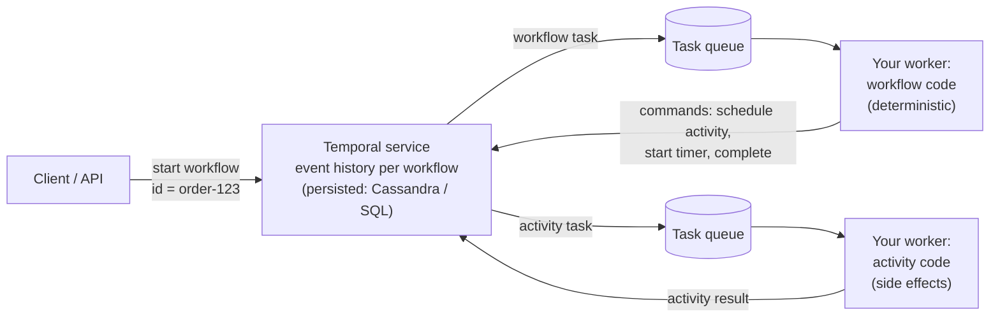

# Deep Dive 37 — Temporal & Durable Execution

> **Source:** Temporal documentation (concepts: workflows, activities, task queues, event history, versioning) + the Cadence lineage (Uber, 2017) + standard comparisons (AWS Step Functions, Azure Durable Functions, Restate, DBOS).
> **Prerequisites:** [Pattern 15 — Multi-step Processes](15-pattern-multi-step-processes.md) (when you need this at all) · [Pattern 19 — Long-Running Tasks](19-pattern-long-running-tasks.md). Pairs with [DD-07 — Flink](07-flink.md) (the same "checkpoint + replay" idea for streams), [35 — Scheduler](../Core%20Course/35-design-scheduler.md), [18c — Payments](../Core%20Course/18c-design-marketplace-money.md).

## What you'll master

Temporal is what you name when a workflow spans services, retries, timers and human waits, and the honest alternative is a hand-built state machine plus a job queue plus a scheduler plus a sweeper. Saying "use Temporal" is easy; the probes test whether you know **how replay works**, **what determinism costs you**, **how to deploy code with workflows in flight**, and **when it's overkill**.

By the end of this note you will be able to:

- Draw the model: **workflows** (deterministic orchestration code) vs **activities** (side effects), **workers** polling **task queues**, and the **Temporal service** storing each workflow's **event history**.
- Explain **replay**: why a crashed workflow resumes exactly where it was, and why that forces deterministic workflow code.
- Use the toolbox: **retry policies and the four activity timeouts**, **heartbeats**, **signals / queries / updates**, **durable timers**, **child workflows**, **continue-as-new**.
- Answer the versioning probe: **patching / version markers** and **worker versioning**.
- Pick between **Temporal, Step Functions, a DB state machine, or nothing**, with the trigger for each.

---

## Table of Contents

0. [In the Room — Staff-Level Delivery](#in-the-room--staff-level-delivery)
1. [The Mental Model — Code That Survives Crashes](#1-the-mental-model--code-that-survives-crashes)
2. [Replay & Determinism](#2-replay--determinism)
3. [Activities — Retries, Timeouts, Heartbeats](#3-activities--retries-timeouts-heartbeats)
4. [Talking to Running Workflows — Signals, Queries, Updates, Timers](#4-talking-to-running-workflows--signals-queries-updates-timers)
5. [Keeping Histories Bounded — Child Workflows & Continue-As-New](#5-keeping-histories-bounded--child-workflows--continue-as-new)
6. [Deploying Changes — Versioning](#6-deploying-changes--versioning)
7. [Operating It — Scale, Persistence, Failure](#7-operating-it--scale-persistence-failure)
8. [Temporal vs the Alternatives](#8-temporal-vs-the-alternatives)
9. [When NOT to Use It](#9-when-not-to-use-it)
10. [Interview Cheat-Sheet](#interview-cheat-sheet)

---

## In the Room — Staff-Level Delivery

### Decisions to make decisively

| Decision | Default position (say this) | One-line justification | Revisit trigger |
|----------|------------------------------|------------------------|-----------------|
| **Adopt durable execution?** | **Only when flows span services, have compensations, and wait for hours/days** | Below that, a transaction + outbox or a state-machine row is simpler ([Pattern 15](15-pattern-multi-step-processes.md)) | Dozens of workflow types, long timers, human steps, on-call drowning in stuck-state repairs |
| **What goes in workflow code** | **Orchestration only: decisions, sequencing, timers** | Workflow code is replayed; it must be deterministic | — |
| **What goes in activities** | **Every side effect: API calls, DB writes, emails** | Activities run once per attempt and their results are recorded | — |
| **Idempotency** | **Every activity idempotent, keyed by workflow ID + step** | Activities are at-least-once: a worker can die after the effect, before the result is recorded | — |
| **Workflow ID** | **A business key** (`order-123`), with "reject duplicate" start policy | Starting the same workflow twice becomes a no-op: free dedupe at the entry point | — |
| **Self-host vs cloud** | **Managed (Temporal Cloud) unless you already run Cassandra/Postgres at scale** | The service is stateful and needs real operations | Data residency, cost at very high volume |

### Altitude — name-and-move-on vs deep-dive

**Name and move on:** the service's internal components (frontend / history / matching services), SDK language details, Cadence lineage.

**Deep-dive — spend your minutes here:**
- **Replay and determinism** (§2): the thing that makes it work and the thing that bites you.
- **Activity semantics** (§3): at-least-once + idempotency, the four timeouts.
- **Versioning** (§6): the probe that separates people who've run it from people who've read about it.

### Experience hooks

- *"Our refund flow was a cron job scanning a status table, plus a retry column, plus a sweeper for stuck rows. Moving it to a durable workflow deleted all three. The code reads top to bottom like the business process, and 'where is refund 123?' is a UI lookup."*
- *"The first incident we had was a non-determinism error after someone added an `if` to a workflow with 40k executions in flight. Patching (`GetVersion`) is now a code-review checklist item."*

---

## 1. The Mental Model — Code That Survives Crashes

- **Workflow:** ordinary code (Go, Java, TypeScript, Python, .NET) that describes the process: `charge()`, then `reserve()`, then `sleep(3 days)`, then `remind()`. It **never** performs side effects directly.
- **Activity:** a function that does one side effect (call the payment API). The service records its result in the history.
- **Workers** are your processes; they **poll task queues**, so the service never calls into your network, and scaling is "run more workers".
- **Event history:** an append-only log per workflow execution (`WorkflowExecutionStarted`, `ActivityTaskScheduled`, `ActivityTaskCompleted`, `TimerFired`, `SignalReceived`…). It's the single source of truth for where the workflow is.

The one-line pitch: **"It's a workflow state machine where the state is the event history and the transitions are written as normal code."**

## 2. Replay & Determinism

**How a crash is survived:** worker A is running `order-123` and dies after `charge()` completed. Another worker picks up the next workflow task, **re-executes the workflow function from the top**, and every time the code calls an activity the SDK checks the history: `charge()` already has a recorded result, so it returns that result *instantly without calling the activity again*. Execution reaches `reserve()`, which has no recorded result, and that's where real work resumes.

**The price — workflow code must be deterministic:** on replay, it must issue the same commands in the same order, or the history no longer lines up (a **non-determinism error**). So in workflow code:
- No wall-clock time (`time.Now()`) → use `workflow.Now()` (recorded).
- No random numbers or UUIDs → `workflow.SideEffect` / SDK-provided deterministic random.
- No direct I/O, network, DB or threads → put it in an activity.
- No iteration over unordered maps where order affects commands.
- Changing the code's decision logic changes replay → see §6.

> **Staff-level insight:** *"Durable execution is event sourcing for control flow. The history is the state, and replay rebuilds it, which is the same insight as Flink's checkpoints. Determinism in workflow code is the cost, so I keep workflow code thin: decisions and sequencing only, with every side effect in an activity."*

## 3. Activities — Retries, Timeouts, Heartbeats

**Activities are at-least-once.** A worker can complete the side effect and die before reporting, so the activity is retried. **Every activity must be idempotent**, with a key derived from `(workflow_id, activity_name)` that the downstream system dedupes on (Stripe's `Idempotency-Key`, an upsert, a conditional write).

**Retry policy** per activity: initial interval, backoff coefficient, maximum interval, maximum attempts, and **non-retryable error types** (a declined card shouldn't be retried; a timeout should).

**The four activity timeouts** (the probe):

| Timeout | Measures | Use it to |
|---------|----------|-----------|
| **Schedule-To-Start** | Time sitting in the task queue before a worker picks it up | Detect no workers / backlog (alert on it; rarely set) |
| **Start-To-Close** | One attempt's execution time | Bound a single try (set this one always) |
| **Schedule-To-Close** | Total time across all attempts | Bound the overall budget for the step |
| **Heartbeat** | Max gap between heartbeats from a running activity | Detect a dead worker on a long activity quickly |

**Heartbeats** let a long activity (transcode for 40 minutes) report progress; if heartbeats stop, the service times it out and retries **from the last heartbeat's recorded progress**, instead of waiting 40 minutes to notice.

## 4. Talking to Running Workflows — Signals, Queries, Updates, Timers

- **Signal:** an asynchronous message into a running workflow by ID ("payment webhook arrived", "manager approved"). Recorded in history, so it's durable. This is how external events and human steps enter.
- **Query:** a synchronous, read-only look at workflow state ("what step is order-123 on?"), no history entry.
- **Update:** a synchronous request that can change state *and* return a result, with validation (e.g. "add an item to this cart workflow, and tell me the new total").
- **Durable timers:** `workflow.Sleep(30 days)` or `await condition(approved, timeout=7 days)`. The workflow takes no resources while waiting; the timer is an entry in the service. This is the feature that makes "remind me in 3 days, cancel after 7" trivial.

The common combination: **wait for a signal with a timeout**, then branch: approved, rejected, or escalate.

## 5. Keeping Histories Bounded — Child Workflows & Continue-As-New

- **History limits:** a single execution's history is capped (about **51,200 events or 50 MB**, with warnings well before). Every activity, timer and signal adds events, so long-lived or looping workflows will hit it.
- **Continue-as-new:** the workflow completes itself and immediately starts a fresh execution with the **same workflow ID** and its current state as input. Use it for entity workflows (one workflow per subscription that runs for years) and loops ("poll every hour forever").
- **Child workflows:** fan out large work into separate executions, each with its own history ("process 10k line items" = batches of child workflows), and they can run on different task queues.
- **Payloads by reference:** pass S3 keys, not 10 MB blobs. Large payloads bloat history and every replay.

## 6. Deploying Changes — Versioning

Workflows outlive deploys. If a 30-day workflow started on v1 replays on v2 code that makes a different decision, replay fails.

| Technique | How | Use when |
|-----------|-----|----------|
| **Patching / version markers** (`workflow.GetVersion` in Go, `patched()` in TS/Python) | The new code branch is wrapped in a version check; the decision is recorded in history, so old executions take the old branch and new executions the new one | Small logic changes to a workflow type with executions in flight |
| **Worker versioning** (executions pinned to a worker build) | Old executions keep running on old-build workers until they complete; new executions start on the new build | Larger rewrites; when you can afford to run old workers until drain |
| **New workflow type** (`OrderWorkflowV2`) | Start new executions on the new type; let the old ones finish | Incompatible redesigns |
| **Migrate via continue-as-new** | At a safe point, the old execution continues-as-new into the new version carrying its state | Long-lived entity workflows that would never drain |

**Process:** a replay test in CI (replay recorded production histories against the new code) catches non-determinism before deploy. Make it mandatory.

> **Staff-level insight:** *"Versioning is the operational tax of durable execution. I'd make replay tests against recorded histories part of CI, use patching for small changes, and pin long-running executions to worker builds for big ones. Deleting an old branch is a cleanup task scheduled after the last old execution closes, not part of the change itself."*

## 7. Operating It — Scale, Persistence, Failure

- **The service** (frontend, history, matching services) is stateless over a **persistence store** (Cassandra, MySQL or Postgres) plus optional Elasticsearch for visibility/search. Workflows are sharded across history shards; **the shard count is fixed at cluster creation**, so size it up front.
- **Throughput** is bounded by the persistence store's write rate (every event is a write), so high-volume, short-lived workflows (millions/s of tiny ones) are the expensive case.
- **Worker scaling:** autoscale workers on **Schedule-To-Start latency / task-queue backlog**, the same signal as any queue.
- **Failure:** workers dying is the normal case and fully handled; the service itself is the critical dependency. Run it multi-AZ (or use the managed cloud), and remember that if it's down, no workflow progresses, though nothing is lost.
- **Observability:** the UI shows every execution's history, which is the biggest day-2 win ("where is order 123, and why is it stuck?" has an answer).

## 8. Temporal vs the Alternatives

| | Pick it when | One-line against |
|---|--------------|-------------------|
| **Temporal** (and **Cadence**, its Uber-built predecessor) | Complex, long-lived, code-defined workflows across services; many workflow types | A stateful platform to run (or pay for); determinism and versioning discipline |
| **AWS Step Functions** | AWS-native, mostly service-to-service steps; JSON/visual state machines; Express mode for high-volume short flows | State-machine DSL instead of code; payload/size limits; AWS lock-in |
| **Azure Durable Functions** | Azure Functions shops | Similar replay model, tied to the Functions runtime |
| **Restate / DBOS** | Lighter-weight durable execution embedded with your service and database | Younger ecosystems |
| **DB state machine + job queue** | A few workflow types, one service, days-long waits are rare | You build retries, timers, sweepers and visibility yourself |
| **Airflow / Dagster** | **Batch data DAGs** on a schedule | Not for per-request business workflows; different latency and scale model |

Default script: **one service, few steps → DB state machine; many services, compensations, long waits → Temporal (or Step Functions on AWS for simpler flows); scheduled data pipelines → Airflow.**

## 9. When NOT to Use It

1. **Everything lives in one database** — a transaction or an outbox is simpler and stronger ([Pattern 15](15-pattern-multi-step-processes.md)).
2. **Sub-millisecond or extremely high-volume, short tasks** — every step is several persistence writes; a stream processor or plain queue is cheaper.
3. **The team can't absorb the discipline** — determinism rules and versioning are a real cost; a stuck non-deterministic workflow is a worse incident than a stuck status row.
4. **Batch analytics DAGs** — use a data orchestrator.

---

## Interview Cheat-Sheet

**One-liner:** *"Durable execution is event sourcing for control flow: workflow code is replayed from its event history after any crash, with completed activities returning their recorded results, so execution resumes exactly where it stopped. Workflow code is deterministic orchestration; every side effect is an idempotent, retried activity. Signals bring external events in, durable timers make multi-day waits free, continue-as-new bounds history, and patching or worker versioning handles deploys."*

**Numbers:** history cap ≈ **51,200 events / 50 MB** per execution · every event = a persistence write · history shard count fixed at cluster creation.

**The four probes and your answers:**

| Probe | Answer |
|-------|--------|
| "Worker dies mid-workflow?" | Another worker replays the history; completed activities return recorded results; the first unrecorded step runs for real |
| "Activity ran but the result was lost?" | At-least-once: it retries, so it's idempotent with a key from (workflow ID, activity) |
| "Change code with 40k executions in flight?" | Patching/version markers or pin to worker builds; replay tests on recorded histories in CI |
| "Why not just a queue and a status table?" | Fine for a few steps in one service; Temporal pays off when retries, timers, compensations and visibility would otherwise be hand-built per workflow |

**Say-verbatim lines:**
- *"Workflow code decides; activities do."*
- *"The history is the state; replay is recovery."*
- *"Every activity is at-least-once, so every activity is idempotent."*
