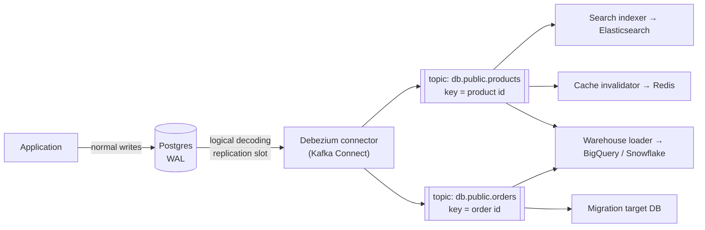
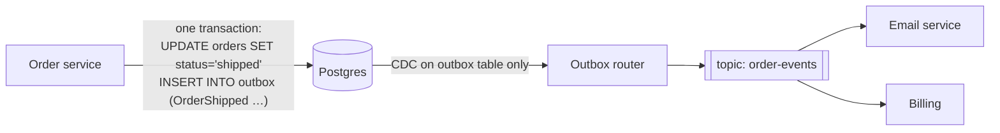

# Deep Dive 39 — Change Data Capture (CDC)

> **Source:** [Hello Interview — Change Data Capture](https://www.hellointerview.com/learn/system-design/deep-dives/change-data-capture) (written guide; premium) + Debezium documentation + Postgres logical decoding / MySQL binlog docs.
> **Prerequisites:** [DD-02 — Kafka](02-kafka.md) (the transport), [DD-03 — PostgreSQL](03-postgresql.md) (WAL), [Pattern 15 — Multi-step](15-pattern-multi-step-processes.md) (the outbox). Pairs with [07 — Search](../Core%20Course/07-search.md) (CDC into the index), [Pattern 16 — Scaling Reads](16-pattern-scaling-reads.md) (cache invalidation), [32 — Migrations](../Core%20Course/32-migrations.md), [34 — Real-Time Analytics](../Core%20Course/34-design-realtime-analytics.md).

## What you'll master

CDC shows up in almost every design that has a second copy of data: the search index, the warehouse, the cache, the new database you're migrating to. Saying "use CDC" is easy; the probes test whether you know **why dual writes fail**, **how log-based capture actually works**, **what ordering and delivery guarantees you get**, and the operational trap that takes production databases down (**an abandoned replication slot filling the disk**).

By the end of this note you will be able to:

- Explain the **dual-write problem** and why CDC fixes it: the database's own log becomes the single source of change events.
- Compare **log-based CDC** (WAL/binlog) with **polling** and **triggers**, and say why log-based is the default.
- Draw the standard pipeline: **database log → connector (Debezium) → Kafka topic per table, keyed by primary key → consumers**.
- Handle **initial snapshots**, **per-key ordering**, **at-least-once delivery with version-guarded upserts**, **deletes and tombstones**, and **schema evolution**.
- Say **when not to use CDC**: when consumers need the *intent* of a change, publish domain events through an **outbox** instead.

---

## Table of Contents

0. [In the Room — Staff-Level Delivery](#in-the-room--staff-level-delivery)
1. [The Problem — Dual Writes](#1-the-problem--dual-writes)
2. [How CDC Works — Reading the Database's Log](#2-how-cdc-works--reading-the-databases-log)
3. [The Pipeline — Debezium, Kafka, Consumers](#3-the-pipeline--debezium-kafka-consumers)
4. [Snapshots — Starting From an Existing Table](#4-snapshots--starting-from-an-existing-table)
5. [Guarantees — Ordering, Delivery, Deletes](#5-guarantees--ordering-delivery-deletes)
6. [Schema Evolution](#6-schema-evolution)
7. [Operational Hazards — the Probes That Separate "Used It" From "Read About It"](#7-operational-hazards--the-probes-that-separate-used-it-from-read-about-it)
8. [When to Use CDC](#8-when-to-use-cdc)
9. [When NOT to Use CDC — Intent Needs an Outbox](#9-when-not-to-use-cdc--intent-needs-an-outbox)
10. [Interview Cheat-Sheet](#interview-cheat-sheet)

---

## In the Room — Staff-Level Delivery

### Decisions to make decisively

| Decision | Default position (say this) | One-line justification | Revisit trigger |
|----------|------------------------------|------------------------|-----------------|
| **Keeping a derived store in sync** | **CDC from the source database, never dual writes** | One commit, one log; the derived store can't silently diverge | — |
| **Capture method** | **Log-based** (Postgres logical decoding, MySQL row binlog, Mongo change streams, DynamoDB Streams) | Sees every change including deletes, in commit order, with no load on the tables | No log access (some managed/legacy DBs) → polling with `updated_at` + soft deletes |
| **Transport** | **Kafka topic per table, keyed by primary key** | Per-key ordering, replay, many independent consumers | Single consumer, low volume → the database's native stream directly |
| **Consumer writes** | **Idempotent upsert guarded by source position** (LSN / binlog position / version) | Delivery is at-least-once; replays and duplicates must be no-ops | — |
| **Events that carry intent** | **Outbox table, captured by CDC** | Consumers get `OrderShipped`, not "column `status` changed" | — |
| **Deletes** | **Tombstone events + Kafka log compaction** | Compacted topics keep the latest state per key and eventually drop deleted keys | Erasure SLAs → see [13b](../Core%20Course/13b-data-compliance-privacy.md) |

### Altitude — name-and-move-on vs deep-dive

**Name and move on:** connector configuration, the event envelope fields, Kafka Connect deployment details.

**Deep-dive — spend your minutes here:**
- **The dual-write failure** (§1): why "write the DB, then write Elasticsearch" is wrong.
- **Guarantees** (§5): per-key ordering, at-least-once, the version guard.
- **Replication slot / binlog retention** (§7): the outage everyone who's run CDC has had.

### Experience hooks

- *"We had a search index that drifted from Postgres for months because a code path updated the DB and forgot the index. Switching the index to CDC fixed every path at once, including ones written later."*
- *"Our Debezium connector was down over a weekend and the Postgres replication slot kept every WAL segment for it. The primary's disk hit 95% on Monday morning. Slot lag is now a paging alert and `max_slot_wal_keep_size` is set."*

---

## 1. The Problem — Dual Writes

The tempting design for "keep Elasticsearch in sync with Postgres":

```
BEGIN; UPDATE products SET price = 79 WHERE id = 42; COMMIT;
es.index(product 42, price 79)          ← separate system, separate failure
```

Every way it breaks:
- **Partial failure:** the DB commit succeeds and the ES write fails (timeout, ES down), so the index is stale **forever**, because nothing retries it.
- **Crash between the two writes:** same result, with no record that anything was missed.
- **Race between concurrent writers:** writer A sets price 79, writer B sets price 85; the DB commits A then B, but the ES writes land B then A. The index says 79, the DB says 85, and nothing will ever correct it.
- **Every code path must remember:** a batch job, an admin script or a new service that writes the table without the second write creates drift.

Retries and idempotency only fix the first case. The race and the forgotten paths need **one ordered source of truth for changes**, and the database already has one: its write-ahead log.

## 2. How CDC Works — Reading the Database's Log

Every serious database writes changes to a log before applying them (for crash recovery and replication). Log-based CDC **reads that log as a replica would** and turns each committed change into an event.

| Database | What CDC reads | Notes |
|----------|----------------|-------|
| **PostgreSQL** | WAL via **logical decoding** (`pgoutput` plugin) through a **replication slot** | The slot remembers the consumer's position, so the server keeps WAL until it's consumed (§7) |
| **MySQL / MariaDB** | **Row-based binlog** (`binlog_format=ROW`), tracked by GTID | Binlog retention is time-based; a consumer that falls behind it must re-snapshot |
| **MongoDB** | **Change streams** (built on the oplog), resumable by token | |
| **DynamoDB** | **DynamoDB Streams** (24 h retention) or Kinesis Data Streams | Native, per-item ordered |
| **Spanner / Cloud SQL / Aurora** | Native change streams / binlog | Managed options with their own limits |

**The three ways to capture changes:**

| Method | How | Catches deletes? | Load on the DB | Ordering | Verdict |
|--------|-----|------------------|----------------|----------|---------|
| **Log-based** | Read the WAL/binlog | Yes | Minimal (reads the log, not tables) | Commit order | **Default** |
| **Query-based (polling)** | `SELECT … WHERE updated_at > :last` every N seconds | **No** (unless soft deletes) | Repeated table scans/index reads | Misses intermediate updates; clock and same-timestamp issues | Fallback when there's no log access |
| **Trigger-based** | Triggers write each change to a changes table | Yes | **Adds write cost to every transaction** | Commit order | Legacy; avoid on hot tables |

## 3. The Pipeline — Debezium, Kafka, Consumers



- **Connector:** Debezium (the common open-source choice) runs in Kafka Connect, reads the log and writes one Kafka topic per table. Managed equivalents exist (AWS DMS, Google Datastream, Confluent connectors).
- **Event envelope:** each event carries `op` (create / update / delete / read-from-snapshot), `before` and `after` row images, and `source` metadata: log position (LSN), transaction ID, commit timestamp, table.
- **Key = primary key:** all changes to one row land in one partition, in order (§5).
- **Consumers are independent:** each has its own offset, so the search indexer can be rebuilt by replaying from the start of retention without touching the warehouse loader.

## 4. Snapshots — Starting From an Existing Table

A new CDC pipeline faces a table that already has 500M rows. The log only has recent changes.

- **Initial snapshot:** the connector reads the full table (events with `op = read`), noting the log position at the start, then switches to **streaming from that position**, so nothing between the snapshot and the stream is missed. Consumers treat snapshot rows as upserts.
- **Large tables:** a blocking snapshot can take hours and hold a long-running transaction. **Incremental snapshots** (Debezium reads the table in primary-key chunks interleaved with live streaming, using watermarks to resolve conflicts between a chunk and concurrent changes) avoid that, and can be triggered later for one table, e.g. to backfill a new consumer.
- **Re-snapshot as recovery:** if a connector falls behind the log's retention (§7), a fresh snapshot is the only way back.

## 5. Guarantees — Ordering, Delivery, Deletes

**Ordering:**
- **Per row: yes.** Changes for one primary key are in commit order and go to one partition.
- **Across rows and tables: no**, by default. A transaction that updates `orders` and `order_items` produces events in two topics that consumers may see in either order. If a consumer needs whole transactions, use the connector's **transaction metadata** (begin/end markers with event counts) to buffer and apply per transaction, or redesign so the consumer needs only per-entity consistency.

**Delivery: at-least-once.** Connector restarts and consumer rebalances replay events. So consumers must be **idempotent**, and the standard technique is a **version-guarded upsert**:

```sql
-- target keeps the source position it last applied for each row
INSERT INTO product_view (id, price, source_lsn) VALUES (:id, :price, :lsn)
ON CONFLICT (id) DO UPDATE
  SET price = EXCLUDED.price, source_lsn = EXCLUDED.source_lsn
  -- older or duplicate events are no-ops:
  WHERE product_view.source_lsn < EXCLUDED.source_lsn;
```

Elasticsearch supports the same thing with **external versioning** (`version_type=external`, version = LSN), so replays never move a document backwards.

**Deletes:** a delete produces a delete event followed by a **tombstone** (key with a null value). On a **log-compacted** topic, compaction keeps the latest value per key and eventually removes tombstoned keys, so the topic itself becomes a replayable snapshot of current state. Consumers must handle deletes explicitly (remove from the index, invalidate the cache). For GDPR erasure, remember the data also lives in uncompacted topics until retention expires ([13b](../Core%20Course/13b-data-compliance-privacy.md)).

**Latency:** typically sub-second to a few seconds end to end. Say "near real time, seconds of lag" and design consumers to tolerate it (read-your-writes for the writer still goes to the primary).

## 6. Schema Evolution

The source table's schema is now a **contract** with every consumer.
- Use a **schema registry** (Avro/Protobuf/JSON Schema) with compatibility rules, so a breaking change is rejected before it ships.
- **Additive changes are safe** (new nullable column). Renames and type changes are breaking: do them with **expand/contract** (add the new column, backfill, move consumers, drop the old one) ([32](../Core%20Course/32-migrations.md)).
- **Coupling warning:** exposing a service's internal tables to other teams via CDC makes every schema change a cross-team migration. For data shared across service boundaries, publish **outbox events with a designed schema** instead (§9).

## 7. Operational Hazards — the Probes That Separate "Used It" From "Read About It"

- **The replication slot fills the disk (Postgres).** A slot holds WAL until its consumer confirms it. If the connector is down or stuck, **WAL accumulates on the primary until the disk fills** and the database stops. Fixes: alert on slot lag (bytes and time), set **`max_slot_wal_keep_size`** so Postgres invalidates a hopelessly lagging slot rather than dying (then re-snapshot), and drop slots for retired connectors.
- **Binlog retention runs out (MySQL).** If the connector is offline longer than binlog retention, its position is gone and it must re-snapshot. Set retention longer than your worst plausible outage.
- **Failover.** A logical replication slot historically lived only on the primary, so after a failover the connector had nowhere to resume. Newer Postgres versions (17+) can synchronize failover slots to standbys; on older setups, plan for a re-snapshot or a managed CDC service that handles it. Test failover with CDC running.
- **The single reader.** One database log is read by one connector task, so throughput per database is bounded (often thousands to tens of thousands of row changes per second). Large bulk updates (a backfill touching 100M rows) produce a burst of 100M events, which is a downstream load spike. Throttle or schedule such jobs.
- **Missing columns in updates.** Postgres sends unchanged large (TOASTed) columns as "unchanged" placeholders by default, and the `before` image depends on `REPLICA IDENTITY`. Set `REPLICA IDENTITY FULL` on tables where consumers need complete before/after images (it costs WAL volume).
- **Monitoring:** connector status, end-to-end lag (commit timestamp vs consumer apply time), slot/binlog lag, and per-consumer offset lag. Lag is the SLO.

## 8. When to Use CDC

The common thread: **the consumer needs a copy of the data, kept in sync.**

| Use | How it looks | Why CDC fits |
|-----|--------------|--------------|
| **Search index sync** | `products` topic → indexer → Elasticsearch, version-guarded | Every write path is covered automatically; rebuild by replay ([07](../Core%20Course/07-search.md)) |
| **Warehouse / lake replication (ELT)** | All tables → loader → BigQuery/Snowflake, merged into current-state tables | Continuous, low-impact replication instead of nightly dumps ([34](../Core%20Course/34-design-realtime-analytics.md)) |
| **Cache invalidation by row** | Row change → delete `product:{id}` from Redis after commit | Ordered after commit; no app code path can forget it ([Pattern 16](16-pattern-scaling-reads.md); Meta's [ZGateway](38-in-the-wild-case-studies.md#5-meta--zgateway-in-front-of-zippydb) invalidates its cache from CDC) |
| **Zero-downtime migration** | Snapshot old DB → stream changes to new DB → verify → cut reads, then writes | The new store stays continuously caught up until cutover ([32](../Core%20Course/32-migrations.md)) |
| **Read models (CQRS)** | Changes → denormalized view tables or a different engine | Derived views without touching the write path |
| **Audit trail** | Every change with before/after into an append-only store | Captures changes from every client, including manual fixes |

Hello Interview's guide lists cache invalidation under "when *not* to use CDC". The distinction that reconciles the two views: CDC is right for invalidating caches **keyed by the row that changed**. It's wrong when the invalidation depends on **business meaning** (e.g. "this price change affects every bundle that contains the product"); that logic belongs in a domain event (§9).

## 9. When NOT to Use CDC — Intent Needs an Outbox

CDC tells consumers **what** changed in a row, not **why**. When consumers need the reason, row diffs are the wrong interface:

- **Send an email when an order ships:** a consumer of raw `orders` changes must infer "shipped" from `status` going from `packed` to `shipped`, and must not re-send on a later unrelated update to the same row, or on replays. Every consumer re-implements the business rule.
- **Background jobs after a state change** (refund, provisioning): same problem, plus side effects that must happen exactly once per business event, not per row update.
- **Events across service boundaries:** raw table changes leak the internal schema to other teams.

**The fix — the outbox pattern, delivered by CDC.** In the same transaction as the business write, insert a row into an **`outbox`** table describing the event (`type = OrderShipped`, `aggregate_id`, a designed payload). CDC captures **only the outbox table** and routes each row to a topic by event type (Debezium has an outbox event router for exactly this). Consumers get intent-carrying, schema-designed events, atomically consistent with the state change, without dual writes.



Also skip CDC when:
- **One consumer, low volume, same service:** a transaction plus a job row ([DD-03 §7.1](03-postgresql.md#71-the-skip-locked-work-queue--the-mechanics)) is simpler.
- **The consumer needs synchronous consistency** (must see the write before responding): CDC is asynchronous by design.
- **You have no log access** and polling would be too heavy: reconsider the architecture rather than forcing it.

---

## Interview Cheat-Sheet

**One-liner:** *"Never dual-write a derived store. Read the database's own log (Postgres logical decoding, MySQL binlog) with a connector like Debezium into a Kafka topic per table keyed by primary key, so changes are ordered per row and replayable. Consumers are at-least-once, so they upsert with a version guard on the source LSN. Use CDC when consumers need a copy (search, warehouse, row-keyed cache invalidation, migrations); when they need intent, write an outbox row in the same transaction and CDC the outbox."*

**Numbers:** end-to-end lag ≈ **sub-second to seconds** · one log reader per database (~thousands to tens of thousands of row changes/s) · DynamoDB Streams retention **24 h** · Postgres slot holds WAL **until consumed** (cap with `max_slot_wal_keep_size`).

**The four probes and your answers:**

| Probe | Answer |
|-------|--------|
| "Why not write to both the DB and Elasticsearch?" | Partial failures and concurrent-writer races leave the index permanently wrong; the log is the one ordered record of every commit |
| "Duplicates or replays?" | At-least-once by design; upsert only if the event's LSN is newer than the stored one (ES external versioning) |
| "The connector was down all weekend?" | Postgres kept WAL for the slot, so the disk is at risk: alert on slot lag, cap with `max_slot_wal_keep_size`, re-snapshot if invalidated |
| "Send an email when an order ships?" | Not raw CDC: outbox row with the business event in the same transaction, captured by CDC and routed by event type |

**Say-verbatim lines:**
- *"The database already has a perfect ordered log of every change; CDC just reads it."*
- *"CDC for copies, outbox for intent."*
- *"Consumers are at-least-once, so every apply is a version-guarded upsert."*
