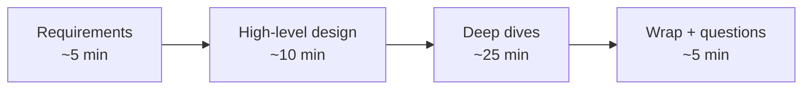
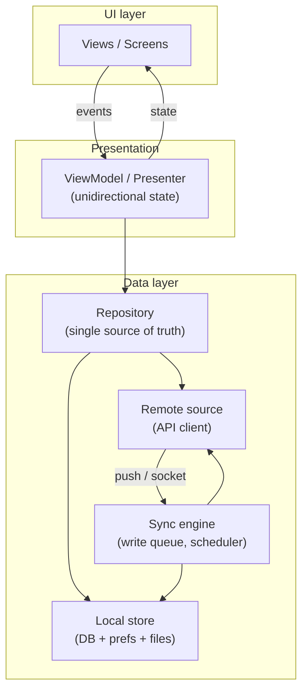

# Mobile 01 — The Framework & the Google Altitude

> **Sources:** [weeeBox — A Simple Framework for Mobile System Design Interviews](https://github.com/weeeBox/mobile-system-design) · [Educative — Grokking the Mobile System Design Interview](https://www.educative.io/courses/mobile-system-design) (SCADET; premium, used as outline) · Android vitals / Apple HIG for the numbers.
> **Prerequisites:** none — this is the root of the track. Pairs with 01 — Interview Framework (the backend equivalent) to see exactly what changes when the system is a device.

## What you'll master

- Why mobile system design is a **different physics problem** from backend design — and the five constraints that generate every mobile interview question.
- The **5-step interview loop** (weeeBox) with a Google-calibrated time budget, and how Educative's SCADET maps onto it.
- The **standard client anatomy** — one diagram you can draw for any "Design app X" prompt in under two minutes.
- The **deep-dive menu**: the seven recurring cruxes, and how to pick the right two for the question asked.
- The **altitude ladder**: what the same answer sounds like at Senior, Staff, and EM — and the sentences that signal each level.

## Table of Contents

1. [Mobile ≠ Backend — the Five Physics Differences](#1-mobile--backend--the-five-physics-differences)
2. [The Interview Loop — 45 Minutes, 5 Steps](#2-the-interview-loop--45-minutes-5-steps)
3. [Requirements — the Scope Question Comes First](#3-requirements--the-scope-question-comes-first)
4. [The Standard Client Anatomy](#4-the-standard-client-anatomy)
5. [The Deep-Dive Menu — Seven Recurring Cruxes](#5-the-deep-dive-menu--seven-recurring-cruxes)
6. [Non-Functionals That Win at Google](#6-non-functionals-that-win-at-google)
7. [The Altitude Ladder — Senior vs Staff vs EM](#7-the-altitude-ladder--senior-vs-staff-vs-em)
8. [Anti-Patterns — How Strong Candidates Fail This Round](#8-anti-patterns--how-strong-candidates-fail-this-round)
9. [Interview Cheat-Sheet](#interview-cheat-sheet)

---

## In the Room — Staff-Level Delivery

| Decision | Default position | Justification | Revisit trigger |
|---|---|---|---|
| Scope | **Ask "client-only, or client + API design?" in the first minute** | The single biggest time-waster is designing servers in a client round | Interviewer explicitly wants end-to-end |
| Architecture | **Unidirectional data flow + repository pattern, drawn once, fast** | It's the industry default; novelty here costs time and buys nothing | Question is a library/SDK (no UI layer) |
| Source of truth | **Local database; network is a sync detail** | Offline-first converts the flaky radio from a bug into a design property | Data is legally not storable on device |
| Deep-dive choice | **Name the crux yourself and propose where to go deep** | Staff candidates drive; Seniors wait to be steered | Interviewer redirects — follow immediately |
| Trade-offs | **Every choice stated with its cost and a number** | "WebSocket costs battery; polling costs freshness — here freshness wins because…" | — |

**Altitude:** this round is won at the **component-contract level** — what each layer promises, what happens when the network/OS/user misbehaves. Code-level detail (which Jetpack class) is a one-sentence garnish; business-level framing (rollout risk, privacy, team cost) is where Staff/EM answers separate — see [§7](#7-the-altitude-ladder--senior-vs-staff-vs-em).

**Experience hooks — have these ready:**
- *"I've shipped a chat SDK used inside other people's apps — API design under someone else's lifecycle, threading, and app-size budget is exactly this interview."*
- *"Our mobile SDK had to survive process death mid-message-send — the offline queue + idempotent send design in [§5](#5-the-deep-dive-menu--seven-recurring-cruxes) is what we actually built."*
- *"We couldn't force customers to upgrade SDK versions — so every API contract decision was a five-year commitment. That's the Staff lens."*

---

## 1. Mobile ≠ Backend — the Five Physics Differences

Backend design scales machines you control. Mobile design ships code into a device you **don't** control, on a network you **can't trust**, under an OS that **actively kills you**. Five constraints generate essentially every question in this track:

| # | Constraint | Consequence in design |
|---|-----------|----------------------|
| 1 | **The radio is flaky and expensive** | Offline-first, caching, batching, retries with idempotency — the network is an optimization, not a dependency |
| 2 | **The OS kills your process at will** | All state that matters survives process death; the app is a state-restoration machine |
| 3 | **Battery and data are user-visible costs** | Every wakeup, every byte justified; batch or die |
| 4 | **You can't roll back a release** | Staged rollout, feature flags, server-driven config; a bad APK lives on devices for weeks |
| 5 | **One codebase, thousands of devices** | Low-end memory budgets, screen sizes, OS versions, iOS + Android parity |

> **Staff-level insight:** every one of these has a backend analogue with the *opposite* default. Backend: retry until it works, restart the pod, ship a hotfix in minutes. Saying "the instinct I have to invert coming from backend is X" is a strong opener — it shows you know which physics you're in.

## 2. The Interview Loop — 45 Minutes, 5 Steps

The weeeBox loop, with the time budget Google's 45-minute format forces:

- **Requirements (~5 min)** — scope question first, then functional / non-functional / out-of-scope. Write them down; you'll trade against them later.
- **High-level (~10 min)** — draw the standard anatomy ([§4](#4-the-standard-client-anatomy)), specialized to the question. Name every box's contract in one sentence. Do **not** linger.
- **Deep dives (~25 min)** — the round is decided here. Pick the crux ([§5](#5-the-deep-dive-menu--seven-recurring-cruxes)), announce it, go three probes deep.
- **Wrap (~5 min)** — failure modes you didn't cover, what you'd build first, what you'd measure.

Educative's **SCADET** mnemonic covers the same ground — Scope, Constraints, Architecture, Data flow, Edge cases, Trade-offs — useful as a completeness checklist, but run the room on the time-boxed loop above; a mnemonic is not a schedule.

> **Staff-level insight:** the Staff move at each transition is to *propose* it: "That's the high level — I think the interesting problem is the sync engine; want me to go deep there, or is pagination more useful?" You're demonstrating the meta-skill of running a design review.

## 3. Requirements — the Scope Question Comes First

**Minute one:** *"Are we designing the client only, the client plus the API contract, or end-to-end including backend?"* At Google the answer is usually **client + API contract** — you own the device side and the shape of the network interface, and you name-drop the backend ("assume a fan-out service exists, like we covered in the feed module").

Then the standard three buckets, mobile-flavored:

- **Functional** — the 3–4 user journeys that matter. For a feed: scroll, like, post, view media. Cut everything else out loud.
- **Non-functional** — this is where mobile diverges. Always put numbers on: **offline behavior** (read-only? full write queue?), **freshness** (how stale is acceptable?), **startup** (cold start budget), **device floor** (does it run on a 2 GB-RAM Android Go phone?), **data/battery budget** (metered network policy).
- **Out of scope** — say it explicitly: "auth exists, backend exists, I'll design the contract not the servers."

Mobile back-of-envelope is about the **device**, not the fleet:

| Quantity | Number to quote |
|---|---|
| Frame budget @ 60 Hz | **16 ms** per frame — jank is a missed frame |
| Cold start | **< 2 s** good; Android vitals flags ≥ 5 s |
| ANR (app-not-responding) | main thread blocked **5 s** |
| Image in memory | width × height × **4 bytes** — a 12 MP photo is ~48 MB raw |
| Memory cache | **~1/8 of app heap** (LruCache guidance) |
| Push payload (FCM) | **4 KB** max — push is a *doorbell*, not a delivery truck |
| Radio tail energy | each wakeup keeps the radio hot for **~5–10 s** — batch or die |

## 4. The Standard Client Anatomy

One diagram serves every "Design app X" question. Draw it fast, then specialize:

The contracts, one sentence each:

- **UI layer** — dumb; renders a state object, emits user events. Survives rotation/process death because it holds no truth.
- **Presentation (ViewModel/MVI)** — turns events into intents, exposes a single observable **state** stream. Unidirectional flow is the answer to "how do you avoid inconsistent UI?"
- **Repository** — the API the rest of the app sees. Its contract: *"you always get data — maybe stale, flagged as such; freshness is my problem."*
- **Local store** — the **source of truth**. UI reads only from here; network writes land here first (or the write queue does).
- **Sync engine** — owns the write queue, retry policy, and scheduling (WorkManager / BGTaskScheduler); the only component allowed to care about connectivity.

For **library/SDK questions** delete the UI/presentation layers and the diagram becomes: **public API surface → engine → cache tiers → network** — the same data layer, now *being* the product. API design (what's sync vs async, how errors surface, who owns threading) becomes the crux.

> **Staff-level insight:** the sentence that upgrades this from Senior to Staff: *"the repository contract is what lets three feature teams build against the data layer in parallel without waiting on each other."* Same diagram, framed as an organizational tool.

## 5. The Deep-Dive Menu — Seven Recurring Cruxes

Every mobile question is 2–3 of these seven wearing a costume. Announce which ones the question is really about, then dive:

| Crux | Trigger in the question | The core move | Track note |
|---|---|---|---|
| **Offline & sync** | "works on the subway", any writes | Local DB truth + persisted write queue + idempotent replay | 04 |
| **Caching** | images, feed, "fast" | Memory → disk → network tiers; explicit size budget + eviction | 04, 16 |
| **Real-time** | chat, live scores, location | Ladder: push → WebSocket → SSE → polling, chosen by write-back need & battery | 03 |
| **Pagination** | any list | Cursor-based, cache-then-network, prefetch at N-from-end | 09, 19 |
| **Media pipeline** | photos, video, stories | Decode off-main, downsample-to-view, resumable transfer | 11, 12, 16 |
| **Background work** | upload, sync, "later" | Deferrable via OS scheduler + constraints; assume you get killed mid-job | 04, 17 |
| **State restoration** | multi-step flows (booking, orders) | Explicit state machine persisted per step; idempotent server calls | 14, 15 |

Three probes deep on the crux beats seven cruxes touched. The interviewer's follow-ups tell you if you picked right — if they keep pulling you elsewhere, go there.

> **Staff-level insight:** the cruxes compound exactly like the Deep Dives themes: the chat write queue **is** the analytics batcher **is** the photo uploader — a persisted, idempotent, constraint-scheduled queue. Saying "this is the same primitive as X, so I'd extract it" is a platform-thinking signal interviewers write down.

## 6. Non-Functionals That Win at Google

Google interviewers (and the Educative course) weight these heavier than most candidates expect. One deliberate sentence each, early:

- **Performance** — name the three budgets: cold start < 2 s, 16 ms frames, memory floor for low-end devices. Say what you'd *measure* (startup trace, jank rate, memory watermark).
- **Battery & data** — batch network calls, respect metered networks, defer to charging+Wi-Fi for heavy sync. "Radio wakeups are the battery unit" is the sentence.
- **Privacy & security** — PII stays out of logs and analytics; tokens in Keystore/Keychain; on-device data encrypted; data-deletion story exists. At Google this is table stakes, and for EM it's a *legal* surface (GDPR/DMA).
- **Accessibility & i18n** — one sentence ("state-driven UI makes TalkBack/dynamic-type support systematic, and strings/RTL are externalized from day one") signals you've shipped globally.
- **Observability** — crash rate, ANR rate, and the funnel metric for your feature; staged-rollout gates read these dashboards.
- **Release safety** — feature flag on everything new; server kill-switch for the risky path. You can't roll back an APK — you can flip a flag.

## 7. The Altitude Ladder — Senior vs Staff vs EM

The same question — "Design the YouTube app" — evaluated at three levels. This is straight from the weeeBox framework's leveling guidance, sharpened:

| Level | The interviewer is checking | What your answer emphasizes |
|---|---|---|
| **Senior** | Can you design the components? | Correct anatomy, solid trade-offs per component, handles failure modes |
| **Staff** | Can you design what *other teams build on*? | API contracts between layers/teams, long-term evolution ("this survives five years of features"), platform extraction, cost of the design in engineer-time |
| **EM** | Can you own the *risk and the roadmap*? | Time-to-market vs robustness trade, staged rollout + kill switches, privacy/legal exposure, build-vs-buy, what the team ships first and what you'd cut |

Sentences that signal each rung — say them verbatim:

- Senior: *"If the socket drops, the queue holds sends and replays idempotently on reconnect."*
- Staff: *"I'd freeze the repository contract first — that's what unblocks the three feature teams; internals can churn behind it."*
- EM: *"V1 ships polling behind a flag — it's 3 weeks cheaper and the flag lets me swap in WebSocket later with zero client risk. I'm buying time-to-market with a freshness cost I can name."*

> **Staff-level insight:** you don't pick one rung — you *stack* them. Lead with the Staff/EM frame ("here's the contract and the rollout risk"), then prove you still own the Senior floor when probed. The failure mode is the inverse: EM candidates who go pure-manager and can't survive one technical probe.

## 8. Anti-Patterns — How Strong Candidates Fail This Round

- **Backend-swallowing** — 15 minutes on fan-out services and shard keys in a *client* round. The scope question in minute one is the vaccine.
- **Framework name-dropping as design** — "I'd use Compose, Coil, Room, Hilt…" is a shopping list, not an architecture. Name the *contract*, then the tool in parentheses.
- **Ignoring process death** — any multi-step flow that keeps truth in memory is an auto-fail probe. The OS **will** kill you mid-flow.
- **Happy-path networking** — no retry/idempotency story, no offline answer. The radio is the villain of every mobile story; write it into the plot early.
- **Boiling the ocean** — touching all seven cruxes at one probe depth. Pick two, go three deep.
- **Forgetting you can't roll back** — shipping a redesign with no flag, no staged rollout, no kill switch. For EM candidates this one is disqualifying.

## 9. The Modern Edges — five topics a Google client loop probes

The seven cruxes (§5) are the core, but a full Staff/EM mobile loop reaches into these, and one-liners aren't enough if the interviewer sits on one:

- **Cross-platform strategy (the EM essay).** "Native vs Flutter vs React Native vs KMP?" is an *organizational* answer, not a technical preference. Frame it on four axes: **team skills + hiring pool** (who maintains it for 5 years?), **performance floor** (native wins on 120 fps / heavy graphics / tight memory; RN/Flutter are fine for content/CRUD apps), **shared-logic surface** (KMP shares *business logic* while keeping native UI — often the best of both; Flutter/RN share UI too but own the render layer), and the **5-year maintenance bill** (a cross-platform bet is a bet on that framework's vendor and your ability to drop to native when it leaks). Say: *"KMP to share the networking/sync/domain layer, native UI per platform — I get one source of truth for the hard logic without betting the render layer on a framework."* Decide on the workload, don't pledge allegiance to a framework.
- **Accessibility — a Google weight-item, not a footnote.** State-driven UI makes it *systematic*: semantic labels / content descriptions on every interactive element, respect **dynamic type / font scaling** (layouts must reflow, not clip), **44pt/48dp minimum touch targets**, sufficient contrast, and a sensible screen-reader traversal order (TalkBack/VoiceOver). Say what you'd *test*: accessibility scanner in CI + a manual screen-reader pass on the critical flow. "A11y is a design constraint I bake into the component contract, not a pass at the end" is the Staff sentence.
- **On-device ML.** Increasingly the differentiating (and privacy-preserving) answer for chat/camera/productivity: smart reply, summarization, translation, on-device vision. The design points: **model delivery** (ship in the binary vs download on demand — app-size budget), **the size/latency/quality trade** vs a server call, **hardware** (NPU via Core ML / LiteRT / ML Kit, and on-device LLMs like Gemini Nano / Apple Intelligence), and the pitch: **on-device = no data leaves the phone**, which is the privacy answer *and* the offline answer. The trade to name: on-device caps model size and drains battery; fall back to server for the heavy tail.
- **Testing strategy.** "How do you test this?" is a standard Staff/EM probe. The pyramid: fast unit tests on the domain/sync logic (the part that's platform-agnostic and where the bugs are), a thin layer of UI/integration tests (Espresso/XCUITest/Maestro) on the critical flows, and — mobile-specific — **explicit tests for the hard paths**: process-death restoration, offline→online sync/conflict, and low-memory eviction. Snapshot/screenshot tests catch UI regressions; test-impact analysis keeps CI fast. The Staff point: you test the *offline and process-death paths deliberately*, because those are exactly what manual QA on a good network never hits.
- **Privacy compliance surface** (2024+, mandatory) — see [06 — Security & Privacy §4](06-security-privacy.md): iOS **App Tracking Transparency** + **Privacy Manifests / required-reason APIs**, and Play **Data Safety**. Name it or a privacy-focused interviewer reads the omission as pre-2024.

## When NOT (to use this track's default)

- **Client-only toy scope** ("design a clock app") — the anatomy shrinks; don't ceremonially draw a sync engine for an app with no server.
- **Pure API/backend question in a mobile loop** — it happens; switch to the main course framework and say you're switching.
- **Cross-platform strategy question** ("native vs Flutter/RN/KMP?") — that's an EM/organizational essay, not this anatomy: answer with team skills, hiring pool, performance floor, and the 5-year maintenance bill.

---

## Interview Cheat-Sheet

**The 30-second frame:** scope question → three requirement buckets with numbers → standard anatomy in one drawing → name the crux → three probes deep → close with rollout + metrics.

**Four probes you must survive:**

| Probe | Your answer |
|---|---|
| "What happens when the app is killed mid-X?" | Truth is in the local DB / persisted queue; on restart the state machine resumes from the last durable step; server calls are idempotent so replays are safe |
| "How does this behave offline?" | Reads serve from local store flagged stale; writes enqueue durably and replay on connectivity; UI shows optimistic state + pending indicator |
| "Why is my battery draining?" | Audit radio wakeups: batch requests, use push instead of polling, defer heavy sync to charging + unmetered, respect OS background limits |
| "How do you ship this safely?" | Feature flag + staged rollout gated on crash/ANR/funnel dashboards, server kill-switch on the risky path — because you can't recall an APK |

**Say-verbatim lines:**

- *"First question: client-only, or client plus the API contract?"*
- *"The local database is the source of truth — the network is a sync detail."*
- *"Push is a doorbell, not a delivery truck — 4 KB payload wakes the app; the app fetches through the normal path."*
- *"Radio wakeups are the unit of battery cost — batch or die."*
- *"I can't roll back an APK, so everything new ships behind a flag."*

**The numbers:** 16 ms frame · cold start < 2 s (flagged ≥ 5 s) · ANR at 5 s main-thread block · image = w×h×4 bytes · memory cache ~1/8 heap · FCM 4 KB · radio tail ~5–10 s.
